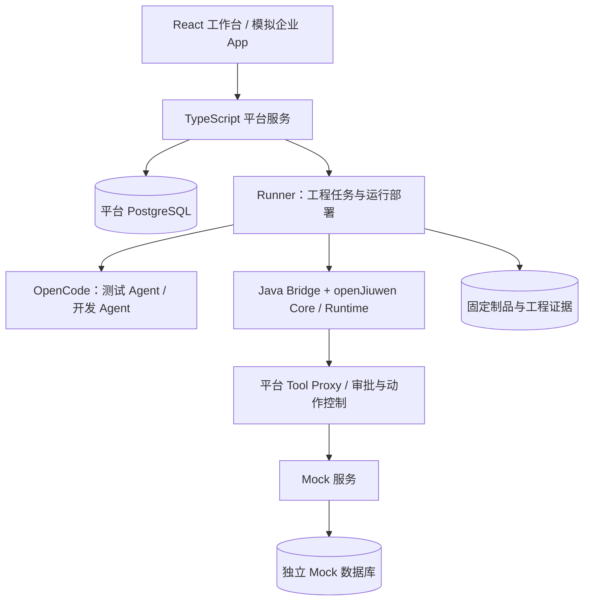

# Agent Builder

面向企业 AI 平台开发人员的一站式 Agent 开发与测试原型：确认需求，由开发 Agent 和测试 Agent 协作生成组件，再由平台根据执行证据决定是否可以交付。

当前可走通 **设备查询 Tool／Skill 自动开发 → 固定候选 → 独立验收 → 同一 JAR 发布 → 模拟企业 App 调用**。平台使用 TypeScript，业务 Agent 运行在 openJiuwen Java 上，工程开发使用 OpenCode 与 DeepSeek。

> 当前为 trusted-local 开发原型，未启用任务沙箱。已实现范围和验证基线截至 2026-10-22 / TDD-017；完整 PRD 尚未验收完成。

## 文档入口

| 你要做什么 | 从这里开始 |
| --- | --- |
| 启动并体验 | 本页的快速上手 |
| 逐步操作、部署维护、开发调试、排错 | [详细操作指南](docs/操作指南.md) |
| 向团队介绍产品、架构与演示方法 | [项目汇报 HTML](docs/项目汇报.html)（浏览器直接打开，支持汇报模式和打印） |
| 了解需求与总体设计 | [文档导航](docs/README.md) |
| 核对已实现范围及实际测试 | [实施进度](docs/implementation/PROGRESS.md)、[TDD-017 验证记录](docs/implementation/TDD-017.md) |

## 快速上手：Docker Compose

在仓库根目录执行命令。需要 **Docker Engine／Docker Desktop（Linux 容器）及 Compose v2、Node.js ≥ 22.12**；建议本机使用 Node.js 24。首次构建需要访问镜像仓库、npm、GitHub 和 Maven 仓库。Docker 路径无需在宿主机安装 JDK、Maven 或 pnpm。

### 1. 生成本地配置

```powershell
node scripts/init-local.mjs
```

脚本创建 `.env.local`，生成本地令牌与数据库密码；重复运行只补缺失字段，保留原值。不要先把 `.env.example` 的占位符直接复制成有效配置。

使用编辑器打开 `.env.local`，填写 `DEEPSEEK_API_KEY`。同时找到 `LOCAL_BOOTSTRAP_TOKEN`，稍后用它登录。配置文件属于本地私有文件，不应提交到 Git。默认请求模型为 `deepseek-v4-flash`。

未配置模型密钥也可以管理草稿；自动开发、业务调试和真实模型验收需要有效密钥，并会消耗模型额度。

### 2. 构建并启动

```powershell
docker compose --env-file .env.local config --quiet
docker compose --env-file .env.local up -d --build --wait
docker compose --env-file .env.local ps
```

启动成功后，`app`、`runner`、`mock-services`、`postgres` 应为健康状态；一次性的 `migrate` 正常退出即可。首次构建包含固定版本 Java SDK 的下载与编译，耗时取决于网络和机器。

Docker 镜像构建负责生产编译和打包，不重复执行单元／契约测试、类型检查或 Java Bridge 测试；这些质量检查由 CI 执行。修改代码后按“开发与测试”章节先运行相关检查，再构建受影响的镜像。代码未变时，直接执行 `docker compose --env-file .env.local up -d --wait`，不要添加 `--build`。

- 仅 Web／Server／Mock 服务变更：`docker compose --env-file .env.local build app`，再 `docker compose --env-file .env.local up -d --wait app mock-services`。
- 仅 Runner／Java Bridge 变更：`docker compose --env-file .env.local build runner`，再 `docker compose --env-file .env.local up -d --wait runner`。
- `packages/contracts` 或共享配置变更：重建并更新 `app`、`runner`。
- 首次启动或确实需要所有服务跟随源码重建时，才使用 `up -d --build --wait`。

### 3. 打开工作台

访问 **http://127.0.0.1:8080**，输入 `.env.local` 中的 `LOCAL_BOOTSTRAP_TOKEN`，点击“进入工作台”。查看环境诊断；“模型已配置”只说明存在配置，实际可用性由运行核验。

### 4. 完成第一条设备查询

1. 点击“新建草稿”，名称填写“设备运维助手”。
2. 填写目标使用者“设备运维人员”、业务目标“查询设备状态、温度和来源”、交付内容“包含设备编号、状态、温度和来源的设备报告”。逐项勾选确认，点击“保存草稿”。
3. 在组件目录查看可用 Tool／Rail 与待生成 Skill，选择能力模板“设备状态查询”。审阅需求与用例，勾选“我已审阅需求、测试场景和预期结果”，点击“确认验收基线”，再点击“固定为测试版本”。
4. 在新版本的“调试消息”中输入 `查询 PUMP-001 的状态、温度与来源。`，点击“运行此版本”。
5. 检查回答以及“查看执行轨迹”“查看外部调用证据”。一次调试成功只验证这次调用；完整交付还需执行项目验收。

要体验自动开发，继续在此版本点击“启动双角色开发”。构建完成后点击“刷新可用构建”，将“候选来源”选为对应生成任务，点击“登记固定候选”。核对“自动验收目标”，运行验收用例；通过后审阅报告并发布。在“模拟企业 App”进入业务会话并发送查询。完整步骤见[操作指南](docs/操作指南.md#自动开发与候选验收)。

## 当前能力

| 能力 | 当前范围 |
| --- | --- |
| 需求与版本 | 字段确认、修订历史、验收基线、不可变测试快照 |
| 双角色自动开发 | 设备只读 Tool／Skill；测试方案先行、真实单测红绿、独立契约检查、固定代码包 |
| 候选与验收 | 独立 JVM 和 Mock 数据；三项只读用例和八项工单模板用例；报告绑定候选和实际制品 |
| 失败修复 | 按完整失败报告复现缺陷、保留旧测试、生成新候选再回归；每个初始任务最多修复三次 |
| 业务运行 | 设备查询；工单模板的用户确认、中断续接、拒绝与幂等控制 |
| 演示发布 | 只读冒烟后切换现行版本、发布历史与回滚、模拟企业 App 的独立业务身份 |
| 企业 Mock | 设备／工单场景；余额、理财与申购基础 API。金融 Agent 与金融 App 流程尚未接通 |

Agent／Rail 自动生成、工单组件自动生成、金融 Agent、完整项目导入导出与新目录恢复、完整会话恢复、生产多租户与任务沙箱仍未交付。工作台已有基础 JSON 项目包，可恢复需求和装配快照，并要求重新验收、重绑连接；它不包含自动生成源码／JAR、Mock 场景包或完整证据，因此不能视为完整项目迁移。

## 架构速览



平台持有需求、验收、发布和业务请求状态；Runner 管理工程进程与 JVM；Java SDK 执行业务 Agent；Mock 保存可核验的业务事实。Compose 提供部署封装，当前不提供每个开发任务的独立沙箱。[技术设计](docs/NL2Agent_技术设计_v0.1.md)描述完整目标架构，[汇报 HTML](docs/项目汇报.html)说明当前实现与设计取舍。

## 常用命令

```powershell
# 查看最近日志
docker compose --env-file .env.local logs --tail 100 app runner mock-services

# 停止服务，保留数据库和制品卷
docker compose --env-file .env.local down

# 再次启动已有镜像
docker compose --env-file .env.local up -d --wait
```

需要修改代码时，安装 pnpm 10.32.1 后运行：

```powershell
pnpm install --frozen-lockfile
pnpm typecheck
pnpm test
pnpm build
```

`pnpm build` 已执行生产 TypeScript 编译；Docker 构建会再次编译并打包运行镜像，但不会重复跑上述测试。Java Bridge 测试在 CI 中执行，Runner 镜像只编译 Bridge 生产 JAR。

未全局安装 pnpm 时，可将 `pnpm` 替换为 `npx pnpm@10.32.1`。宿主机开发、数据库集成测试、Java 构建及浏览器测试的完整前置条件见[操作指南](docs/操作指南.md#开发与测试)。

## 验证基线

TDD-017 记录了 **85 项单元／契约 + 94 项 PostgreSQL 集成 + 26 项原生适配器测试通过**，以及 Docker 真实 DeepSeek 八项工单验收、同一 JAR 发布、U1002 审批写入与重复确认。Java Bridge 的 14 项 JUnit 属于 TDD-015 验证，本批未单独重跑。

这些结果证明相应实现路径，不代表完整平台验收或交付成功率。平台 P0-C 清单仍为 **88 项未验证**；交付成功率将在固定任务包上另行评测。详细条件、夹具／真实模型区分和证据链接见 [TDD-017](docs/implementation/TDD-017.md)。
