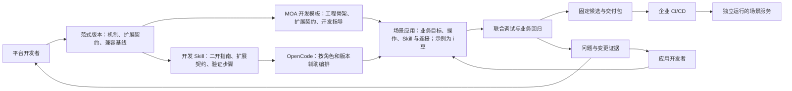

# 企业 Agent 开发工作台 PRD 2.0

版本：2.0\
日期：2026-10-24\
修订：应用开发者独立旅程、MOA 通用模板、Coding Agent 开发方案与终端用户模拟器（2026-10-24）\
状态：产品设计基线及第一阶段可点击 Demo；真实前后端能力尚未按 2.0 验收。\
适用对象：企业 AI 平台开发者、应用开发者，以及承接应用的企业 IT 团队。

**产品主线：平台开发者交付可复用的 Agent 范式和开发模板；应用开发者通过配置、装配与少量开发完成业务应用；应用经过验证后，交给企业既有 CI/CD，发布为独立服务。** 以“MOA 类范式 → i豆场景应用 → 企业服务”为贯穿案例。

**新应用开发者的起点：只看到已经可用的 MOA 开发模板，没有 i豆模板，也没有预建 i豆应用。创建应用后，开发者向 Coding Agent 描述业务需求，再审阅开发方案、接入企业系统、修改代码、调试和交付。平台维护是独立工作流，不要求每位应用开发者先切换平台角色发行模板。**

**核心开发方式：把范式的二次开发知识、扩展契约和验证方法整理成开发 Skill，注入 Coding Agent（首选 OpenCode），辅助开发者完成编排及代码修改。** 应用开发与平台开发采用不同工作区、默认内容和修改范围，共用底层工程、版本、执行与证据能力。两类用户均可查看代码、进行简单修改，不把编码能力收窄为聊天或只读展示。

本文接替[PRD v0.1](NL2Agent_需求文档_v0.1.md)作为新增功能的产品方向。旧 PRD、测试基线、机器验收清单和实施记录保留原版本及其证据，不自动迁移为 2.0 通过项。本文使用独立的 `V2-FR`、`V2-AC` 编号；技术设计、交互设计和机器验收规则在对应实施批次适配。当前排期与检查规则见[后续推进计划](后续推进计划与执行要求.md)；页面定义见[交互设计 2.0](Agent开发工作台_交互设计_v2.0.md)，演示见[双角色 Demo](developer-prototype-v2/README.md)。

## 1 产品问题与本次调整

企业中的两类开发者承担不同工作。平台开发者需要把执行机制、企业连接和业务扩展边界沉淀为可维护的公共能力；应用开发者需要在这些边界内完成具体应用，并能处理真实接口差异。两者必须共享应用版本、测试用例和调试证据，才能交接工作。

当前设计偏重“描述需求后，由开发 Agent 和测试 Agent 自动生成组件”。这条路径可保留为工程辅助，但不足以承载范式交接、场景维护和企业交付。2.0 将以下四个问题作为设计依据；它们来自本轮讨论和源码分析，不表示已经完成客户调研或收益测量。

| 用户问题 | 产品响应 | 负责对象 | 可观察结果 |
| --- | --- | --- | --- |
| 公共机制与场景代码混在一起，每次交付依赖原作者 | 发布带扩展契约的范式版本及开发模板 | 平台开发者 | 场景应用锁定范式版本；接口适配不修改范式核心 |
| 配置覆盖不了企业接口差异，完整源码开发又过重 | 配置优先，开放有边界的映射、校验及连接适配 | 应用开发者，平台开发者支持 | 能定位并修复一次真实接口结果差异，留下差异与回归记录 |
| 配置、Java 代码、Skill 和执行轨迹分散 | 同一应用、同一执行快照下联合调试 | 工作台 | 从失败业务操作定位到具体配置、脚本或连接版本 |
| 本地工作台演示无法直接交接企业发布 | 导出应用包或可构建源码工程，提供契约和测试包 | 应用开发者交付，企业 IT 发布 | 企业流水线部署后，停止开发工作台仍可调用服务 |

### 1.1 与 v0.1 的关系

| 原设计 | 2.0 调整 | 原因及保留项 |
| --- | --- | --- |
| 首要用户集中于企业 AI 平台开发人员 | 明确平台开发者与应用开发者两类用户 | 应用方需要独立完成配置和局部开发；一人可兼任，但责任不同 |
| 自然语言 → 双 Agent → 四类组件生成是主流程 | 范式 → 模板 → 应用 → 联调 → 测试与交付是主流程 | 注入范式开发 Skill 的 OpenCode 是编排辅助核心；手工修改和独立验收保留，不强制每次运行双角色生成 |
| 固定“需求、装配、开发、发布”四页签 | 全局应用列表与应用内横向五页签分开，历史运行有独立入口 | 当前四页签继续作为既有演示入口；新信息架构逐批实现 |
| 高码、低码、Workflow 容易形成不同工程 | 共用应用模型，编辑器是不同视图 | Java、Skill、受支持流程与配置可协作；高码不等同于 ReAct |
| 调试前需手工确认并固定版本 | 点击调试时自动保存不可变执行快照 | 正式候选仍固定内容、测试和环境；调试便利性不降低写操作约束 |
| 本地 Mock 演示发布是主要终点 | 企业 CI/CD 可接管的服务交付是完整目标 | 本地演示保留；生产托管、灰度、集群运维另属运行态 |
| 自动交付成功率是核心衡量口径 | 增加场景独立交付和公共能力复用指标 | 人工完成合法扩展属于正常开发；自动生成效果单独统计 |

原有版本绑定、独立验收、业务确认、幂等与未知结果核对、Mock 隔离、秘密外置、失败记录和资源退出要求继续适用。旧阶段未通过项不能因本次调整而改为通过；不再作为 2.0 前置条件的旧目标保留原状态并在后续映射中说明。

## 2 用户、责任与协作

| 角色 | 主要任务 | 交付物 | 责任边界 |
| --- | --- | --- | --- |
| 企业 AI 平台开发者 | 维护 Core/Runtime 兼容基线；实现 MOA 类范式；开发公共业务 Skill、Rail、Tool 和企业适配；把二开指导整理为 OpenCode 开发 Skill | 范式发行包、开发 Skill 包、扩展契约、模板、公共测试及接入样例 | 对公共机制、知识与版本兼容、扩展边界负责；复杂机制变更由此角色处理 |
| 应用开发者 | 选择模板；配置业务规则、提示和操作；绑定企业连接；编写少量适配；调试、回归、交付 | 场景应用、扩展源码、场景测试、应用包或源码工程 | 对场景规则、映射与交付验证负责；不要求掌握 Agent Loop 内部实现 |
| 企业 IT 发布与运维人员 | 注入目标环境配置和凭据；执行 CI/CD；部署、检查、回退 | 部署记录、服务地址、制品摘要和运行记录 | 对企业发布、环境和服务运维负责；开发工作台不替代既有流水线 |
| 业务及测试协作者 | 确认业务规则、验收样例与结果；维护独立验收条件 | 业务契约、测试集、验收结论 | 开发者或 AI Coding 不能为使实现通过而降低其硬性断言 |

平台开发者也可以开发场景应用；模板不足时，应用开发者可提交带失败输入、Trace 和版本的扩展需求，由平台开发者发布新范式或公共组件版本。双方始终围绕同一个应用工作。

首轮本地 Demo 可由一人按两种身份完成交接，界面角色切换不构成权限隔离，也不证明独立团队复用。应用开发者应能理解接口字段、业务规则和测试结果；产品不承诺完全无代码、无需技术理解。

### 2.1 平台开发者的工作路径

1. 从已有 Java 工程或代码仓固定修订接入范式，声明 Core/Runtime 和扩展依赖；首轮允许导入本地工程，不以在线代码仓集成为前置。
2. 选择匹配版本的基础开发指南与范式开发 Skill，交给 OpenCode 辅助实现业务 Skill、Rail、Tool、SPI 和企业连接；同时保留源码浏览和手工编辑。检查真实差异及运行结果后形成发行版本。
3. 定义开放给应用方的配置、操作、代码接口和文件范围，并给出默认值、示例与正反用例。范式核心 Rail 不因作为模板交付而变成任意可编辑组件。
4. 发布开发模板及绑定的应用开发 Skill，把基础连接、公共机制与业务可变部分分开交接。应用方选模板后获得对应 OpenCode 指导，可查看来源和维护者，并从实际运行失败回到契约或工程文件。
5. 收到应用方的失败 Trace 或新扩展需求后，在平台工程处理公共变更，验证兼容性并发布新版本；已有应用选择是否升级。

平台工程保留标准源码与构建方式，工作台负责组织资产、调用工程辅助、关联验证和交接。首轮无需在浏览器内重做完整 IDE，也不要求用模型重新生成已有 MOA/Core/Runtime。

### 2.2 两类用户看到不同内容

| 维度 | 应用开发工作区（基础功能） | 平台开发工作区（平台功能） |
| --- | --- | --- |
| 首页与导航 | 应用、开发模板；新用户先到空列表，进入应用后为横向五页签 | 范式工程、公共能力、开发 Skill、模板发行、工程活动与应用运行诊断 |
| 主要编辑对象 | 能力与接口契约、连接、配置、业务 Skill、映射/校验脚本 | Agent 定义、Rail/Tool/SPI、服务装配、兼容依赖、开发 Skill 和开放契约 |
| Coding Agent 指导 | 当前模板绑定的应用开发 Skill、允许的扩展路径和业务验收 | 框架开发知识 + 范式维护 Skill、API/SPI 契约、注册/接线和升级测试 |
| 编排与代码 | 默认看应用目标、开发方案与进度；可随时查看并修改开放代码；所有变更回到同一工程和版本 | 默认看工程结构、能力关系与源码；可编辑公共能力并决定向应用方开放什么 |
| 交付动作 | 固定应用候选、导出应用包或源码，移交企业 CI/CD | 发布范式版本、开发 Skill 包和开发模板，提供兼容声明 |
| 默认隐藏的复杂度 | 不在常用操作中堆放 Core/Runtime 版本、SPI 和核心 Rail 维护入口 | 展示底座和契约细节，不用场景表单替代工程开发 |

这不是同一页改角色名称，也不是强制建设两个后端。基础编辑器、代码差异、OpenCode 会话、运行和证据服务可复用；导航、任务入口、默认上下文、开放能力和交付对象按角色区分。本地设计稿的角色切换仅模拟视图，实际权限必须由服务端和工具执行边界落实。

## 3 三个核心产品对象

**范式**是执行机制及其扩展契约的版本化发行物；**开发模板**是把范式包装成可实例化的工程骨架、开放契约和开发指导；**场景应用**是开发者填写业务目标、装配业务操作并接入企业系统后形成的工程。

本次关系为：**MOA 范式 → MOA 开发模板 → i豆服务助手（场景应用示例）**。平台发布 MOA 模板，应用方基于它创建 i豆、采购协同等应用。i豆的余额、兑换、业务 Skill、连接与测试属于应用层；不是 MOA 模板固有业务。Demo 在应用需求明确涉及 i豆后提供预设开发方案，需审阅并应用到当前工程；其他业务可整理需求草稿，接口与运行保持待实现，不自动带入 i豆逻辑。

### 3.1 对象最小契约

以下为工作台拟议产品契约，字段名不是现有 SDK API；实际存储和接口在技术设计中确定。

| 对象 | 必须携带的内容 | 版本规则 |
| --- | --- | --- |
| 范式版本 | 标识、版本、源码/制品摘要、Core/Runtime/扩展依赖锁定、入口协议、配置 Schema、扩展点清单、状态及续接约定、部署依赖、兼容测试 | 发布后不可改写；声明哪些机制固定、哪些参数可改、哪些接口可扩展 |
| 开发模板版本 | 范式引用、工程骨架、默认技术配置、业务操作扩展契约、开发 Skill 引用、允许修改的文件/字段、基础用例；可选业务示例单独标识 | 创建应用时固定版本；模板升级不静默覆盖应用修改 |
| 开发 Skill 包（范式附属发行件） | Skill 标识/版本/摘要、适用角色、指南来源修订、兼容范式及依赖、任务入口、参考契约、示例、验证配方、工具/路径要求 | 模板绑定具体版本；实际工程任务记录装载版本；更新知识不改写历史任务 |
| 场景应用 | 名称与业务目标、模板来源、范式锁定、业务操作、配置、连接引用、业务 Skill/扩展资产、业务规则、测试集、环境配置档 | 草稿可编辑；执行和交付引用快照；允许配置副本，不复制公共源码作为默认扩展方式 |
| 执行快照 | 实际配置、依赖、脚本内容摘要、连接配置版本、模型配置标识、运行环境和执行 ID | 内容身份与执行 ID 分开；秘密只记录引用，不写入快照 |
| 候选版本 | 应用内容摘要、构建产物、完整资产、依赖清单、测试集版本、适用环境、来源及验证报告 | 草稿修改产生新候选；旧报告继续指向旧目标 |
| 交付记录 | 候选引用、应用包/源码工程摘要、目标环境前置条件、CI 执行及部署结果引用 | “已导出”“CI 验证通过”“已部署”分别呈现 |

应用包内的业务操作、连接、Skill 和扩展均有稳定标识，用于测试与事件关联。无需首期建设公共资产市场；先实现一个企业工作区内的登记、选择、版本固定和追溯。

### 3.2 状态与机制归属

| 状态或决策 | 归属 | 工作台职责 |
| --- | --- | --- |
| 范式、模板、应用、候选与测试版本 | 开发工作台/代码仓 | 固定引用、展示差异、记录来源与交付 |
| Agent 循环、会话检查点、等待与续接 | 选定范式及 Core/Runtime | 通过适配读取和操作，避免另建一套冲突的执行状态 |
| 用户身份及可用业务权限 | 企业身份系统与服务入口 | 配置可信来源；区分开发身份和最终业务用户身份 |
| i豆余额、兑换订单、业务幂等和交易提交 | 企业业务系统；Demo 中为独立 Mock | 采集调用与状态证据，不用模型回答代替交易事实 |
| 用户确认绑定与失效 | 范式运行机制，配合业务规则 | 呈现待确认内容及原因，保留动作与参数版本 |
| 服务发布与回退 | 企业 CI/CD 与运行平台 | 提供制品/测试契约并关联结果；回退服务不撤销已发生交易 |

### 3.3 开发范式如何注入 OpenCode

必须区分三个概念：运行范式规定 Agent 怎样执行；开发 Skill 指导 OpenCode 怎样开发这种 Agent；业务 Skill 在交付应用中处理业务。开发 Skill 不作为业务能力装载到运行时，业务 Skill 也不能承担开发工具权限控制。

| 开发 Skill 层次 | 内容来源与职责 | 面向用户 |
| --- | --- | --- |
| 基础 Java 开发指导 | `agent-solution/guides/docs-java`：选型、`agent/` 与 `service/` 分层、API/SPI、资源注册与契约测试 | 平台方完整使用；应用方按任务引用必要片段 |
| 范式维护指导 | MOA 开发手册及平台能力接入手册：候选/意图/路由一致性、固定主机制、Skill 操作、接线、沙箱与交付 | 平台开发者 |
| 场景装配指导 | 平台方从范式指导裁剪：模板操作、开放参数、映射/校验脚本、场景例子与必要验证 | 应用开发者 |

建议包结构为 `SKILL.md`（何时使用与任务步骤）、`references/`（公开契约及选定指南）、`examples/`（完整最小工程或增量片段）、`checks/`（验证配方）。包外的发行清单维护来源提交、摘要、角色、范式版本、依赖锁定与工具策略引用。这是产品包约定，不声称它已是 OpenCode 官方配置 Schema。

注入流程：选择角色及范式/模板 → 校验开发 Skill 与工程版本兼容 → 建立 OpenCode 工程会话并提供 Skill/参考资料 → 读取当前代码和运行证据 → 提出编排计划与文件差异 → 应用选定变更 → 执行对应层检查 → 回填同一工程。不能把整份文档无差别塞进所有任务，也不能让外部指南文本提高工具权限。

每次任务记录角色、工程修订、开发 Skill 版本/摘要、文档来源、实际读取材料、工具调用、文件差异、检查和失败。Skill/依赖缺失或版本冲突时给出诊断，不能静默改用另一套 API。用户可撤销尚未交付的变更；应用建议前检查基础修订，避免覆盖用户刚做的手工修改。

现有 Builder 已通过 `engineering-skill.md`、OpenCode 角色提示和受限 MCP 工具传递固定工程指导；这可作为接入基础，但**尚不是可发布、可选择、可版本化的范式开发 Skill 体系**。实现时核验实际 OpenCode 版本的 Skill 发现/读取机制；原生加载或显式指导注入均需有实际装载证据，不能仅因目录存在便标记已加载。

## 4 MOA 代码对产品设计的约束

本章基于 `agent-solution` 提交 `1a92265cd238406054f24a069bc08c5e7af978e3` 的静态审阅。它是已核对的源码快照，不代表当前分支、已部署服务或本仓已集成能力。源文件索引见第 13 章。

| 源码事实 | 产品含义 | 不能据此宣称的能力 |
| --- | --- | --- |
| 自动配置提供候选解析、意图召回、任务选择、条件判断等 SPI；主执行入口及核心 Rail 装配固定 [M1] | 平台开发者交付稳定范式，并显式开放扩展点 | 任意 Rail Bean 都能自动加入主链；任意组件拖拽即可运行 |
| `SkillOperation` 包含操作类型、固定路由/意图、输入输出 Schema、前置/结果脚本、确认要求、调用预算和终结标记 [M2] | “业务操作”应成为场景装配对象，不能只提供提示词和 Tool 开关 | 产品自定义操作描述可未经适配直接当成 MOA 配置 |
| `SkillActionRail` 校验参数、绑定确认与状态修订；结果脚本产出经过 Schema 验证的结果；完成受终结操作约束 [M2] | 交互需要展示结果结构、确认失效及终结条件；映射脚本是合理的小开发入口 | 文本返回正常就表示交易成功；模型判断可替代确定性校验 |
| `LocalSkillDelegate` 将本地 Skill 子执行映射回父执行；Native Skill 按执行创建并使用 Core 状态 [M3] | 同一工作台展示父任务、子执行和暂停点 | 每个 Skill 都是独立部署服务；跨重启恢复已完成产品验证 |
| `ExecutionEngine` 默认处理 AGENT/WORKFLOW 委派；本地 SKILL 走特定委派路径；规划按待执行项顺序推进 [M4] | 首轮只开放实际接通的执行类型和依赖形式 | 通用 DAG、任意并行、所有候选类型和跨任务字段映射已齐备 |
| Skill 从文件系统装载；Native Skill 默认关闭，开启时要求 SESSION 范围 Runtime Sandbox [M3] | 发行包需携带资产、装载配置及脚本环境前置检查 | 只有 JAR 就包含全部运行材料；现有 Builder 已具备该沙箱路径 |
| MOA 官方按可执行应用交付；内部库及业务 starter 由使用方维护 [M5] | 平台侧需明确内部范式发行方式，再输出企业应用包 | 已有官方双 JAR/starter 可直接用于二次依赖 |
| 业务扩展记录中存在结果处理脚本误要求下游不存在字段的案例；README 中 i豆意图仍标注未接入 [M6] | Demo 应演示一次结果契约差异的定位与局部修复；i豆需基于 MOA 模板补建场景业务和 Mock | 现有 MOA 已交付可直接演示的 i豆完整应用 |

据此，2.0 采用“固定机制 + 声明式业务操作 + 少量适配扩展”的产品方式。模板既包含配置，也包含代码入口、资产和验证方法。复杂条件、身份链、异步业务和补偿需要明确实现责任，不通过增加 Prompt 掩盖契约缺口。

## 5 i豆贯穿案例与 Demo

### 5.1 场景假设

终端用户的业务故事为：企业用户查询 i豆余额，选择礼品，检查资格，确认兑换，提交申请并查询结果。i豆具体业务制度、扣减时点、礼品约束和上下游接口尚待客户确认。本节名称、字段、数据和路径均为拟议 Demo 契约，不表示已有客户接口。

首轮使用可控制且独立保存业务状态的 Mock 系统；模型调用、Agent 执行、脚本运行和 HTTP/A2A 请求必须真实发生才可标记为真实联调。预构建组件允许复用，来源应标明。真实企业集成在接口、权限和测试环境确定后另行验收。

| 操作 | 输入及可信上下文 | 输出与确定性规则 | 场景可配置/开发部分 |
| --- | --- | --- | --- |
| `query_balance` | 企业入口注入的用户标识 | 可用 i豆、更新时间；字段缺失为契约错误，不能编造余额 | 企业返回字段映射、展示提示 |
| `list_gifts` | 查询条件、业务域 | 礼品标识、所需 i豆、库存/有效状态 | 目录连接、筛选规则及字段映射 |
| `check_eligibility` | 礼品、数量及当前业务结果版本 | 可兑换/不可兑换及原因；金额、库存等硬约束由确定性逻辑或业务接口判定 | 规则参数、前置校验脚本 |
| `redeem_gift` | 礼品、数量、业务幂等标识；用户身份来自可信上下文 | 订单标识、明确业务状态；确认与当前参数/结果版本绑定 | 请求映射、结果映射、业务连接 |
| `query_redemption` | 订单或原业务幂等标识、可信用户身份 | 成功、拒绝、处理中、结果未知等明确状态及凭据 | 状态码映射与查询连接；不能将未知改写成成功 |

一次操作记录应包含传输结果、Schema 校验结果和业务结果。HTTP 成功、A2A 完成或 Skill 结束都不能单独作为兑换成功依据。工作台显示的 `处理中/结果未知` 是产品状态要求，需要适配实际 Runtime 协议，不能声称 MOA 当前已原生提供同名状态。

应用开发者的故事是“开发一个支持上述业务的应用”。选择礼品和确认兑换是终端用户操作，只出现在调试页明确标识的终端用户模拟器中；开发首页展示需求、方案、接口契约、代码与开发进度。

### 5.2 完整产品的贯穿场景

以下描述第二、三阶段的真实能力目标。第一阶段用明确标识的本地模拟串起这些界面与决策，不执行模型、Java、OTLP 或 CI/CD。

平台团队预先发布 MOA 模板和开发 Skill，声明可用扩展、Core/Runtime 兼容基线与检查方式。该供给是应用开发者的起点；平台后续维护、发行和升级单独演示，不构成每次应用开发的任务步骤。

1. **创建应用。** 新应用开发者只看到 MOA 模板。填写应用名称和业务目标，获得固定版本的工程起点。创建表单不提供 i豆模板、业务示例选择器或礼品选择。
2. **提出需求并审阅方案。** 以“员工福利助手”为例，开发者要求查询 i豆余额、接入福利系统并支持兑换。Coding Agent 根据 MOA 开发 Skill 提出能力、接口、规则、文件和验证计划；应用前可审阅差异。应用后继续维护同一应用，保留其名称与目标。第一阶段明确标为预设方案；后续阶段才验证真实 OpenCode 生成。
3. **接入系统并完善实现。** 查看余额、目录、兑换、回执契约与确认策略，配置连接和映射，查看或简单修改配置与业务 Skill。Demo 必须显式绑定本地 Mock；选择尚未接通的企业环境不能获得模拟成功。
4. **调试及定位差异。** 在终端用户模拟器中发送查询，固定应用快照并记录独立的测试输入。切换嵌套返回夹具使旧映射失败，从 Trace 定位脚本，交给 Agent 修复或手工修改。保留失败与旧快照。
5. **验证业务交互。** 在模拟器中选择礼品、确认兑换，验证拒绝、确认失效、重复提交及写后超时核对。更换测试礼品只影响本次业务确认，不修改应用配置、代码修订或已固定候选。
6. **评测与交付。** 完成相关必测集、固定候选，导出应用包或可构建源码工程，交给企业 CI/CD。第一阶段只预演检查及下载设计 JSON，不产出 JAR。
7. **验证独立运行。** 后续真实阶段在目标环境部署，停止开发工作台及专用 Runner/代理后，直接调用导出服务。保留模型、企业接口及状态存储等已声明依赖，独立核对结果。

第一阶段先交付可点击的双角色全流程。第二、三阶段先讨论技术方案，再开发真实能力；不能把真实后端或全部功能验收作为点击 Demo 的前置条件。现有设备查询 RP-01 Demo 保留原入口和验证记录，不改名为 i豆 Demo。

## 6 功能需求

下列均为 2.0 要求。责任列给出单一牵头角色；实施开工时在批次记录中落实具体责任人，不虚构人员或工时。

| 编号 | 功能与必须满足的行为 | 牵头责任 | 验收 |
| --- | --- | --- | --- |
| V2-FR-01 | 范式登记与版本发布：登记实际发行物、兼容基线、状态约定、扩展契约和部署前置条件；可选择指定版本，缺失依赖时明确阻断 | 平台开发者 | V2-AC-01、22 |
| V2-FR-02 | 模板交接：创建开发模板版本，以工程骨架、扩展契约与开发指导创建场景应用；业务目标和业务资产属于应用，可选示例来源单列；展示来源与可编辑范围 | 平台开发者 | V2-AC-01、02 |
| V2-FR-03 | 配置式装配：Schema 驱动编辑，绑定模型/连接/资产，支持必填、类型、引用和组合约束检查；不支持的能力不呈现为可执行 | 工作台产品研发 | V2-AC-02、19 |
| V2-FR-04 | 业务操作与企业接入：按第 7 章契约配置请求、结果、身份、确认、幂等与超时处理；通过适配器接入实际支持的 HTTP/A2A 等协议 | 平台开发者 | V2-AC-04、08、09、10、20 |
| V2-FR-05 | 工程开发与 AI Coding：以注入开发 Skill 的 OpenCode 辅助编排；平台方维护范式工程与 Skill/Rail/Tool/SPI，应用方修改开放配置和扩展；两者均能查看代码及简单编辑 | 工作台产品研发 | V2-AC-03、05、06、25、26 |
| V2-FR-06 | 快速调试：从有效草稿自动保存执行快照并运行；缺少运行必需项时定位错误；不要求先完成全套交付确认 | 工作台产品研发 | V2-AC-04、07 |
| V2-FR-07 | 联合定位：按应用修订与运行标识关联 Trace、任务、子执行、业务操作、脚本和确认点；跨任务用关联标识或 Span Link，不强行合并为一个长 Trace；历史回放只读 | 工作台产品研发 | V2-AC-05、07、11 |
| V2-FR-08 | 业务状态控制：确定性前置规则、确认失效、重复处理、等待/续接、取消及未知结果查询按契约执行 | 平台开发者 | V2-AC-08、09、10、11、12 |
| V2-FR-09 | 测试与回归：模板基础集加场景增量集；支持固定输入、Mock 故障、外部状态断言；稳定回归由执行器完成，AI 可辅助设计和诊断 | 测试负责人 | V2-AC-13、14 |
| V2-FR-10 | 候选与证据：锁定内容、依赖、配置、测试及实际环境；变化生成新候选，旧报告原样保留；验收与导出状态分开 | 工作台产品研发 | V2-AC-13、14、17 |
| V2-FR-11 | 应用包交付：导出可执行应用及全部外部资产、配置样例、依赖清单、启动/健康/测试说明；支持企业部署后独立调用 | 交付工程负责人 | V2-AC-15、17 |
| V2-FR-12 | 源码与 CI/CD：导出固定源码、依赖与构建入口；流水线可构建、测试和部署，并关联实际产物摘要与结果 | 交付工程负责人 | V2-AC-16 |
| V2-FR-13 | 升级与兼容：展示模板/范式升级差异、应用覆盖项及受影响检查；既有候选不随升级改变；在途会话按声明策略处理 | 平台开发者 | V2-AC-18 |
| V2-FR-14 | 环境与身份：秘密以引用注入，区分开发/测试/目标环境和业务身份；Mock 可隔离、受控重置；脚本环境前置条件可检查 | 平台开发者 | V2-AC-17、20、22 |
| V2-FR-15 | 增量与资源：按变化决定检查和构建；相同内容与多次执行分开；新工作区有保留上限及退出清理，保留被引用制品 | 工作台产品研发 | V2-AC-21 |
| V2-FR-16 | 复用验证：第二个场景或团队复用范式/模板，记录新增代码、核心改动、投入、支持及失败；生成效果另计 | 产品负责人 | V2-AC-23 |
| V2-FR-17 | 开发 Skill 发行与注入：把固定来源的二开指南、约束、示例与检查整理成角色化包；绑定范式/模板；OpenCode 任务校验兼容性并记录真实装载 | 平台开发者 | V2-AC-24 |
| V2-FR-18 | 双工作区：按第 2.2 章提供不同导航、默认信息、编辑范围和交付入口，共用工程与证据；场景侧不直接维护底座 | 工作台产品研发 | V2-AC-25 |
| V2-FR-19 | 编排与代码协同：Coding Agent 建议、可视化和手工代码共享同一修订；差异应用防止覆盖新修改；修改后旧验证失效，恢复/撤销保留历史 | 工作台产品研发 | V2-AC-26 |
| V2-FR-20 | OpenTelemetry 查询与轨迹回放：复用 Core/Runtime 的既有上报；工作台关联版本、展示业务步骤和 Span 详情；对保存的事件/快照只读播放，缺失采样或载荷明确显示，不重新调用业务 | 工作台产品研发 | V2-AC-27 |

## 7 配置、少量开发与复杂衔接的边界

### 7.1 三层修改范围

| 层次 | 允许的修改 | 典型 i豆例子 | 验证及升级方式 |
| --- | --- | --- | --- |
| 配置与装配 | 模板开放的参数、提示、操作选择、连接引用、Schema 内的映射配置 | 更换礼品目录连接，设置可兑换数量上限 | 校验引用与约束，执行相关用例；不产生新的范式版本 |
| 应用代码与局部扩展 | 指定目录内的结果/请求映射、前置校验、Skill 资产，以及已定义接口的适配实现 | 把企业接口的嵌套余额字段转为模板输出；包装一个不同响应格式 | 展示源码差异，运行脚本/组件测试及场景回归；Java 扩展变更需要编译 |
| 范式与公共能力 | 新执行策略、核心 Rail、状态协议、跨应用公共连接和新的扩展接口 | 增加持久化异步回调机制或新的任务协调方式 | 平台开发者升级范式，发布兼容性和迁移说明；不能作为普通参数保存 |

“少量开发”由修改范围和稳定接口界定，不用任意代码行数界定。AI Coding 生成的代码遵守当前角色工程的边界：输入包含当前版本、操作契约、允许路径和失败用例；输出包含实际文件差异、依赖变化、执行记录和检查结果。场景工程不能借助 AI 越过模板的可编辑范围；平台工程的核心改动必须作为范式变更记录。生成服务不可用时，手工编辑或既有工程导入仍应可工作。

OpenCode 是辅助编排与代码开发的核心入口，手工配置/编辑是并行保留的操作方式。独立测试 AI 角色可按任务启用，不强制每次运行双角色流程。自动生成任务继续记录角色、预算、尝试和失败，测试方不可改被测实现，开发方不可降低独立验收标准。

当前 Builder 的路径/命令限制属于可信本地开发约束。MOA Native Skill 使用的 Runtime Sandbox 是另一项运行依赖。接入该路径必须验证其 SESSION 隔离和脚本执行配置；不得以已有 Runner 或 Docker Compose 代替该验证。首个切片只补所选路径需要的适配，不以通用沙箱平台建设为前置条件。

### 7.2 业务操作契约

每个可装配操作至少声明下列项目；只读操作可显式标记写入相关项为不适用。

| 契约项 | 必须表达的内容 | 平台必须检查的行为 |
| --- | --- | --- |
| 标识与执行绑定 | 稳定 operation ID、实际支持的执行类型、连接/路由/意图、超时与调用上限 | 未登记路由、脚本和类型不能由模型临时指定；协议支持按适配器版本声明 |
| 输入与身份 | 输入 Schema、字段来源、可信上下文与模型可填写字段的分界 | 用户标识不能被对话参数覆盖；可信来源需由入口验证，不能只依赖 metadata 字段存在 |
| 输出与业务结果 | 原始结果到标准输出的映射、输出 Schema、成功/拒绝/处理中/未知的判定 | 结果错误不得伪装成功；保留脱敏原始返回与校验原因 |
| 前后依赖 | 依赖的操作结果、字段及其版本；无结果或版本失效的处理 | 本轮输入来自明确结果；不把旧礼品资格用于新礼品；不能宣称已有通用跨任务数据流 |
| 前置规则与确认 | 硬性条件、用户看到的动作/对象/参数、确认有效期和失效条件 | 固定业务校验先于写入；确认绑定当前动作、主体、关键参数及相关状态版本 |
| 写入与幂等 | 外部业务幂等标识、重复请求策略、写后超时查询方法 | 同一次业务重试不产生第二笔写入；MOA 调用标识不自动等同于企业交易幂等键 |
| 暂停、续接及终结 | 等待对象、关联标识、拒绝/取消规则、终结条件、支持的恢复范围 | 续接匹配原等待点；迟到或陈旧响应不能推进另一业务；取消不声称撤销已完成写入 |
| 脚本与环境 | 脚本内容摘要、运行环境、允许的环境引用及资源预算 | 文件存在、装载版本一致、结果可校验；错误定位到操作和脚本版本 |

MOA 的语义条件判断可帮助判断流程是否应继续，但余额、库存、权限、确认和交易状态需由确定性规则或权威业务接口确认。`maxCalls` 限制单操作调用次数，不能替代业务幂等或交易一致性。

### 7.3 复杂上下游衔接

| 衔接情况 | 本期处理方式 | 需由平台方补充的情况 |
| --- | --- | --- |
| 字段、枚举、错误码、请求格式不同 | 声明映射或局部适配；保留原始与标准化结果 | 新协议、动态连接授权或无法表达的公共映射机制 |
| 先查资格再执行写入 | 明确依赖版本；提交时按业务规则再校验；旧确认失效 | 跨系统原子事务仍由业务系统或专门事务服务承担 |
| 写入超时、重复回执 | 保持未知状态，使用原业务标识核对；重复回执不能二次推进 | 下游缺少幂等或查询接口时，阻断自动重试并登记人工核对职责 |
| 用户补充参数或确认 | 复用范式等待/续接契约，显示当前等待对象 | 跨重启续接只有经过目标持久化环境验证后才标为支持 |
| 长时间审批或异步业务回调 | 首轮只支持明确列入模板且已验证的流程 | 持久化订阅、超时、回调认证、乱序处理需专门能力；不以 Prompt 模拟 |
| 用户中途更换意图 | 明确提示当前任务与已发生副作用，按范式声明的策略处理 | 暂存任务列表不等于可自动恢复；本地 Skill 的阻断行为不得包装成任意切换 |
| 撤销、退款或跨 Agent 协作 | 声明是否支持，未支持时给出明确结果 | 补偿是独立业务操作；新协调模式需平台方实现和验证 |

## 8 工作台信息架构与交互

全局入口按角色组织为两个工作区。应用开发者的全局左栏仅有“应用、开发模板”；新用户进入空应用列表，从 MOA 模板创建应用。进入应用后，标题显示当前应用并提供可搜索的切换器，下方用横向页签展示应用内工作。应用列表不混入应用页签或某个应用的 Coding Agent。平台开发者进入“范式工程”，看到公共能力、依赖与接线、开发 Skill 和模板发行。角色差异不能只靠隐藏少数按钮表达。

应用内及平台工作区采用“工作对象 + 编排/代码编辑 + Coding Agent”的协作布局。OpenCode 面板展示当前开发 Skill、可修改范围、任务输入、计划、代码差异与检查反馈。默认提供与角色相关的建议，例如应用创建后“根据目标制定开发方案”，已有实现后“适配接口返回”，平台侧“补充 SPI 契约并开放模板参数”。预览和应用是同一修订的变更；自然语言不能绕过文件和工具边界。

平台工作区包括：范式工程（依赖/装配/源码）、公共能力（业务 Skill、Tool、Rail、SPI）、开发 Skill（来源/内容/角色/兼容性）、模板发行（开放参数/应用指导/示例/版本）、工程活动（修改/检查/发行记录）、应用运行诊断（应用来源/跨服务 Trace/底层 Span）。工程活动与业务运行分别标识，真实工程执行轨迹只有接入并取得证据后才展示。应用内使用以下五个横向页签：

| 应用页签 | 用户主要操作 | 必须展示的结果 |
| --- | --- | --- |
| 概览 | 明确目标、审阅方案、查看进度与模板来源 | 待办、修订及文件变更；业务用户选择礼品不作为开发步骤 |
| 开发 | 维护应用指令、业务技能、工具、连接和文件；使用 Coding Agent 审阅并应用差异 | 五类对象职责明确，配置与代码指向同一应用；保留开放文件查看与简单修改 |
| 测试 | 交互调试、测试检查和失败定位 | 终端用户模拟器与开发者设置分开；报告绑定实际草稿和测试输入 |
| 运行记录 | 筛选历史，查看 Trace、执行快照及只读回放 | 仅当前应用的记录；不受当前连接阻断，不重跑业务 |
| 版本与发布 | 引用测试报告、固定候选、导出及关联企业 CI/CD | 当前草稿、旧候选、历史交接分别显示；检查执行入口位于测试页 |

“开发”页的五类对象定义如下，不能再混成“能力与系统接入”：

| 开发对象 | 面向应用开发者的含义 | MOA + i豆示例 |
| --- | --- | --- |
| 应用指令 | 应用职责、回答方式、行为限制及模型选择 | 先给余额查询结果；指令可在表单和 `instructions.md` 中查看修改 |
| 业务技能 | 如何完成一项业务任务，以及模板开放的规则 | 福利服务 Skill、兑换前资格校验、每次兑换数量上限；不混入给 OpenCode 的开发 Skill |
| 工具 | 应用可调用的外部接口，展示输入、输出和使用规则 | 查询余额、礼品目录、提交兑换、查询回执；资格校验和用户确认是规则，不计为外部接口 |
| 连接 | 工具调用的系统环境、地址与授权方式 | 福利系统 Mock 或企业测试环境；Demo 仅 Mock 可用，不收集真实凭据 |
| 文件 | 当前应用实际工程文件及可编辑范围 | 应用配置、指令、业务 Skill、映射脚本；连接文件为已保存配置的只读视图 |

每个应用有独立标识。应用切换分别保留草稿、代码及表单暂存、Coding Agent 对话与未审阅方案、测试输入、待确认任务、模拟业务状态、运行、报告、候选和交接。平台开发者可跨应用筛选诊断，查看另一应用 Trace 不切换或改写应用方当前上下文。旧单应用数据迁入列表，历史快照与候选原样保留。

应用上下文始终保留当前草稿、执行快照和候选的关系。切换工作区不创建另一个应用；选择旧快照后明确显示只读状态。小修改可直接调试，系统后台记录实际输入与内容，不增加手工冻结步骤。应用配置、连接、代码变化产生新修订并使旧验证过期；调试消息、夹具和礼品属于测试输入，不改应用修订。测试报告另绑定其实际用例与执行输入，不能把不同输入的运行冒充相同证据。

中途进入时，应用列表显示实际阶段和最后位置，提供继续开发、历史轨迹、交付版本三个入口。各应用及平台工程分别恢复当前文件、未发送目标和待审阅建议；未保存编辑须与已保存修订分开。Demo 在本浏览器暂存代码及应用配置，刷新可恢复，旧基础修订不得覆盖新内容；真实阶段需讨论服务端保存、并发与冲突处理。状态提示覆盖待审阅、待接入、未完成测试、待检查、检查失败、待固定候选和待交接，不把访问某页计为完成阶段。

应用交付与平台发行都需区分可编辑内容和固定版本。修改后的草稿不能继承旧版本“已交接/已发行”状态。保留候选、交接与模板发行的只读历史，下载依据用户选择的候选；无变更不重复发行同一工程修订。平台新版本提示不自动升级已有应用，升级必须另有兼容检查流程。Demo 的工程活动仅为实际页面操作记录，不冒充模型或构建 Trace。角色阶段走查见[原记录](developer-prototype-v2/双角色阶段走查.md)，本批导航、多应用隔离和迁移验证见[多应用导航走查](developer-prototype-v2/多应用导航走查.md)。

SDK 装配图、Rail 钩子、工具/Skill 绑定图和受支持的 Workflow 编辑器是同一应用的视图。只有实际接通的执行形态才开放运行和交付。静态代码识别不证明实际装配；模拟事件不证明调用；图中的控制流边和能力绑定边必须区别表示。

原型中的布局、版本视图和事件定位方式可复用；其 Python 伪代码、顺序模拟器、localStorage 发布申请和 JSON 导出不能直接成为生产执行协议。首轮不从零建设通用拖拽编辑器、完整云 IDE 或任意 Java 反射图解析器。

调试与正式验收共用运行适配和事件关联，但状态不同。调试运行不默认形成交付资格；交付候选需用户确认该版本的业务规则与测试基线，执行适用的硬性检查。用户业务确认在调试和交付运行中都不能跳过。

### 8.1 OpenTelemetry 与只读回放

产品定位是消费已有观测数据。源码核验表明，Core `tracerotel` 已有 OTLP HTTP/gRPC 导出；Runtime 服务侧由 `agent-solution` 的 `agentcore-ext` 扩展装配上报与请求/出站上下文关联。该路径以 `openjiuwen.service.otel.enabled=true` 启用，默认关闭，并依赖对应类与装配条件。不能由源码存在推断当前工作台已经收到完整 Trace。固定源码位置见第 13 章。

| 层次 | 责任与展示 |
| --- | --- |
| Core / Runtime 既有能力 | 复用实际 Span、事件及上下文传播；接入时核对发行版本、Exporter 配置和真实字段，不重复初始化全局 Provider |
| 观测存储与查询适配 | OTLP 是上报协议；Trace 查询需对接所选存储的查询接口。后端选型、Collector 是否需要及本机运行方式留在技术讨论中确定 |
| 工作台业务关联 | 关联应用修订、范式/模板版本、运行/任务标识、Trace/Span 与源码；OpenCode 工程任务和应用业务执行分别记录，通过修订/任务关联，不能冒充同一次执行 |
| 应用开发者视图 | 业务步骤、输入/输出摘要、耗时、等待与错误；由失败步骤定位脚本/连接并交给 Coding Agent 修复 |
| 平台开发者视图 | 增加 Span 层次、调用边界、Core/Rail/Tool/Runtime 细节、传播缺口与版本诊断；仅显示已实际采集的字段 |
| 轨迹回放 | 按事件序号与时间播放、暂停、前后步跳转；展示当时输入、可记录的状态变化与结果，保持原执行版本，绝不重发模型或业务调用 |

Trace 本身不保证记录所有参数或业务状态。完整只读回放需要保存适用的业务事件/快照，并与 Span 关联；不把模型隐藏推理作为采集目标。载荷脱敏、截断、保留期和访问范围由平台策略约束，界面标明缺失、截断、未采样或不支持透传的边界。等待/异步步骤不能仅凭时间排序推断因果，需使用实际关联与序号。只有 Trace 的步骤可以查看，缺少状态的步骤不能虚构恢复画面。

“只读回放”“重新运行”“从断点恢复”是三种不同能力。首期提供只读回放；重新运行需要新运行标识与执行确认，断点恢复需要 Runtime 检查点及副作用控制，两者不包含在回放承诺中。第一阶段的时间条、Span 标识和载荷均为模拟示例。

## 9 交付形式与企业 CI/CD

### 9.1 两种交付包

| 交付方式 | 必备内容 | 使用方式 |
| --- | --- | --- |
| 可执行应用包 | 可启动 JAR、Skill/脚本/提示等外部资产、配置样例、依赖锁定与内容摘要、模型/存储/沙箱等前置条件、启动及健康检查说明、测试包和报告 | 企业流水线校验并部署固定制品，注入目标环境配置，执行验收 |
| 可构建源码工程 | 应用与扩展源码、资产、固定构建配置/依赖、构建入口、环境说明和同一业务测试包 | 企业在自己的制品仓和 CI 环境重建，记录新制品摘要并验证后发布 |

公共组件 JAR 与可执行应用 JAR 必须分别命名和说明用途。最终服务可在进程内嵌入 Runtime，并调用企业提供的模型、存储、沙箱、鉴权和业务系统。独立运行指服务的业务执行不依赖开发工作台存活，不表示没有外部依赖，也不要求每个 Skill 单独部署。

MOA 当前从文件系统装载 Skill，应用包必须明确资产目录、内容摘要、安装/装载方式及环境引用；不能只交付一个缺少资产的 JAR。用户无需在目标环境复制 Builder 数据库或 Runner 工作目录才能启动应用。

### 9.2 交付验收契约

1. 包中无模型 Key、真实凭据或会话秘密；运行时通过企业环境注入。连接地址、凭据引用、必要权限和网络依赖有清单。
2. 企业可在约定的干净工作目录按说明构建或启动；构建所需仓库和依赖可解析，不引用开发机绝对路径、缓存目录或未声明文件。
3. 已通过报告明确绑定实际制品、资产、配置版本和测试目标。目标环境变化执行对应检查；源码重建后的新摘要不能冒用旧二进制报告。
4. 停止开发工作台、专用 Runner 和 Builder 业务代理后，服务可直接完成查询及已交付的确认/兑换流程。必要运行依赖保持可用并逐项记录。
5. 运行结果包含稳定服务/应用版本及任务/调用关联信息，可对接企业观测入口。关闭工作台后业务执行不因事件上报不可用而失败。
6. 导出成功不等于发布成功。工作台只在获取真实流水线/部署结果后显示对应状态；失败保留原因、目标及重试记录。

首个 CI 验证可使用明确标识的本地 CI 等价环境，证明交付契约；它不等于客户流水线已集成。企业发布审批、镜像仓、网关注册、生产高可用和灰度策略按客户环境接入，开发态不另建完整运维平台。

## 10 三阶段目标与分支

用户已明确顺序：先交付可点击 Demo；第二、三阶段分别先讨论技术实现，再启动前后端开发。第一阶段不等待真实后端。RP-01 是既有预构建设备样例，保留原结果，不与本次 i豆交互 Demo 混计。

| 阶段 | 分支与用户可观察结果 | 进入条件 | 退出条件 |
| --- | --- | --- | --- |
| DEMO-01 双角色点击 Demo | 当前 `demo/prd-v2-workbench`；两种工作区、代码编辑、Coding Agent 差异、MOA → i豆、Trace 回放、企业交付预演 | 本轮已授权；本机浏览器或 Node 静态服务；无完整后端依赖 | 下表 DMO-01～07 的浏览器检查；模拟标识完整；交付可打开设计稿和本地提交，然后停止 |
| DEV-02 应用开发者前后端 | 拟建 `dev/application-workbench-v2`；从固定范式/模板完成真实编排与少量开发、OpenCode 辅助、Java 调试、Trace 查询、场景检查与交付 | 先与用户讨论并确定本阶段技术方案和切片；之后才创建分支及开发。平台发行物可由固定基线供应 | 真实场景路径及适用 V2-AC 的证据；实际导出与独立运行分别验收。具体首批范围在讨论中固定 |
| FULL-03 双角色完整前后端 | 拟建 `full/platform-workbench-v2`；增加平台范式工程、公共能力、开发 Skill/模板发行及兼容升级，完成两角色协作 | 复用第二阶段成果；先讨论本阶段技术方案与验收范围，再创建分支及开发 | 两角色真实流程、服务端/工具范围、发行交接与版本关联均可验证；完整产品验收另设明确批次 |

后续分支名为建议，当前只创建 Demo 分支。DEV-02 应从审定的稳定产品基线引入设计；FULL-03 承接 DEV-02 已验证成果，不在三个分支长期重复开发同一功能。阶段负责人与工时在切片明确后落实，父批与子任务不重复计数。

### 10.1 第一阶段交互验收

| 编号 | 浏览器可观察结果 | 证明边界 |
| --- | --- | --- |
| DMO-01 | 两角色导航不同；应用全局入口与应用内横向页签区分；新用户进入空列表且仅有 MOA 模板；多应用切换不覆盖草稿、对话和历史；创建后通过 Coding Agent 审阅并应用业务方案、绑定连接；无须切平台角色；其他需求不误跑 i豆；平台发行不覆盖旧应用 | 本地状态模拟，不证明真实权限或发行后端 |
| DMO-02 | 同一应用内完成需求方案、查看和简单编辑代码；预览/应用 Coding Agent 差异；陈旧建议不能覆盖手改；代码与编排同步；中途进入可继续上次位置与待审阅方案 | 预设建议，无真实 OpenCode 会话 |
| DMO-03 | 查询余额、嵌套返回映射失败、修复后再次运行；旧快照保留 | 本地夹具，不执行 Python/Java 或企业接口 |
| DMO-04 | 兑换交互只在终端用户模拟器；测试礼品变化使确认失效但不改应用修订；拒绝零写入、写后超时与原交易核对 | 浏览器模拟账本，无真实业务交易 |
| DMO-05 | Trace 分步详情、播放/暂停/跳转；平台可看 Span；回放前后业务和记录不变；当前连接失效后仍可查询历史；工程活动与应用运行分开 | 模拟轨迹，不证明 OTLP 收发或完整观测 |
| DMO-06 | 示例检查失败可定位、固定候选、修改使旧检查过期、企业交接与 JSON 下载；历史候选/发行快照不随新草稿改变；同一工程修订不能重复发行 | 设计清单明确 `simulation: true`、`runnable: false`；无 JAR/CI/部署 |
| DMO-07 | 桌面/手机核心页可操作；各应用及平台工程未保存代码、应用配置刷新恢复，暂存不进入已保存版本；重置只影响本 Demo；无外部请求或浏览器异常 | 本机浏览器检查，不等于真实业务 E2E |

### 10.2 第二、三阶段的技术讨论入口

优先讨论本机运行：Node.js 承载工作台服务，OpenCode 执行工程任务，本地 Java 执行应用。Docker 不作为默认前置条件；第一阶段仅需静态页面，连 Java 也不需要。以下是候选结构与待决问题，尚未作为第二、三阶段实施方案批准或实现。

| 决策 | 讨论重点 |
| --- | --- |
| 工作台与工程任务 | 复用现有 TS 服务/Runner 的哪些接口；OpenCode 启动、取消、任务隔离、允许目录/命令与开发 Skill 发现/装载；开发 Skill 不代替执行器权限 |
| 本地 Java | 固定 JDK/构建工具与已发行 Core/Runtime/范式版本；启动命令、端口、健康检查、停止及日志归属；Skill 需要外部 Sandbox 的路径逐项诊断，不能用本机 Java 代替未接通的脚本沙箱 |
| 状态与文件 | 比较复用现有 PostgreSQL 与本地轻量存储的迁移代价；草稿、不可变运行、候选、文件工作区的责任和保留上限；不在 Demo 阶段迁移数据库 |
| 观测链路 | 确认现有 OTel 上报实际版本/配置；优先复用企业观测服务，再比较本机原生进程；明确查询适配、关联字段及回放所需事件。是否增加 Collector 取决于协议和存储选择 |
| 企业交付 | JAR 与外部 Skill/脚本/配置的组合、构建基线、企业流水线入口、脱离 Builder 的依赖处理；不把当前 Demo JSON 当部署包 |
| 双角色后端 | 第二阶段先固定场景侧权限和平台供给契约；第三阶段再落实平台维护/发行 UI 与 API、角色授权、兼容升级和协作冲突 |

讨论收敛后，才为对应阶段编写技术方案、首个开发切片、必要用例和负责人。本轮到第一阶段交付为止，不自动启动真实模型、Java、数据库或观测服务。

## 11 验收矩阵与验证口径

以下是独立的真实产品 2.0 验收目标，**当前状态全部为待实现或待验证**。第一阶段 DMO 浏览器检查与下列 V2-AC 分开统计。已有机制和历史测试只能作为实现基础；正式通过需记录本批候选、环境和证据。机器化前落实每条用例的输入、操作、硬性断言和证据位置。

| 编号 | 场景与必要断言 | 证据 |
| --- | --- | --- |
| V2-AC-01 | 平台发布范式/模板，应用方创建应用；依赖、资产及测试版本固定；未声明或缺失依赖明确失败 | 版本清单、装载记录、应用来源 |
| V2-AC-02 | 配置默认值、必填、类型、引用与组合约束有效；不开放的核心字段不可作为普通配置提交 | UI/API 正反检查、差异 |
| V2-AC-03 | 完成指定接口差异适配；仅修改模板允许的场景文件，MOA/范式核心无修改 | 修改文件清单、源码 diff、实际回归 |
| V2-AC-04 | 草稿一键运行自动固定快照；真实模型与执行链调用 Mock，余额与外部状态一致；随后编辑草稿不改变该次运行 | 快照、模型/工具事件、HTTP 与业务事实 |
| V2-AC-05 | 故障返回触发输出契约失败，能定位操作、脚本与版本；不能输出成功余额或兑换结论 | 原始失败、Trace、定位结果 |
| V2-AC-06 | 按平台工程或场景工程的允许范围完成扩展/修复，相关组件/场景用例通过；AI 模式记录真实任务和全部尝试，手工/复用路径分别标注；越界请求被拒绝 | 文件差异、调用记录、边界检查、失败与修复报告 |
| V2-AC-07 | 模拟预览、静态装配、真实执行和历史回放标签明确；草稿调试不要求预先形成交付候选；模拟报告不能成为正式通过依据 | UI 检查、运行来源、门禁正反检查 |
| V2-AC-08 | 正常确认后兑换成功；礼品、数量、主体或相关结果版本改变时旧确认不能用于写入；拒绝/过期不写入 | 确认内容、版本、写调用数与订单 |
| V2-AC-09 | 同一业务重复提交/重复回执不产生第二笔兑换，不重复推进已完成阶段 | 业务幂等标识、调用记录、订单/账本 |
| V2-AC-10 | 写后超时保持未知；按原业务标识查询核对后才能给出结论；未知期间不盲目重写 | 故障注入、查询调用、最终订单及提示 |
| V2-AC-11 | 同会话补参/确认续接回到原等待点；错误或陈旧关联不能推进任务；取消不报告已发生交易撤销 | 父子执行关联、等待/续接事件与外部状态 |
| V2-AC-12 | 余额不足、资格拒绝、依赖结果缺失或失效时禁止写入；模型建议不能覆盖确定性拒绝 | 规则结果、写调用数为零、业务状态 |
| V2-AC-13 | 模板与场景必测集运行于固定候选；失败/阻塞/未验证逐项呈现；新修改生成新候选，旧报告内容及目标不变 | 测试集版本、候选摘要、前后报告 |
| V2-AC-14 | 开发或 AI 不能为通过而降低独立断言；真实结果、Mock 状态和模型辅助评估分列；无模型评分覆盖硬失败 | 契约正反检查、报告及用例变更记录 |
| V2-AC-15 | 应用包在约定环境启动；开发工作台、专用 Runner/代理停止后，直接执行核心查询/兑换/异常测试仍通过 | 包内容、依赖/停止清单、部署及外部 HTTP/业务结果 |
| V2-AC-16 | 源码工程在约定干净目录通过 CI 构建、测试和启动；新制品摘要有对应报告，无开发机隐式路径 | CI 配置、构建/运行日志、产物与测试关联 |
| V2-AC-17 | 应用包资产完整，篡改可识别；缺资产阻断；配置不含秘密；导出、CI 验证和部署状态分别依据真实结果 | 内容清单/摘要、负向检查、交付记录 |
| V2-AC-18 | 升级显示场景覆盖与不兼容变化；旧候选仍固定原版本；不能迁移的在途会话按声明策略阻断升级或先结束 | 升级 diff、兼容测试、旧版运行与会话策略记录 |
| V2-AC-19 | 不支持的执行类型/插件/流程不能作为可用能力运行或交付；视图切换保持同一应用、配置与版本 | 正反用例、应用标识、实际装载清单 |
| V2-AC-20 | 对话伪造用户标识不能覆盖可信业务身份；测试与目标环境不串用；Mock 重置不修改其他环境或历史证据 | 入口/适配契约检查、调用身份、隔离与重置记录 |
| V2-AC-21 | 内容复用已实现后，同一输入三次执行复用一次构建并保留三份执行记录；脚本变更路径 Java 编译为零，实际新内容已装载；临时目录有界且不删被引用制品 | 编译/打包次数、内容与执行标识、装载/业务结果、目录与引用清单 |
| V2-AC-22 | 范式运行依赖可诊断；选用 MOA Native Skill 时验证资产及 SESSION Sandbox 配置，缺少/错误配置阻断；未选路径标记不适用并说明实际路径 | 环境检查、实际脚本执行与所选路径记录 |
| V2-AC-23 | 非首场景原作者完成约定第二场景；记录公共能力改动、场景代码、投入、专家支持和失败，不将同一作者切换角色视为独立复用 | 场景 diff、执行人员/步骤、测试与投入记录 |
| V2-AC-24 | 固定指南来源、范式及开发 Skill 版本；平台/场景任务装载对应指导，实际 OpenCode 记录可复核；版本不兼容和缺失依赖阻断；业务 Skill 不被误装为工程指导 | 来源/兼容清单、实际装载与工具记录、正反用例 |
| V2-AC-25 | 两类用户进入不同导航和默认内容；场景可改开放配置/代码，平台可维护公共工程/开发 Skill；同一应用的代码、编排及交付版本一致；越权工具请求拒绝 | 两种工作区的浏览器检查、服务端/工具边界用例 |
| V2-AC-26 | Coding Agent 提出计划与文件差异，应用后编排/代码同步；手工修改使旧建议不可直接覆盖、旧验证过期；撤销保留原记录；自由代码不能被静态图误报可执行 | 变更前后修订、差异、并发/过期建议、撤销与执行证据 |
| V2-AC-27 | 固定版本 Java 应用实际上报 OTel，工作台可查询对应 Trace 并关联运行/源码；业务步骤与真实 Span/事件相符；缺失/截断标识明确；只读回放前后模型/工具调用次数、订单及业务状态不变；工程任务与业务运行可分别定位 | Exporter/接收/查询记录、版本关联、脱敏与缺失用例、回放前后调用及业务状态 |

验证分为文档检查、组件/契约、模拟交互、真实模型与 Mock 联调、约定 CI 环境、真实企业业务 E2E。各层分开报告；编译成功不证明运行成功，Mock 通过不证明真实企业业务通过，静态源码审阅不证明跨重启恢复。

测试只覆盖本批变化及明确依赖；完整阶段验收另设批次。Java 代码变化执行组件编译/测试，Skill/映射变化验证内容装载与相关行为，UI 变化检查相关交互，文档变化执行内容/链接/diff 检查。增量机制未实现前如实记录实际构建次数，不靠更改文档宣称已经零编译。

## 12 衡量方式与待确认事项

### 12.1 成功衡量

第一阶段成功条件见 DMO-01～07，不统计真实生成率或业务交付率。后续真实阶段的成功条件是应用方通过模板和局部开发交付可验证应用，平台方可从同一证据定位问题，企业 IT 可接管交付包。采集以下指标，不在缺少实测时承诺比例或耗时改善：

| 维度 | 记录口径 |
| --- | --- |
| 场景交付 | 固定场景任务是否完成对应阶段的必测与交接；失败、阻塞、人工支持分别记录 |
| 公共能力复用 | 新增/修改场景文件、公共组件与核心代码改动；第二场景所需范式升级及原因 |
| 开发与支持投入 | 应用方、平台方投入和专家支持；等待环境、编译、启动、模型调用、业务验证分开记录 |
| 工程效率 | 各次模型调用、编译、打包、部署次数与磁盘变化；比较相同输入的冷/热路径 |
| AI Coding 效果 | 仅对明确启动的生成任务统计自动完成、人工修复、失败、取消和全部尝试；不能把模板物化计作模型生成 |
| 企业接管 | 导出/CI/部署/独立调用是否完成，目标环境和未验证依赖是什么 |

普通场景开发允许手工编码，因此手工完成声明的扩展可计作场景交付成功，但不可计作自动生成成功。分母为零显示未评测；原 v0.1 自动生成评测记录保留原口径。

### 12.2 进入相应实施批次前确认

| 事项 | 当前假设/处理 | 最迟确认点 |
| --- | --- | --- |
| i豆具体业务制度与企业接口 | 本文操作和字段为 Demo 假设；首轮 Mock 独立保存可核验状态 | DEV-02 技术讨论时分批固定 |
| MOA 采用版本及内部发行方式 | 以已审阅快照作参考，不把它声明为当前企业生产版本；平台维护内部适配/发行 | DEV-02 实际接入前 |
| OpenCode 与开发 Skill 注入契约 | 已有固定角色提示与受限工具；新包的发现/装载、来源与版本匹配需核验实际 OpenCode | DEV-02 工程任务接入前 |
| 场景小开发的脚本/Java 范围 | 首选结果映射与前置校验；新增 Java 连接只按已发布接口 | DEV-02 选择首个差异用例前 |
| 跨重启、长审批、回调与补偿 | 不默认纳入首轮；需明确业务等待时长及实际状态持久化要求 | 承诺相应能力前另定切片 |
| 企业 CI/CD、制品仓与运行依赖 | DEV-02 可先以本地 CI 等价环境证明交付契约，真实客户接入单列 | DEV-02 交付切片开工前 |
| 第二场景与独立团队 | 尚未指定；不能用首场景作者重复演示代替 | FULL-03 复用验证前 |

以上不阻断本次 PRD 与点击 Demo；第二、三阶段必须先讨论方案，不自动启动。

## 13 来源、现状与文档衔接

### 13.1 设计来源

| 来源 | 采用内容与边界 |
| --- | --- |
| 用户本轮关于两类开发者、MOA/i豆、少量开发和 JAR/CI/CD 的讨论 | 2.0 产品主线与贯穿案例；具体业务规则仍为待确认假设 |
| 本地输入 `docs/企业Agent平台工具_V2.8_整体汇报大纲.md` 第四节及三态交接讨论 | 联合开发 → 高低码协作 → 独立复用；共同资产/Trace/交付版本；不默认建设完整自主编码系统 |
| 本地输入 `docs/developer-prototype/README.md` 及交互原型 | 复用页面组织、资产与版本/轨迹视图思路；全部模拟边界保留，不作为运行能力证明 |
| [旧 PRD](NL2Agent_需求文档_v0.1.md)、[旧验收基线](NL2Agent_测试与验收基线_v0.1.md)、[实施记录](implementation/PROGRESS.md) | 保留内容/证据绑定、业务确认与幂等、独立测试及历史验证边界；不继承未验证通过状态 |
| `agent-solution` 固定提交 `1a92265cd238406054f24a069bc08c5e7af978e3` | 下表 MOA 源码事实；静态审阅，本次未编译或运行该快照 |
| `agent-solution` 当前检出提交 `68fcb1c3186b96042df9db9dbaa2b91eb198c27c` 的 `guides/docs-java/` | `how-to/agent-development-path.md`、`how-to/config-driven-agent.md`、`conventions/project-structure.md`、`quick-start/extend-openjiuwen.md`、`spi/contract-testing.md`、`compatibility.md`：开发 Skill 的选型/分层/扩展/验证知识来源；与 MOA 快照分别固定，不能未经兼容验证混用版本或 API |
| MOA 快照的 `docs/用户开发手册/MOA_Agent开发方式指南.md` 3.1～3.5、5～6 节，以及 `MOA_Agent平台能力接入指南.md` | 配置优先、SPI 二开、候选/意图/下游一致性、Skill 十步开发与运行依赖。文档指导需转为具体任务步骤和校验，不只是全文提示词 |
| 本仓 `apps/runner/src/engineering/engine.ts`、`workspace.ts`、`profile.ts` | 现有 OpenCode 角色提示、`engineering-skill.md` 和工具/目录限制；不证明已实现角色化范式 Skill 发行与选择 |
| Core 当前检出 `2a080017`：`src/main/java/com/openjiuwen/extensions/tracerotel/OtelTracerSetup.java`、`OtelAgentHandler.java`、`OtelWorkflowHandler.java`、`OtelRail.java` | 既有 OTel 导出与 Agent/Workflow/Rail 观测入口；本轮仅源码核验，未运行其测试或 exporter |
| Runtime 当前检出 `c42eea2b` 与 solution `68fcb1c31` 的 `common/agent-runtime-ext-java/agent-service-adapters/agent-service-adapters-agentcore-ext/.../middleware/otel/` | `OtelAutoConfiguration`、`OtelTrajectoryProperties`、`http/HttpRequestSpanFilter`、`egress/OtelRemoteAgentCallerDecorator`；服务侧装配/传播主要在 solution 扩展，不能只查 runtime 仓即判断缺失 |
| [OpenTelemetry Traces](https://opentelemetry.io/docs/concepts/signals/traces/) 与 [Trace API](https://opentelemetry.io/docs/specs/otel/trace/api/) | Trace/Span、事件与关联概念；观测协议不自动提供业务状态回放或重执行 |
| [2.0 交互 Demo](developer-prototype-v2/README.md) | 双角色可点击界面、编排/代码编辑、模拟 Trace/回放与交付预演；静态网页独立于既有产品后端 |

MOA 索引均相对于该提交的 `common/agents/moa-agent/`；Java 文件位于 `src/main/java/com/moaagent/`：

| 索引 | 文件与定位 | 支持的判断 |
| --- | --- | --- |
| M1 | `runtime/orchestration/MoaRuntimeAutoConfiguration.java`、`IntentCandidateConfiguration.java` | 自动配置、可替换 SPI、固定主 Handler 与 Rail 装配 |
| M2 | `agent/skill/SkillOperation.java`、`SkillActionRail.java`、`SkillSession.java` | 操作契约、参数/确认/结果版本、回执与终结校验；不证明外部交易恰好一次 |
| M3 | `runtime/skill/NativeSkillConfiguration.java`；`agent/skill/NativeSkillAgent.java`、`LocalSkillDelegate.java`、`SkillAssets.java`、`SandboxScriptRunner.java` | Native Skill 启用、执行映射、资产及沙箱要求 |
| M4 | `agent/execution/ExecutionEngine.java`；`agent/planning/StagePlanningRail.java`、`agent/planning/condition/ModelConditionEvaluator.java`；`agent/routing/IntentRoutingRail.java` | 默认执行类型、顺序推进、结果处理及语义条件/意图切换边界 |
| M5 | `docs/business-extension.md`、`pom.xml` | 官方应用发行与内部普通库/业务 starter 的使用方责任 |
| M6 | `docs/native-skill-agent.md` 的结果处理修复记录；`README.md` 中 i豆意图条目 | 用作映射差异案例依据；i豆在该快照为未接入 |

### 13.2 当前能力与差距

| 项目 | 本次可确认的状态 | 对 2.0 的影响 |
| --- | --- | --- |
| 现有工作台 | 有候选、快照、设备/工单等场景及工程生成的历史实施记录；RP-01 预构建 Demo 已交付 | 复用已验证机制；各记录仍以其原环境/制品为准，本次未重跑 |
| MOA 范式与 Native Skill | 上述快照有可参考的源码机制，本仓尚未据此完成 i豆接入 | 需范式发行、运行适配、模板、资产、环境及业务验证 |
| 开发态 HTML 原型 | 原设计保留；2.0 Demo 可走通双角色 MOA/i豆模拟流程，无真实 Runtime/模型/部署接入 | 第一阶段交互交付，与真实 V2-AC 分开验证 |
| OTel 上报与回放 | Core 与服务 Runtime 扩展已有上报源码；本工作台尚未验证完整接收/查询链路 | 复用采集，新增查询、业务关联与只读回放；Demo 数据为模拟 |
| 双工作区与开发 Skill | 本次新增对应 PRD 和 2.0 交互设计稿；真实 OpenCode Skill 注入、角色权限和代码/编排同步仍需产品实现 | 设计稿中的预设建议、差异、模拟验证和清单下载不作为功能验收证据 |
| 独立服务交付 | 当前 Runner 注入 `builder.proxy-base`，Bridge 工具路径使用该代理；不能据现有 JAR 宣称可脱离 Builder | DEV-02 交付切片必须处理此运行依赖并实际执行停工作台测试；来源为 `apps/runner/src/runtime/deployment-manager.ts` 和 `java/runtime-bridge/src/main/java/local/agentbuilder/bridge/BridgeApplication.java` |
| 增量与兼容 | RP-02/03 的身份分离、共享 SDK、Skill 零 Java 编译仍是待实现目标 | 不作为 DEMO-01 的默认前置；达到 V2-AC-21 前必须记录实际路径 |
| 技术/交互/机器验收文档 | 现有配套文件仍描述 v0.1/v0.2 实现与原阶段目标 | 新批次适配受影响部分；不得把原 `manifest.json` 的通过数换名为 2.0 通过数 |

本次衔接范围：刷新 PRD 2.0，新增可点击设计稿、交互说明与浏览器检查，更新仓库/文档导航、当前推进计划和实施进度入口。旧 PRD 与机器跟踪基线保持原文件、原摘要；现有未提交证据及输入材料不随本次变更改写。
