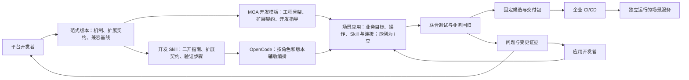
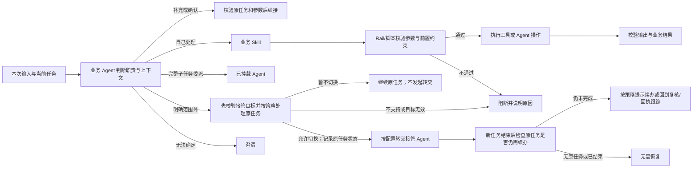

# 企业 Agent 开发工作台 PRD 2.0

版本：2.0\
日期：2026-10-24\
修订：保留合并后的完整开发阶段；架构按 Demo 优先精简，首个可运行切片与完整验收分开（2026-10-25）\
状态：产品设计基线及第一阶段可点击 Demo；真实前后端能力尚未按 2.0 验收。\
适用对象：企业 AI 平台开发者、应用开发者，以及承接应用的企业 IT 团队。

**产品主线：平台开发者交付可复用的 Agent 范式和开发模板；应用开发者通过配置、装配与少量开发完成业务应用；应用经过验证后，交给企业既有 CI/CD，发布为独立服务。** 以“MOA 类范式 → i豆场景应用 → 企业服务”为贯穿案例。

**新应用开发者的起点：进入应用列表，在新建流程选择已经可用的 MOA 开发模板，没有 i豆模板，也没有预建 i豆应用。创建应用后，开发者向 Coding Agent 描述业务需求，再审阅开发方案、接入企业系统、修改代码、调试和交付。平台维护是独立工作流，不要求每位应用开发者先切换平台角色发行模板。**

**核心开发方式：把范式的二次开发知识、扩展契约和验证方法整理成开发 Skill，注入 Coding Agent（首选 OpenCode），辅助开发者完成编排及代码修改。** 应用开发与平台开发采用不同工作区、默认内容和修改范围，共用底层工程、版本、执行与证据能力。两类用户均可查看代码、进行简单修改，不把编码能力收窄为聊天或只读展示。

本文是重新启动项目的独立产品基线。当前分支只保留 PRD 相关文档与静态 Demo；旧实现和资料已移至[历史项目归档](历史项目归档说明.md)，不构成本项目的实现、架构前提或验收通过状态。本文继续使用 `V2-FR`、`V2-AC` 编号以保持需求追踪；保留 2.0 文档名称不表示沿用旧代码。当前排期与检查规则见[后续推进计划](后续推进计划与执行要求.md)；页面定义见[交互设计 2.0](Agent开发工作台_交互设计_v2.0.md)，演示见[双角色 Demo](developer-prototype-v2/README.md)。

## 1 产品问题与本次调整

企业中的两类开发者承担不同工作。平台开发者需要把执行机制、企业连接和业务扩展边界沉淀为可维护的公共能力；应用开发者需要在这些边界内完成具体应用，并能处理真实接口差异。两者必须共享应用版本、测试用例和调试证据，才能交接工作。

当前设计偏重“描述需求后，由开发 Agent 和测试 Agent 自动生成组件”。这条路径可保留为工程辅助，但不足以承载范式交接、场景维护和企业交付。2.0 将以下四个问题作为设计依据；它们来自本轮讨论和源码分析，不表示已经完成客户调研或收益测量。

| 用户问题 | 产品响应 | 负责对象 | 可观察结果 |
| --- | --- | --- | --- |
| 公共机制与场景代码混在一起，每次交付依赖原作者 | 发布带扩展契约的范式版本及开发模板 | 平台开发者 | 场景应用锁定范式版本；接口适配不修改范式核心 |
| 配置覆盖不了企业接口差异，完整源码开发又过重 | 配置优先，开放有边界的映射、校验及连接适配 | 应用开发者，平台开发者支持 | 能定位并修复一次真实接口结果差异，留下差异与回归记录 |
| 配置、Java 代码、Skill 和执行轨迹分散 | 同一应用、同一执行快照下联合调试 | 工作台 | 从失败业务操作定位到具体配置、脚本或连接版本 |
| 本地工作台演示无法直接交接企业发布 | 导出应用包或可构建源码工程，提供契约和测试包 | 应用开发者交付，企业 IT 发布 | 企业流水线部署后，停止开发工作台仍可调用服务 |

### 1.1 新项目的设计边界

从本版需求和两阶段目标重新确定技术方案，不要求迁移旧后端、数据库或生成链。第一阶段交付可点击 Demo；原第二、三阶段合并为 DEV-02 完整开发阶段，统一设计并实现应用开发者和平台开发者的前后端。允许按端到端能力分批交付，但不再按角色拆成两个产品阶段。先讨论技术架构和实施切片，再开始开发。

版本绑定、独立验收、业务确认、幂等与未知结果核对、Mock 隔离、秘密外置和失败记录都是本版产品要求，须在选定实现中实际验证；旧项目的检查结果不转为本项目通过。开发过程允许配置、编排与少量编码，OpenCode 辅助修改，企业 CI/CD 可接管是完整产品目标。

## 2 用户、责任与协作

| 角色 | 主要任务 | 交付物 | 责任边界 |
| --- | --- | --- | --- |
| 企业 AI 平台开发者 | 维护 Core/Runtime 兼容基线；实现 MOA 类范式；维护公共业务 Skill、Rail、Tool、企业连接与接入适配；把二开指导整理为 OpenCode 开发 Skill | 范式发行包、开发 Skill 包、公共工具与连接、扩展契约、模板、公共测试及接入样例 | 对公共机制、技术接入、知识与版本兼容、扩展边界负责；接通服务不等于获得授予业务权限的权力 |
| 应用开发者 | 选择模板及其开放的 Agent／工作流、业务 Skill、工具；编写应用专用业务 Skill；配置业务规则、指令和连接引用；在开放契约内开发映射、校验及应用专用工具；调试、回归、交付 | 场景应用、业务 Skill、应用专用工具/扩展源码、场景测试、应用包或源码工程 | 对本应用的业务组合、局部实现与交付验证负责；不直接修改公共组件、平台鉴权或范式核心；具体可开发范围以阶段和模板实际支持为准 |
| 企业 IT 发布与运维人员 | 注入目标环境配置和凭据；执行 CI/CD；部署、检查、回退 | 部署记录、服务地址、制品摘要和运行记录 | 对企业发布、环境和服务运维负责；开发工作台不替代既有流水线 |
| 业务及测试协作者 | 确认业务规则、验收样例与结果；维护独立验收条件 | 业务契约、测试集、验收结论 | 开发者或 AI Coding 不能为使实现通过而降低其硬性断言 |

平台开发者也可以开发场景应用；模板不足时，应用开发者可提交带失败输入、Trace 和版本的扩展需求，由平台开发者发布新范式或公共组件版本。双方围绕同一应用的版本和证据协作。分工按复用范围、接入授权和机制影响确定，不按 Skill/Tool 名称、文件后缀或代码行数决定。

首轮本地 Demo 可由一人按两种身份完成交接，界面角色切换不构成权限隔离，也不证明独立团队复用。应用开发者应能理解接口字段、业务规则和测试结果；产品不承诺完全无代码、无需技术理解。

### 2.1 平台开发者的工作路径

1. 从已有 Java 工程或代码仓固定修订接入范式，声明 Core/Runtime 和扩展依赖；首轮允许导入本地工程，不以在线代码仓集成为前置。
2. 选择匹配版本的基础开发指南与范式开发 Skill，交给 OpenCode 辅助实现业务 Skill、Rail、Tool、SPI 和企业连接；同时保留源码浏览和手工编辑。检查真实差异及运行结果后形成发行版本。
3. 定义开放给应用方的配置、操作、代码接口和文件范围，并给出默认值、示例与正反用例。范式核心 Rail 不因作为模板交付而变成任意可编辑组件。
4. 发布开发模板及绑定的应用开发 Skill，把基础连接、公共机制与业务可变部分分开交接。应用方选模板后获得对应 OpenCode 指导，可查看来源和维护者，并从实际运行失败回到契约或工程文件。
5. 收到应用方的失败 Trace 或新扩展需求后，在平台工程处理公共变更，验证兼容性并发布新版本；已有应用选择是否升级。

平台工程保留标准源码与构建方式，工作台负责组织资产、调用工程辅助、关联验证和交接。首轮无需在浏览器内重做完整 IDE，也不要求用模型重新生成已有 MOA/Core/Runtime。

### 2.2 两类用户看到不同内容

| 维度 | 应用开发工作区（基础功能） | 平台开发工作区（平台功能） |
| --- | --- | --- |
| 首页与导航 | 仅应用；新用户先到空列表，新建时选择模板，进入应用后为横向五页签 | 范式工程、公共能力、开发 Skill、模板发行、工程活动与应用运行诊断 |
| 主要编辑对象 | 角色与行为（应用层 System Prompt）、业务 Skill、可用工具的配置、连接引用、映射/校验及开放范围内的应用专用工具 | Agent 定义、公共 Skill/Tool/Rail/SPI、系统连接与服务装配、兼容依赖、开发 Skill 和开放契约 |
| Coding Agent 指导 | 当前模板绑定的应用开发 Skill、允许的扩展路径和业务验收 | 框架开发知识 + 范式维护 Skill、API/SPI 契约、注册/接线和升级测试 |
| 编排与代码 | 默认看应用目标、开发方案与进度；可随时查看并修改开放代码；所有变更回到同一工程和版本 | 默认看工程结构、能力关系与源码；可编辑公共能力并决定向应用方开放什么 |
| 交付动作 | 固定应用候选、导出应用包或源码，移交企业 CI/CD | 发布范式版本、开发 Skill 包和开发模板，提供兼容声明 |
| 默认隐藏的复杂度 | 不在常用操作中堆放 Core/Runtime 版本、SPI 和核心 Rail 维护入口 | 展示底座和契约细节，不用场景表单替代工程开发 |

这不是同一页改角色名称，也不是强制建设两个后端。基础编辑器、代码差异、OpenCode 会话、运行和证据服务可复用；导航、任务入口、默认上下文、开放能力和交付对象按角色区分。本地设计稿通过一个“切换用户身份”入口模拟陈晓（应用开发者）和林知远（平台开发者）；当前姓名、身份、导航和 Coding Agent 上下文一致。实际权限必须由服务端和工具执行边界落实，Demo 不实现登录或授权后端。

### 2.3 Skill、Tool 和连接分别由谁维护

两类开发者都可以编写业务 Skill 和 Tool，但修改对象及交付范围不同。下表是产品责任约定，不表示当前 Demo 已实现任意工具开发或真实接入；各阶段范围见 10.3。

| 对象或变更 | 牵头开发与维护者 | 另一方怎样使用或参与 | MOA + i豆例子 |
| --- | --- | --- | --- |
| 给 Coding Agent 的开发 Skill | 平台开发者 | 应用方使用模板绑定的指导，补充本应用需求；不借此修改执行器权限 | MOA 工程结构、开放目录、Tool 适配和测试方法 |
| 应用专用业务 Skill | 应用开发者 | 平台提供机制、示例和开放契约；应用方通过 Coding Agent 或手工维护业务内容 | 如何回答余额查询、组合目录查询与兑换、解释失败结果 |
| 跨应用复用的公共业务 Skill | 平台开发者 | 应用方引用固定版本，可贡献变更需求或代码；应用配置不直接改公共源版本 | 多个福利应用共用的业务步骤与操作约束 |
| 已提供的公共 Tool | 平台开发者 | 应用方选择、配置，并在允许位置做输入输出映射 | 福利余额查询、兑换提交、回执查询工具 |
| 仅供当前应用使用的局部 Tool | 应用开发者 | 平台先提供扩展契约及授权范围；应用方在其范围内通过 API 适配、MCP 工具或脚本实现、测试并随应用交付；不强制每个接口新增 Java Tool | 包装已授权的礼品库存 API，适配为本应用的查询工具 |
| 新企业系统、公共连接或新接入机制 | 平台开发者 | 应用方提供需求和业务用例；企业系统方提供接口及授权，IT 按既有流程注入环境凭据 | 首次接通福利系统，增加一种认证方式、协议适配或共享 SDK |
| 范式核心、公共 Rail 与执行协议 | 平台开发者 | 应用方只使用已开放参数；缺口交由平台处理 | 新增等待/回调机制或改变写操作确认机制 |

应用专用 Skill 可以包含脚本或工具调用，但仍受相同的接口授权与执行范围限制。把 API 调用写进 Skill，不会使它自动成为已接入、已授权的工具。应用专用工具被第二个应用复用前，由平台确认公共契约、维护者、版本及相关测试，再作为公共能力提供；不要求首期建设在线审核或资产市场。

### 2.4 新工具和新 API 的接入判定

1. **已有工具满足需求：应用方选用和配置。** 绑定可用连接，调整模板允许的规则、映射和业务 Skill；不必重新开发接入层。
2. **已有受支持连接，目标 API 已获授权，且公开扩展契约允许新增应用工具：应用方开发。** 修改只位于本应用的开放目录，不改变鉴权、公共 SDK 或执行机制。应用方负责接口输入输出、错误与副作用说明，以及组件和业务用例；新工具绑定本应用版本。上述条件未满足时，不能仅凭接口地址可访问就认定可以接入。
3. **涉及新系统、授权范围变化、新认证/协议、公共 SDK 或范式机制：平台方牵头。** 应用方提交业务目标、接口资料和预期结果；企业系统负责人确认调用主体、API 与数据范围，平台完成技术适配和契约检查，再向应用方提供可用工具/连接。业务授权沿用企业流程，不由 Coding Agent 或页面身份切换授予。

例如，员工福利助手新增“查询礼品库存”：如果库存 API 已包含在现有连接的授权范围内且 Tool 扩展已开放，应用方可实现局部工具；如果需要首次接入仓储系统或新的服务账号，则由平台牵头接入，应用方继续负责业务 Skill 和应用验收。新增写操作还必须沿用第 7 章的确认、幂等、超时核对及业务权限约束。

工具文件由谁编写和工具由谁长期维护是两件事。平台可协助编写应用代码，应用方也可贡献公共组件；首次接入或公共发行时仍需明确一个维护责任方。企业系统负责人、IT 是既有协作方，本次不新增对应工作台角色或管理页面。

## 3 三个核心产品对象

**范式**是执行机制及其扩展契约的版本化发行物；**开发模板**是把范式包装成可实例化的工程骨架、开放契约和开发指导；**场景应用**是开发者填写业务目标、装配业务操作并接入企业系统后形成的工程。

本次关系为：**MOA 范式 → MOA 开发模板 → i豆服务助手（场景应用示例）**。平台发布 MOA 模板，应用方基于它创建 i豆、采购协同等应用。i豆的余额、兑换、业务 Skill、连接与测试属于应用层；不是 MOA 模板固有业务。Demo 在应用需求明确涉及 i豆后提供预设开发方案，需审阅并应用到当前工程；其他业务可整理需求草稿，接口与运行保持待实现，不自动带入 i豆逻辑。

### 3.1 对象最小契约

以下为工作台拟议产品契约，字段名不是现有 SDK API；实际存储和接口在技术设计中确定。

| 对象 | 必须携带的内容 | 版本规则 |
| --- | --- | --- |
| 范式版本 | 标识、版本、源码/制品摘要、Core/Runtime/扩展依赖锁定、入口协议、配置 Schema、扩展点清单、状态及续接约定、部署依赖、兼容测试 | 发布后不可改写；声明哪些机制固定、哪些参数可改、哪些接口可扩展 |
| 开发模板版本 | 范式引用、工程骨架、默认技术配置、开放的能力类型及执行方式、业务操作扩展契约、开发 Skill 引用、允许修改的文件/字段、基础用例；可选业务示例单独标识 | 创建应用时固定版本；模板升级不静默覆盖应用修改 |
| 开发 Skill 包（范式附属发行件） | Skill 标识/版本/摘要、适用角色、指南来源修订、兼容范式及依赖、任务入口、参考契约、示例、验证配方、工具/路径要求 | 模板绑定具体版本；实际工程任务记录装载版本；更新知识不改写历史任务 |
| 场景应用 | 名称与业务目标、模板来源、范式锁定、能力装配清单及实现状态、业务操作、配置、连接引用、业务 Skill/扩展资产、业务规则、测试集、环境配置档 | 草稿可编辑；执行和交付引用快照；允许配置副本，不复制公共源码作为默认扩展方式 |
| 执行快照 | 实际配置、依赖、脚本内容摘要、连接配置版本、模型配置标识、运行环境和执行 ID | 内容身份与执行 ID 分开；秘密只记录引用，不写入快照 |
| 候选版本 | 应用内容摘要、构建产物、完整资产、依赖清单、测试集版本、适用环境、来源及验证报告 | 草稿修改产生新候选；旧报告继续指向旧目标 |
| 交付记录 | 候选引用、应用包/源码工程摘要、目标环境前置条件、CI 执行及部署结果引用 | “已导出”“CI 验证通过”“已部署”分别呈现 |

应用包内的业务操作、连接、Skill 和扩展均有稳定标识，用于测试与事件关联。应用开发首期可用固定清单或工程配置提供少量可用工具和连接，保留选择、版本固定和追溯；不要求先建设自助登记界面、公共资产市场或完整授权管理。后续公共登记能力按 10.3 逐步完善。

### 3.2 状态与机制归属

| 状态或决策 | 归属 | 工作台职责 |
| --- | --- | --- |
| 范式、模板、应用、候选与测试版本 | 开发工作台/代码仓 | 固定引用、展示差异、记录来源与交付 |
| Agent 循环、会话检查点、等待与续接 | 选定范式及 Core/Runtime | 通过适配读取和操作，避免另建一套冲突的执行状态 |
| 用户身份及可用业务权限 | 企业身份系统、服务入口与业务系统 | 配置可信来源；区分开发者、应用服务账号和最终业务用户；工具可见/可选不等于可访问全部业务数据 |
| i豆余额、兑换订单、业务幂等和交易提交 | 企业业务系统；Demo 中为独立 Mock | 采集调用与状态证据，不用模型回答代替交易事实 |
| 用户确认绑定与失效 | 范式运行机制，配合业务规则 | 呈现待确认内容及原因，保留动作与参数版本 |
| 服务发布与回退 | 企业 CI/CD 与运行平台 | 提供制品/测试契约并关联结果；回退服务不撤销已发生交易 |

### 3.3 开发范式如何注入 OpenCode

必须区分三个概念：运行范式规定 Agent 怎样执行；开发 Skill 指导 OpenCode 怎样开发这种 Agent；业务 Skill 在交付应用中处理业务。开发 Skill 不作为业务能力装载到运行时，业务 Skill 也不能承担开发工具权限控制。

| 开发 Skill 层次 | 内容来源与职责 | 面向用户 |
| --- | --- | --- |
| 基础 Java 开发指导 | `agent-solution/guides/docs-java`：选型、`agent/` 与 `service/` 分层、API/SPI、资源注册与契约测试 | 平台方完整使用；应用方按任务引用必要片段 |
| 范式维护指导 | MOA 开发手册及平台能力接入手册：候选/意图/路由一致性、固定主机制、Skill 操作、接线、沙箱与交付 | 平台开发者 |
| 场景装配指导 | 平台方从范式指导裁剪：模板操作、开放参数、映射/校验脚本、场景例子与必要验证 | 应用开发者 |

建议包结构为 `SKILL.md`（何时使用与任务步骤）、`references/`（公开契约及选定指南）、`examples/`（完整最小工程或增量片段）、`checks/`（验证配方）。包外的发行清单维护来源提交、摘要、角色、范式版本、依赖锁定与工具策略引用。这是产品包约定，不声称它已是 OpenCode 官方配置 Schema。

注入流程：选择角色及范式/模板 → 校验开发 Skill 与工程版本兼容 → 建立 OpenCode 工程会话并提供 Skill/参考资料 → 读取当前代码和运行证据 → 提出编排计划与文件差异 → 应用选定变更 → 执行对应层检查 → 回填同一工程。不能把整份文档无差别塞进所有任务，也不能让外部指南文本提高工具权限。

每次任务记录角色、工程修订、开发 Skill 版本/摘要、文档来源、实际读取材料、工具调用、文件差异、检查和失败。Skill/依赖缺失或版本冲突时给出诊断，不能静默改用另一套 API。用户可撤销尚未交付的变更；应用建议前检查基础修订，避免覆盖用户刚做的手工修改。

本项目尚未实现真实 OpenCode 工程接入或可发布、可选择、可版本化的范式开发 Skill 体系。DEV-02 从本版契约讨论接入方式，并核验选定 OpenCode 版本的 Skill 发现/读取机制；原生加载或显式指导注入均需有实际装载证据，不能仅因目录存在便标记已加载。

### 3.4 工具可用范围与业务权限

平台开发者负责技术接入和公共能力供给，企业既有授权规则决定谁能使用哪些系统与数据。以下两层分别处理：

| 权限层次 | 要回答的问题 | 首期处理 |
| --- | --- | --- |
| 开发时的工具使用范围 | 当前团队或应用可以选择、配置、扩展哪些工具与连接？ | 按模板开放契约和预先约定的工具/连接清单提供；真实执行校验允许范围，不必先做完整的授权配置界面 |
| 运行时的业务访问权限 | 本次调用以谁的身份执行，可以读取或修改哪些业务数据？ | 明确采用最终用户身份、应用服务账号或两者结合；复用企业服务入口和业务系统的权限校验 |

例如，应用开发者能选择“查询 i豆余额”工具，不代表应用或其用户有权查询所有员工余额。采用员工身份时校验该员工的数据范围；采用服务账号时也需按业务约定约束请求对象，不能让对话中的用户标识扩大访问范围。开发者身份、应用服务账号和最终业务用户不可混为一体。

连接选择的是可用环境及凭据引用，真实凭据由企业环境按既有流程注入；Skill、Prompt、导出包和 Trace 不携带秘密值。开发者可编辑业务 Skill 或 Tool，不等于可改变授权范围。服务调用被拒绝时保留失败原因，不以 Mock 成功替代真实权限结果。

完整的工具共享授权、审批界面、凭据生命周期及统一权限管理后续完善。真实系统接入时，身份来源、必要执行范围校验和业务权限检查仍须生效；不要求开发工作台重新实现企业身份或权限体系。当前 Demo 只模拟角色视图、预置工具及装配草稿，不增加授权配置流程，也不证明真实权限隔离。

### 3.5 可装配能力类型与执行方式

能力是被编辑和运行引用的对象；装配是选择、添加、配置及绑定连接的动作，不是另一套对象或独立工作阶段。“添加能力”按用户装配的对象分为三类。A2A 是调用协议，Skill 是业务说明与相关资产，脚本是执行方式；不把三者直接平铺为同一层类型。以下是产品契约，实际可运行范围由模板和执行适配共同决定。

| 装配类型 | 对象及用途 | 执行方式与子类 | i豆设计示例，非已实现企业接口 |
| --- | --- | --- | --- |
| Agent／工作流 | 复用已经能够完成一项业务的下游服务 | 保留 Agent、工作流子类；MOA 当前默认通过 A2A 调用 | 查询积分 Agent、已有兑换工作流 |
| 业务 Skill | 描述业务步骤、使用条件和交互规则，并关联脚本或其他资产 | Agent 读取说明并选择已开放操作；Skill 不是独立服务或通信协议 | 查询、选择、确认、兑换与异常核对 |
| 工具 | 一个输入输出明确的操作，可为查询、写入、转换或校验 | HTTP API、MCP 工具、Python 脚本；Java 函数可作为后续工程扩展，不单设一级类型 | 查询余额、校验兑换条件、转换订单字段 |

一项业务 Skill 可以指导模型使用工具或调用远程服务。脚本可以只做校验，也可以调用外部接口；不能把“脚本工具”解释为只能在 Skill 内存在，或把所有工具都解释为外部接口。当前 MOA 的具体脚本接线仍以第 4 章为准。

连接管理环境、调用身份和凭据引用；模型属于运行配置；知识库和记忆属于数据资源；Rail 属于执行约束。它们不混入以上业务能力类型。给 OpenCode 的开发 Skill 仍属于模板开发指导，不在“业务 Skill”中装配。

装配项至少记录稳定标识、名称、用途、类型、执行方式、来源/维护方、版本或草稿修订、配置/资产引用、实现与验证状态。真实调用还需第 7 章的输入输出、连接、身份与业务约束。工具不能通过保存 Markdown 或配置自动获得新系统访问权限。

模板明确开放哪些类型和具体执行方式。平台在工程草稿维护范围，检查并发行后，新应用固定该版本的范围；旧应用不随平台修改静默变化。真实阶段既在 UI 筛选，也在服务端和执行边界校验；不支持的组合不得运行或交付。完整共享授权和任意插件管理后置。

DEMO-01 展示三类入口：Agent／工作流使用 A2A 子类，工具可选 HTTP API、MCP 或 Python 脚本，业务 Skill 与脚本保留内容编辑。保存、修改、移除产生应用新修订，刷新和切换应用保留各自内容；已选预置能力和新增草稿在同一列表中展示，详情直接编辑该对象；可查看只读 `capabilities/assembly.json`，把草稿带给 Coding Agent 讨论。Skill/脚本内容可在详情或对应文件中修改，二者读取和保存同一字段，不复制为另一份配置。所有新增项均为 `simulation: true`、`runnable: false` 的待实现草稿，不发现服务、不测试接口、不执行脚本。未实现草稿阻止完整候选检查通过；原有 i豆 Mock 可继续单独调试。删除草稿不改写历史快照。

Demo 的模板范围开关只声明三类入口；API/MCP/脚本选项均为设计交互。正式模板还需按实际接通的方式细分范围，不能把 Demo 的开关解释为 MOA 已具备通用 Tool 执行器。完整开发阶段先讨论适配方案，不因本节直接开工。

### 3.6 角色与行为（System Prompt）

原“应用指令”改名为“角色与行为”，界面明确标注 **应用层 System Prompt**。它定义运行时应用 Agent 的角色、服务范围、回答方式及总体行为要求，对应 `instructions.md`；不是给开发工具的指令，也不等同于全部运行时提示。选定模板和框架还可能叠加固定约束、工具说明及执行上下文，真实阶段需明确最终提示的组合顺序与可编辑范围。

| 内容 | 使用者与作用 | 编辑入口 |
| --- | --- | --- |
| 应用层 System Prompt | 应用 Agent：你是谁、负责什么、如何回答 | 开发 → 应用设置 → 角色与行为；或 `instructions.md` |
| 业务 Skill | 应用 Agent：某项任务的步骤、使用条件和关联资产 | 开发 → 能力 → 业务 Skill 详情；或对应 Skill 文件 |
| 开发 Skill | Coding Agent：如何按范式修改工程、使用工具与验证 | 平台维护，右侧 Coding Agent 展示当前固定版本 |
| 执行约束 | 程序控制权限、工具允许范围、确认绑定与幂等 | 范式/Runtime 与企业系统执行；应用仅修改模板开放参数 |

例如，“你是员工福利助手，先回答余额，再说明下一步”属于 System Prompt；“查询余额、核对资格、展示礼品与数量、确认后兑换”属于业务 Skill。模型提示不能授予业务权限，也不能替代强制确认或幂等校验。Demo 保存提示文本并展示与文件的同步关系，不调用模型验证提示效果。

### 3.7 编排：业务范围与转交、业务 Skills、操作与规则

**当前应用开发对象是下层业务 Agent（L2）。** 上级 MOA（L1）负责全局候选、规划和重新分发，由平台维护。应用开发者不需要先配置上级意图目录，才能编写自己的业务。源码依据、业务规则 BA-01～20 与案例保存在 [MOA 业务 Agent 分层与转交规则分析](MOA业务Agent分层与转交规则分析.md)。

“能力”定义有哪些对象可用；“编排”定义本 Agent 负责什么、怎样完成业务、何时委派或转交接管 Agent。Coding Agent 根据固定开发 Skill 提出配置与代码差异；可视化和文件共享同一修订，不产生第二套能力对象。

| 编排内容 | 应用开发者定义 | MOA + i豆例子 | 执行边界 |
| --- | --- | --- | --- |
| 处理流程 | 查看已保存规则、节点条件和目标；输入请求预演并高亮去向 | 查看福利 Skill、采购 Agent、兜底 Agent 及原任务续接的分支 | 设计投影与运行 Trace 分开；点击节点只查看，不改变路由或执行业务 |
| 业务范围 | 自己负责的业务、所用 Skill、可委派的 Agent 与范围外示例 | 查询与兑换由福利 Skill 处理，已挂载的采购 Agent 可承接采购子任务 | 范围包括自身及已配置可处理的业务；未匹配不直接等于范围外 |
| 转交与续办 | 接管 Agent、未完成任务处理、新任务结束后的续办策略 | 福利应用范围外请求交给企业总助理；原兑换任务保留后提示继续 | 产品目标是可配置的控制权转交；底层回传信号或 A2A 调用方式由模板实现，不限定必须返回原调用者 |
| 业务 Skills | 业务内容、步骤、输入与完成要求、可用操作和规则 | 一次福利 Skill 调用可包含查询、补充信息、确认和提交 | Skill 是可复用能力定义，在当前业务任务内调用；完成返回原任务，不新增独立业务待办。一次调用不等于一步执行，允许等待输入 |
| 操作与规则 | Skill 可用的工具/Agent、契约、确认、调用上限、前置条件和完成依据 | 工具完成余额/目录/兑换/回执操作；Agent 可承接子任务 | 强制规则由 Rail/脚本/校验代码执行；文字说明不等于已落实；不必执行全部终结操作 |
| 规则预演 | 单条输入判断，以及读取已保存策略的转交/Skill 规则测试 | 改变处理策略后，观察保留、询问、续办或 Skill 原任务内调用的不同结果 | 确定性输入匹配与固定测试条件均为模拟，不调用模型/服务，不生成业务运行或发布证据 |

该图表示产品目标。远端 L2 的控制器适配已有委派与返回信号路径；当前本地 Native Skill 遇到意图切换会返回 `INTENT_SWITCH_REJECTED`，上级也排除 Skill 自动重路由。两条路径尚未构成统一的业务 Agent 模板 [M9]。当前 MOA 意图切换挂起旧计划，没有自动恢复旧计划的入口。

**后续消息规则：** 优先交当前业务处理；补充参数与确认必须关联原任务、操作和参数版本。仅输入文本变化不能触发上级重路由；需要任务切换时由业务侧产生明确信号。未匹配示例先澄清；目标缺失或未授权报配置/权限错误，不能当成范围外返回。接管目标可以是上级或其他已配置 Agent；目标缺失时提示补齐，不自动寻找兜底。System Prompt 与业务范围的真实生成和一致性校验按 3.8 接入 OpenCode，Demo 不自动同步这两份文本。

**任务与 Skill 的配置边界：** 任务指一次业务办理实例；Skill 指可复用的业务能力。Skill 执行完成返回所属任务，可包含多步和等待输入，不单独进入“待续办任务”列表。这个归属由模板固定；应用方配置 Skill 内容、可用操作与约束，不能靠提示词改写归属。Runtime 内部执行 ID、子会话或协议 Task 不等于这里的独立业务待办。

**转交与续办配置：**

| 开发者配置的问题 | Demo 支持的选择 | 效果 |
| --- | --- | --- |
| 范围外交给谁 | 模板示例“企业总助理”，或当前应用添加的 A2A Agent | 目标来自保存的配置，不是固定故事；工作流不是此处的接管 Agent 选项；选择目标不自动把其全部业务纳入本应用范围 |
| 原任务未完成时怎么办 | 保留进度先处理新请求；切换前询问用户 | 询问模式提供保留、放弃或暂不切换；已经提交的操作不能通过此处放弃而假装撤回 |
| 新任务结束后怎么办 | 提示用户选择是否继续；自动回到原任务 | 自动返回仍先复核；用户可稍后继续；已完成/已放弃的任务不再提示恢复 |

模板固定恢复前业务条件与确认复核、已提交操作继续跟踪原回执、不重复提交，以及 Skill 的当前任务归属。首次请求没有原任务时不产生挂起记录。新任务失败也不得丢失原任务；原任务的迟到回执只更新原任务，不夺走当前新任务的处理位置。

**转交顺序：** 先检查目标及模板支持范围，再按保存策略处理原任务。询问模式在用户决定前不得发起新转交；“暂不切换”继续原任务且新转交调用数为零。允许切换后先记录原任务的保留、放弃或回执跟踪安排，再交出新请求；已经提交的操作不可通过“放弃”伪装撤回。目标无效或发生重复弹回时，停止对应转交并保留原任务状态，不静默选择另一 Agent。实际等待、发送失败或结果未明的处理范围在 DEV-02 确认，不能仅因页面切换就报告接管成功。

**首期恢复范围已确定（2026-10-25）：含当前任务共两层。** 原任务 A 未完成时可切到新任务 B，B 结束后只恢复 A；最多同时保留一个未完成原任务和一个当前任务。这相当于一次嵌套切换，与当前 Demo 所称“一层切换”的计数口径不同，不意味着 Demo 已具备真实恢复。层数按业务任务计，不按 Agent 名称、Skill 调用、A2A 子执行或 Trace ID 计。

A 仍未结束时，B 若需要保留自身并再切到 C，会超出首期范围：必须在改变 A/B 状态和发起 C 调用前阻断，显示“两层任务上限：请先完成当前任务或稍后处理新请求”，保留 A/B 及续办入口，不自动放弃旧任务。A 已提交待回执时仍占原任务层；回执仅更新 A，不抢占 B。A 已结束或明确放弃未提交任务后，不再作为待恢复层；放弃不能取消已经提交的操作。B 完成或失败后，仍未结束的 A 按保存策略续办，未提交操作先复核并重新确认；原操作已提交时仅跟踪原回执，不重复提交。

模板须声明并验证上述两层边界。等待期限、会话离开、跨重启支持及发送失败/结果未明的技术处理仍在 10.2、12.2 讨论；不默认承诺跨重启恢复。业务范围、System Prompt 与 Skill 的冲突按 3.8 交给 OpenCode 统一处理。

开发者在“转交与续办”配置三项策略，“保存并预演”进入规则测试。测试条件为未提交的原任务、无原任务、已提交待回执、当前任务调用 Skill。界面突出任务状态及用户下一步操作，执行记录折叠显示；模拟一层切换，不宣称具备多层任务栈、真实检查点恢复或后台回调。

**处理流程可视化：** “开发 → 编排”默认进入“处理流程”。在同一张图上展示用户输入、当前 Agent 判断、原任务续接，以及三种业务去向：自己调用业务 Skill、委派已挂载 Agent、明确范围外时转交兜底 Agent。兜底就是已配置的接管目标，不是额外的一类能力，也不默认等于原调用方。另列信息不足/多候选的澄清分支，以及范围冲突、配置缺失、目标失效的阻断分支。未命中示例不得画成兜底成功。

图中的名称、业务条件、服务标识、Skill 可用操作和转交策略来自当前应用已保存定义；新应用没有预置业务绑定。点击节点只查看规则，可从详情进入现有配置页。操作以可选集合展示，不能用顺序连线暗示固定执行；Skill 返回当前任务，不生成独立待办。输入请求和任务上下文后复用单条输入判断结果，高亮命中节点与连线，并提供文字原因。点击“查看路径”把结果与图示滚入视野。改变输入、上下文或保存修订后移除旧高亮并标明过期；未保存表单不进入流程图。图示位置和预演按应用隔离。

该图是已保存规则的设计投影，不是可拖拽流程执行器或真实 Trace。运行轨迹继续在“运行记录”查看，当前 Demo 的轨迹仍为模拟事件；新增图示不产生业务调用、运行记录或发布证据。

**定义、暂存与验证规则：**

- 新 MOA 应用初始没有 i豆职责。福利方案审阅并应用后才加入示例范围、Skill 和操作；保留已有手工定义。同一 Demo 版本内，缺少范围或转交策略时显式补齐；不能把旧 `return_to_caller` 自动解释成新目标。同版本内不改写历史快照；跨 Demo 版本按下述演示数据规则清空，不保留旧演示应用。
- 业务分工保存稳定内部标识，不要求应用方输入上级意图代码。业务范围、转交策略和 Skill 表单暂存属于当前应用，可跨刷新/角色/应用恢复；基础修订变化时拒绝旧暂存覆盖。实际变更增加修订，无修改保存不增加。
- Skill 在编排、能力详情与文件之间同步。移除目标保留失效引用，要求修复；不自动换绑。业务分工与范围外示例冲突时阻止自动选择。
- `orchestration/business-scope.json` 包含业务范围、分工与 `handoff` 策略；`orchestration/skills.json` 包含 Skill 操作及当前任务执行归属。两者是只读设计投影，标记 `simulation: true`、`runnable: false`，不是 MOA 原生配置。旧对象标识与历史快照保留。
- 预演只读取已保存定义，输入/上下文/修订变化后旧预演失效；操作集合不表示固定顺序。续接仅支持页面注明的固定样例，不能据此证明真实上下文识别。范围外按完整示例匹配；未命中先澄清。
- 预置福利 Mock 保留原演示流程；自定义范围、分工、转交策略或操作约束不能沿用其通过结果固定新候选，Skill 语义仍未经过模型验证。
- 平台维护全局分发、控制信号、执行和 Rail 机制，把二开规则与缺口注入开发 Skill。多 Skill 实例、状态隔离与转交衔接在 DEV-02 先讨论后实现。

### 3.8 定义冲突由 OpenCode 统一处理

**已确定的产品决定（2026-10-25）：** 业务范围、应用层 System Prompt 和业务 Skill 指导出现冲突时，由 OpenCode（Coding 助手）统一分析并修订。应用方不需要分别在三个页面重复协调；平台把一致性检查和修订指导注入范式开发 Skill。这是开发态工程修改，不是在业务运行中临时改写定义。

1. **提示冲突。** 在当前应用显示“定义存在冲突，交给 Coding 助手统一修订”，列出相互矛盾的规则/文件位置、当前修订和受影响行为。例如，业务范围定义“仅查询余额”，System Prompt 却要求“办理兑换”，Skill 又描述“无需确认直接兑换”。普通校验器负责引用、类型和开放范围检查；跨文本语义由 OpenCode 检查，不把关键词检查当成完整语义判断。
2. **统一提出修订。** OpenCode 读取同一工程修订的业务范围、System Prompt、相关 Skill、操作约束及范式开发指导，依据开发者的业务目标提出一组关联差异和理由，不默认某份文本总是覆盖其他定义。若业务目标本身不明确，由助手向开发者澄清具体分歧；不得自行扩大业务职责、增加未授权目标或放宽固定执行约束。
3. **审阅并应用。** 沿用 Coding 助手既有的差异审阅流程；一组修订共同审阅、校验基础版本并应用到同一工程新修订，失败不留下部分生效的混合状态。开发者拒绝、助手失败或期间发生手工修改时，保留原内容与冲突记录；旧建议不能覆盖新修改，可重新分析。应用后相关表单、文件与流程图读取同一新修订，旧检查失效。
4. **复核再运行。** 对新修订重新检查定义一致性和受影响行为。未解决的已识别冲突允许保存草稿，但阻止受影响路径的真实调试和该修订的候选交付，并提供返回助手的入口；不改写旧候选或历史运行。助手给出“已修复”不是验收通过，仍须有修订差异、检查结果及对应行为证据；语义修改才重做相应模型检查，未变修订复用有效结论。

权限、确认、幂等和任务归属仍由已声明的执行机制保证，OpenCode 不能以改提示词的方式取消这些约束。真实检查触发、工程变更应用与服务接口在 DEV-02 技术方案中确定；本次不声称已接通真实 OpenCode 冲突修复，现有 Demo 的预设建议也不计为此能力通过。

## 4 MOA 代码对产品设计的约束

本章基于 `agent-solution` 提交 `1a92265cd238406054f24a069bc08c5e7af978e3` 的静态审阅。它是已核对的源码快照，不代表当前分支、已部署服务或本仓已集成能力。源文件索引见第 13 章。

| 源码事实 | 产品含义 | 不能据此宣称的能力 |
| --- | --- | --- |
| 默认 `PackIntentRecall` 使用本地示例与关键词；模型参与任务判断、仲裁和慢路径计划；Rail 检查并推进 [M8] | 区分上级全局分发与下层业务处理；应用界面配置自身范围、Skills 与规则，实际路径从 Trace 查看 | 所有路由都由 LLM 决定；所有步骤都是固定工作流；风险标签自动实现授权 |
| 自动配置提供候选解析、意图召回、任务选择、条件判断等 SPI；主执行入口及核心 Rail 装配固定 [M1] | 平台开发者交付稳定范式，并显式开放扩展点 | 任意 Rail Bean 都能自动加入主链；任意组件拖拽即可运行 |
| `SkillOperation` 包含操作类型、固定路由/意图、输入输出 Schema、前置/结果脚本、确认要求、调用预算和终结标记 [M2] | “业务操作”应成为场景装配对象，不能只提供提示词和 Tool 开关 | 产品自定义操作描述可未经适配直接当成 MOA 配置 |
| `SkillActionRail` 校验参数、绑定确认与状态修订；结果脚本产出经过 Schema 验证的结果；完成受终结操作约束 [M2] | 交互需要展示结果结构、确认失效及终结条件；映射脚本是合理的小开发入口 | 文本返回正常就表示交易成功；模型判断可替代确定性校验 |
| `LocalSkillDelegate` 将本地 Skill 子执行映射回父执行；Native Skill 按执行创建并使用 Core 状态 [M3] | 同一工作台展示父任务、子执行和暂停点 | 每个 Skill 都是独立部署服务；跨重启恢复已完成产品验证 |
| `ExecutionEngine` 默认处理 AGENT/WORKFLOW 的 A2A 委派；本地 SKILL 走特定委派路径；TOOL 只有候选类型和执行扩展入口，默认未注册通用执行器 [M4、M7] | 首轮只开放实际接通的执行类型和依赖形式 | 通用 DAG、任意并行、所有候选类型和跨任务字段映射已齐备 |
| `SkillOperation.Type` 为 A2A/SCRIPT；`call_versatile` 进入 A2A，`call_mcp` 执行已登记的 Python 脚本，具体 MCP 调用由脚本承担 [M2、M7] | 能力类型与执行方式分别展示；Skill 可以关联多种操作 | `call_mcp` 名称等于通用 MCP 客户端；脚本工具已可在 MOA 顶层直接装配 |
| Skill 从文件系统装载；Native Skill 默认关闭，开启时要求 SESSION 范围 Runtime Sandbox [M3] | 发行包需携带资产、装载配置及脚本环境前置检查 | 只有 JAR 就包含全部运行材料；现有 Builder 已具备该沙箱路径 |
| MOA 官方按可执行应用交付；内部库及业务 starter 由使用方维护 [M5] | 平台侧需明确内部范式发行方式，再输出企业应用包 | 已有官方双 JAR/starter 可直接用于二次依赖 |
| 业务扩展记录中存在结果处理脚本误要求下游不存在字段的案例；README 中 i豆意图仍标注未接入 [M6] | Demo 应演示一次结果契约差异的定位与局部修复；i豆需基于 MOA 模板补建场景业务和 Mock | 现有 MOA 已交付可直接演示的 i豆完整应用 |

据此，2.0 采用“固定机制 + 声明式业务操作 + 少量适配扩展”的产品方式。模板既包含配置，也包含代码入口、资产和验证方法。复杂条件、身份链、异步业务和补偿需要明确实现责任，不通过增加 Prompt 掩盖契约缺口。

## 5 i豆贯穿案例与 Demo

### 5.1 场景假设

终端用户的业务故事为：企业用户查询 i豆余额，选择礼品，检查资格，确认兑换，提交申请并查询结果。i豆具体业务制度、扣减时点、礼品约束和上下游接口尚待客户确认。本节名称、字段、数据和路径均为拟议 Demo 契约，不表示已有客户接口。

首轮使用可控制且独立保存业务状态的 Mock 系统；模型调用、Agent 执行、脚本运行和 HTTP/A2A 请求必须真实发生才可标记为真实联调。预构建组件允许复用，来源应标明。真实企业集成在接口、权限和测试环境确定后另行验收。

| 操作 | 输入及可信上下文 | 输出与确定性规则 | 场景可配置/开发部分 |
| --- | --- | --- | --- |
| `query_balance` | 企业入口注入的用户标识 | 可用 i豆、更新时间；字段缺失为契约错误，不能编造余额 | 企业返回字段映射、展示提示 |
| `list_gifts` | 查询条件、业务域 | 礼品标识、所需 i豆、库存/有效状态 | 目录连接、筛选规则及字段映射 |
| `check_eligibility` | 礼品、数量及当前业务结果版本 | 可兑换/不可兑换及原因；金额、库存等硬约束由确定性逻辑或业务接口判定 | 规则参数、前置校验脚本 |
| `redeem_gift` | 礼品、数量、业务幂等标识；用户身份来自可信上下文 | 订单标识、明确业务状态；确认与当前参数/结果版本绑定 | 请求映射、结果映射、业务连接 |
| `query_redemption` | 订单或原业务幂等标识、可信用户身份 | 成功、拒绝、处理中、结果未知等明确状态及凭据 | 状态码映射与查询连接；不能将未知改写成成功 |

一次操作记录应包含传输结果、Schema 校验结果和业务结果。HTTP 成功、A2A 完成或 Skill 结束都不能单独作为兑换成功依据。工作台显示的 `处理中/结果未知` 是产品状态要求，需要适配实际 Runtime 协议，不能声称 MOA 当前已原生提供同名状态。

应用开发者的故事是“开发一个支持上述业务的应用”。选择礼品和确认兑换是终端用户操作，只出现在调试页明确标识的终端用户模拟器中；开发首页展示需求、方案、接口契约、代码与开发进度。

### 5.2 完整产品的贯穿场景

以下描述 DEV-02 完整开发阶段的真实能力目标。第一阶段用明确标识的本地模拟串起这些界面与决策，不执行模型、Java、OTLP 或 CI/CD。

平台团队预先发布 MOA 模板和开发 Skill，声明可用扩展、Core/Runtime 兼容基线与检查方式。该供给是应用开发者的起点；平台后续维护、发行和升级单独演示，不构成每次应用开发的任务步骤。

1. **创建应用。** 新应用开发者只看到 MOA 模板。填写应用名称和业务目标，获得固定版本的工程起点。创建表单不提供 i豆模板、业务示例选择器或礼品选择。
2. **提出需求并审阅方案。** 以“员工福利助手”为例，开发者要求查询 i豆余额、接入福利系统并支持兑换。Coding Agent 根据 MOA 开发 Skill 提出能力、接口、规则、文件和验证计划；应用前可审阅差异。应用后继续维护同一应用，保留其名称与目标。第一阶段明确标为预设方案；后续阶段才验证真实 OpenCode 生成。
3. **选择能力、连接并完善实现。** 应用方查看余额、目录、兑换、回执契约，选择业务 Skill 和需要挂载的 Agent，绑定可用连接并维护映射。新增 API 按 2.4 判定责任，阶段支持范围按 10.3 执行。Demo 必须显式绑定本地 Mock；选择尚未接通的企业环境不能获得模拟成功。
4. **配置业务范围与分工。** 在“开发 → 编排 → 业务范围”定义福利业务由自己使用 Skill 处理；如需承接采购业务，再把采购 Agent 加入分工。明确范围外示例；添加一个能力不等于它自动负责所有相似请求。
5. **配置转交、续办和 Skill 规则。** 选择范围外请求的接管 Agent、原任务处理方式和新任务结束后的续办策略；编写同一份业务 Skill，选择操作、前置约束、确认与完成依据。Skill 归当前任务，操作集合不表示全部执行或固定顺序。
6. **查看处理流程并预演。** 在“处理流程”检查条件、目标及分支，使用首次请求、原任务补充/确认、业务委派、范围外、未匹配、多候选和错误配置分别预演。业务范围、System Prompt 或 Skill 指导发生冲突时，按 3.8 交由 OpenCode 统一提出修订、审阅应用并复核；再进入“规则预演”比较保留/询问、续办、进行中回执及 Skill 调用的交互；保存修改后旧预演失效。预演不生成运行记录或发布证据。
7. **调试及定位差异。** 在终端用户模拟器中发送查询，固定应用快照并记录独立的测试输入。切换嵌套返回夹具使旧映射失败，从 Trace 定位脚本，交给 Agent 修复或手工修改。保留失败与旧快照。
8. **验证业务交互。** 在模拟器中选择礼品、确认兑换，验证拒绝、确认失效、重复提交及写后超时核对。更换测试礼品只影响本次业务确认，不修改应用修订。任务切换用例为“等待兑换确认时收到范围外请求”：先决定原任务处理，再转交；新任务结束后按策略复核续办。另验证原操作已提交时的迟到回执只归原任务。第一阶段这些切换仅在规则预演中模拟；预置福利 Mock 不证明自定义编排已接通，后续须按 V2-AC-28～35 验证实际链路。
9. **评测与交付。** 完成相关必测集、固定候选，导出应用包或可构建源码工程，交给企业 CI/CD。第一阶段只预演检查及下载设计 JSON，不产出 JAR。
10. **验证独立运行。** 后续真实阶段在目标环境部署，停止开发工作台及专用 Runner/代理后，直接调用导出服务。保留模型、企业接口及状态存储等已声明依赖，独立核对结果。

第一阶段先交付可点击的双角色全流程。完整开发阶段先讨论技术方案，再实现两角色真实能力；不能把真实后端或全部功能验收作为点击 Demo 的前置条件。旧设备查询 Demo 及其验证记录保存在归档工作区，不是当前分支入口或实施前置。

## 6 功能需求

下列均为 2.0 要求。责任列给出单一牵头角色；实施开工时在批次记录中落实具体责任人，不虚构人员或工时。

| 编号 | 功能与必须满足的行为 | 牵头责任 | 验收 |
| --- | --- | --- | --- |
| V2-FR-01 | 范式登记与版本发布：登记实际发行物、兼容基线、状态约定、扩展契约和部署前置条件；可选择指定版本，缺失依赖时明确阻断 | 平台开发者 | V2-AC-01、22 |
| V2-FR-02 | 模板交接：创建开发模板版本，以工程骨架、扩展契约与开发指导创建场景应用；业务目标和业务资产属于应用，可选示例来源单列；展示来源与可编辑范围 | 平台开发者 | V2-AC-01、02 |
| V2-FR-03 | 配置式装配：按 3.5 区分 Agent／工作流、业务 Skill、工具及执行方式，模板限定开放范围；Schema 驱动编辑，绑定模型/连接/资产，支持必填、类型、引用和组合约束检查；不支持的能力不呈现为可执行 | 工作台产品研发 | V2-AC-02、19 |
| V2-FR-04 | 业务操作与企业接入：平台提供公共工具、连接及实际支持的 HTTP/A2A 等适配；应用方按 2.4 选用、配置或开发开放范围内的局部工具；均遵循第 7 章请求、结果、身份、确认、幂等与超时契约 | 平台开发者 | V2-AC-04、08、09、10、20 |
| V2-FR-05 | 工程开发与 AI Coding：以注入开发 Skill 的 OpenCode 辅助编排；平台方维护范式、开发 Skill 和公共组件，应用方编写业务 Skill、开放配置、局部工具与适配；按 2.3 分工，两者均能查看代码及简单编辑 | 工作台产品研发 | V2-AC-03、05、06、25、26 |
| V2-FR-06 | 快速调试：从有效草稿自动保存执行快照并运行；缺少运行必需项时定位错误；不要求先完成全套交付确认 | 工作台产品研发 | V2-AC-04、07 |
| V2-FR-07 | 联合定位：按应用修订与运行标识关联 Trace、任务、子执行、业务操作、脚本和确认点；跨任务用关联标识或 Span Link，不强行合并为一个长 Trace；历史回放只读 | 工作台产品研发 | V2-AC-05、07、11 |
| V2-FR-08 | 业务状态控制：确定性前置规则、确认失效、重复处理、等待/续接、取消及未知结果查询按契约执行 | 平台开发者 | V2-AC-08、09、10、11、12 |
| V2-FR-09 | 测试与回归：模板基础集加场景增量集；支持固定输入、Mock 故障、外部状态断言；稳定回归由执行器完成，AI 可辅助设计和诊断 | 测试负责人 | V2-AC-13、14 |
| V2-FR-10 | 候选与证据：锁定内容、依赖、配置、测试及实际环境；变化生成新候选，旧报告原样保留；验收与导出状态分开 | 工作台产品研发 | V2-AC-13、14、17 |
| V2-FR-11 | 应用包交付：导出可执行应用及全部外部资产、配置样例、依赖清单、启动/健康/测试说明；支持企业部署后独立调用 | 交付工程负责人 | V2-AC-15、17 |
| V2-FR-12 | 源码与 CI/CD：导出固定源码、依赖与构建入口；流水线可构建、测试和部署，并关联实际产物摘要与结果 | 交付工程负责人 | V2-AC-16 |
| V2-FR-13 | 升级与兼容：展示模板/范式升级差异、应用覆盖项及受影响检查；既有候选不随升级改变；在途会话按声明策略处理 | 平台开发者 | V2-AC-18 |
| V2-FR-14 | 环境与身份：秘密以引用注入，区分环境、开发者、服务账号和业务用户；按 3.4 分开处理工具可用范围和业务访问权限；Mock 可隔离、受控重置；脚本环境前置条件可检查；管理界面后置不免除实际执行校验 | 平台开发者 | V2-AC-17、20、22 |
| V2-FR-15 | 增量与资源：按变化决定检查和构建；相同内容与多次执行分开；新工作区有保留上限及退出清理，保留被引用制品 | 工作台产品研发 | V2-AC-21 |
| V2-FR-16 | 复用验证：第二个场景或团队复用范式/模板，记录新增代码、核心改动、投入、支持及失败；生成效果另计 | 产品负责人 | V2-AC-23 |
| V2-FR-17 | 开发 Skill 发行与注入：把固定来源的二开指南、约束、示例与检查整理成角色化包；绑定范式/模板；OpenCode 任务校验兼容性并记录真实装载 | 平台开发者 | V2-AC-24 |
| V2-FR-18 | 双工作区：按第 2.2 章提供不同导航、默认信息、编辑范围和交付入口，共用工程与证据；场景侧不直接维护底座 | 工作台产品研发 | V2-AC-25 |
| V2-FR-19 | 编排与代码协同：Coding Agent 建议、可视化和手工代码共享同一修订；差异应用防止覆盖新修改；修改后旧验证失效，恢复/撤销保留历史 | 工作台产品研发 | V2-AC-26 |
| V2-FR-20 | OpenTelemetry 查询与轨迹回放：复用 Core/Runtime 的既有上报；工作台关联版本、展示业务步骤和 Span 详情；对保存的事件/快照只读播放，缺失采样或载荷明确显示，不重新调用业务 | 工作台产品研发 | V2-AC-27 |
| V2-FR-21 | 业务范围与输入归属：按 3.7 保存自身职责、Skill/Agent 分工与范围外定义；首次及后续输入区分原任务续接、自己处理、业务委派、范围外转交、澄清和配置阻断；可用能力与业务分工分开 | 工作台产品研发 | V2-AC-28、29 |
| V2-FR-22 | 转交与任务续办：配置接管目标、原任务处理与结束后续办策略；先决策和记录再转交，支持暂不切换；首期含当前任务共两层 A→B，B 结束后只恢复 A，保留 A/B 时阻断第三层；已提交操作只跟踪原回执；模板声明恢复范围并阻断不支持或循环的转交 | 平台开发者 | V2-AC-29、30、31、32、35 |
| V2-FR-23 | Skill 的任务归属：应用方配置业务 Skill 内容、操作与约束；调用及等待归当前业务任务，完成返回，不新增独立业务待办；内部执行/协议标识仍可保留并关联，固定约束不能被提示覆盖 | 平台开发者 | V2-AC-33 |
| V2-FR-24 | 处理流程与规则预演：由保存定义生成条件与目标视图，点击节点查看并进入原配置；预演结果可解释且高亮一致，修订/输入/上下文变化后旧结果失效；未保存表单不进入图示，应用隔离；设计图与运行 Trace 分开 | 工作台产品研发 | V2-AC-26、34 |
| V2-FR-25 | 定义冲突统一修订：按 3.8 由 OpenCode 联合检查业务范围、System Prompt 与 Skill 指导，定位冲突并提出关联差异；开发者审阅后应用同一修订，过期/失败不覆盖内容；重新检查通过后才解除受影响路径和候选交付的阻断，固定执行约束保持 | 工作台产品研发 | V2-AC-26、36 |

新增需求的业务规则、Demo 与真实验收映射见 11.1；各项仍按所选实施切片验证，不因新增编号改变通过状态。

## 7 配置、少量开发与复杂衔接的边界

### 7.1 三层修改范围

| 层次 | 允许的修改 | 典型 i豆例子 | 验证及升级方式 |
| --- | --- | --- | --- |
| 配置与装配 | 模板开放的参数、提示、操作选择、连接引用、Schema 内的映射配置 | 更换礼品目录连接，设置可兑换数量上限 | 校验引用与约束，执行相关用例；不产生新的范式版本 |
| 应用代码与局部扩展 | 指定目录内的结果/请求映射、前置校验、业务 Skill，以及满足 2.4 条件的应用专用 Tool/适配实现 | 转换嵌套余额字段；在已授权连接和开放契约内包装库存查询 API | 应用方展示差异，运行组件测试及业务回归，绑定应用版本；Java 扩展变更需要编译；不能改变鉴权或公共执行机制 |
| 范式与公共能力 | 新执行策略、核心 Rail、状态协议、跨应用公共连接和新的扩展接口 | 增加持久化异步回调机制或新的任务协调方式 | 平台开发者升级范式，发布兼容性和迁移说明；不能作为普通参数保存 |

“少量开发”由修改范围和稳定接口界定，不用任意代码行数界定。AI Coding 生成的代码遵守当前角色工程的边界：输入包含当前版本、操作契约、允许路径和失败用例；输出包含实际文件差异、依赖变化、执行记录和检查结果。场景工程不能借助 AI 越过模板的可编辑范围；平台工程的核心改动必须作为范式变更记录。生成服务不可用时，手工编辑或既有工程导入仍应可工作。

OpenCode 是辅助编排与代码开发的核心入口，手工配置/编辑是并行保留的操作方式。独立测试 AI 角色可按任务启用，不强制每次运行双角色流程。自动生成任务继续记录角色、预算、尝试和失败，测试方不可改被测实现，开发方不可降低独立验收标准。

当前 Builder 的路径/命令限制属于可信本地开发约束。MOA Native Skill 使用的 Runtime Sandbox 是另一项运行依赖。接入该路径必须验证其 SESSION 隔离和脚本执行配置；不得以已有 Runner 或 Docker Compose 代替该验证。首个切片只补所选路径需要的适配，不以通用沙箱平台建设为前置条件。

### 7.2 业务操作契约

每个可装配操作至少声明下列项目；只读操作可显式标记写入相关项为不适用。

| 契约项 | 必须表达的内容 | 平台必须检查的行为 |
| --- | --- | --- |
| 标识与执行绑定 | 稳定 operation ID、实际支持的执行类型、连接/路由/意图、超时与调用上限 | 未登记路由、脚本和类型不能由模型临时指定；协议支持按适配器版本声明 |
| 输入与身份 | 输入 Schema、字段来源、可信上下文与模型可填写字段的分界 | 用户标识不能被对话参数覆盖；可信来源需由入口验证，不能只依赖 metadata 字段存在 |
| 输出与业务结果 | 原始结果到标准输出的映射、输出 Schema、成功/拒绝/处理中/未知的判定 | 结果错误不得伪装成功；保留脱敏原始返回与校验原因 |
| 前后依赖 | 依赖的操作结果、字段及其版本；无结果或版本失效的处理 | 本轮输入来自明确结果；不把旧礼品资格用于新礼品；不能宣称已有通用跨任务数据流 |
| 前置规则与确认 | 硬性条件、用户看到的动作/对象/参数、确认有效期和失效条件 | 固定业务校验先于写入；确认绑定当前动作、主体、关键参数及相关状态版本 |
| 写入与幂等 | 外部业务幂等标识、重复请求策略、写后超时查询方法 | 同一次业务重试不产生第二笔写入；MOA 调用标识不自动等同于企业交易幂等键 |
| 暂停、续接及终结 | 等待对象、关联标识、拒绝/取消规则、终结条件、支持的恢复范围 | 续接匹配原等待点；迟到或陈旧响应不能推进另一业务；取消不声称撤销已完成写入 |
| 脚本与环境 | 脚本内容摘要、运行环境、允许的环境引用及资源预算 | 文件存在、装载版本一致、结果可校验；错误定位到操作和脚本版本 |

MOA 的语义条件判断可帮助判断流程是否应继续，但余额、库存、权限、确认和交易状态需由确定性规则或权威业务接口确认。`maxCalls` 限制单操作调用次数，不能替代业务幂等或交易一致性。

### 7.3 复杂上下游衔接

| 衔接情况 | 本期处理方式 | 需由平台方补充的情况 |
| --- | --- | --- |
| 字段、枚举、错误码、请求格式不同 | 声明映射或局部适配；保留原始与标准化结果 | 新协议、动态连接授权或无法表达的公共映射机制 |
| 先查资格再执行写入 | 明确依赖版本；提交时按业务规则再校验；旧确认失效 | 跨系统原子事务仍由业务系统或专门事务服务承担 |
| 写入超时、重复回执 | 保持未知状态，使用原业务标识核对；重复回执不能二次推进 | 下游缺少幂等或查询接口时，阻断自动重试并登记人工核对职责 |
| 用户补充参数或确认 | 复用范式等待/续接契约，显示当前等待对象 | 跨重启续接只有经过目标持久化环境验证后才标为支持 |
| 长时间审批或异步业务回调 | 首轮只支持明确列入模板且已验证的流程 | 持久化订阅、超时、回调认证、乱序处理需专门能力；不以 Prompt 模拟 |
| 用户中途更换意图 | 明确提示当前任务与已发生副作用，按范式声明的策略处理 | 暂存任务列表不等于可自动恢复；本地 Skill 的阻断行为不得包装成任意切换 |
| 撤销、退款或跨 Agent 协作 | 声明是否支持，未支持时给出明确结果 | 补偿是独立业务操作；新协调模式需平台方实现和验证 |

### 7.4 A2A 委派、等待与续接

应用 Agent A 可以将任务委派给 B，并在收到 B 的结果后继续原任务。返回方式由协议版本和服务声明决定：可使用调用响应、流式订阅、轮询，或约定的推送通知。采用推送时，由 A 所在 Runtime 的回调入口接收，再按原任务关联恢复执行；不能将收到回调一概解释为对 A 新建一次业务调用。

| 产品状态 | 当前在等谁 | 用户可见内容与下一步 |
| --- | --- | --- |
| 等待下游执行 | 被委派的 Agent／工作流 | 任务、下游名称与进度；等待结果，不出现无意义的用户确认按钮 |
| 等待用户补充或确认 | 业务用户或约定的授权主体 | 展示下游请求、待补字段或本次确认内容；回复后按原任务标识续接 |
| 已完成 | 原委派已完成 | 保存结果，应用继续后续步骤；下游完成不直接代表外部交易成功 |
| 失败、取消或结果未知 | 按原因处理 | 显示失败与可用动作；未知写入先核对，取消不宣称撤销已发生写入 |

产品保存父子任务关联、下游 taskId/contextId、等待对象、当前修订和确认绑定。补充或确认回到原等待点，重复、陈旧或错配消息不得推进另一任务；Trace/回放使用保存的关联，不能仅凭消息到达时间推断调用关系。`input-required` 可能表示缺少信息，不必然表示业务确认；只有明确的确认请求才显示确认按钮。

**已核验边界：Runtime `c42eea2b` 有回调接收及原任务恢复入口，但 `HttpPushNotificationSender.isCallbackState` 仅发送 `COMPLETED` 和 `FAILED`；不推送 `INPUT_REQUIRED`。** 接收端 Mapper 能表达输入请求，不证明中间确认的异步推送闭环已完成。上述结论来自静态源码核验，未运行 Runtime 集成测试；真实中间回调、持久化恢复、重复处理与版本兼容必须在 DEV-02 技术方案中明确，不在本轮修改 Runtime。

DEMO-01 在远程能力详情提供独立交互示例：等待下游 → 模拟需要确认 → 用户确认并续接原任务 → 等待下游 → 模拟完成，另可模拟失败。页面持续标记“交互示例”，不执行当前草稿、不创建运行/Trace、不影响候选或业务状态。原 i豆测试与运行记录明确显示“等待用户确认”。

## 8 工作台信息架构与交互

全局入口按角色组织为两个工作区。应用开发者的全局左栏仅有“应用”；新用户进入空应用列表，在“新建应用”中选择 MOA 模板并查看说明。模板是创建起点，维护与发行入口归平台用户。进入应用后，标题显示当前应用并提供可搜索的切换器，下方用横向页签展示应用内工作。标题下显示固定的 MOA 模板版本，可只读查看来源；新发行版本只用于之后创建的应用。应用列表不混入应用页签或某个应用的 Coding Agent。平台开发者进入“范式工程”，看到公共能力、依赖与接线、开发 Skill 和模板发行。角色差异不能只靠隐藏少数按钮表达。

应用内及平台工作区采用“工作对象 + 编排/代码编辑 + Coding Agent”的协作布局。OpenCode 面板展示当前开发 Skill、可修改范围、任务输入、计划、代码差异与检查反馈。默认提供与角色相关的建议，例如应用创建后“根据目标制定开发方案”，已有实现后“适配接口返回”，平台侧“补充 SPI 契约并开放模板参数”。预览和应用是同一修订的变更；自然语言不能绕过文件和工具边界。

平台工作区包括：范式工程（依赖/装配/源码）、公共能力（业务 Skill、Tool、Rail、SPI）、开发 Skill（来源/内容/角色/兼容性）、模板发行（开放参数/应用指导/示例/版本）、工程活动（修改/检查/发行记录）、应用运行诊断（应用来源/跨服务 Trace/底层 Span）。工程活动与业务运行分别标识，真实工程执行轨迹只有接入并取得证据后才展示。应用内使用以下五个横向页签：

| 应用页签 | 用户主要操作 | 必须展示的结果 |
| --- | --- | --- |
| 概览 | 明确目标、审阅方案、查看进度与模板来源 | 待办、修订及文件变更；业务用户选择礼品不作为开发步骤 |
| 开发 | 在应用设置、能力、编排和文件之间切换；使用 Coding Agent 审阅并应用差异 | 同一能力从列表进入详情或文件编辑，不重复配置；保留开放文件查看与简单修改 |
| 测试 | 交互调试、测试检查和失败定位 | 终端用户模拟器与开发者设置分开；报告绑定实际草稿和测试输入 |
| 运行记录 | 筛选历史，查看 Trace、执行快照及只读回放 | 仅当前应用的记录；不受当前连接阻断，不重跑业务 |
| 版本与发布 | 引用测试报告、固定候选、导出及关联企业 CI/CD | 当前草稿、旧候选、历史交接分别显示；检查执行入口位于测试页 |

“开发”页提供四个入口，新应用默认进入“能力”，返回时恢复上次位置：

| 开发入口 | 面向应用开发者的含义 | MOA + i豆示例 |
| --- | --- | --- |
| 应用设置 | 角色与行为（应用层 System Prompt）、模型、连接 | `instructions.md` 与表单同步；选择福利系统 Mock 或企业环境，显示身份与凭据来源 |
| 能力 | 同一列表显示已选与新增能力，按 Agent／工作流、业务 Skill、工具筛选；选中后就地展示详情与编辑入口 | 福利服务 Skill、四个接口工具与新增草稿共同展示；“添加能力”是装配动作，工具方式在第二步选择 |
| 编排 | 处理流程（默认）、业务范围、转交与续办、业务 Skills、规则预演 | 从图中查看条件及去向，配置业务分工、接管目标与原任务策略；Skill 在当前任务内调用；单条输入与多步规则测试分开 |
| 文件 | 同一对象的工程表示及开放源码；允许查看和简单修改 | 指令、业务 Skill、映射脚本，以及新增 Skill/脚本内容；能力清单、连接与编排配置为只读投影 |

能力列表必须展示类型、来源、维护方与实际状态。已有可运行实现、新增草稿、待验证项应有明确区分；Demo 已有能力只标为“Mock 示例”，新增项标“待实现”，不声称生产可运行。列表、详情和文件引用同一对象与修订，不保留独立的“装配草稿库”和“业务技能/工具库”。旧版预置实现继续引用原字段，不复制历史快照；新增内容文件使用稳定能力标识命名。

能力详情提供“在编排中使用”。业务 Skill 的过程与操作绑定在编排维护，内容文件和详情同步；原业务规则入口保留，避免重复存储同一规则；工具详情显示输入输出、维护方、连接引用和允许修改的文件，连接跳转“应用设置”。按 2.4 说明局部工具和新系统接入的责任，按 3.5 保留待实现状态。同版应用切换和导航切换保留内容、选择、未保存编辑与历史；Demo 版本更新按 10.1 清理，不再承诺旧导航数据迁移。连接仍区分调用身份和业务权限，不增加完整授权管理流程。

模板开发是平台开发者的工作任务，不新增第三类身份。平台导航分为模板开发与记录诊断，代码页保留所属导航及返回入口。发行前可预览应用团队将收到的开放范围与开发指导；预览不创建应用、不切换用户。应用运行诊断使用运行上下文，不展示无关的工程发行待办。

本轮面向 PC 页面。主工作对象、代码编辑与 Coding Agent 并列；助手输入与发送入口保持可见，指导、对话和建议在面板内滚动。按 1280、1440、1920px 三种 PC 窗口检查导航、表单、代码与运行记录，不把手机适配纳入本轮目标。

每个应用有独立标识。应用切换分别保留草稿、代码及表单暂存、Coding Agent 对话与未审阅方案、测试输入、待确认任务、模拟业务状态、运行、报告、候选和交接。平台开发者可跨应用筛选诊断，查看另一应用 Trace 不切换或改写应用方当前上下文。真实产品按不可变快照与候选规则保留历史；Demo 只在同一内容版本内保留，跨 Demo 版本清空全部本 Demo 演示数据，不再迁入旧单应用状态。

应用上下文始终保留当前草稿、执行快照和候选的关系。切换工作区不创建另一个应用；选择旧快照后明确显示只读状态。小修改可直接调试，系统后台记录实际输入与内容，不增加手工冻结步骤。应用配置、连接、代码变化产生新修订并使旧验证过期；调试消息、夹具和礼品属于测试输入，不改应用修订。测试报告另绑定其实际用例与执行输入，不能把不同输入的运行冒充相同证据。

中途进入时，应用列表显示实际阶段和最后位置，提供继续开发、历史轨迹、交付版本三个入口。各应用及平台工程分别恢复当前文件、未发送目标和待审阅建议；未保存编辑须与已保存修订分开。Demo 在本浏览器暂存代码及应用配置，同一内容版本内刷新可恢复，升级 Demo 后按 10.1 清空；旧基础修订不得覆盖新内容；真实阶段需讨论服务端保存、并发与冲突处理。状态提示覆盖待审阅、待接入、未完成测试、待检查、检查失败、待固定候选和待交接，不把访问某页计为完成阶段。

应用交付与平台发行都需区分可编辑内容和固定版本。修改后的草稿不能继承旧版本“已交接/已发行”状态。保留候选、交接与模板发行的只读历史，下载依据用户选择的候选；无变更不重复发行同一工程修订。平台新版本提示不自动升级已有应用，升级必须另有兼容检查流程。Demo 的工程活动仅为实际页面操作记录，不冒充模型或构建 Trace。角色阶段走查见[原记录](developer-prototype-v2/双角色阶段走查.md)，历史导航、多应用隔离和迁移验证见[多应用导航走查](developer-prototype-v2/多应用导航走查.md)；历史迁移记录不改变当前 Demo 跨版本清理要求。

SDK 装配图、Rail 钩子、工具/Skill 绑定图和受支持的 Workflow 编辑器是同一应用的视图。只有实际接通的执行形态才开放运行和交付。静态代码识别不证明实际装配；模拟事件不证明调用；图中的控制流边和能力绑定边必须区别表示。

原型中的布局、版本视图和事件定位方式可复用；其 Python 伪代码、顺序模拟器、localStorage 发布申请和 JSON 导出不能直接成为生产执行协议。首轮不从零建设通用拖拽编辑器、完整云 IDE 或任意 Java 反射图解析器。

调试与正式验收共用运行适配和事件关联，但状态不同。调试运行不默认形成交付资格；交付候选需用户确认该版本的业务规则与测试基线，执行适用的硬性检查。用户业务确认在调试和交付运行中都不能跳过。

### 8.1 OpenTelemetry 与只读回放

产品定位是消费已有观测数据。源码核验表明，Core `tracerotel` 已有 OTLP HTTP/gRPC 导出；Runtime 服务侧由 `agent-solution` 的 `agentcore-ext` 扩展装配上报与请求/出站上下文关联。该路径以 `openjiuwen.service.otel.enabled=true` 启用，默认关闭，并依赖对应类与装配条件。不能由源码存在推断当前工作台已经收到完整 Trace。固定源码位置见第 13 章。

| 层次 | 责任与展示 |
| --- | --- |
| Core / Runtime 既有能力 | 复用实际 Span、事件及上下文传播；接入时核对发行版本、Exporter 配置和真实字段，不重复初始化全局 Provider |
| 观测存储与查询适配 | OTLP 是上报协议；Trace 查询需对接所选存储的查询接口。后端选型、Collector 是否需要及本机运行方式留在技术讨论中确定 |
| 工作台业务关联 | 关联应用修订、范式/模板版本、运行/任务标识、Trace/Span 与源码；OpenCode 工程任务和应用业务执行分别记录，通过修订/任务关联，不能冒充同一次执行 |
| 应用开发者视图 | 业务步骤、输入/输出摘要、耗时、等待与错误；由失败步骤定位脚本/连接并交给 Coding Agent 修复 |
| 平台开发者视图 | 增加 Span 层次、调用边界、Core/Rail/Tool/Runtime 细节、传播缺口与版本诊断；仅显示已实际采集的字段 |
| 轨迹回放 | 按事件序号与时间播放、暂停、前后步跳转；展示当时输入、可记录的状态变化与结果，保持原执行版本，绝不重发模型或业务调用 |

Trace 本身不保证记录所有参数或业务状态。完整只读回放需要保存适用的业务事件/快照，并与 Span 关联；不把模型隐藏推理作为采集目标。载荷脱敏、截断、保留期和访问范围由平台策略约束，界面标明缺失、截断、未采样或不支持透传的边界。等待/异步步骤不能仅凭时间排序推断因果，需使用实际关联与序号。只有 Trace 的步骤可以查看，缺少状态的步骤不能虚构恢复画面。

“只读回放”“重新运行”“从断点恢复”是三种不同能力。首期提供只读回放；重新运行需要新运行标识与执行确认，断点恢复需要 Runtime 检查点及副作用控制，两者不包含在回放承诺中。第一阶段的时间条、Span 标识和载荷均为模拟示例。

## 9 交付形式与企业 CI/CD

### 9.1 两种交付包

| 交付方式 | 必备内容 | 使用方式 |
| --- | --- | --- |
| 可执行应用包 | 可启动 JAR、Skill/脚本/提示等外部资产、配置样例、依赖锁定与内容摘要、模型/存储/沙箱等前置条件、启动及健康检查说明、测试包和报告 | 企业流水线校验并部署固定制品，注入目标环境配置，执行验收 |
| 可构建源码工程 | 应用与扩展源码、资产、固定构建配置/依赖、构建入口、环境说明和同一业务测试包 | 企业在自己的制品仓和 CI 环境重建，记录新制品摘要并验证后发布 |

公共组件 JAR 与可执行应用 JAR 必须分别命名和说明用途。最终服务可在进程内嵌入 Runtime，并调用企业提供的模型、存储、沙箱、鉴权和业务系统。独立运行指服务的业务执行不依赖开发工作台存活，不表示没有外部依赖，也不要求每个 Skill 单独部署。

MOA 当前从文件系统装载 Skill，应用包必须明确资产目录、内容摘要、安装/装载方式及环境引用；不能只交付一个缺少资产的 JAR。用户无需在目标环境复制 Builder 数据库或 Runner 工作目录才能启动应用。

### 9.2 交付验收契约

1. 包中无模型 Key、真实凭据或会话秘密；运行时通过企业环境注入。连接地址、凭据引用、必要权限和网络依赖有清单。
2. 企业可在约定的干净工作目录按说明构建或启动；构建所需仓库和依赖可解析，不引用开发机绝对路径、缓存目录或未声明文件。
3. 已通过报告明确绑定实际制品、资产、配置版本和测试目标。目标环境变化执行对应检查；源码重建后的新摘要不能冒用旧二进制报告。
4. 停止开发工作台、专用 Runner 和 Builder 业务代理后，服务可直接完成查询及已交付的确认/兑换流程。必要运行依赖保持可用并逐项记录。
5. 运行结果包含稳定服务/应用版本及任务/调用关联信息，可对接企业观测入口。关闭工作台后业务执行不因事件上报不可用而失败。
6. 导出成功不等于发布成功。工作台只在获取真实流水线/部署结果后显示对应状态；失败保留原因、目标及重试记录。

首个 CI 验证可使用明确标识的本地 CI 等价环境，证明交付契约；它不等于客户流水线已集成。企业发布审批、镜像仓、网关注册、生产高可用和灰度策略按客户环境接入，开发态不另建完整运维平台。

## 10 两阶段目标与分支

用户于 2026-10-25 明确：保留可点击 Demo 阶段，将原应用开发者开发阶段和平台开发者完整阶段合并，作为一个完整产品统一考虑。当前只有 PRD、设计与 Demo，旧项目历史不计入新项目实现或通过状态。

| 阶段 | 分支与用户可观察结果 | 进入条件 | 退出条件 |
| --- | --- | --- | --- |
| DEMO-01 双角色点击 Demo | 当前 `demo/prd-v2-workbench`；双角色页面、MOA → i豆、编排预演、模拟 Trace 与企业交付 | 本机浏览器或 Node 静态服务，无完整后端依赖 | DMO-01～13 的相关浏览器检查，模拟边界明确；文档和可打开 Demo 已交付 |
| DEV-02 完整开发工作台 | 拟建 `dev/workbench-v2`；统一实现平台范式/公共能力/开发 Skill/模板发行，以及应用创建、编排、OpenCode 辅助、Java 调试、Trace/回放与 JAR/源码交付 | 先讨论 [技术架构设计](Agent开发工作台_技术架构设计_v2.0.md)，明确技术基线、首个端到端切片及验证，再创建分支开发 | 两角色真实协作及本版 V2-FR/V2-AC 的阶段必需项可验证；实际模板发行、业务运行、制品导出与独立服务运行分别有证据，未完成项不得计为完整交付 |

不再另设 `full/platform-workbench-v2`。原两阶段的需求和验收全部并入 DEV-02，不因合并降低条件。开发切片以“平台供给 → 应用使用 → 运行/交付验证”为主线，共用模型、版本和实现；负责人在切片明确后落实，不重复计算父批与子项工作量。本次只调整产品计划并提供架构设计，不开始真实前后端开发。

### 10.1 第一阶段交互验收

下表的刷新恢复、切换保留及历史不改写，均指同一 Demo 内容版本内。版本变化按 DMO-12 清空演示数据；该策略不改变真实产品的版本及审计持久化要求。正文、阶段退出条件和成功衡量统一引用 DMO-01～13。

| 编号 | 浏览器可观察结果 | 证明边界 |
| --- | --- | --- |
| DMO-01 | 单一身份入口显示模拟用户姓名与身份，两类用户导航不同；应用全局入口与应用内横向页签区分；新用户进入空列表，新建时仅有 MOA 模板可选；多应用切换不覆盖草稿、对话和历史；创建后通过 Coding Agent 审阅并应用业务方案、绑定连接；无须切平台角色；其他需求不误跑 i豆；平台发行不覆盖旧应用 | 本地状态模拟，不证明真实权限或发行后端 |
| DMO-02 | 同一应用内完成需求方案、查看和简单编辑代码；预览/应用 Coding Agent 差异；陈旧建议不能覆盖手改；代码与编排同步；中途进入可继续上次位置与待审阅方案 | 预设建议，无真实 OpenCode 会话 |
| DMO-03 | 查询余额、嵌套返回映射失败、修复后再次运行；旧快照保留 | 本地夹具，不执行 Python/Java 或企业接口 |
| DMO-04 | 兑换交互只在终端用户模拟器；测试礼品变化使确认失效但不改应用修订；拒绝零写入、写后超时与原交易核对 | 浏览器模拟账本，无真实业务交易 |
| DMO-05 | Trace 分步详情、播放/暂停/跳转；平台可看 Span；回放前后业务和记录不变；当前连接失效后仍可查询历史；工程活动与应用运行分开 | 模拟轨迹，不证明 OTLP 收发或完整观测 |
| DMO-06 | 示例检查失败可定位、固定候选、修改使旧检查过期、企业交接与 JSON 下载；历史候选/发行快照不随新草稿改变；同一工程修订不能重复发行 | 设计清单明确 `simulation: true`、`runnable: false`；无 JAR/CI/部署 |
| DMO-07 | PC 核心页在 1280、1440、1920px 窗口可操作；各应用及平台工程未保存代码、应用配置刷新恢复，暂存不进入已保存版本；重置只影响本 Demo；无外部请求或浏览器异常 | 本机浏览器检查，不等于真实业务 E2E |
| DMO-08 | 开发提供应用设置、能力、编排、文件；统一列表中的添加能力分三类，工具再选 API/MCP/脚本；同一对象在详情和文件同步编辑，草稿可移除、刷新恢复、多应用隔离并查看清单；模板开放范围随发行固定，旧应用保留旧范围；待实现草稿不执行且阻止完整候选检查；移除后保留旧运行 | 设计草稿与模板范围模拟，不证明真实 A2A/MCP/API 或脚本运行 |
| DMO-09 | 应用层 System Prompt 表单与文件同步；A2A 示例区分下游等待与用户确认，按原任务展示续接、完成和失败；示例前后应用、运行、业务、报告与候选不变 | 仅文本与状态交互模拟，不证明提示效果、中间回调或 Runtime 续接 |
| DMO-10 | 从空 MOA 应用进入编排；方案加入福利示例后可编辑业务范围、分工、Skill 内容及操作约束；文件同步，过期预演和失效引用可见；后续补充/确认、自己处理、委派、范围外转交、未匹配澄清、多候选选择及配置冲突可预演；目标失效不能作为范围外返回；暂存隔离且陈旧修订不覆盖；自定义编排不能复用预置 Mock 发布；预演无业务副作用 | 静态设计定义与示例匹配，不证明自由编排生成、MOA 配置装载、模型规划或 Rail 执行 |
| DMO-11 | 开发者可配置接管 Agent、原任务处理和续办方式；预演读取保存配置并体现策略差异；覆盖无原任务、未提交、进行中回执、失败、复核与重新确认；Skill 归当前任务且无独立待办；错误目标/陈旧修订阻断，暂存与预演隔离，旧配置显式补齐 | 设计配置与固定条件预演，不证明真实多层任务栈、检查点恢复、A2A 或 Skill 执行 |
| DMO-12 | 新版加载自动清空本 Demo 历史数据；同版刷新保留；无变化重复构建版本不变；HTML/CSS/JS 任一变化生成新标记；旧标签页不得写回；其他应用存储保留 | 仅浏览器演示数据策略，不影响真实产品持久化要求 |
| DMO-13 | 处理流程默认可见；真实保存条件/目标投影；Skill、挂载 Agent、兜底、续接、澄清、错误阻断均可查看；预演高亮与单条判断一致；点击节点不改变路由；配置/输入过期、应用隔离及 PC 布局可验证 | 设计规则图，不证明真实执行顺序、模型决策或 Trace |

**Demo 更新与数据重置（用户明确要求，2026-10-25）：** 每次修改页面、样式或脚本并构建后，按源码内容生成新版本标记；浏览器加载与现有数据不同的版本时，清空本 Demo 的应用、草稿、对话、Mock 业务、运行、候选、交接、平台工程与发行演示记录，再创建初始状态。同一版本内刷新和身份/应用切换保留进度。已打开的旧页面不能向新版存储写回旧数据。仅清理本 Demo 拥有的浏览器键，不清理其他应用、后端数据或仓库验收证据。此规则仅适用于第一阶段 Demo；真实产品的版本、候选及审计持久化要求不变。

### 10.2 完整开发阶段的技术讨论入口

优先讨论本机运行：Node.js 承载工作台服务，OpenCode 执行工程任务，本地 Java 执行应用。Docker 不作为默认前置条件；第一阶段仅需静态页面，连 Java 也不需要。统一方案见[技术架构设计](Agent开发工作台_技术架构设计_v2.0.md)：首个切片采用 Git/worktree、单个 Node.js/Express 服务、OpenCode、本机 Java 和 Jaeger，以 RD-01～06 形成双角色可运行 Demo。默认模型为 deepseek-flash。完整 V2-AC 保留，Demo 不以前置完成通用版本库、Trace 后端、跨重启恢复或构建缓存为条件。下表保留开工前需要核验的接口和依赖；文档不表示已经实现或完成集成验证。

| 决策 | 讨论重点 |
| --- | --- |
| 工作台与工程任务 | 从产品契约定义 Node.js 工作台与工程任务接口；讨论 OpenCode 启动、取消、任务隔离、允许目录/命令及开发 Skill 发现/装载；开发 Skill 不代替执行器权限，不默认继承旧 Runner |
| 本地 Java | 固定 JDK/构建工具与已发行 Core/Runtime/范式版本；启动命令、端口、健康检查、停止及日志归属；Skill 需要外部 Sandbox 的路径逐项诊断，不能用本机 Java 代替未接通的脚本沙箱 |
| 编排落地 | 下层业务范围如何映射控制器/Skill/操作注册；远端 L2 与 Native Skill 的转交如何统一；上级候选由平台维护；多 Skill 的实际实例/路由；Rail 固定机制与应用可改范围；自然语言条件的语义与程序约束如何分开验证 |
| 任务切换与恢复范围 | 产品边界已定：含当前任务共两层 A→B，按 3.7 阻断保留 A/B 时的第三层请求；讨论状态存储、循环终止、等待期限、会话离开与跨重启范围，以及目标拒绝、发送失败/结果未明的提示和状态保留；按 V2-AC-35 验证，Demo 模拟不证明后端能力 |
| 定义一致性 | 已定由 OpenCode 按 3.8 统一处理业务范围、System Prompt 与 Skill 冲突，结合相关手工代码和固定约束提出关联差异；讨论检查触发、版本化诊断、工程变更应用与复核接口，按 V2-AC-36 验证；不新增由应用方手工协调三套定义的流程 |
| 状态与文件 | 按首期范围比较本地轻量存储与数据库方案；明确草稿、不可变运行、候选、文件工作区的责任和保留上限；没有旧数据库迁移前提，Demo 不接数据库 |
| 观测链路 | 确认现有 OTel 上报实际版本/配置；优先复用企业观测服务，再比较本机原生进程；明确查询适配、关联字段及回放所需事件。是否增加 Collector 取决于协议和存储选择 |
| 企业交付 | JAR 与外部 Skill/脚本/配置的组合、构建基线、企业流水线入口、脱离 Builder 的依赖处理；不把当前 Demo JSON 当部署包 |
| 工具与连接供给 | 按三类装配对象选择首个实际支持的执行路径，明确通用 Tool 与 MOA 的适配缺口；首个应用切片固定少量工具/连接、维护者、调用主体、授权范围与可修改位置；明确哪些只可配置、哪些允许局部扩展；新系统或鉴权缺口由平台牵头，不以工具市场为前置 |
| 双角色后端 | 同一 DEV-02 内统一设计两角色的 UI/API、工程模型、基本权限、能力供给、模板发行、应用引用、兼容升级及协作冲突；切片覆盖供给与消费两端，完整共享授权管理仍按 10.3 后置 |

统一架构讨论收敛后，固定技术基线、首个开发切片、必要用例和负责人，再启动实施。本次修订仅增加用户授权的 DeepSeek 单次 API 连通性探测；未启动真实工作台、Java、数据库或观测服务。模型探测不能计为业务验收通过。

### 10.3 完整开发阶段内的工具接入与权限范围

| 范围 | DEV-02 必须覆盖 | 后置范围 |
| --- | --- | --- |
| 平台供给与应用消费 | 平台维护少量公共工具/连接、范式、开发 Skill 和模板并发行；应用方选用固定版本，维护业务 Skill、配置、映射及已开放的局部工具；服务端检查角色、工具范围、调用主体与企业授权 | 自助接入任意 API、工具市场、跨团队共享审批、完整凭据生命周期和细粒度权限管理 |
| 版本与变更 | 同时提供平台发行和应用引用/兼容检查，公共能力变更不自动覆盖旧应用；失败可定位到来源版本与维护方 | 超出首个契约的插件生态、复杂多团队审批及大规模托管运营 |

后置的是管理界面和自动化；实际调用仍执行鉴权、业务数据权限、秘密外置、确认、幂等和未知结果核对。平台工程可以用预配置数据启动第一个切片，但不能用预配置长期代替平台角色的真实能力并宣布完整阶段结束。每个切片标明适用 V2-AC 和证据；全部需求仍按同一 DEV-02 范围统筹，不再按角色拆分阶段。

## 11 验收矩阵与验证口径

以下是独立的真实产品 2.0 验收目标，**当前状态全部为待实现或待验证**。第一阶段 DMO 浏览器检查与下列 V2-AC 分开统计。已有机制和历史测试只能作为实现基础；正式通过需记录本批候选、环境和证据。机器化前落实每条用例的输入、操作、硬性断言和证据位置。

| 编号 | 场景与必要断言 | 证据 |
| --- | --- | --- |
| V2-AC-01 | 平台发布范式/模板，应用方创建应用；依赖、资产及测试版本固定；未声明或缺失依赖明确失败 | 版本清单、装载记录、应用来源 |
| V2-AC-02 | 配置默认值、必填、类型、引用与组合约束有效；不开放的核心字段不可作为普通配置提交 | UI/API 正反检查、差异 |
| V2-AC-03 | 完成指定接口差异适配；仅修改模板允许的场景文件，MOA/范式核心无修改 | 修改文件清单、源码 diff、实际回归 |
| V2-AC-04 | 草稿一键运行自动固定快照；真实模型与执行链调用 Mock，余额与外部状态一致；随后编辑草稿不改变该次运行 | 快照、模型/工具事件、HTTP 与业务事实 |
| V2-AC-05 | 故障返回触发输出契约失败，能定位操作、脚本与版本；不能输出成功余额或兑换结论 | 原始失败、Trace、定位结果 |
| V2-AC-06 | 按平台工程或场景工程的允许范围完成扩展/修复，相关组件/场景用例通过；AI 模式记录真实任务和全部尝试，手工/复用路径分别标注；越界请求被拒绝 | 文件差异、调用记录、边界检查、失败与修复报告 |
| V2-AC-07 | 模拟预览、静态装配、真实执行和历史回放标签明确；草稿调试不要求预先形成交付候选；模拟报告不能成为正式通过依据 | UI 检查、运行来源、门禁正反检查 |
| V2-AC-08 | 正常确认后兑换成功；礼品、数量、主体或相关结果版本改变时旧确认不能用于写入；拒绝/过期不写入 | 确认内容、版本、写调用数与订单 |
| V2-AC-09 | 同一业务重复提交/重复回执不产生第二笔兑换，不重复推进已完成阶段 | 业务幂等标识、调用记录、订单/账本 |
| V2-AC-10 | 写后超时保持未知；按原业务标识查询核对后才能给出结论；未知期间不盲目重写 | 故障注入、查询调用、最终订单及提示 |
| V2-AC-11 | 区分等待下游与等待用户；补参/确认按原 taskId/contextId 回到原等待点；错误、重复或陈旧关联不能推进另一任务；取消不报告已发生交易撤销 | 父子执行关联、等待/续接事件与外部状态 |
| V2-AC-12 | 余额不足、资格拒绝、依赖结果缺失或失效时禁止写入；模型建议不能覆盖确定性拒绝 | 规则结果、写调用数为零、业务状态 |
| V2-AC-13 | 模板与场景必测集运行于固定候选；失败/阻塞/未验证逐项呈现；新修改生成新候选，旧报告内容及目标不变 | 测试集版本、候选摘要、前后报告 |
| V2-AC-14 | 开发或 AI 不能为通过而降低独立断言；真实结果、Mock 状态和模型辅助评估分列；无模型评分覆盖硬失败 | 契约正反检查、报告及用例变更记录 |
| V2-AC-15 | 应用包在约定环境启动；开发工作台、专用 Runner/代理停止后，直接执行核心查询/兑换/异常测试仍通过 | 包内容、依赖/停止清单、部署及外部 HTTP/业务结果 |
| V2-AC-16 | 源码工程在约定干净目录通过 CI 构建、测试和启动；新制品摘要有对应报告，无开发机隐式路径 | CI 配置、构建/运行日志、产物与测试关联 |
| V2-AC-17 | 应用包资产完整，篡改可识别；缺资产阻断；配置不含秘密；导出、CI 验证和部署状态分别依据真实结果 | 内容清单/摘要、负向检查、交付记录 |
| V2-AC-18 | 升级显示场景覆盖与不兼容变化；旧候选仍固定原版本；不能迁移的在途会话按声明策略阻断升级或先结束 | 升级 diff、兼容测试、旧版运行与会话策略记录 |
| V2-AC-19 | 不支持的执行类型/插件/流程不能作为可用能力运行或交付；视图切换保持同一应用、配置与版本 | 正反用例、应用标识、实际装载清单 |
| V2-AC-20 | 对话伪造用户标识不能覆盖可信业务身份；测试与目标环境不串用；Mock 重置不修改其他环境或历史证据 | 入口/适配契约检查、调用身份、隔离与重置记录 |
| V2-AC-21 | 内容复用已实现后，同一输入三次执行复用一次构建并保留三份执行记录；脚本变更路径 Java 编译为零，实际新内容已装载；临时目录有界且不删被引用制品 | 编译/打包次数、内容与执行标识、装载/业务结果、目录与引用清单 |
| V2-AC-22 | 范式运行依赖可诊断；选用 MOA Native Skill 时验证资产及 SESSION Sandbox 配置，缺少/错误配置阻断；未选路径标记不适用并说明实际路径 | 环境检查、实际脚本执行与所选路径记录 |
| V2-AC-23 | 非首场景原作者完成约定第二场景；记录公共能力改动、场景代码、投入、专家支持和失败，不将同一作者切换角色视为独立复用 | 场景 diff、执行人员/步骤、测试与投入记录 |
| V2-AC-24 | 固定指南来源、范式及开发 Skill 版本；平台/场景任务装载对应指导，实际 OpenCode 记录可复核；版本不兼容和缺失依赖阻断；业务 Skill 不被误装为工程指导 | 来源/兼容清单、实际装载与工具记录、正反用例 |
| V2-AC-25 | 两类用户进入不同导航和默认内容；场景可改开放配置/代码，平台可维护公共工程/开发 Skill；同一应用的代码、编排及交付版本一致；越权工具请求拒绝 | 两种工作区的浏览器检查、服务端/工具边界用例 |
| V2-AC-26 | Coding Agent 提出计划与文件差异，应用后编排/代码同步；手工修改使旧建议不可直接覆盖、旧验证过期；撤销保留原记录；自由代码不能被静态图误报可执行 | 变更前后修订、差异、并发/过期建议、撤销与执行证据 |
| V2-AC-27 | 固定版本 Java 应用实际上报 OTel，工作台可查询对应 Trace 并关联运行/源码；业务步骤与真实 Span/事件相符；缺失/截断标识明确；只读回放前后模型/工具调用次数、订单及业务状态不变；工程任务与业务运行可分别定位 | Exporter/接收/查询记录、版本关联、脱敏与缺失用例、回放前后调用及业务状态 |
| V2-AC-28 | 固定应用修订和业务输入集，分别提交新请求、原任务补充/确认、自己处理、业务委派、明确范围外、未匹配、多候选及范围冲突输入；运行结果符合 3.7 的归属；补充/确认仍关联原任务，不能因文字变化重跑全局路由；未匹配/多候选先澄清，冲突阻断，均不触发未选目标 | 版本化输入与预期归属、任务关联、实际路由/调用事件及未选目标调用数；模型路径与固定规则路径分别记录 |
| V2-AC-29 | 使用无效、移除、未授权或缺服务标识的业务委派/接管 Agent 目标，分别检查保存/运行边界并拒绝可执行的非法引用；已有引用失效时保留错误供修复，不静默换目标；注入重复弹回时按已声明机制终止，不把错误改为范围外成功；用户可见原因与原任务状态可核对 | UI/API 与执行边界正反用例、目标/授权版本、错误及调用链、非法目标调用数为零、循环阻断后无新增调用、原任务前后状态 |
| V2-AC-30 | 原任务未提交时分别测试“保留”和“先询问”；允许切换后先记录原任务处置，再发起新转交；先询问在决定前新转交调用数为零，“暂不切换”保持原任务且新转交调用数为零；用户选择放弃须留记录；无原任务不制造挂起项；已提交操作不提供虚假撤回 | 已保存策略、决定与状态记录、转交事件顺序、各目标调用计数、原任务及副作用记录 |
| V2-AC-31 | 新任务完成或失败后，原任务仍未结束时分别测试提示续办、稍后处理和自动回到原任务；恢复未提交任务均先复核，未通过不写入，通过后写操作须重新确认；旧确认不可复用；已完成/已放弃或不存在的原任务不提示恢复，新任务失败不丢失原任务 | 原/新任务关联、恢复位置与策略、复核/确认事件、失败及稍后续办记录、写调用数和业务状态 |
| V2-AC-32 | 原业务操作已提交但回执未到时切换到新任务，随后注入原任务回执及重复回执；原操作继续等待，不重复提交或假装取消；回执仅更新原任务，不推进或抢占新任务；恢复原任务时继续跟踪原操作 | 原业务/调用标识、两个任务的前后状态、回执关联及去重事件、提交次数与外部订单记录 |
| V2-AC-33 | 在同一业务任务内调用已固定版本的 Skill，覆盖多步、等待补充、完成返回和失败；任务归属保持，补充续接同一次 Skill 调用，不新增独立业务待办；内部执行/协议 ID 可不同但关联完整；使用未开放操作或过期确认被拒，Skill 文本不能改变固定执行约束 | 任务与子执行关联、Skill 版本/操作清单、等待及返回事件、待办列表前后对比、非法操作与写调用数 |
| V2-AC-34 | 流程图读取真实保存的应用修订；条件、目标、服务标识、Skill 可用操作和转交策略与定义一致；点击节点只查看，预演高亮与其声明的判断结果一致；改输入/上下文/修订后旧高亮失效，未保存表单不进入图示；多应用隔离；多候选/失效目标不显示成功路径，操作集合不画成固定执行顺序；预演不产生业务运行或发布证据 | 保存/API/文件投影对照、浏览器分支及过期检查、版本记录、预演前后业务调用/运行/候选对比；实际执行验证另按 V2-AC-28～33 |
| V2-AC-35 | 固定模板支持含当前任务共两层，分别验证 A→B 后 B 成功/失败只续办仍未结束的 A；A/B 均未结束且需保留时请求 B→C，须提示超限、C 调用数为零，A/B 状态和续办入口不丢失；已提交待回执的 A 仍计层，迟到回执不抢占 B；A 已结束/放弃未提交任务后不再占待恢复层且不得被再次恢复；Skill/子执行 ID 不额外计层。继续验证循环终止及审定的等待/恢复范围；超出范围、无法接管或恢复失败时说明原因并保留可核查状态，不伪称成功或静默丢弃任务；跨重启等未选能力明确不支持/未验证，不可凭 Demo 计为通过 | 模板版本与两层声明、A/B/C 关联及前后状态、超限前后调用数、恢复顺序与复核/确认、迟到回执及外部业务状态、边界/故障用例；关联 V2-AC-30～33 |
| V2-AC-36 | 在同一修订注入业务范围、System Prompt、Skill 指导互相矛盾及违反固定约束的样例；真实 OpenCode 定位来源、影响与修订理由，业务目标不明时先澄清；关联差异审阅前不生效，应用后各入口指向同一新修订并重新检查；覆盖拒绝、助手失败、应用失败、并发手工修改及修复后仍有冲突，均不得假报解决或部分生效；冲突未解决时可存草稿但受影响真实调试/候选交付被阻止；权限/确认/幂等/任务归属不可放宽，旧候选和历史不改写 | 实际 OpenCode 会话及读取修订、冲突位置、完整差异/审阅/失败记录、应用前后内容、复核与受影响行为测试、阻断与通过用例；预设建议不计真实通过 |

验证分为文档检查、组件/契约、模拟交互、真实模型与 Mock 联调、约定 CI 环境、真实企业业务 E2E。各层分开报告；编译成功不证明运行成功，Mock 通过不证明真实企业业务通过，静态源码审阅不证明跨重启恢复。

测试只覆盖本批变化及明确依赖；完整阶段验收另设批次。Java 代码变化执行组件编译/测试，Skill/映射变化验证内容装载与相关行为，UI 变化检查相关交互，文档变化执行内容/链接/diff 检查。增量机制未实现前如实记录实际构建次数，不靠更改文档宣称已经零编译。

### 11.1 新增编排需求的追踪关系

本轮按用户决定细化 V2-FR-22 / V2-AC-35，新增 V2-FR-25 / V2-AC-36。本版已有需求与验收编号保持，旧项目机器清单仅存于归档分支；AC-11 验证同一委派的等待/续接，AC-30～32 另验证任务切换前后状态，二者不可替代。所有新增 V2-AC 仍为待实现或待验证，DMO 的通过不计入真实验收。

| 产品行为与章节 | 业务规则依据 | 正式需求 | 真实产品验收 | Demo 对应 | 阶段与范围 |
| --- | --- | --- | --- | --- | --- |
| 3.7 业务范围、首次/后续输入与业务分工 | BA-01～09、13、18 | V2-FR-21 | V2-AC-28、29 | DMO-10 | DEV-02 讨论后选择真实控制器/Skill 路径；平台全局分发按既有责任提供 |
| 3.7 接管目标、切换前决策与两层任务续办 | BA-04、05、09、14～16、18、19 | V2-FR-22 | V2-AC-29～32、35 | DMO-11（已有 A/B 模拟，不覆盖新增正式断言） | DEV-02 按含当前任务两层的已定边界讨论恢复机制；平台配置/发行与应用使用在同一阶段验证 |
| 3.7 业务 Skill 在当前任务内调用 | BA-02、07、12、17 | V2-FR-23 | V2-AC-33 | DMO-11 | DEV-02 验证所选 Skill 执行路径；模板固定归属由平台机制保障 |
| 3.7/8 处理流程、节点条件与预演 | BA-06、09、13、18 | V2-FR-24 | V2-AC-26、34 | DMO-10、13 | DEV-02 接实际应用保存与版本；第一阶段仅为确定性模拟 |
| 3.8 业务范围、System Prompt 与 Skill 冲突统一修订 | BA-20 | V2-FR-25 | V2-AC-26、36 | 无真实链路；不新增 Demo 通过结论 | DEV-02 接真实 OpenCode 与工程修订；平台开发 Skill 注入一致性处理规则 |

以上阶段是讨论与承接范围，不是本次开工授权。含当前任务两层及 OpenCode 统一处理冲突已确定；持久化、检查接口等剩余技术事项按 12.2 讨论，再形成切片的输入、硬性断言、负责人及证据清单。已定产品规则不再列为待定，未实现能力不计为通过。

## 12 衡量方式与待确认事项

### 12.1 成功衡量

第一阶段成功条件见 DMO-01～13，不统计真实生成率或业务交付率。后续真实阶段的成功条件是应用方通过模板和局部开发交付可验证应用，平台方可从同一证据定位问题，企业 IT 可接管交付包。采集以下指标，不在缺少实测时承诺比例或耗时改善：

| 维度 | 记录口径 |
| --- | --- |
| 场景交付 | 固定场景任务是否完成对应阶段的必测与交接；失败、阻塞、人工支持分别记录 |
| 公共能力复用 | 新增/修改场景文件、公共组件与核心代码改动；第二场景所需范式升级及原因 |
| 开发与支持投入 | 应用方、平台方投入和专家支持；等待环境、编译、启动、模型调用、业务验证分开记录 |
| 工程效率 | 各次模型调用、编译、打包、部署次数与磁盘变化；比较相同输入的冷/热路径 |
| AI Coding 效果 | 仅对明确启动的生成任务统计自动完成、人工修复、失败、取消和全部尝试；不能把模板物化计作模型生成 |
| 企业接管 | 导出/CI/部署/独立调用是否完成，目标环境和未验证依赖是什么 |

普通场景开发允许手工编码，因此手工完成声明的扩展可计作场景交付成功，但不可计作自动生成成功。分母为零显示未评测；旧项目的自动生成评测不纳入本项目统计。

### 12.2 进入相应实施批次前确认

| 事项 | 当前假设/处理 | 最迟确认点 |
| --- | --- | --- |
| i豆具体业务制度与企业接口 | 本文操作和字段为 Demo 假设；首轮 Mock 独立保存可核验状态 | DEV-02 技术讨论时分批固定 |
| MOA 采用版本及内部发行方式 | 以已审阅快照作参考，不把它声明为当前企业生产版本；平台维护内部适配/发行 | DEV-02 实际接入前 |
| OpenCode 与开发 Skill 注入契约 | 按新项目定义角色提示与工具范围；开发 Skill 的发现/装载、来源与版本匹配需核验实际 OpenCode | DEV-02 工程任务接入前 |
| 场景小开发的脚本/Java 范围 | 首选结果映射与前置校验；新增 Java 连接只按已发布接口 | DEV-02 选择首个差异用例前 |
| 工具供给、API 授权与调用主体 | 首期固定少量工具/连接；区分平台公共组件与应用局部工具；明确员工身份/服务账号、目标 API 范围和企业授权来源，完整管理界面后置 | DEV-02 接入真实系统前；完整授权管理按 10.3 后置 |
| 两层任务恢复的实现方式 | 已定含当前任务共两层 A→B，只恢复 A，超限按 3.7 阻断；剩余为状态存储、等待期限、会话离开/跨重启、失败/未知结果的处理与恢复接口；产品上限不再待定 | DEV-02 转交/续办切片开工前讨论技术方案，按 V2-AC-35 验证 |
| OpenCode 一致性修订的接入方式 | 已定由 OpenCode 按 3.8 统一分析、提出关联修订并在审阅应用后复核；剩余为检查触发、诊断/差异格式、版本保护和检查接口；不把固定约束交给提示词覆盖 | DEV-02 编排切片开工前讨论技术方案，按 V2-AC-36 验证 |
| 跨重启、长审批、回调与补偿 | 不默认纳入首轮；需明确业务等待时长及实际状态持久化要求 | 承诺相应能力前另定切片 |
| 企业 CI/CD、制品仓与运行依赖 | DEV-02 可先以本地 CI 等价环境证明交付契约，真实客户接入单列 | DEV-02 交付切片开工前 |
| 第二场景与独立团队 | 尚未指定；不能用首场景作者重复演示代替 | DEV-02 复用验证前 |

以上不阻断本次 PRD 与点击 Demo；DEV-02 必须先讨论统一方案，不自动启动。

## 13 来源、现状与文档衔接

### 13.1 设计来源

| 来源 | 采用内容与边界 |
| --- | --- |
| 用户本轮关于两类开发者、MOA/i豆、少量开发和 JAR/CI/CD 的讨论 | 2.0 产品主线与贯穿案例；具体业务规则仍为待确认假设 |
| [企业 Agent 平台工具 V2.8 整体汇报大纲](企业Agent平台工具_V2.8_整体汇报大纲.md) 第四节及三态交接讨论 | 联合开发 → 高低码协作 → 独立复用；共同资产/Trace/交付版本；不默认建设完整自主编码系统 |
| [归档的旧交互原型](历史项目归档说明.md) | 早期页面风格与视图思路来源；不作为当前代码或运行能力 |
| [历史项目归档](历史项目归档说明.md) | 仅供历史核查；当前需求、实现和验收独立建立，不继承旧计划或通过状态 |
| `agent-solution` 固定提交 `1a92265cd238406054f24a069bc08c5e7af978e3` | 下表 MOA 源码事实；静态审阅，本次未编译或运行该快照 |
| `agent-solution` 当前检出提交 `68fcb1c3186b96042df9db9dbaa2b91eb198c27c` 的 `guides/docs-java/` | `how-to/agent-development-path.md`、`how-to/config-driven-agent.md`、`conventions/project-structure.md`、`quick-start/extend-openjiuwen.md`、`spi/contract-testing.md`、`compatibility.md`：开发 Skill 的选型/分层/扩展/验证知识来源；与 MOA 快照分别固定，不能未经兼容验证混用版本或 API |
| MOA 快照的 `docs/用户开发手册/MOA_Agent开发方式指南.md` 3.1～3.5、5～6 节，以及 `MOA_Agent平台能力接入指南.md` | 配置优先、SPI 二开、候选/意图/下游一致性、Skill 十步开发与运行依赖。文档指导需转为具体任务步骤和校验，不只是全文提示词 |
| Core 当前检出 `2a080017`：`src/main/java/com/openjiuwen/extensions/tracerotel/OtelTracerSetup.java`、`OtelAgentHandler.java`、`OtelWorkflowHandler.java`、`OtelRail.java` | 既有 OTel 导出与 Agent/Workflow/Rail 观测入口；本轮仅源码核验，未运行其测试或 exporter |
| Runtime 当前检出 `c42eea2b` 与 solution `68fcb1c31` 的 `common/agent-runtime-ext-java/agent-service-adapters/agent-service-adapters-agentcore-ext/.../middleware/otel/` | `OtelAutoConfiguration`、`OtelTrajectoryProperties`、`http/HttpRequestSpanFilter`、`egress/OtelRemoteAgentCallerDecorator`；服务侧装配/传播主要在 solution 扩展，不能只查 runtime 仓即判断缺失 |
| Runtime `c42eea2b` 的 `service/agent-service-app/src/main/java/com/openjiuwen/service/app/` | `controller/a2a/HttpPushNotificationSender.java:163` 仅推送完成/失败；`orchestrator/A2AEnabledServeOrchestrator.java:203` 转交回调恢复；`orchestrator/RemoteInvocationBatchMapper.java:171` 处理输入状态。静态核验，未跑集成测试 |
| [OpenTelemetry Traces](https://opentelemetry.io/docs/concepts/signals/traces/) 与 [Trace API](https://opentelemetry.io/docs/specs/otel/trace/api/) | Trace/Span、事件与关联概念；观测协议不自动提供业务状态回放或重执行 |
| [2.0 交互 Demo](developer-prototype-v2/README.md) | 双角色可点击界面、编排/代码编辑、模拟 Trace/回放与交付预演；静态网页独立运行，当前分支没有产品后端 |

M1～M8 相对于该提交的 `common/agents/moa-agent/`；Java 文件位于 `src/main/java/com/moaagent/`。M9 涉及的跨模块路径见专项分析：

| 索引 | 文件与定位 | 支持的判断 |
| --- | --- | --- |
| M1 | `runtime/orchestration/MoaRuntimeAutoConfiguration.java`、`IntentCandidateConfiguration.java` | 自动配置、可替换 SPI、固定主 Handler 与 Rail 装配 |
| M2 | `agent/skill/SkillOperation.java`、`SkillActionRail.java`、`SkillSession.java` | 操作契约、参数/确认/结果版本、回执与终结校验；不证明外部交易恰好一次 |
| M3 | `runtime/skill/NativeSkillConfiguration.java`；`agent/skill/NativeSkillAgent.java`、`LocalSkillDelegate.java`、`SkillAssets.java`、`SandboxScriptRunner.java` | Native Skill 启用、执行映射、资产及沙箱要求 |
| M4 | `agent/execution/ExecutionEngine.java`；`agent/planning/StagePlanningRail.java`、`agent/planning/condition/ModelConditionEvaluator.java`；`agent/routing/IntentRoutingRail.java` | 默认执行类型、顺序推进、结果处理及语义条件/意图切换边界 |
| M5 | `docs/business-extension.md`、`pom.xml` | 官方应用发行与内部普通库/业务 starter 的使用方责任 |
| M6 | `docs/native-skill-agent.md` 的结果处理修复记录；`README.md` 中 i豆意图条目 | 用作映射差异案例依据；i豆在该快照为未接入 |
| M7 | `agent/discovery/CandidateCard.java`、`agent/skill/SkillTools.java`、`SkillOperation.java`、`SkillActionRail.java`、`agent/execution/ExecutionEngine.java` | AGENT/WORKFLOW/SKILL/TOOL 候选与 A2A/SCRIPT 操作分层；通用 Tool 默认未接通，不能只看枚举或工具名称推断能力 |
| M8 | `agent/routing/recall/PackIntentRecall.java`、`agent/discovery/CandidateRecall.java`、`agent/routing/IntentRouter.java`；`agent/planning/StagePlanningRail.java` 的 `startFast` 与计划确认路径、`NativeSkillAgent.java` | 本地候选召回、模型仲裁/计划、直接执行与慢路径确认的区别，以及 Skill 内模型和 Rail 分工；旧指南外部召回描述不等于此默认实现 |
| M9 | 固定 `agent-solution@1a92265cd238406054f24a069bc08c5e7af978e3` 的 `ControllerHandoffAgentHandler`、`HandoffSignals`、`IntentRoutingRail`、`SkillActionRail` 及相关测试源码，路径见[专项分析第 5 节](MOA业务Agent分层与转交规则分析.md#5-版本与源码证据) | 远端 L2 已有委派/向上返回/同域切换；Native Skill 拒绝切换，上级跳过 Skill 自动重路由；静态核查，未运行 Java 测试或业务 E2E |

### 13.2 当前能力与差距

| 项目 | 当前分支状态 | 后续工作 |
| --- | --- | --- |
| PRD、设计与 Demo | 已有需求、业务规则、双角色 PC 页面及模拟流程 | 按变更维护设计、构建与浏览器检查；不把模拟计为真实通过 |
| MOA 范式与业务应用 | 仅有固定外部源码快照的分析，尚未接入真实 Runtime、Skill 或企业接口 | DEV-02 先讨论模板供给、运行适配、资产与首个业务切片 |
| 两层恢复与定义冲突修订 | 已确定含当前任务两层和 OpenCode 统一处理冲突；尚未真实实现 | 按 V2-AC-35/36 验证恢复边界及真实助手修订 |
| OpenCode 与开发 Skill | Demo 只有预设建议和差异，不接真实模型或工程执行器 | 讨论工程接入、开发 Skill 装载、可修改范围、版本保护和真实验证 |
| A2A 与 OTel | 来源表记录外部仓固定版本的源码发现；本项目尚未集成 | 核验选定版本，分别实现任务续接、Trace 查询和只读回放 |
| JAR、源码工程与企业 CI/CD | Demo 下载设计 JSON，不构建或部署服务 | 后续实际生成交付物，并验证停止工作台后的独立运行 |
| 构建、状态与验收体系 | 当前只有静态 Demo 构建和浏览器检查；无旧 Java 工程、数据库或机器验收清单 | 从本版契约建立实现与验证，不以旧项目结构作为前置 |

旧源码、文档和本地证据的保全方式见[历史项目归档说明](历史项目归档说明.md)。当前项目不自动复用旧实现或历史通过结论；若技术方案选择参考某个旧模块，需明确适用范围并重新验证。
