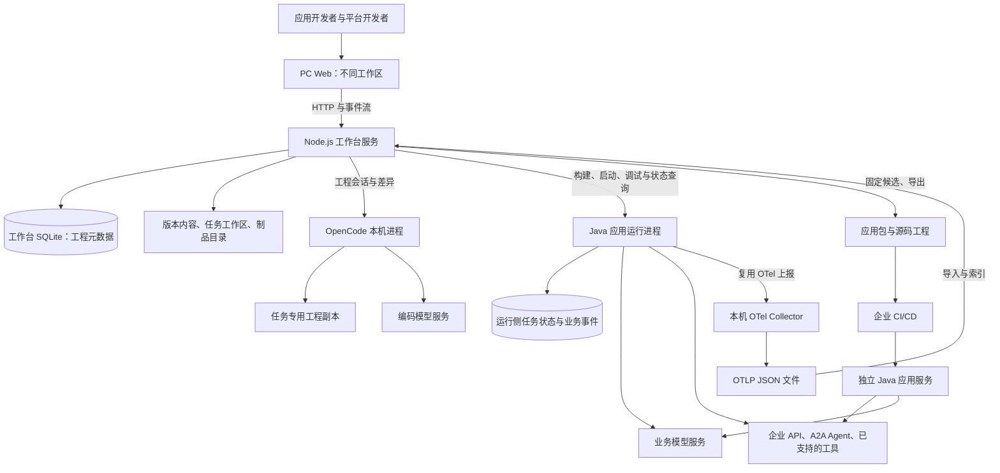
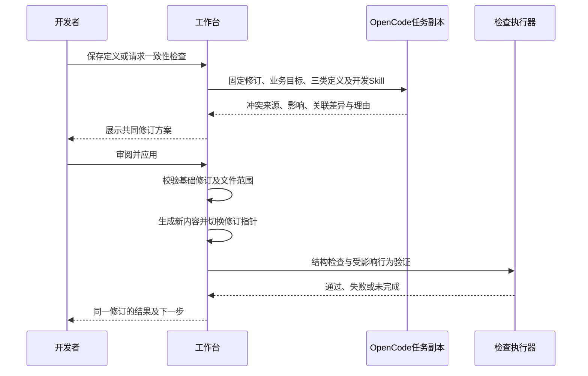
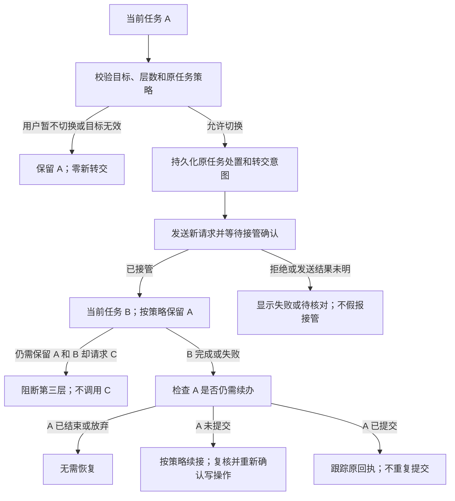

# Agent 开发工作台技术架构设计 2.0

日期：2026-10-25。状态：**统一架构设计草案，供实施前讨论；尚未开发或集成验证。**

依据：[PRD 2.0](Agent开发工作台_PRD_v2.0.md)、[交互设计](Agent开发工作台_交互设计_v2.0.md)及[MOA 业务规则与固定源码分析](MOA业务Agent分层与转交规则分析.md)。原第二、三阶段合并为 **DEV-02 完整开发工作台**，两角色共用工程模型、后端和交付链。旧项目已归档，本文从新需求定义方案，不以旧代码为实现起点。

本文中的目录、接口、数据结构和模块名称均是拟议契约；当前仓库仍只有文档与静态 Demo。下文区分用户已确定的产品规则、推荐技术方案和需要技术验证的依赖。

## 1 架构结论与边界

采用“**PC Web 工作台 + Node.js 模块化服务 + OpenCode 工程进程 + Java 应用运行进程**”。开发态优先本机运行，不要求 Docker、Kubernetes、Redis 或外部数据库。平台开发者维护和发行模板，应用开发者消费模板，使用同一套版本、差异、调试与交付能力。

| 事项 | 决定或建议 | 性质 |
| --- | --- | --- |
| 产品阶段 | DEMO-01 与 DEV-02 两阶段；DEV-02 同时覆盖平台方和应用方 | 用户已确定 |
| 任务层数 | 含当前任务共两层 A→B，B 结束后只恢复未结束的 A；保留 A/B 时禁止第三层 | 用户已确定 |
| 定义冲突 | OpenCode 联合处理业务范围、System Prompt 和 Skill 指导，审阅应用后复核 | 用户已确定 |
| 本机方式 | Node.js 工作台、OpenCode 和 Java 以本机进程运行 | 用户方向；本文给出实现建议 |
| 服务拆分 | 一个 Node.js 模块化服务负责开发态控制；Java 负责业务运行；首期不拆成多套微服务 | 本文推荐 |
| 工作台存储 | 本机 SQLite 存元数据，文件系统存不可变内容、源码和制品；不共用业务运行数据库 | 本文推荐 |
| 开发态观测 | 复用 Java OTel 上报；本机 Collector 导出文件，工作台导入查询；可替换为企业观测服务适配 | 本文推荐，须验证固定组件版本 |
| 交付 | Java 服务及外部 Skill/配置资产可以脱离工作台和 OpenCode 运行 | PRD 要求 |

不纳入首期完整产品的内容：生产托管平台、集群编排、工具市场、任意不可信插件执行、完整 IAM/共享审批平台、多层任务栈及未经验证的跨 Java 重启自动恢复。后置管理能力不免除服务端角色检查、企业业务权限、确认和幂等。

## 2 总体结构与运行拓扑



图中 Collector 在启用本机 Trace 时启动；也可通过查询适配器读取已有企业观测后端。导出的服务不依赖图中的工作台、OpenCode、开发工作区或本机 Collector。企业环境自行提供其声明的模型、业务系统、状态存储与观测端点。

| 进程/存储 | 生命周期及职责 | 不承担的职责 |
| --- | --- | --- |
| Web + Node.js 服务 | 同一入口提供静态资源、API、SSE；服务层划分工程、能力、助手、运行、验证和制品模块 | 不持有业务任务的权威执行状态 |
| OpenCode | 按工程任务启动或复用专属会话；工作目录为固定修订的任务副本，空闲后回收 | 不直接改已审阅工程，不办理终端用户业务 |
| Java 应用 | 按固定执行快照启动；接入 Core/Runtime、业务模板和企业能力 | 不依赖工作台数据库决定任务或回执归属 |
| Collector | 本机观测子进程；固定协议及文件输出配置，单独健康检查 | 不判断业务成功、权限或任务恢复 |
| 工作台 SQLite + 内容目录 | Node.js 单一写入者，存工程与开发活动；SQLite 文件置于本机文件系统 | 不与 Java 共享同一数据库文件 |
| Java 状态存储 | 运行侧单一写入者；首期可采用独立 SQLite/JDBC 存储适配，随应用部署 | 不由网页或 OpenCode 直接修改 |

端口以配置和启动时登记为准：工作台示例 `127.0.0.1:8768`，OpenCode/Java 使用分配的本机端口，Collector 使用约定的 OTLP 端口；示例端口不是硬编码契约。启动前检查占用，记录进程标识、归属、健康状态和日志，不误停其他项目进程。

技术基线建议：前端 TypeScript/React，工作台 Node.js/TypeScript；浏览器代码编辑可使用成熟编辑器组件，流程图由声明投影生成。Java 先按来源代码的 JDK 17 编译基线讨论，最终以所选 Core/Runtime/范式发行物的兼容清单为准。前端和数据库驱动的具体版本在实施基线锁定，不以本文宣称已完成兼容验证。

## 3 模块、责任及角色视图

| 模块 | 核心职责 | 主要契约 | 单一牵头责任 |
| --- | --- | --- | --- |
| 双角色工作区 | 平台工程/发行/诊断；应用列表、编排、文件、调试、轨迹与版本 | 当前用户、工程标识、修订、可编辑范围 | 前端负责人 |
| 工程与内容服务 | 工程创建、版本、文件、结构化配置、草稿及并发保护 | `ProjectRevision`、基础修订校验 | 工作台后端负责人 |
| 范式与能力登记 | 范式/开发 Skill/模板/工具版本、开放契约和来源 | `TemplateRelease`、`CapabilityVersion` | 平台能力负责人 |
| Coding 服务 | OpenCode 生命周期、开发 Skill 注入、事件、差异、冲突修订 | `EngineeringJob`、`ChangeSet`、一致性检查 | 工程工具负责人 |
| 运行与构建管理 | 依赖检查、构建、启动/停止、调试连接、日志归属 | `Build`、`Run`、进程句柄 | 运行集成负责人 |
| 业务运行适配 | MOA 业务模板、路由、Skill/操作、两层任务、确认/回执 | `ApplicationSpec`、运行协议及任务契约 | Java/范式负责人 |
| 观测与验证 | Trace 导入/查询、只读回放、测试集和证据关联 | `RunEvent`、`TraceRef`、`ValidationReport` | 验证与观测负责人 |
| 制品与发行 | 平台发行、应用候选、导出、兼容升级与交付验证 | `ReleaseManifest`、`Candidate` | 交付负责人 |

角色决定视图和可改对象，不产生两套后端：平台方可改范式工程、公共能力和开发 Skill；应用方只改其应用及模板开放部分。应用专用 Skill/工具在应用工程内管理，公共化须形成有维护方、版本及验证的公共能力。模板固定引用发行版本，新发行不静默覆盖旧应用。

首期本机开发可保留显式模拟身份选择，服务端仍检查所选开发身份的操作范围；这只验证开发角色路径，不证明企业身份认证。对外共享部署须接可信登录主体和基本项目授权接口，不能接受客户端自报角色即获得平台权限。无需恢复旧 Demo 的手工访问令牌入口，也不在首期建设完整 IAM 平台。

## 4 工程、版本和数据模型

### 4.1 对象与事实来源

| 对象 | 关键标识与内容 | 权威来源 |
| --- | --- | --- |
| 范式发行 | `patternId/version/digest`、Core/Runtime 兼容范围、固定机制及扩展 SPI | 平台发行清单 |
| 开发 Skill 包 | `devSkillId/version/digest`、角色、指南来源、适用范式 | 平台固定版本资产 |
| 模板发行 | 工程骨架、范式/开发 Skill/能力锁定、开放字段与检查集 | 不可变 `TemplateRelease` |
| 应用定义 | `appId/revisionId`、角色行为、业务范围、Skill、工具/Agent 引用、转交策略 | 当前已保存 `ProjectRevision` 内容 |
| 内容标识 | 对规范化文件清单、内容及固定依赖计算摘要 | `contentDigest`；不含日志、时间或执行 ID |
| 工程任务 | `jobId/baseRevisionId/sessionId`、实际模型/Skill 版本、尝试及差异 | 工作台任务记录 |
| 调试运行 | `runId/revisionId/artifactDigest/testInputId/environmentRef` | 工作台运行记录；业务状态仅为运行侧投影 |
| 业务任务 | `businessTaskId/conversationId/coreSessionRef`、调用和确认关联 | Java 运行侧状态库 |
| 候选与验证 | 内容、依赖、环境、用例、实际结果及制品摘要 | 固定候选和不可变报告 |

`businessTaskId`、A2A `taskId/contextId`、Core session、OpenCode session、`runId` 和 `traceId` 分开保存，通过映射关联，不能用一个“任务 ID”替代全部对象。

### 4.2 同一份定义，多个编辑入口

推荐应用工程内容组织如下，仅为设计示例：

```text
application/
  app.yaml                         # 元信息与固定依赖引用
  instructions.md                  # 应用层 System Prompt
  orchestration/business-scope.json
  orchestration/handoff.json        # 接管、原任务处理、续办
  skills/<skill-id>/SKILL.md        # 业务 Skill 内容
  capabilities/manifest.json       # 工具/Agent/Skill 引用及操作约束
  adapters/                        # 模板允许的映射/Java 局部扩展
  tests/                           # 场景输入与业务断言
  dependencies.lock.json           # 发行版本及内容摘要
```

表单和文件编辑都提交同一工程修订，流程图读取已保存声明；不存在额外的可视化配置数据库。自由代码不能可靠反推为静态流程时，图中显示“代码扩展，需运行验证”，不能补画成已证明的执行路径。

这些文件是工作台自己的声明格式，**不是现成 MOA 原生配置**。由版本化 `ApplicationCompiler/MoaBusinessAdapter` 映射到实际支持的运行配置、注册对象和资产；编译诊断必须区分引用/类型错误、语义冲突及运行适配不支持。

### 4.3 修订提交与持久化

保存使用 `baseRevisionId` 做比较更新；基础修订已变化则返回冲突，不能覆盖。多文件变更先写入新的不可变内容目录，验证摘要后一次性更新 SQLite 的当前修订指针和事件记录。失败不切换指针；未引用临时目录按保留策略回收，避免把文件系统与数据库两次写入假称为同一个原子事务。

使用本机 SQLite 的建议依据是部署简单且可支持并发读取；WAL 仍有单写者和本机文件系统约束，不能直接共享到网络盘。工程写入由服务排队，后续多人/多主机部署再通过存储接口迁移，不增加当前数据库集群。[SQLite WAL](https://www.sqlite.org/wal.html)

## 5 平台发行与应用开发的完整链路

1. 平台方创建范式工程，固定 Core/Runtime、业务模板、公共工具和开发 Skill。系统检查依赖、开放契约及基础测试，发布不可变模板版本。
2. 应用方从该版本创建应用，固定依赖来源；描述“员工福利助手”需求后，OpenCode 提出业务范围、Skill、连接映射、代码及验证计划。
3. 开发者审阅差异并应用新修订；编辑表单或代码都回到该修订。范围、System Prompt 与 Skill 冲突统一由助手处理。
4. 从有效草稿自动创建执行快照，编译适配后的 Java 应用；连接真实模型和独立 Mock 业务服务，记录运行、外部状态和 Trace。
5. 平台方从同一运行证据诊断模板或公共能力问题，修复后发布新版本；应用方选择升级并核验差异，不影响旧候选。
6. 测试满足适用条款后固定应用候选，导出 JAR/资产包及源码工程，在无工作台环境下独立验证。两角色都参与同一闭环，预置模板不能长期替代平台侧能力。

## 6 OpenCode、开发 Skill 与定义冲突

### 6.1 接入方式

推荐由 Node.js 通过 OpenCode Server 的 HTTP API 或对应 SDK 控制会话，不通过抓取终端文本驱动业务。官方提供会话、异步消息、取消及 SSE 事件入口；具体请求体、权限回复格式和重连行为须对锁定版本的 `/doc` 核验。[OpenCode Server](https://opencode.ai/docs/server/)、[SDK](https://opencode.ai/docs/sdk/)

工程任务状态为 `queued → running → awaiting_review → applying → validating → succeeded/failed/cancelled`。OpenCode 接收请求或 SSE 断开均不等于完成；根据实际会话状态、输出差异和检查证据判断。取消先请求终止原会话并检查子进程；不重复启动同一生成任务。

每个任务从固定修订创建专用工程副本，记录实际 OpenCode/模型/开发 Skill 版本。OpenCode 只能修改任务副本；工作台从副本提取差异，不允许它直接写当前已审阅内容或发布候选。

### 6.2 范式知识注入

把固定版本开发 Skill 放入任务工程的 `.opencode/skills/<name>/SKILL.md`，携带必要参考资料和检查配方。OpenCode 的原生 Skill 按需发现和读取；文件存在只能证明已提供，实际使用须记录 Skill 工具调用或受控显式注入内容。[OpenCode Agent Skills](https://opencode.ai/docs/skills/)

每类任务指明应读取的开发 Skill 和固定来源摘要；未装载所需指导时不能标为符合范式。平台开发任务得到公共机制和发行指导；应用任务得到所用模板的装配与开放扩展指导。业务 Skill 放在应用资产中，不能混作开发工具权限配置。

配置 OpenCode 的 `allow/ask/deny` 规则，明确文件、命令和外部工具范围；任务环境不继承无关全局 Skill、项目规则或凭据。具体隔离方式需要对选定版本验证；默认全局自动批准不可作为角色边界。[OpenCode Permissions](https://opencode.ai/docs/permissions/)

本机进程共享操作系统用户权限，工作目录和工具规则不等于容器或 OS 沙箱。首期仅支持可信开发工程，严格验证差异路径、符号链接和允许修改范围；不声称可安全运行任意第三方代码。企业 API 权限和业务确认继续由运行侧执行。

### 6.3 冲突处理与变更应用



没有“业务范围永远覆盖 System Prompt”这样的文本优先级。助手根据当前业务目标、模板契约和固定约束协调三处内容；目标有歧义时向开发者澄清。修复拒绝、助手失败、应用失败或建议过期均保留原修订。未解决的已识别冲突允许存草稿，但阻止受影响路径真实运行与该修订交付。

结构、引用、角色和工具约束由确定性校验器处理；跨文本语义由 OpenCode 分析，修复后还需实际行为验证。只在语义或相关依赖变化时重做对应模型检查，稳定修订复用其有效结论；助手的“已完成”文本不能清除硬性失败。

## 7 Java 应用与能力装配

推荐以公开 API/SPI 构建独立的业务模板适配模块，优先避免改 Core/Runtime 内部。平台可开发新模板和公共扩展，应用只修改开放资产；所需扩展点若当前版本没有公开契约，先验证并形成适配方案，不能直接承诺接通。

| 配置对象 | 执行映射 | 必须验证的边界 |
| --- | --- | --- |
| 业务范围与输入归属 | 业务模板结合当前任务，以模型判断提出 `CONTINUE / SKILL / DELEGATE / HANDOFF / CLARIFY` 决策 | 输出 Schema、目标引用、当前任务关联及不确定性；不能以关键词预演替代真实语义 |
| System Prompt | 应用角色行为 + 模板固定指导 + 工具说明 + 当前上下文 | 组合顺序和来源可查，文本不能放宽固定约束 |
| 业务 Skill | 固定资产及其允许操作，由业务模型选择步骤，Rail/代码执行校验 | 原任务归属、多步等待、确认及终结条件 |
| A2A Agent/工作流 | 已登记服务与协议适配，保留远端 task/context/call 关联 | 服务可达、允许目标、等待/续接、重复消息及控制信号 |
| HTTP 工具与映射 | 固定接口契约、连接引用、输入输出及局部适配 | 身份、参数、响应结构、超时、幂等和副作用 |
| MCP 或脚本工具 | 模板声明的具体适配器，接通后才能开放 | 不以类型枚举宣称实现；脚本解释器/沙箱依赖必须明确 |

首个集成闭环建议采用业务 Skill + HTTP 工具 + 受控 A2A Mock。Python/MCP 在同一 DEV-02 内按已声明支持范围补齐；未接通的类型不得运行或交付。不需要用一个独立编排引擎重复实现 MOA 的模型循环。

MOA 固定快照的 Native Skill 默认路径依赖 `SandboxScriptRunner` 和会话 Sandbox。无 Docker 不等于该依赖已消失。若首期采用本地脚本进程，须新增明确的 `SkillScriptRunner` 适配、解释器版本、输入输出契约及超时限制并单独验证，标明可信本机执行；不能把 Node 子进程直接当成现有 Runtime Sandbox。

## 8 两层任务恢复与 A2A

### 8.1 状态归属和计数

**业务状态的权威写入方是 Java 运行侧。** 推荐增加业务模板级 `BusinessTaskCoordinator`，在 Core 调用边界管理任务归属和转交；工作台只查询或提交明确操作。该协调器随应用包交付，不能仅存在于 Node.js，否则停工作台后任务恢复就会失效。

两层按业务任务计数：一个未结束原任务 A，加一个当前任务 B；Skill、内部子执行和 A2A 协议 task 不自动占业务层。每个业务任务关联独立 Core 会话/续接上下文；不把 A 的状态直接覆盖成 B，也不依赖一份聊天摘要恢复 A。

| 记录 | 主要字段与作用 |
| --- | --- |
| 会话处理位置 | `conversationId/currentTaskId/retainedTaskId/version`，约束最多一个保留任务 |
| 业务任务 | 业务状态、应用修订、所属 Core 会话、恢复位置、输入及操作版本 |
| 转交尝试 | `handoffIntentId/sourceTaskId/targetServiceId/targetTaskRef/status`，关联请求、接管确认和失败 |
| 外部操作 | `operationId/idempotencyKey/requestDigest/remoteTaskRef/resultStatus`，区分未提交、处理中和结果未知 |
| 确认凭据 | 原任务、操作、参数摘要、执行修订、业务主体、期限和一次性标识 |
| 事件日志 | 单调序号、事件 ID、任务/调用关联、前后状态、结果；用于查询和只读回放 |

任务执行状态与对话处理位置分开：A 不再是当前对话，不意味着已发出的业务操作停止。A 可以在保留位置继续等待回执并完成；其回执不能抢占 B。

### 8.2 转交、恢复与失败顺序



按会话串行处理状态转换，并使用版本校验，防止用户输入和回执同时修改处理位置。新请求先交当前业务上下文；补参/确认继续原等待点，明确业务切换才进入转交。模型正在计算时，新消息排队至声明的安全边界，不承诺冻结任意 Java 调用栈；已经发出的远端写操作不得伪装暂停。

接管前先保存 A 的处置、B 的预留记录和转交意图，再通过持久化发送记录驱动外部调用。网络与数据库不是同一事务：结果未明时用原调用标识查询或去重重试，不能直接新建第二个远端任务。只有实际接管确认后才显示 B 已开始；若目标拒绝，保留的 A 仍可继续，已明确放弃的 A 不自动复活。

B 结束后，自动续办表示回到 A 的复核位置，不表示自动执行写操作。检查资源、资格、参数和确认是否仍有效；确认绑定旧参数或旧修订时失效。A 已提交的操作只查询原业务/调用标识，重复回执去重并遵守终态约束。

### 8.3 恢复支持的首期技术建议

| 情况 | 建议行为与边界 |
| --- | --- |
| 浏览器刷新/离开后回来 | 从运行侧查询 A/B 和等待点；不靠 localStorage 恢复真实任务 |
| Node.js 控制服务重启 | 保留工程和任务记录；重新核验本机 Java 实例标识/健康与实际状态，不因丢失连接重复启动业务 |
| Java 实例仍存活，A→B→A | 依靠任务专属会话、保存的恢复位置和操作关联续接；按 V2-AC-35 验证 |
| Java 进程重启 | 首期建议不自动重驱未完成模型/Skill；保留持久化记录，标“需核对”，查询原远端结果；有完整检查点兼容验证后再开放自动恢复 |
| 超时/未知写结果 | 不创建新的写操作；保留原幂等/业务标识，进入查询核对路径 |
| 第三层、循环或失效目标 | 在新调用前阻断并显示原因，A/B 状态与续办入口保留 |

持久化元数据不等于保存了可恢复的模型/框架检查点。Java 重启策略属于本文建议，须在实施范围讨论中确认；不能以“含当前任务两层”推导跨进程恢复已经支持。

### 8.4 A2A 适配

A2A 服务的调用响应、流、查询或推送用于观察同一次远端任务；推送回到 Runtime 的回调入口后，应按原 task/context/call 关联续接，不能解释为重新调用应用 Agent。[A2A Specification](https://a2a-protocol.org/latest/specification/)

协议版本、Agent Card、返回模式和输入请求能力记录在服务适配清单中。来源 Runtime Java `c42eea2b` 的推送发送器仅推送完成/失败，不能据此声称中间确认已异步贯通。首个闭环可采用经适配验证的流式/查询路径接收 `input-required`；若目标只支持推送中间状态，须补齐该链路后开放该能力，不能悄悄降为完成态通知。

两层上限由同一对话的协调器统一计数，转交携带关联标识与剩余业务层数；B 再请求切换时必须回到该协调器核验。普通内部工具调用不消耗业务层。远端 Agent 若不接受此控制契约，只能按已验证的委派能力接入，不能宣称其任意自主转交都满足两层恢复；拒绝超限时应证明 C 的外部调用数为零。

业务控制信号使用版本化结构，区分“结果”“等待补参/确认”“委派”“范围外接管”。验证来源、允许目标、任务关联和循环，不能凭任意业务字符串跳转。MOA 的旧挂起展示记录和 Native Skill 的 `INTENT_SWITCH_REJECTED` 不能当作本方案已实现，也不能直接删除保护逻辑；必须验证新的协调边界与底层等待/续接能共同工作。

## 9 OpenTelemetry、步骤查看与只读回放

复用 Core/Runtime 的既有 OTel 采集与导出能力，不重写采集 SDK。推荐本机方案：**Java OTLP → 固定版原生 Collector → 未压缩 OTLP JSON 行文件 → 工作台导入器 → Trace 索引与页面**。Collector 可以与应用同机运行；OTLP 负责传输，不自带查询后端。[Collector 本机部署](https://opentelemetry.io/docs/collector/deploy/agent/)、[OTLP 规范](https://opentelemetry.io/docs/specs/otlp/)

File Exporter 支持按行 OTLP JSON 与文件轮转，但其 trace 支持仍标为 alpha。应锁定 Collector/Exporter 版本，验证导入夹具和轮转边界；这是开发态采集路径，不替代企业生产观测平台。[File Exporter](https://github.com/open-telemetry/opentelemetry-collector-contrib/blob/main/exporter/fileexporter/README.md)

导入器按文件标识和偏移保存检查点，完整行才入库，重读按 `traceId + spanId` 去重；轮转后不从头重复产生业务事件。关联至少包含应用、工程修订、制品摘要、run、业务任务、操作和 Skill/模板版本。跨 Agent 关系按真实父子或 Link 展示，不把并行任务拼成一个连续业务步骤。

**业务事件与 OTel Span 分开保存。** Java 的任务转换、确认、提交、回执和失败事件是步骤回放的依据；Span 提供调用耗时与诊断。未采样、载荷截断、导入延迟或事件缺失时显示缺口，不用当前配置补历史内容，不把 Span 状态自动等同于业务成功。

回放读取固定运行的事件与快照，按任务内序号推进；跨任务显示关联而不虚构全局严格时间顺序。回放组件不接入执行器：播放、跳步和查看参数都不得发起模型、工具、A2A、确认或订单写入。验收比较回放前后的实际调用计数和业务状态。

Trace 载荷按字段策略脱敏和截断，凭据仅存引用。平台方按项目授权查看跨应用诊断；应用方只读自己有权限的运行。工作台自身的 OpenCode/构建任务作为开发活动独立展示，不能冒充业务 Trace。

## 10 构建、版本发行与企业交付

### 10.1 构建与验证身份

构建键由源码、编译依赖、编译参数和工具链摘要组成；资产键覆盖 Skill、配置与映射；执行 ID 和测试输入另存。只改外部 Skill/配置时，目标是复用已验证编译产物，但仍执行内容装载和相关行为检查。实际是否达到零 Java 编译须通过 V2-AC-21 验证，不能先写成已有能力。

平台发行冻结范式、开发 Skill、模板、公共能力和开放契约。应用候选冻结其实际引用版本、源码/资产、制品、连接环境引用、测试集和报告。候选固定后再编辑只产生新修订；下载旧候选不得夹带新文件。兼容升级形成显式差异与回归，不自动覆盖在途会话和历史候选。

### 10.2 两类交付物

```text
app-bundle/
  app.jar
  assets/skills/                  # 固定业务资产
  config/application.example.*   # 无秘密的配置样例
  manifest.json                  # 内容、依赖、构建及验收摘要
  bin/                           # 启停/健康检查入口
  verification/                  # 用例、输入及验证说明
  README.md
source-bundle/
  source/                        # 可构建的应用源码与资产
  build/                         # 固定构建入口和依赖清单
  verification/
  manifest.json
```

工程依赖通过固定发行仓库或声明的离线包获取；不引用本机 Maven/源码的偶然绝对路径。秘密由企业环境注入，原始 Key、开发用户凭据和工作台内部路径不得进入交付包。

**独立运行的硬性验证：** 在新目录/独立进程运行导出服务，停止工作台、OpenCode 和开发专用代理，保留所声明模型、企业接口、状态存储及观测依赖，直接发业务请求并完成等待/确认/回执流程。不能由 Demo JSON 下载或本机 Runner 成功替代这一步。

## 11 拟议接口与代码边界

以下为新接口的设计契约，不是当前仓库已有 API。

| 接口组 | 拟议动作 | 关键约束 |
| --- | --- | --- |
| 身份与工程 | `GET /api/context`；创建/列出工程、应用、角色可编辑范围 | 服务器解析主体与项目范围，不信任客户端自行提升角色 |
| 范式/模板/公共能力 | 工程维护、检查、`POST /api/templates/{id}/releases` | 平台角色、固定版本、检查证据；不原地改发行物 |
| 修订与文件 | 读取定义/文件，`POST /api/projects/{id}/revisions` | 基础修订、允许路径、引用/Schema 校验；多视图同一内容 |
| Coding | 创建任务、查询事件、取消；审阅/应用 `ChangeSet` | 固定基础修订、任务副本、完整失败记录和版本保护 |
| 一致性 | `POST /api/projects/{id}/consistency-checks` | OpenCode 语义检查与程序硬约束分开，结果绑定修订 |
| 构建与调试 | 创建构建/运行、发送测试输入、查询运行状态与日志 | 固定快照、输入另存；重复请求可核对原运行，不盲目重启 |
| 业务等待操作 | 向 Java 转发补充、确认、拒绝、续办意图 | 校验原任务/参数/主体；Java 返回权威结果，网页不直接改任务状态 |
| 事件与轨迹 | 按运行查询步骤/Trace、`GET /api/events` SSE | 项目授权、游标、去重、明确缺失；回放只读 |
| 检查与交付 | 执行适用测试、固定候选、下载应用/源码包 | 内容/环境/用例一致，未通过或过期检查阻断候选 |

统一错误包含 `code/message/objectRef/revisionId/retryable`。基础版本冲突返回可定位的冲突；目标无效、越权、能力未实现、第三层请求和执行结果未知必须区分，不统一改为“稍后重试”。SSE 断线后通过服务器游标补事件，不能重新发送业务写请求来重建页面。

推荐后续代码布局为 `frontend/`、`workbench-server/`、`runtime-template-java/`、`shared-contracts/` 和 `verification/`。现在不创建这些实现目录。共享契约管理 JSON Schema、版本和兼容样例；TypeScript/Java 通过适配使用同一契约，不各自定义互不兼容的路由或任务状态。

## 12 进程、资源和失败处理

- 每个工程同时只允许一个正在应用的内容变更；编码、构建和 Java 运行使用有上限的队列/并发。达到上限则排队或明确拒绝，不淘汰等待用户的业务任务。
- Java 启动记录制品摘要、端口、实例标识和健康检查。超时先查原进程状态；进程仍活跃就继续观察，不因观察超时重新启动应用。
- 只终止本服务创建并核验归属的进程。工作台“停止调试”不是业务撤回；存在已提交操作时保留原标识与未知结果处理，不把 kill 进程当作取消远端交易。
- 临时工程、构建目录、日志和 Trace 都配置有限保留量；被候选、报告、运行或回滚引用的内容不得回收。按清单记录空间与文件数量，不默认清空整个缓存。
- OpenCode 异常保留任务副本、基础修订和失败记录；构建失败不产出可用候选；观测失联不假报业务失败或成功，单独展示观测缺失。
- 本机开发与企业部署都不将秘密写入提交、制品、日志或截图。身份、授权和执行范围在对应服务边界校验，模型判断不能授予权限。

## 13 同一完整阶段内的实施切片与验收

以下是 **DEV-02 内的工程里程碑，不是重新拆回应用阶段/平台阶段**。每个里程碑都围绕共同对象交付；先验证关键契约，再扩功能。最终完整交付需覆盖全部适用需求，未完成部分不能因里程碑通过而计为完成。

| 里程碑 | 可观察结果与退出依据 | PRD 需求 | 正式验收 | 单一牵头责任 |
| --- | --- | --- | --- | --- |
| M1 工程与双角色供给/消费 | 平台维护并发行最小模板；应用创建并锁定版本；两角色权限和升级边界可查 | V2-FR-01、02、03、13、18 | V2-AC-01、02、18、19、22、25 | 工作台后端负责人 |
| M2 工程助手与共同修订 | 两角色实际装载各自开发 Skill；OpenCode 生成可审阅差异，统一处理三类定义冲突，过期建议不覆盖 | V2-FR-05、17、19、25 | V2-AC-03、06、24、26、36 | 工程工具负责人 |
| M3 Java 业务与任务闭环 | 平台提供真实工具/范式，应用调用；验证 A/B、第三层阻断、确认、迟到回执、Skill 归属及未知结果 | V2-FR-04、06、08、14、21、22、23 | V2-AC-04、08、09、10、11、12、20、28、29、30、31、32、33、35 | Java/范式负责人 |
| M4 可解释执行与诊断 | 应用看步骤/流程，平台定位同一版本失败；真实 OTel 查询及只读回放不产生业务副作用 | V2-FR-07、20、24 | V2-AC-05、07、27、34 | 验证与观测负责人 |
| M5 验证、构建与独立交付 | 平台/应用检查与候选对应；应用包和源码实际构建、独立部署；构建复用及资源保留有计数证据 | V2-FR-09、10、11、12、15 | V2-AC-13、14、15、16、17、21 | 交付负责人 |
| M6 独立复用验证 | 非原作者使用所发模板完成第二应用，记录代码改动、失败和所需支持 | V2-FR-16 | V2-AC-23 | 产品负责人 |

正式验收需要固定来源版本、环境、模型/工具调用及外部业务状态。第一批关键技术验证建议聚焦三件事：Core/Runtime 的任务隔离与续接扩展点、OpenCode 的固定 Skill 装载与差异应用、Java OTel 到查询/回放的完整链路。它们分别决定 M3、M2、M4 是否能按方案实施；不能以静态类名、成功日志或 Demo 代替结果。

## 14 来源、风险和实施前待定项

### 14.1 核查来源与证明边界

| 来源 | 本次使用的事实 | 边界 |
| --- | --- | --- |
| 用户确认及 PRD 3.7/3.8/10 | 两阶段、两角色统一、含当前任务两层、OpenCode 统一修订 | 已确定产品规则；实现待验证 |
| `agent-solution@1a92265cd238406054f24a069bc08c5e7af978e3` | MOA `IntentRoutingRail` 挂起旧计划；`SkillActionRail` 校验确认并拒绝 Skill 内意图切换；`SandboxScriptRunner` 调用 Sandbox；MOA POM Java 17 | 本次重新读取固定 Git 文件；未运行该快照测试或模型链路 |
| `agent-core-java@2a080017` | POM Java 17 编译基线；既有 OTel 扩展分析见 PRD 来源表 | 未证明与任意 MOA/Runtime 组合兼容 |
| `agent-runtime-java@c42eea2b23433f83f7d392119c4008fcaf1da9a1` | `HttpPushNotificationSender` 仅推送 completed/failed；`A2AEnabledServeOrchestrator` 有中断/续接处理 | 本次静态核查；中间状态推送和业务 E2E 未验证 |
| OpenCode 官方 Server、SDK、Skills、Permissions 文档 | HTTP/事件接入、开发 Skill 发现及权限规则的接口依据 | 在线资料查阅于 2026-10-25；实施前固定具体版本与 API Schema |
| OpenTelemetry 官方与 Collector File Exporter 文档 | 同机 Collector、OTLP 传输及文件导出格式依据 | 尚未在新项目接通；alpha 组件须固定版本及夹具验证 |
| SQLite 官方 WAL 文档 | 本机存储的并发与部署边界 | 不据此宣称已完成工作台数据库或多机部署 |

来源代码路径与符号索引详见[MOA 专项分析第 5 节](MOA业务Agent分层与转交规则分析.md#5-版本与源码证据)。`agent-solution` 当前 `common` 检出不包含 MOA 模块，所以不能只按当前目录是否存在判断能力；本方案固定读取上述历史内容，不修改外部仓库。

### 14.2 关键风险与处理

| 风险 | 处理方式与失败时结果 |
| --- | --- |
| Core/Runtime 没有足够公开的等待/恢复扩展点 | 先以固定版本验证 `BusinessTaskCoordinator` 与会话隔离；缺扩展点则明确适配改动并讨论，不能把旧挂起展示当完整恢复 |
| OpenCode 语义修订不稳定或遗漏冲突 | 固定任务输入/Skill/版本，保留全部尝试；硬性断言不降级；未解决冲突继续阻断相应运行/交付 |
| 无 Docker 时 Native Skill 脚本路径不可用 | 首个闭环选择已支持能力；新增本地 runner 单独实现和验证，明确可信执行边界 |
| A2A 中间输入通知不闭环 | 按目标能力选择经验证的流/查询路径，或补齐推送；不把终态回调算作中间确认能力 |
| Collector 文件格式或轮转变化 | 固定版本、导入夹具、偏移及去重；故障显式显示缺失，业务事实仍以运行侧事件为准 |
| 工作台与运行侧各维护一份任务状态 | Java 是权威源；Node 只存带来源和序号的投影，不反向改写原任务 |
| 导出包隐含工作台代理依赖 | 在独立目录停止开发态服务后验收；失败不能发布为独立企业服务 |

### 14.3 实施前需要固定的具体参数

1. Core/Runtime/MOA 及 OpenCode/Collector 的发行版本和兼容组合；MOA 固定参考提交不是自动选定的生产发行物。
2. 首个 i豆接口、模型、业务主体和企业授权方式；Mock 只用于声明的联调证据，真实企业 E2E 单独组织。
3. 两层恢复在 Java 重启后的声明、等待期限、外部未知结果查询契约；本文建议首期不自动重驱，必须保留核对入口。
4. 首机的进程并发、日志/Trace/临时目录保留量，以及可接受的查询延迟；先实测，再设阈值，不虚构性能收益。

这些参数影响技术方案定版和首个切片，不改变两角色统一、任务两层和 OpenCode 统一处理冲突的产品决定。本次交付止于架构文档和 PRD 同步，不创建真实开发分支或实现目录。
