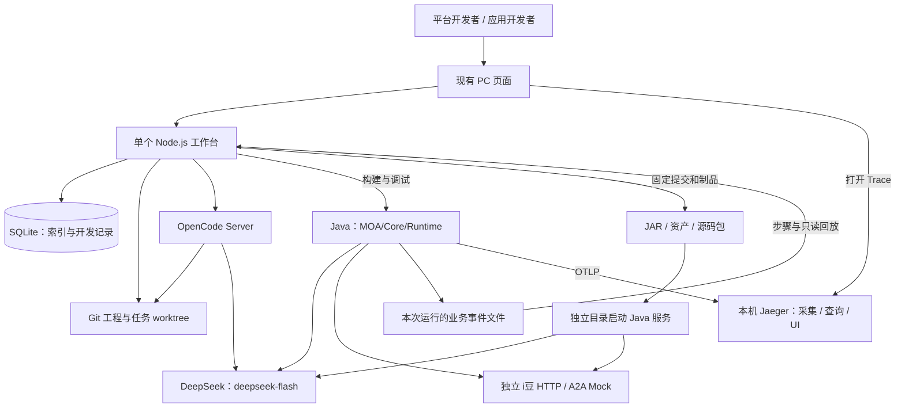
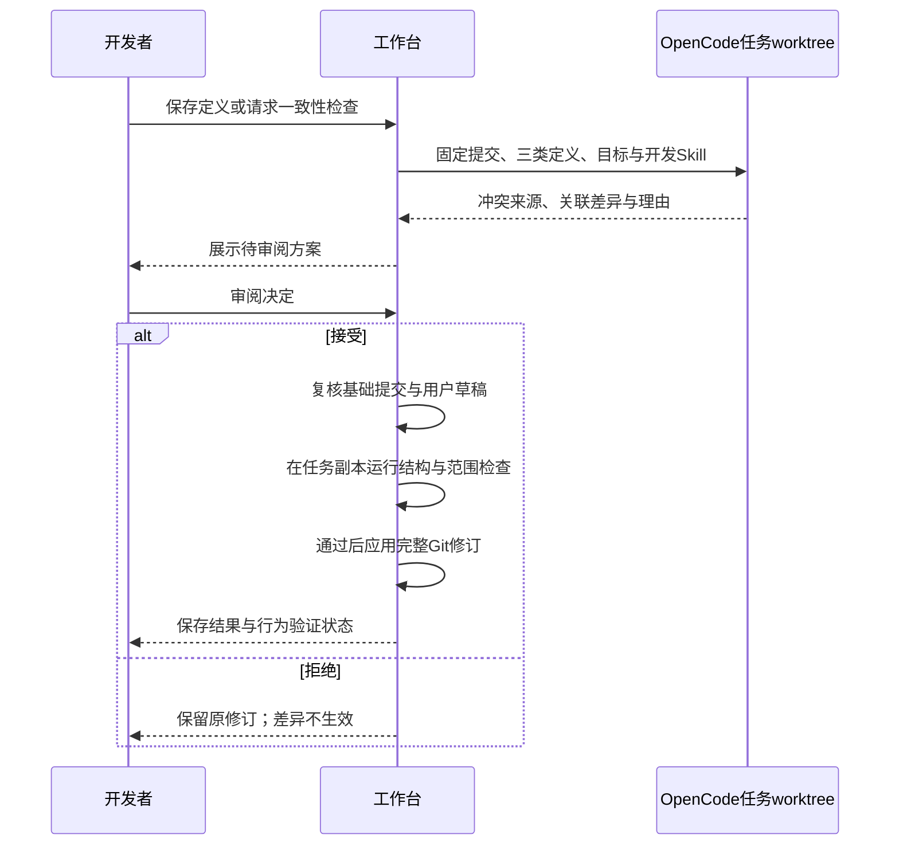
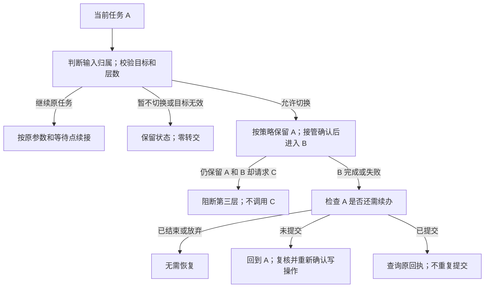

# Agent 开发工作台技术架构设计 2.0

日期：2026-10-25。修订：**Demo 优先，复用成熟组件，收缩自研范围；增加 DeepSeek 测试配置。** 状态：实施前设计；已有静态 Demo，本文真实工作台尚未实现。DeepSeek 单次 API 连通性已单独验证，证明边界见第 11 节。

依据：[PRD 2.0](Agent开发工作台_PRD_v2.0.md)、[交互设计](Agent开发工作台_交互设计_v2.0.md)及[MOA 固定源码分析](MOA业务Agent分层与转交规则分析.md)。产品仍为 DEMO-01 与 DEV-02 两阶段，原第二、三阶段合并。本文把 **DEV-02 的首个交付切片**定义为双角色可运行 Demo，不增加第三个产品阶段，不删减完整产品验收。

## 1 本次设计取舍

首个结果是：**平台发布一个 MOA 模板 → 应用方创建福利应用 → OpenCode 辅助修改并审阅 → Java 办理 i豆业务 → 查看轨迹和任务续办 → 导出后独立运行。** 模型和 Java 执行真实接通，企业业务接口使用明确标识的独立 Mock。

| 保留或简化 | 首个可运行 Demo 的选择 | 后续再做 |
| --- | --- | --- |
| 两个角色 | 同一个 PC 页面入口和后端，按身份显示不同工作区和可改对象 | 企业登录、细粒度共享审批和完整 IAM |
| 本机运行 | 一个 Node.js 服务、OpenCode、一个活动 Java 应用和本机 Jaeger | 集群、微服务拆分、生产托管 |
| 工程版本 | Git 提交/worktree，SQLite 只存索引和开发活动 | 自研不可变内容库、通用内容回收与跨版本证据复用 |
| 模板和装配 | 一个 MOA 模板，一套配置 Schema，一个直接适配器 | 多范式编译框架、任意插件和工具市场 |
| 两层任务 | 含当前任务共 A/B 两层；同一 Java 进程内续办 A | 跨重启自动恢复、通用分布式任务调度 |
| 观测 | Java OTel 直接接本机 Jaeger；业务事件驱动只读回放 | 自研 Trace 导入器/索引库、企业观测查询适配 |
| 构建和交付 | 固定构建命令，正常完整构建，导出 JAR/资产/源码 | 智能缓存、零 Java 编译、自动兼容升级 |
| 测试模型 | 默认 `deepseek-flash`，编码和业务调用分别记录 | `deepseek-v4-pro` 显式对比；不自动切换模型 |

已确定的产品规则继续适用：Skill 属于当前业务任务，不新增独立待办；A→B 后只恢复未结束的 A，保留 A/B 时阻断第三层；业务范围、System Prompt 和 Skill 指导冲突由 OpenCode 联合提出修订。审阅前不生效，未解决冲突阻断受影响运行和该修订交付。

本次只修订文档、保存本地测试配置并执行一个模型 API 探测，不创建真实开发分支或实现目录。后续实施先完成第 13 节的小范围技术验证。

## 2 成熟组件与本机拓扑

| 部分 | 首选方案 | 选型边界 |
| --- | --- | --- |
| PC 页面 | 沿用现有 Demo 交互，逐页替换模拟 API | 不以前端框架迁移为前置；代码编辑沿用或接成熟编辑组件 |
| 工作台后端 | Node.js + TypeScript + Express 5，一个服务 | 普通模块和直接函数调用，不增加消息队列/通用调度框架 |
| 工程内容 | 本机 Git 仓库与 worktree | Git 负责文件版本；工作台保留审阅、草稿保护和基本版本校验 |
| 工程索引 | 单个本机 SQLite 文件，由 Node.js 写入 | 只存应用、模板索引、工程任务/运行记录及引用，不复制工程内容 |
| 编码执行 | OpenCode Server 的 HTTP/SDK、SSE、会话与 diff | 固定版本后核验 API；不解析终端输出，不重写编码循环 |
| 业务执行 | 固定兼容版本的 MOA/Core/Runtime + Java | JDK 17 是来源编译基线，组合可运行性先验证 |
| Trace | Jaeger v2 原生可执行程序，all-in-one | 一进程包含采集、查询、UI；Demo 默认内存存储，重启丢 Trace |
| 构建 | 模板已有的固定 Maven 构建入口 | 不预建一套新的构建系统或制品仓 |

Express 的接入和 Git 多工作区均有现成机制。[Express](https://expressjs.com/en/starter/installing/)、[Git worktree](https://git-scm.com/docs/git-worktree)。SQLite 置于本机文件系统；单写者由工作台串行处理，不共享到网络盘。[SQLite WAL](https://www.sqlite.org/wal.html)



Jaeger 可直接作为单个本机二进制运行，采用固定版配置接收 OTLP；Demo 不另启 Collector 或自研文件导入链路。内存模式只是开发测试选择，不能承诺历史 Trace 跨重启保留。[Jaeger 架构](https://www.jaegertracing.io/docs/2.22/architecture/)、[部署](https://www.jaegertracing.io/docs/2.22/deployment/)、[入门](https://www.jaegertracing.io/docs/2.22/getting-started/)

启动脚本只负责检查依赖、按配置启动/停止归属明确的进程、健康检查和日志位置。首期同一工程串行操作，最多一个活动调试应用；等待用户的任务不能因切换页面被杀掉。端口可配置且先检查占用，不自动停止其他项目。独立 Mock 是独立进程或服务，不能藏在工作台内部，否则无法验证导出后独立运行。

## 3 角色、模块与接口

双角色是同一产品的两种视图，不是两套后端。平台方维护 MOA 模板、范式开发 Skill、公共工具及开放范围；应用方维护自己的业务范围、System Prompt、业务 Skill、能力引用和开放代码。平台发行新版本不自动覆盖旧应用。

| Node.js 内部模块 | 直接职责 | 最小接口对象 | 单一牵头责任 |
| --- | --- | --- | --- |
| 工程与模板 | 列表、创建、文件、Git 修订、模板打包/引用 | `projectId`、`baseCommit`、`templateCommit` | 工作台后端负责人 |
| Coding 与审阅 | OpenCode 会话、事件、差异、接受/拒绝 | `jobId`、`sessionId`、`baseCommit`、结果提交 | 工程工具负责人 |
| 运行与交付 | 固定构建、启停、测试输入、业务事件、Trace 链接、导出 | `runId`、`commit`、`artifactDigest`、`traceId` | 运行集成负责人 |

页面使用 HTTP 读取/操作，助手输出使用 SSE；普通任务状态可轮询。接口按上述对象组织，不先建设通用事件总线。断线后查询原任务，不重新发送业务写请求。版本冲突、执行失败、结果未知和目标不支持分别显示。

Java 的任务状态、补参、确认和续办由运行侧接口处理；Node.js 只转发操作和展示结果。UI 的按钮状态不能替代 Java 对任务/参数/确认的校验。

本机 Demo 保留显式模拟身份切换，并按所选身份限制可操作对象；它不是可信企业登录。服务仅面向本机可信开发，不增加手工访问令牌页面。共享部署的认证和项目授权留到后续；秘密外置、文件范围检查及业务确认仍需保留。

## 4 工程版本：复用 Git

### 4.1 最小对象和关联

| 对象 | 保存什么 | 权威来源 |
| --- | --- | --- |
| 模板版本 | 模板 ID、固定提交、包摘要、依赖版本和开放范围 | Git 提交及版本包清单 |
| 应用工程 | 模板来源、已保存提交、未保存草稿 | Git + 工作区；草稿不算已验证修订 |
| 工程任务 | 基础提交、OpenCode 会话、差异、尝试和结果 | 工作台记录 + 任务 worktree |
| 调试运行 | 工程提交、制品摘要、模型设置、输入、起止状态 | 工作台运行记录 |
| 业务任务 | A/B、Core 会话、操作与确认关联 | 活跃 Java 进程；最少事件另存运行文件 |
| 交付包 | 源码提交、依赖、资产与包摘要、对应验证 | 固定输出目录及清单 |

内容版本、执行 ID、业务任务、A2A task/context、OpenCode session 和 Trace ID 分开关联。同一提交可以多次运行；不能把一次运行的成功自动计到其他输入或模型配置。

### 4.2 保存、任务副本与审阅

一个应用一个本机 Git 工程。应用保存和助手修改都经工作台串行处理；自动提交只包含本次允许的工程文件，不暂存秘密、运行输出或无关文件。界面显示版本名称即可，不要求用户操作 Git。

助手任务从已保存提交创建临时 worktree；主工程继续保留用户草稿。展示 diff 时校验允许路径、删除项、符号链接以及实际新增/未跟踪文件，不能仅凭助手摘要。审阅应用时复核基础提交和未保存修改；有冲突就拒绝覆盖。先在任务副本检查并形成完整提交，通过后由工作台切换受控工程版本；运行和导出只读取确定提交，失败时仍可定位旧版本。

Git/worktree 负责版本与副本，不等于 OS 安全沙箱，也不自动解决网页并发。首期用工程操作锁和基础提交校验，不实现分布式事务或通用内容寻址仓库。SQLite 索引可由 Git/清单核对修复，不成为另一份工程内容。

### 4.3 一套 MOA 配置和薄适配

工程包含应用元信息、`instructions.md`、业务范围/转交配置、`skills/<id>/SKILL.md`、能力引用、少量开放扩展及场景测试。表单和文件修改同一份内容；流程图读取已保存配置，草稿/旧图明确提示过期。

这些是工作台与固定 MOA 模板约定的配置，不宣称为 MOA 原生格式。首期只写一套 JSON Schema 校验和直接映射适配器，把固定字段映射到实际运行配置。暂不建设通用 `ApplicationCompiler`、多范式 DSL 或任意代码反向生成流程；开放代码无法静态解释时标记“代码扩展，需运行验证”。

## 5 双角色贯穿路线

1. 平台方修改一个 MOA 模板及开发 Skill，运行基础检查，发布带固定提交和依赖的版本包。已有版本保持不变。
2. 应用方从 MOA 模板新建空应用，再描述员工福利/i豆需求；不存在 i豆模板或预建 i豆应用。
3. OpenCode 根据该模板指导提出范围、业务 Skill、连接映射和必要代码差异；应用方可审阅、拒绝、简单手改和再次生成。
4. 保存后以固定提交构建 Java，连接 `deepseek-flash` 和独立 i豆 Mock。至少完成查询余额及一次带确认的兑换。
5. 演示范围内 Skill 调用、受控 A2A 委派、范围外接管和 A→B→A。平台方用同一运行的错误和 Trace 定位模板/能力问题。
6. 导出 JAR、Skill/配置资产和源码包。在另一个目录停止工作台/OpenCode后直接运行，业务和任务行为不依赖工作台代理。

两角色都要有实际保存、发行或消费结果，不能只切换菜单。Mock 调用也必须是真实 HTTP/A2A 请求，不能由页面预设成功代替；真实企业接口接入不在本次 Demo 的证明范围。

## 6 OpenCode 与统一修订

### 6.1 直接接官方能力

使用 OpenCode Server 的会话、消息、事件、取消和 diff 接口，工作台只实现工程上下文、角色指导、审阅与验证。最小状态为排队、执行中、待审阅、检查中、成功/失败/取消；不建设多 Agent 编码调度器。[OpenCode Server](https://opencode.ai/docs/server/)

每个任务固定工程提交、所用模型和开发 Skill。一次只运行一个工程修改任务；断线先查询原会话，取消须核实原任务停止，不能因页面超时重复调用。助手的“完成”不等于文件已修改或检查通过。

### 6.2 注入范式开发 Skill

把固定版指南和必要参考文件放入任务工程 `.opencode/skills/<name>/SKILL.md`。平台任务拿到范式/公共能力/发行指导，应用任务拿到模板装配和开放扩展指导。业务 Skill 仍在应用资产中，两类 Skill 不混用。记录实际读取指导的证据，文件存在不等于已使用。[OpenCode Skills](https://opencode.ai/docs/skills/)

采用 OpenCode 现成权限规则和工作台路径检查。首期只执行可信本地工程；固定实际生效的配置来源，避免无关全局规则/凭据干扰，不宣称 worktree 隔离了操作系统权限。[OpenCode Permissions](https://opencode.ai/docs/permissions/)

### 6.3 冲突修订流程



业务范围、System Prompt、Skill 指导没有固定文本优先级。OpenCode 联合处理，目标歧义需澄清；程序负责角色、Schema、工具范围和确认等硬约束。修复不能放宽硬约束，拒绝或应用失败保留原版本；未解决冲突可存草稿但不运行受影响路径。审阅后的行为验证必须绑定实际提交，失败继续阻断该修订交付。

## 7 Java 与能力装配

使用现有 MOA/Core/Runtime 的模型循环、工具与会话接口；Node.js 不重新编排业务模型。首个模板只开放已验证的 Skill、少量 HTTP 操作和一个受控 A2A 对端。路由输出有明确枚举及目标引用，由 Rail/代码校验；不能用任意字符串触发写操作。

| 能力 | Demo 实现范围 | 不由此推断 |
| --- | --- | --- |
| 业务 Skill | 模型按指导选择允许操作，必要时补问/确认，结果归当前任务 | 任意 Skill 包均可装载或无需适配 |
| HTTP 工具 | 固定 i豆查询/兑换/回执接口及参数映射 | 自助接入任意 API 或鉴权方式 |
| A2A | 一个受控对端，验证等待输入、结束、失败和任务关联 | 任意 Agent 可嵌套接管或推送中间状态 |
| MCP/Python 脚本 | 当前未选路径保留配置说明并标未接通 | 类型选项存在等于能真实调用 |

MOA 固定快照的 Native Skill 有 `SandboxScriptRunner`/会话 Sandbox 依赖。先验证所选调用链在本机的最小依赖；如果不可用，明确补一个限定范围的本地适配或调整首个用例，不能默默删掉保护逻辑，也不因“无 Docker”就宣称现有脚本路径可运行。通用脚本 runner 和插件生态后置。

## 8 两层任务：限定到同进程的业务状态机

**业务状态归 Java；首期只验证同一 Java 实例存活期间的 A→B→A。** 优先复用 Core/Runtime 会话与续接点，必要时在 MOA 模板补最小状态机，不先建设通用 `BusinessTaskCoordinator` 服务、持久化发送调度器或分布式恢复框架。

每个业务任务保留自己的 Core 会话/等待点；会话只维护当前任务和一个保留任务。记录任务 ID、调用 ID、参数版本、确认和已提交操作标识。Skill/内部子执行不增加业务层数；已提交待回执的 A 仍计层。Java 向页面提供只读状态及明确的补参/确认/续办入口。



按会话串行处理输入和回执；模型执行中收到的新消息排到安全边界，不冻结任意调用栈。接管失败不能假报 B 已开始。超时或写结果未知时保留原调用标识并查询，不自动重发写操作。迟到回执只更新所属 A，不抢占当前 B；用户放弃未提交任务后不能将其复活。

新转交前保存最少的任务/操作关联事件，足以事后核对；事件文件不承担框架检查点或自动重驱。Java 重启后未完成运行标记中断/需核对，保留已提交操作标识供查询，不承诺自动恢复。浏览器刷新则查询仍活跃的 Java，不依赖 localStorage 恢复真实业务。Node.js 重启后先核验原 Java 进程，不能再启动重复运行。

A2A 响应、流、查询或推送都关联同一次远端 task/context/call。首个受控对端选一种经验证的等待/续接方式；Runtime Java 来源快照仅有终态推送的证据，不能据此宣布中途确认已贯通。A/B 上限由本对话的 Java 状态机控制；对端请求再接管必须经过该入口，否则不得开放为可恢复转交。普通业务结果与接管控制信号分开校验。[A2A 规范](https://a2a-protocol.org/latest/specification/)

## 9 Trace 与只读回放

复用 Java 既有 OTel 上报，直接发送到本机 Jaeger。工作台保存 `runId → traceId` 关联，在运行详情提供 Trace 入口；先使用 Jaeger 现成调用树、耗时和错误详情，不自研 Trace 存储/查询服务。当前版本的嵌入查询 UI 不作为首个 Demo 前置。

业务步骤另由 Java 输出少量有序事件，按运行保存为 JSON/JSONL 文件，包含任务、操作、前后状态、结果和关联 Trace。回放只读这些事件及固定运行信息，支持逐步、暂停和跳转；没有事件就显示缺口，不能用当前配置补写历史。

业务成功以实际结果和外部状态为准，Span 不代替业务事实。回放不连接执行器，播放前后核对模型/工具调用计数及 Mock 业务状态不变。参数按字段脱敏，Key 不进入事件或 Trace。

Jaeger 内存模式重启会清空 Trace；页面据实显示不可用，保留本机业务事件也不等于保留了全部 Span。Trace 持久化、深度页面整合及企业观测适配留到完整阶段后续切片，不将这项简化计为全部观测验收通过。

## 10 固定构建和独立交付

调用模板固定 Maven 命令，首期允许正常完整构建。运行绑定 Git 提交、依赖清单、模型设置和制品摘要。只改 Skill 时的零 Java 编译、智能构建缓存和跨版本证据复用后置；V2-AC-21 保留且标待实现，不以 Demo 成功计为通过。

平台发行是固定提交的模板包及清单；应用导出是固定提交对应的 JAR、Skill/配置资产、无秘密的配置样例、启动说明和可构建源码。候选固定后编辑只产生新提交，不改旧包。不要把本机源码绝对路径、开发凭据或工作台代理打进交付物。

独立验证：将导出包放到新目录，停止工作台和 OpenCode，以环境变量提供模型 Key，保留独立 Mock/已声明服务，直接发起查询、确认和续办请求。不能依赖工作台转发。企业 CI/CD 先提供固定构建/启动入口，真实客户流水线接入及自动升级后置。

## 11 DeepSeek 测试配置与验证边界

用户指定首测 `deepseek-flash`。官方文档列出 OpenAI/Anthropic 两种兼容地址及 `deepseek-flash`、`deepseek-v4-pro`；模型名中的“(1)”是文档脚注，不进入请求。官方服务可能更新别名对应版本，所以运行记录同时保存请求和响应模型名、协议及测试时间。[DeepSeek API](https://api-docs.deepseek.com/)

| 配置项 | 值或约定 |
| --- | --- |
| 默认测试模型 | `deepseek-flash` |
| 备选模型 | `deepseek-v4-pro`；仅显式选择，不自动降级或替换 |
| OpenAI 兼容 base URL | `https://api.deepseek.com`；本次探测 `/chat/completions` |
| Anthropic 兼容 base URL | `https://api.deepseek.com/anthropic`；备用接入方式，本次未调用 |
| 密钥 | `DEEPSEEK_API_KEY` 环境变量；真实值仅在本机被忽略的 `.env.local`，权限 `600` |
| 模型使用位置 | OpenCode 编码会话与 Java 业务模型分别配置、分别记录；同一 Key 不意味着共用会话 |

本机环境变量约定如下，真实 Key 不写入文档、前端、Git、制品、命令参数或测试报告：

```dotenv
DEEPSEEK_API_KEY=<仅在本机填写>
DEEPSEEK_BASE_URL=https://api.deepseek.com
DEEPSEEK_ANTHROPIC_BASE_URL=https://api.deepseek.com/anthropic
DEEPSEEK_MODEL=deepseek-flash
DEEPSEEK_OPTIONAL_MODEL=deepseek-v4-pro
```

这些是工作台的配置约定，不表示当前静态 Demo 或任意 Java SDK 会自动读取；真实接入时由启动器将必要变量映射给 OpenCode provider/Java 模型配置。优先使用现成 DeepSeek provider 或兼容客户端，固定模型 ID；模型列表未包含该 ID 时按官方配置显式注册，不能静默换成其他模型。`.env.local` 留在受控启动位置，不复制到助手 worktree。[OpenCode Providers](https://opencode.ai/docs/providers/)、[配置变量](https://opencode.ai/docs/config/)

Anthropic 地址只用于采用对应协议的客户端，不把两种 base URL 混用。其 Key 由同一个本地密钥变量映射，后续若选该协议再单独验证。[DeepSeek Anthropic 接口](https://api-docs.deepseek.com/guides/anthropic_api/)

**本次探测结果（2026-10-25，北京时间）：** 经 OpenAI 兼容接口请求 `deepseek-flash`，HTTP 200，响应模型为 `deepseek-flash`，短提示返回预期 `OK`，用量 9 输入 + 1 输出 = 10 tokens。为这次连通性探测显式关闭 thinking，`max_tokens=64`、超时 30 秒、无自动重试；这些不是业务或编码任务的质量参数。thinking 参数依据官方说明，真实任务需单独验证工具调用/流式/续接及模型配置。[Thinking Mode](https://api-docs.deepseek.com/guides/thinking_mode/)

第一次尝试在沙箱内 DNS 失败，没有取得 API 响应；允许网络访问后的一次请求成功。脱敏记录保存在本机 `test-results/architecture-v2-demo-first-20261025/`。仅证明该 Key 与模型的单次文本调用可用，未验证 OpenCode、Java、Anthropic、`deepseek-v4-pro` 或业务 E2E。Key 不可用时显示失败，不自动换 Key/模型。

## 12 最少的运行约束

- 本机可信单人开发，同一工程串行修改、同一时刻一个活动 Java 调试应用；不同应用的文件、运行和模板版本仍隔离。
- 工程修改保留基础提交、失败和拒绝记录；只允许工作台管理的路径，不能覆盖用户未保存修改。应用新提交后使旧检查失效。
- 远端/模型调用有超时与取消入口；首期不做自动业务写重试。观察超时先查原任务，未知结果保留操作标识。
- 工作台停止调试不等于撤回外部业务。只停止归属明确的子进程，等待用户的任务不因页面切换被清理。
- 临时 worktree、构建、事件和日志设有限保留量；引用中的提交/包/报告不得删除。先用简单清单管理，不建设通用垃圾回收平台。
- 保留确认、参数校验、幂等与未知结果核对。只读回放无执行入口，导出不依赖工作台，秘密始终外置。

## 13 首个 Demo 的实施与停止条件

### 13.1 先验证三个具体技术点

1. 固定 MOA/Core/Runtime 组合能在本机完成 Skill/HTTP 最小调用；验证两份业务上下文的等待与续接点，以及 Sandbox 的实际依赖。失败只解决该适配点，不先扩建调度框架。
2. OpenCode 用固定开发 Skill 和 `deepseek-flash` 修改一个文件，取得实际 diff，拒绝不生效、接受可应用。单次 API 通并不替代此验证。
3. Java 的一条真实调用链能在本机 Jaeger 查到，并与一份业务事件/运行关联。先证明链路，再完善页面。

### 13.2 首个可运行 Demo 到此结束

| 编号 | 可观察结果 | 最小退出证据 |
| --- | --- | --- |
| RD-01 | 平台修改并发布一个 MOA 模板；应用方从该版本创建空应用 | 实际文件差异、模板包/提交、两角色保存和来源引用 |
| RD-02 | 应用方描述 i豆需求，OpenCode 按开发 Skill 给出修改；支持审阅、手改和一致性修订 | 实际会话/读取、diff、拒绝不生效、过期建议阻断、保存提交及修订后检查 |
| RD-03 | 固定 Java 应用真实查询余额、确认兑换，错误映射可修改后重试 | 模型/HTTP 调用记录、独立 Mock 状态，拒绝确认零写入、结果未知不重复写 |
| RD-04 | 演示 Skill、受控 A2A 和同进程 A→B→A | A/B 归属、B 成功/失败续办、C 零调用、迟到回执、复核确认；未支持情况明确报错 |
| RD-05 | 应用看步骤和 Trace，平台从同一运行定位问题；只读回放 | 真实 Jaeger Trace、业务事件，播放前后调用计数与 Mock 状态不变 |
| RD-06 | 导出 JAR/资产及源码，在新目录独立运行 | 固定提交和包摘要；停工作台/OpenCode后直接调用成功 |

RD 是 DEV-02 内的首个演示退出清单，不替换 DMO 或 V2-AC，也不新增产品阶段。以上通过后停止扩大 Demo；功能已列但未接通的选项明确标未实现，不能进入可运行交付包。

### 13.3 完整产品保留的后续范围

兼容升级、完整 Trace 历史查询、更多工具类型、构建复用、复杂并发和独立团队第二应用仍按原 PRD 推进。下面保留完整需求映射，用于后续排期和正式验收，**不是首个 Demo 的全部开工或退出条件**：

| 里程碑 | 可观察结果与退出依据 | PRD 需求 | 正式验收 | 单一牵头责任 |
| --- | --- | --- | --- | --- |
| M1 工程与双角色供给/消费 | 平台维护并发行最小模板；应用创建并锁定版本；两角色权限和升级边界可查 | V2-FR-01、02、03、13、18 | V2-AC-01、02、18、19、22、25 | 工作台后端负责人 |
| M2 工程助手与共同修订 | 两角色实际装载各自开发 Skill；OpenCode 生成可审阅差异，统一处理三类定义冲突，过期建议不覆盖 | V2-FR-05、17、19、25 | V2-AC-03、06、24、26、36 | 工程工具负责人 |
| M3 Java 业务与任务闭环 | 平台提供真实工具/范式，应用调用；验证 A/B、第三层阻断、确认、迟到回执、Skill 归属及未知结果 | V2-FR-04、06、08、14、21、22、23 | V2-AC-04、08、09、10、11、12、20、28、29、30、31、32、33、35 | Java/范式负责人 |
| M4 可解释执行与诊断 | 应用看步骤/流程，平台定位同一版本失败；真实 OTel 查询及只读回放不产生业务副作用 | V2-FR-07、20、24 | V2-AC-05、07、27、34 | 验证与观测负责人 |
| M5 验证、构建与独立交付 | 平台/应用检查与候选对应；应用包和源码实际构建、独立部署；构建复用及资源保留有计数证据 | V2-FR-09、10、11、12、15 | V2-AC-13、14、15、16、17、21 | 交付负责人 |
| M6 独立复用验证 | 非原作者使用所发模板完成第二应用，记录代码改动、失败和所需支持 | V2-FR-16 | V2-AC-23 | 产品负责人 |

首个 Demo 的通过记录只能支撑它实际执行的用例；不能把 M1～M6 整组或全部 V2-AC 标为通过。后续按受影响层补齐验证，完整阶段结束条件仍以 PRD 为准。

## 14 来源与待验证项

| 来源 | 使用范围 | 证明边界 |
| --- | --- | --- |
| PRD 与用户确认 | 两阶段、双角色、两层任务、OpenCode 修订及 Demo 优先 | 产品规则保留，不等于实现 |
| MOA `agent-solution@1a92265cd238406054f24a069bc08c5e7af978e3` | 挂起记录、Skill 保护、Sandbox 依赖及 JDK 17 | 沿用固定源码分析；本批未重跑 Java 或模型业务链 |
| Core `2a080017` / Runtime Java `c42eea2b23433f83f7d392119c4008fcaf1da9a1` | 编译基线、中断/续接及终态推送的已有证据 | 待验证实际兼容组合与公开扩展点 |
| Git、Express、SQLite、OpenCode 官方资料 | 成熟基础组件及接口 | 设计选型；尚未组成真实工作台 |
| Jaeger v2 官方文档 | 原生单进程、OTLP 接入、查询/UI及内存存储 | 本项目尚未接通；不承诺重启保留 Trace |
| DeepSeek 官方文档与本次脱敏探测 | 模型名、两种协议地址、一次 OpenAI 兼容文本响应 | Anthropic/Pro/工具调用/编码/业务均未验证 |

源码路径和事实详见[MOA 专项分析第 5 节](MOA业务Agent分层与转交规则分析.md#5-版本与源码证据)。固定参考快照不是自动选定的发行版本，不能用当前目录、类名或旧测试数量宣告集成完成。

实施前只需收敛会阻断首个闭环的事项：Core/Runtime/MOA 的可运行组合、Skill 本机执行依赖、两层等待/续接点、OpenCode 模型/开发 Skill 实际接入，以及 Jaeger 固定版配置。业务侧先明确独立 Mock 契约，真实企业授权另行接入。并发和持久化扩展按实测需要后置，不把完整平台能力作为 Demo 的前置条件。
