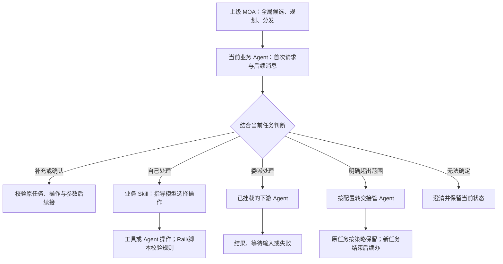

# MOA 业务 Agent 分层与转交规则分析

日期：2026-10-24；2026-10-25 更新接管配置、任务续办与 Skill 归属。用途：记录本次产品讨论、源码发现及 Demo 的解释边界，作为后续 DEV-02 技术方案输入。相关设计见 [PRD 3.7](Agent开发工作台_PRD_v2.0.md#37-编排业务范围与转交业务-skills操作与规则) 与 [交互设计](Agent开发工作台_交互设计_v2.0.md)。本文不宣告后端实现完成。

## 1 结论与开发对象

**应用开发者开发的是下层业务 Agent（L2）：定义自己的服务范围，编写业务 Skills，装配操作和下游 Agent。上级 MOA（L1）的全局候选、规划与重新分发由平台维护。** 原 Demo 把上级“意图候选 → 执行目标”直接当成应用开发者的主流程，混合了两层责任，需要调整。

2026-10-25 的进一步澄清：产品应支持配置接管 Agent，通常为上级 Agent；“沿当前调用链返回信号”只是当前 MOA 的一种实现，不能写成唯一产品规则。任务切换需要保留恢复状态，现有挂起展示记录不等于可恢复任务栈。开发工具配置这些行为，规则预演用来检查配置效果。

用户提出的两段逻辑成立：先结合上下文判断“这件事是否由我负责”，再在职责内完成业务。职责内既可以自己通过 Skills 完成，也可以委派已挂载的 Agent；不能把“我不亲自执行”一律判成超出业务范围。

此图是**产品目标**。远端 L2 控制器适配与本地 Native Skill 尚未统一，不能据此推断所有分支已在同一个模板中实现。

## 2 业务规则

| 编号 | 条件 | 动作与结果 | 性质与依据 |
| --- | --- | --- | --- |
| BA-01 | 当前业务 Agent 收到新请求或后续输入 | 结合当前任务判断归属；不是每句话都先重跑上级全局意图识别 | 产品规则；MOA 有待续接/活动计划时优先续接 [E1] |
| BA-02 | 属于自己的业务，当前 Skill 可以处理 | 读取业务指导，选择允许的操作、补问或确认；程序校验执行约束 | 产品规则及本地 Skill 机制 [E5] |
| BA-03 | 属于自己的服务责任，但应由已挂载 Agent 完成 | 向已配置且获准的目标委派，保留调用关联和等待状态，消费其结果 | 远端控制器适配有此链路 [E2、E3]；Demo 只预演 |
| BA-04 | 自身及已配置的 Agent/Skills 均不处理此业务 | 转交配置的接管 Agent，通常为上级；按规则处理原任务 | 产品目标；当前 MOA 沿结果通道回传信号 [E2、E4] 是已有路径，不是目标配置的唯一实现方式 |
| BA-05 | 未配置接管目标，或目标失效 | 开发态提示补齐；不自动选择别的 Agent | 产品配置规则；现有直接调用的控制信号由调用方处理 [E4]，不能据此推断已有任意目标接管 |
| BA-06 | 信息不足、多个业务都可能匹配 | 先澄清；未命中本地示例不是范围外的证据 | 产品规则；Demo 确定性预演与真实语义判断分开 |
| BA-07 | 等待用户补充或确认 | 使用原任务、操作及参数版本续接。仅收到“确认”不能绕过参数绑定或重新授权 | Skill 校验及产品规则 [E5] |
| BA-08 | 用户变更为同业务域的另一个意图 | 由业务侧判断是原任务补充还是任务切换；需要切换时发出明确信号。远端同域切换保留原适配目标及新意图 | 源码事实 [E1、E4]；不是任意文本变化就自动切换 |
| BA-09 | 挂载目标不存在、未授权或重复弹回 | 报配置/权限/循环错误，不能替换成“超出范围”或静默换目标 | 源码事实 [E2、E3] |
| BA-10 | 远端 L2 返回范围外或同域切换信号 | 上级挂起旧计划，再全局识别或回到原适配器；不承诺新业务结束后自动恢复旧计划 | 源码及指南约束 [E1、E7] |
| BA-11 | Native Skill 的 A2A 操作收到意图切换信号 | 当前实现清除挂起调用并以 `INTENT_SWITCH_REJECTED` 阻断；不能展示为已成功向上重路由 | 当前实现缺口 [E6] |
| BA-12 | 开发者在界面写入前置条件、Skill 步骤 | 文本作为指导或设计说明；强制条件必须落到 Rail、校验代码或脚本并验证 | 产品规则与机制分工 [E5] |
| BA-13 | 范围声明和业务分工互相冲突 | 提示修正，不自动选择“委派”或“返回”；自定义定义不能借用预置 Mock 通过报告 | 本次 Demo 的可验证规则 |

新增配置规则：

| 编号 | 条件 | 配置与交互 | 边界 |
| --- | --- | --- | --- |
| BA-14 | 范围外新请求到达，原任务未提交 | 开发者选择保留进度或切换前询问；询问时用户可保留、放弃或暂不切换 | 挂起的对象是业务任务及恢复状态，不是 Agent 名字或聊天摘要 |
| BA-15 | 新任务结束，原任务未完成 | 开发者选择提示续办或自动回到原任务；继续前复核，写入重新确认 | 自动返回不等于自动执行写操作；本 Demo 仅模拟一层切换 |
| BA-16 | 原操作已提交并等待回执 | 切换对话后继续跟踪原操作，迟到回执归原任务，不重复提交 | 不假装远端执行也暂停，不提供无依据的撤回 |
| BA-17 | 当前任务调用业务 Skill | 配置业务内容和操作；归属固定为当前任务，完成后返回，等待输入仍属于原任务 | Skill 是能力定义，一次调用可有多步；不新增独立业务待办，不限制内部执行/Trace ID |
| BA-18 | 规则或能力被修改 | 保存新修订，旧预演过期；旧表单不能覆盖新内容；目标移除保留失效引用 | 规则预演只读已保存配置，真实运行接线仍待实现 |

“上级”是控制关系，“兜底 Agent”是可能的产品角色，不应把两者等同。上级可以重新选择业务 Agent、澄清或拒绝，不必自己执行业务。“向上返回范围信号”“下游正常返回结果”“需要用户补充/确认”也不是同一类事件。

## 3 用 i豆业务串起来

| 当前情况与用户输入 | 产品应表达的含义 | Demo 的表现 |
| --- | --- | --- |
| 新请求：“查询我的 i豆余额” | 本业务自己处理，由业务 Skill 选择余额操作 | 展示自己处理与允许的操作集合，不显示固定必经步骤 |
| 等待兑换数量：“数量是1件” | 继续当前任务，补齐参数并重新校验 | 固定续接样例，不调用接口 |
| 等待兑换确认：“确认” | 核验本次待确认操作及参数；不能把旧确认用于新参数 | 显示确认约束，不实际兑换 |
| 无进行中任务：“确认” | 缺少确认对象 | 提示澄清 |
| 等待兑换确认：“先查兑换记录” | 当前业务范围内的新要求；是否切换任务需业务侧判断 | 展示当前业务先处理，明确控制信号要求 |
| “帮我采购电脑”，且已挂载采购 Agent | 如果应用负责协调该事项，可委派子任务 | 添加能力与分工后显示委派路径；服务标识为空时先报错 |
| “帮我报销差旅费”，明确列为范围外 | 交给已配置的接管 Agent；按策略处理原任务 | 示例目标为企业总助理，可更换为添加的 A2A Agent；没有真实调用 |
| “查询天气”，未提供归属依据 | 不能用未命中关键词代替语义判断 | 先澄清 |

以上语句是**模拟测试样例**。预演用已保存示例和关键词匹配；范围外仅按完整示例匹配。续接只识别页面注明的固定句式。真实的业务意图识别、上下文管理及变更判定仍需模板适配和模型验证。

## 4 Skills、操作与 Rail 的关系

- **业务任务**：一次业务办理实例，具有进度、等待、完成/取消状态。任务切换时需保留恢复信息。
- **业务 Skill**：可复用的能力定义，包含步骤、必要信息、操作选择及完成要求。在当前任务内调用，一次调用可多步执行或等待输入，完成后返回；不新增独立业务待办。模型可以读取子 Skill 文件；增加 Markdown 不等于新增 Agent。
- **操作**：被授权的单次工具调用或 A2A 子任务。一个 Skill 可以用工具，也可以委派 Agent；两种用法共享操作白名单、参数、结果等约束。
- **Rail/脚本**：在适当阶段执行确定性校验或数据处理。确认绑定、允许范围、参数 Schema 与结果版本不能只靠 Skill 文本保证。
- **应用层 System Prompt**：角色、服务范围、回答方式。它与业务范围定义需要在真实生成阶段保持一致；本次 Demo 分开保存，不声称已经自动同步或做了模型语义校验。
- **开发 Skill**：提供给 OpenCode 的二开指导。包含分层规则、允许修改的文件、控制信号约定、实现缺口和测试方法；不随终端业务请求执行。

固定 MOA 快照默认创建一个本地入口 Skill 及操作集合。多个 Skill 资产可供模型读取，但多套独立业务 Skill 实例的注册、状态隔离和向上转交不是本次源码已经证明的通用能力。

## 5 版本与源码证据

本次按固定 Git 内容静态核查，不运行 Java 测试，不连接真实模型/业务系统，也不修改 `agent-solution` 工作树。

- `agent-solution` 当前检出为 `common`，HEAD `68fcb1c3186b96042df9db9dbaa2b91eb198c27c`；该检出不含 MOA 模块。
- MOA 与 handoff 适配器证据统一固定到 **`1a92265cd238406054f24a069bc08c5e7af978e3`**。下表路径均相对此提交的仓库根目录。文件行号用于定位此快照，不能当成当前检出行号。
- 相关测试源码用于核对预期，**未在本批执行**。表中“已实现”仅指所核查路径的静态实现，不代表线上版本或业务 E2E 通过。

路径前缀：

- `M = common/agents/moa-agent/`
- `H = common/agent-runtime-ext-java/agent-service-adapters/agent-service-adapters-versatile-controller-handoff/`
- `HJ = H/src/main/java/com/openjiuwen/service/adapters/versatile/controller/handoff/`

| 证据 | 文件、符号与定位 | 核查结论 |
| --- | --- | --- |
| E1 | `M/src/main/java/com/moaagent/agent/routing/IntentRoutingRail.java`：`beforeInvoke` 107、Skill 排除分支 280、`handleIntentSwitch` 299、`routeInScope` 370 | 活动任务优先续接；接收到下游信号才切换；先挂起旧计划；同域切换保留来源目标 |
| E2 | `HJ/ControllerHandoffAgentHandler.java`：`execute` 216、`runHandoffChain` 301、`emitSignalIfMatched` 345、`handoffDelegateInterrupt` 417 | 请求远端业务控制器；先消费范围信号；否则解析目标并输出 `a2a_delegate` 中断，由 Runtime 执行；重复目标报错 |
| E3 | `HJ/IntentHandoffClassifier.java`：`classify` 56；`HJ/HandoffTargetResolver.java`：`resolve` 36 | 前者解析控制器 SSE/JSON 中已给出的决策，**不是语义分类模型**；后者按 direct/intent/domain 映射并检查允许目标，缺失/未授权报错 |
| E4 | `HJ/HandoffSignals.java`：说明 17、类型 37/40、信封 63/91；`M/src/main/java/com/moaagent/agent/continuation/IntentSwitch.java` | `versatile_handoff_not_in_scope` 与 `versatile_handoff_in_scope_intent_change` 沿普通结果通道返回，不出站反调；上级解码并使用新请求原文 |
| E5 | `M/src/main/java/com/moaagent/agent/skill/NativeSkillAgent.java`：`create` 59、指导 86；`SkillActionRail.java`：调用校验 156、A2A 231、回调校验 258 | 模型按 Skill 选择操作；Rail 限定白名单/Schema/确认与终结结果；本地 Skill 需要操作及终结操作 |
| E6 | 同目录 `SkillActionRail.java`：269–279；`IntentRoutingRail.java`：280–284 | 回调检查原操作及参数；意图切换时返回 `INTENT_SWITCH_REJECTED`；上级排除 Skill 自动切换，因此两条机制没有直接贯通 |
| E7 | `M/docs/用户开发手册/MOA_Agent开发方式指南.md`：4.5 意图跳转，835 起 | 新输入先交当前 L2；远端同域/跨域切换；旧计划挂起，当前没有恢复入口，不自动取消远端任务 |
| E8 | `M/src/test/java/com/moaagent/it/staged/StageFlowIT.java`：510/562/591；`agent/routing/IntentRoutingRailTest.java`：399/407 | 测试源码描述 L2 等待后的切换与新 query 传递；仅改变文本而无信号不触发切换 |
| E9 | `M/src/test/java/com/moaagent/agent/skill/SkillActionRailTest.java`：222；`it/staged/NativeSkillHttpIT.java`：220 | 测试源码明确 Skill 拒绝意图切换，不启动新处理器；未在本批运行 |

**新增恢复证据（同一固定提交，静态核查）：** `M/src/main/java/com/moaagent/agent/continuation/SuspendedTasks.java:59` 保存 id/revision/query/name/adapter/intent/状态等展示信息，没有在此记录里保存完整执行检查点；`agent/planning/StagePlanningRail.java:847` 挂起并清空 pendingCall/pendingTool；`agent/carryout/SuspendedTaskCarryout.java:17` 明确只展示，不提供恢复或选择入口。`StagePlan.terminal()` 把 SUSPENDED 列为当前计划终态，随后 `beginRequest()` 可以建立新计划。因此不能把现有清单当成完整可恢复栈。这里不否认其他 Runtime 层可能有检查点机制，但本路径的完整恢复衔接尚无证据。

补充纠偏：`SkillBoundaryRail` 检查执行身份、父级关联、续接上下文和工具边界，名字中含 Boundary 不代表它已经实现业务范围语义识别。当前快照默认 `PackIntentRecall` 为本地候选召回；指南中较早的外部意图工作流描述不能代替默认代码。上级召回、规划与 Rail 的事实仍保留，但不再直接映射成应用方的必填界面。

复核固定内容可使用 `git -C <agent-solution> show 1a92265cd238406054f24a069bc08c5e7af978e3:<文件路径>`，不需要切换当前分支。

## 6 后续技术方案要解决什么

1. **配置落地与统一业务 Agent 模板**：明确接管目标、原任务处理、结束后续办三个配置的真实映射；选择业务范围判断放在控制器、Skill 入口还是专用 Rail/组件；定义它与当前任务状态的接口。不要把 `IntentHandoffClassifier` 当作现成的业务意图识别器。
2. **贯通 Skill 与转交**：业务 Skill 不作为独立待办，但其内部执行状态须能被所属任务正确保存和恢复。定义 Native Skill 收到范围切换时的安全退出、挂起状态、控制信封、上级消费和失败结果；先讨论再实现，不直接删除 `INTENT_SWITCH_REJECTED` 防护。
3. **明确任务语义**：分开参数补充、确认、同域新任务、跨域返回和取消；确认绑定原参数，不复用旧授权；多个等待调用时必须确定输入发给哪个调用。
4. **控制数据与业务结果分开**：定义信号版本、来源、task/context/call 标识、调用链、重试/重复返回和无上级行为。不要靠任意业务字符串触发控制跳转。
5. **配置与代码一致**：工作台业务范围、System Prompt、Skill、操作配置共同生成到同一工程并校验；多 Skill 注册、权限与企业 API 接入按首个切片收敛。
6. **验证闭环**：先测信号生产/消费与状态归属，再接真实业务 controller/LLM，最后验证连续对话和 Trace。Demo 点击、测试源码、运行测试、真实 E2E 分开报告。

以上属于 DEV-02/FULL-03 的讨论输入；本批只交付静态 Demo 和产品文档。
