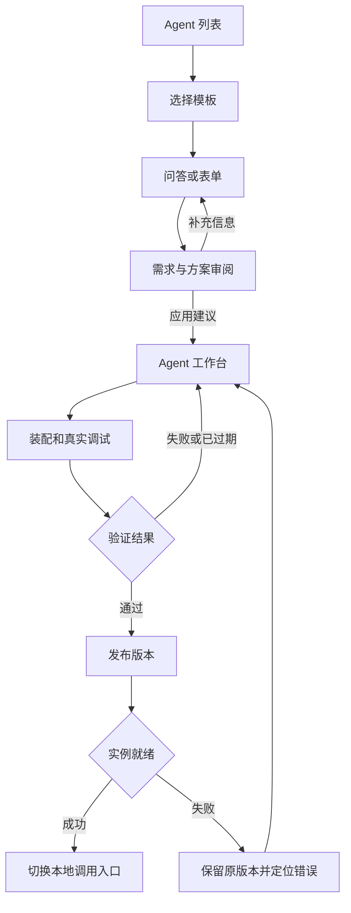
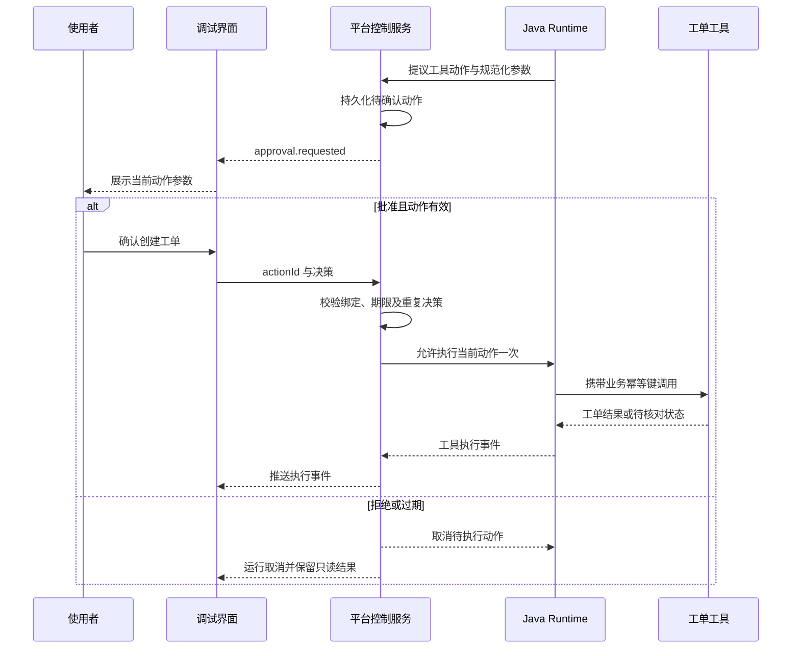

# 自然语言 to Agent 开发平台交互设计

版本：v0.1  
日期：2026-10-21  
设计范围：桌面 Web、本地开发 Demo、P0 页面与关键状态  
配套文档：[需求文档](NL2Agent_需求文档_v0.1.md)

## 1 设计定位

工作台围绕“描述需求 → 检查生成结果 → 装配能力 → 真实调试 → 发布版本”组织。用户首先看到业务目标、工具和运行结果；开发者可以进一步查看 Agent 类型、Rail、依赖版本和事件。

本设计借鉴 agent-studio 的 Agent 编辑页、能力配置区、右侧调试区及发布入口。**复用的是用户理解界面的方式，平台的数据模型、前后端和执行适配独立实现。** 本文是可实施的交互规格，不是 Studio 现有功能清单，也不是对其页面的像素复刻。

### 1.1 Studio 借鉴项与本平台扩展

| 来源或设计依据 | 已观察到的界面组织 | 本平台采用方式 | 本平台新增设计 |
| --- | --- | --- | --- |
| Studio Agent 编辑页 [S1] | 名称与模式、配置页签、提示词和工具、右侧调试、发布按钮 | 固定顶部身份区；中央编辑；右侧随时调试 | 自然语言修改建议、修订号、快照和现行版本分别展示 |
| Studio 能力配置 [S2] | 模型、MCP、插件、Workflow、Skill 等分区 | 能力卡片与统一选择抽屉 | 工厂兼容检查；独立 Rail 装配页；绑定版本与缺口定位 |
| Studio 调试区 [S3] | 对话、清空、日志、展开调试区 | 对话与事件切换；支持展开查看 | 真实执行标识、Rail 触发、动作确认、重连、取消和结果核对 |
| Studio 发布弹窗 [S4] | 分类标签、说明文案和确认按钮 | 独立的发布确认容器 | 版本说明、当前快照校验、实例就绪、原子切换和失败保留旧版本 |
| 本项目需求 | 模板或问答生成可运行 Agent | 同一份需求记录，两种输入方式 | 从需求缺口到组件缺口的连续修复路径 |

不能据此断言 Studio 只能编排 Workflow，也不能据工具配置界面推断其已支持通用 Rail 可视化装配。本平台的 DeepAgent/Rail 交互是针对 Java 底座另行设计的能力。

### 1.2 核心交互原则

1. 先用业务语言收集目标，再把技术映射放进“开发者详情”；不要求业务用户选择 Java 类或填写生命周期回调。
2. 每项生成内容都有来源；建议只有在用户应用后才改变草稿。生成、保存、验证、发布是不同动作。
3. 配置中的 Rail、实例已装载的 Rail、某次运行实际触发的 Rail 分开呈现。
4. 草稿修改影响后续快照，不能改变已经启动的 Run 或现行发布版本。
5. 实际执行、模拟执行和示例业务数据分别标记；计划、轨迹、耗时和成功状态均依据真实事件展示。
6. 页面出现可操作入口时，后端必须有对应能力；未实现项只在路线说明中呈现。

## 2 导航与页面清单

### 2.1 全局导航

| 导航 | 内容 | P0 说明 |
| --- | --- | --- |
| Agent | 列表、创建、编辑、测试、版本 | 默认首页，主要工作入口 |
| 资产 | 模型连接、工具、Rail、Skill、服务连接 | 目录与连接分开；工具中心承担插件接入入口 |
| 运行记录 | 历史会话、Run、事件、待处理动作 | 可按 Agent 和发布版本筛选 |
| 设置 | Runtime、环境诊断、导入导出、显示模式 | 本地工作区设置；不呈现未实现的团队权限系统 |

“业务模式 / 开发者模式”属于显示偏好。业务模式可使用模板推荐的 Rail 组合，开发者模式可配置允许调整的细节；两者不是授权边界。

### 2.2 页面与路由建议

以下路由是新平台建议，与上游路由无绑定关系。列表、详情、创建向导均应支持刷新后恢复。

| 页面 ID | 页面 | 建议路由 | 主要出口 |
| --- | --- | --- | --- |
| UI-01 | 首次设置与环境诊断 | /settings/environment | 创建 Agent、修复连接 |
| UI-02 | Agent 列表 | /agents | 新建、继续编辑、查看运行 |
| UI-03 | 模板与问答创建 | /agents/new；创建草稿后 /agents/:id/requirements | 需求审阅、保存退出 |
| UI-04 | 需求与变更审阅 | /agents/:id/review | 应用建议、返回补充 |
| UI-05 | Agent 工作台 | /agents/:id/edit | 装配、调试、测试、发布 |
| UI-06 | Rail 装配 | /agents/:id/edit?tab=rails | 参数抽屉、装配检查、运行证据 |
| UI-07 | 资产与连接 | /assets/:type；/assets/:type/:id | 登记、测试、绑定到 Agent |
| UI-08 | 调试与运行详情 | 工作台侧栏；/runs/:runId | 确认、取消、查看事件、重新运行 |
| UI-09 | 测试与验证报告 | /agents/:id/tests；/validations/:id | 修复失败项、进入发布 |
| UI-10 | 版本与部署 | /agents/:id/versions | 发布、查看操作、回滚、复制调用方式 |

### 2.3 主流程与返回路径

进入工作台后始终可以返回需求记录。更改需求先生成建议差异，不能自动替换当前装配。

## 3 桌面布局与视觉规则

### 3.1 工作台布局规格

按 1440 × 900 桌面视口设计基线；单位为 CSS px。尺寸是起点，允许根据长文本和实际组件库调整。

| 区域 | 推荐尺寸与位置 | 固定内容 | 滚动与折叠 |
| --- | --- | --- | --- |
| 全局侧栏 | 左侧 176；工作台默认收起到 64 | Agent、资产、运行记录、设置 | 全局导航保持可见 |
| 顶部身份栏 | 高 64 | 返回、名称、Agent 类型、草稿保存状态、测试与发布 | 随页面固定 |
| 二级页签 | 高 44 | 概览、能力、Rail、需求、测试、版本 | 单行，不混入运行终态 |
| 左侧构建助手 | 宽 280–320，可收起 | 对话、需求缺口、修改建议卡片 | 独立滚动；收起后保留未应用建议数 |
| 中央编辑区 | 弹性，宽不小于 480 | 选中页签的表单、能力卡片、装配关系 | 独立滚动，表单标签不截断 |
| 右侧调试区 | 宽 360–420，可展开 | 执行模式、会话、对话、事件、确认卡片 | 独立滚动，可切换全宽运行详情 |

宽度不足以同时满足最小尺寸时，先收起左侧构建助手；1200 以下将调试改为覆盖式抽屉或全宽页签，保留编辑内容。小屏支持查看状态与记录，完整编排面向桌面。不能简单压缩三个面板造成字段不可读。

### 3.2 工作台默认内容

| 视区 | 初次生成后的内容示例 | 对应动作 |
| --- | --- | --- |
| 顶栏 | 设备运维助手 · DeepAgent；草稿 r7 · 已保存 | 测试；发布本地版本；更多 |
| 左侧 | “已根据需求生成装配建议”；“工单连接待绑定” | 查看建议；补充需求 |
| 中央 | 任务目标、模型、工具 3 个、Rail 2 个、输出与执行规则 | 修改字段；进入具体能力 |
| 右侧 | “真实执行”；“示例业务数据”；“尚未运行” | 输入 PUMP-001 示例；运行 |
| 顶栏状态说明 | “现行版本 v1；草稿含未发布变更” | 比较与 v1 的差异 |

左侧“构建助手”负责修改 Agent；右侧“运行调试”负责执行 Agent。二者输入框标题、占位文案、会话记录和发送按钮必须区分，防止把开发指令当成业务执行请求。

### 3.3 视觉与可访问性

| 项目 | 设计建议 |
| --- | --- |
| 基调 | 浅灰工作区、白色面板、蓝色主操作；减少无关装饰 |
| 字体 | 中文系统无衬线；正文 14，辅助 12–13，页面标题 20–24；代码使用等宽字体 |
| 间距 | 以 4 为基础步长；卡片内边距 16–24；相邻表单区块 24 |
| 状态 | 成功、警告、失败同时使用文字与图标，不只靠颜色 |
| 对比度 | 正文和按钮标签达到 WCAG AA 对应对比要求；禁用原因仍可阅读 |
| 交互 | 键盘可访问页签和抽屉；焦点清晰；关闭抽屉后回到触发控件 |
| 表单 | 错误贴近字段，同时提供顶部错误摘要；保留失败前输入 |
| 长内容 | 工具结果、JSON 和堆栈默认折叠，按需展开；密钥内容始终脱敏 |

## 4 UI-01 首次设置与环境诊断

**目的：** 让用户知道能做什么、缺什么，以及如何修复；环境不完整也能先编写需求。

显示平台服务、数据库、Runtime、组件目录、模型连接五项检查。每项展示当前状态、最后检测时间、简要原因和“重新检测”。首次检测结果只作为当时的观察，运行前仍由服务端执行必要校验。

| 情况 | 页面文案 | 可用动作 |
| --- | --- | --- |
| 无模型连接 | 尚未配置模型，可先保存需求草稿 | 添加模型；先创建草稿 |
| Runtime 无法访问 | 执行服务连接失败，草稿编辑不受影响 | 查看地址；重新检测；诊断详情 |
| 组件版本不兼容 | 当前 Runtime 不支持所选组件版本 | 查看依赖差异；修改配置 |
| 端口冲突 | 本地端口已被占用 | 查看端口；按启动说明调整 |
| 全部就绪 | 开发环境已就绪；检测于 HH:mm:ss | 使用示例创建；新建空白 Agent |

模型连接表单包含名称、服务地址、模型标识、凭据输入和“测试连接”。测试结果展示流式、工具调用等已核验能力；“HTTP 可达”不等于“模型能力全部可用”。凭据提交后不回填明文。

## 5 UI-02 Agent 列表

卡片或表格包含名称、类型、草稿状态、现行版本、最近运行状态和修改时间。首版默认列表，提供搜索、类型和部署状态筛选。

主按钮“新建 Agent”打开 UI-03。空状态说明：“用需求模板或问答创建 Agent，也可以导入已有定义。”提供“设备运维示例”“空白创建”“导入”三个明确入口。

“继续编辑”默认打开草稿；“查看现行版本”打开只读版本。不要把已部署版本当作可直接修改对象。列表中的“最近运行失败”不能将部署状态改成“部署失败”。

更多操作首版包含复制草稿、导出、归档。归档仅隐藏常规列表，不自动停止部署或清除运行记录；若未实现归档后端，则不展示该操作。批量删除和物理清理后置。

## 6 UI-03 模板与分支问答

### 6.1 创建入口

模板卡展示适用任务、预计所需信息、需要的连接和预设验收样例。首版提供“设备运维助手”和“空白 Agent”。模板导入内容均标记“模板默认”，不能冒充用户确认。

选择模板或空白创建后立即得到 Agent 草稿标识。向导顶部展示三个阶段：“描述任务”“补齐信息”“审阅生成”，并提供“保存退出”。问答和表单是同一阶段的两种视图。

### 6.2 问答界面

左侧为当前问题和已有回答，右侧为同步更新的需求摘要。首轮允许用户一次描述三项内容：“谁来用、要做什么、最终交付什么”。能从用户完整描述中提取的字段不再重复询问。

后续每轮聚焦一个主要决策，可附少量相关字段。回答方式包括选项、自由文本和资源选择；用户可以明确回答“不确定”。未知项进入待确认清单。

| 问答分支 | 面向用户的问题示例 | 写入字段 | 后续行为 |
| --- | --- | --- | --- |
| 数据来源不清楚 | 告警和维护资料从哪里获取？ | resources | 选择已有连接或登记待接入资源 |
| 是否需要外部动作 | 只给出建议，还是还要创建维修工单？ | actions | 选择创建后补问确认与工单字段 |
| 动作确认 | 创建工单前是否需要使用者确认？ | approval | 展示平台强制规则；不允许绕过锁定策略 |
| 步骤约束 | 哪些步骤必须执行？哪些可由 Agent 自主安排？ | process | 固定业务约束与自主计划分别记录 |
| 输出不明确 | 结果要包含哪些信息？ | output | 提供告警事实、建议、资料来源等候选 |
| 异常处理 | 没有设备编号或维护资料时怎么办？ | exceptions | 推荐追问或说明依据不足，等待确认 |
| 缺少验收样例 | 给一个输入和你认为合格的结果 | examples | 生成可编辑的测试草案 |

**提问停止条件：** 生成草稿所需的业务字段已经明确，或剩余问题已被用户明确标为待补充。真实连接未就绪可以继续生成草稿，但显示“尚不能真实运行”。

### 6.3 同步、纠错与恢复

- 切换到表单时显示当前所有字段；更新表单后问答读取新状态，不复述已完成问题。
- 用户更正某个答案时，只将受影响的规则、组件和测试标记为待复核。例如从“只查询”改成“创建工单”，新增写操作与确认问题。
- 用户撤销写操作需求后，工单工具移除作为待应用建议；已生成的测试变更需要一起审阅。不得直接删除历史运行记录。
- 自动保存显示“保存中 / 已保存 / 保存失败”。失败时保留本地输入并允许重试；退出前提示未保存内容。
- 问答服务不可用时仍可填写表单和保存。生成方案需等待构建服务恢复或由开发者手工配置。

## 7 UI-04 需求与变更审阅

### 7.1 首次生成前审阅

审阅区由业务摘要、执行方案、资源与缺口、验收样例四部分组成。每条内容展示来源标签：“用户确认”“模板默认”“系统建议”“待确认”。业务字段必须有明确来源，不能把推测隐藏为默认事实。

| 审阅项 | 设备运维示例 | 用户操作 |
| --- | --- | --- |
| 业务目标 | 查询告警并给出维护建议，按需创建工单 | 修改目标 |
| 执行方式 | 推荐 DeepAgent；按任务自主制定计划 | 查看原因；开发者可选择兼容工厂 |
| 工具 | 告警查询、资料检索、工单创建 | 绑定连接；替换工具 |
| Rail 组合 | 任务规划扩展、运行审计；来源为平台示例扩展 | 查看作用和实现状态 |
| 执行规则 | 缺少编号先追问；创建工单需确认；最多 12 个任务轮次 | 修改允许变更的值 |
| 验收样例 | 正常告警、缺编号、拒绝工单、工具超时 | 编辑输入与断言 |
| 未决事项 | 工单连接未绑定 | 定位资产接入或保留为草稿 |

主操作“生成装配建议”。生成过程中展示实际阶段，例如读取目录、生成定义、结构校验；没有阶段事件时只显示加载状态，不能播放虚构的执行轨迹。

### 7.2 建议应用与局部修改

首次生成和后续自然语言修改采用同一种变更卡片：目的、受影响字段、变更前后、依赖变化、测试变化、校验结果。建议绑定生成时的草稿 revision 和目录版本。

“应用建议”创建新修订；“放弃”保留原草稿。互相依赖的修改作为一组应用，P0 不提供任意单行勾选导致半套无效配置。可以逐项编辑建议后重新校验。

| 状态 | 主操作 | 限制或提示 |
| --- | --- | --- |
| 校验通过且基线未变 | 应用建议 | 说明将生成的新修订 |
| 关键字段或组件非法 | 修改建议、重新生成 | 禁止应用非法内容 |
| 工具合法但连接待绑定 | 应用到草稿 | 明确真实运行仍被阻塞 |
| 建议生成期间草稿已变 | 比较冲突、基于新草稿重新生成 | 禁止覆盖较新修订 |
| 生成失败 | 重试、查看诊断、手工编辑 | 保留原输入和现有草稿 |

“撤销本次修改”创建一个恢复内容的新修订，不删除历史修订，也不改变已有 Run。

## 8 UI-05 Agent 工作台

### 8.1 页签与编辑内容

| 页签 | 内容 | 业务模式 | 开发者模式 |
| --- | --- | --- | --- |
| 概览 | 目标、输入、输出、执行规则、未决项 | 可编辑业务规则 | 查看生成定义及字段映射 |
| 能力 | 模型、工具、Skill、知识服务引用 | 选择已登记资源 | 查看 Schema、版本、连接和兼容性 |
| Rail | 行为扩展、锁定策略、装配检查 | 展示用途和推荐组合 | 参数、挂载点、顺序及实现信息 |
| 需求 | 原始问答、完整表单、来源与修订 | 可更正需求 | 需求与当前定义差异 |
| 测试 | 用例、报告、失败定位 | 业务输入与预期 | 确定性断言、证据和版本摘要 |
| 版本 | 现行版本、历史部署与回滚 | 只读理解版本状态 | 本地发布、切换、导出 |

业务模式隐藏技术细节，不隐藏重要限制和失败原因。首版不提供一个空白 Workflow 画布作为 DeepAgent 的默认编辑器。

### 8.2 手工编辑与自动保存

表单通过字段校验后自动保存，建议停止输入 800 ms 后提交；失焦可提前提交。保存请求带 expectedRevision，服务端返回新 revision。连续保存需按顺序处理，避免旧响应覆盖新值。

跨页签保留未完成输入。格式非法时显示字段错误，不发送无效定义；草稿其余合法修改可保存，但错误项不能被误记为已保存。“运行”和“测试”必须等待当前合法修改保存完毕，再由服务端创建不可变快照。

冲突返回 409 时显示本地与服务端差异，允许取回较新版本后重新应用本地修改。多标签页也按此处理，不因 P0 单用户而忽略并发覆盖。

### 8.3 类型与策略切换

Agent 类型选择器来自能力目录，只列出当前可用工厂。切换 DeepAgent 到 ReAct 前展示将受影响的 Rail、Skill 和规则。若目标工厂不支持，要求用户明确修改或取消；不能静默丢弃配置。

“任务最大轮次”“工具调用上限”“执行超时”只在适配器支持且语义明确时展示。策略受平台锁定时显示锁定原因及来源，不提供无效开关。

## 9 UI-06 Rail 装配

### 9.1 Rail 页面结构

| 区域 | 内容 | 关键交互 |
| --- | --- | --- |
| 顶部摘要 | 已启用数、冲突数、上次装配检查状态 | 添加 Rail；检查装配 |
| 已选 Rail 列表 | 名称、用途、版本、启用状态、参数摘要、顺序约束 | 打开详情；修改参数；移除可选项 |
| 装配检查 | 兼容性、依赖、锁定策略、有效执行顺序 | 点击错误定位具体 Rail |
| 实例证据 | 指定 Run 的实际装载清单 | 跳转运行详情 |

Rail 卡片的主标题使用用途，例如“运行审计”；副标题显示 `demo.audit@1.0.0`。Java 类名、制品摘要和 hook 标识放在开发者详情中。

### 9.2 添加与配置

“添加 Rail”打开右侧抽屉，支持按用途、适用类型和来源筛选。卡片明确标识“SDK 内置”“平台扩展”或其他已登记来源。推荐组件必须来自当前目录，无法解析的名称不能出现在可添加列表。

选择后显示说明、参数表单、依赖和冲突；参数表单由已验证的 Schema 驱动。确认添加后只修改草稿。需要其他组件时列出完整变更组，由用户一并应用。

P0 默认展示只读有效顺序，不预设拖拽排序。只有目录和适配器确认支持用户排序时才开放顺序控件；系统按实际 SDK 语义校验，不把优先级数字当作自然语言顺序。

### 9.3 三类状态必须分开

| 对象 | 状态示例 | 能证明什么 | 不能据此推断什么 |
| --- | --- | --- | --- |
| 草稿配置 | 已启用、已禁用、参数错误 | 当前定义是否选择该 Rail | 实例已经装载 |
| 指定实例 | 已装载、装载失败、未知 | Runtime 回报的组件与版本 | 本次业务路径已经触发 |
| 指定 Run 的回调 | 已触发、失败、未触发、不可观测 | 该次运行的实际回调证据 | 所有后续运行一定触发 |

“已装载但未触发”可能是本次路径未经过该 hook，不能显示为故障，也不能伪造一次触发补齐演示。尚无事件采集能力时显示“不可观测”，并将对应验收标为未完成。

### 9.4 错误与影响提示

- 参数缺失：在字段下展示错误，并在 Rail 列表显示未完成标记。
- 版本或类型冲突：写明冲突的双方与原因，提供更换版本或移除可选项。
- 强制 Rail：显示锁定状态；生成建议和手工操作均不可移除。
- 已有运行时修改：提示“将在后续新实例生效；当前 Run 使用快照 S-xxx”。
- 目标制品不可用：阻止真实装配，提供制品和目录诊断；不降级成忽略该 Rail。

## 10 UI-07 资产、工具与连接

### 10.1 资产对象区分

| 对象 | 用户看到的内容 | 修改影响 |
| --- | --- | --- |
| 工具定义 | 名称、用途、读写分类、输入输出 Schema、版本 | 创建新定义版本，不覆盖已被快照引用的版本 |
| 服务连接 | 地址、认证方式、凭据配置状态、连接版本 | 新绑定用于后续验证；已有报告可能失效 |
| Rail | 实现版本、参数和生命周期扩展 | 在新实例装配时生效 |
| Skill | 来源、版本、内容或包摘要、适用工厂 | 通过已验证适配器装载 |
| 模型连接 | 服务地址、模型标识、已检测能力 | 重新验证相关 Agent 的模型要求 |

工具中心使用“HTTP / OpenAPI”和“MCP”接入卡片。MCP 是工具来源与协议，不等于 Rail；知识检索以工具引用呈现，不在首版展示未实现的文档入库流水线。

### 10.2 HTTP 与 OpenAPI 接入流程

先输入或导入规范，再选择操作、检查 Schema 和读写分类，随后绑定连接并保存工具版本。不能仅按 HTTP 方法推断是否有副作用；允许维护者声明，未知类别默认要求复核。

导入结果区分“已识别操作”和“不支持部分”。不支持认证、引用或 Schema 特性时指出具体位置；禁止静默丢失约束后声称导入成功。

“测试工具”弹窗展示请求参数、目标环境、读写分类和可能的业务动作。无副作用探测可以直接执行；写操作测试必须明确展示并确认本次参数。保存、导入或选择工具本身不触发业务请求。

### 10.3 MCP 接入流程

填写服务名称、地址、当前支持的传输方式与凭据，点击“连接并读取工具列表”。工具列表显示名称、描述、Schema 和状态；逐项选择要登记的工具。协议不兼容、鉴权失败、超时、工具发现成功但零工具分开提示。

传输方式由 M0 固定 SDK 核验结果决定；未支持的 stdio 或远程变体不能做成可保存但无效的配置选项。远端工具 Schema 变化时提示更新候选版本，不自动覆盖现有定义。

### 10.4 从工作台补接资源

从“连接待绑定”进入资产抽屉时携带原 Agent 和字段定位。保存连接后返回原工作台，显示待应用的绑定变化。新增资产成功不代表 Agent 已绑定，也不代表旧测试仍有效。

## 11 UI-08 运行调试与动作确认

### 11.1 运行前

调试区顶部显示执行模式、业务数据来源、当前快照、会话和连接环境。例如：“真实执行 · 示例业务数据 · 快照 S-17 · 本地测试”。模拟执行使用持续可见的标签，并在报告中保留模式字段。

用户发送输入后，前端先等待草稿保存、检查必要条件，再创建 Run。请求返回 runId 后立即将该标识写入路由或本地视图状态；重复点击发送使用同一请求幂等键，不重复启动。

一个会话可包含多个 Run。缺少设备编号等普通追问在 P0 作为本次 Run 的正常响应结束，界面提示“请补充设备编号”；用户回答后在同一会话创建新 Run。涉及写操作的人工确认则保持同一 Run 等待确认，二者不能混为一种状态。

P0 每个会话固定快照。修改定义后继续调试时，新建会话并提示将使用新快照，避免旧上下文被误当作新配置的验证证据。可查看旧会话，但不能把历史测试结果挪到新快照。

### 11.2 对话与事件视图

| 视图 | 展示内容 | 规则 |
| --- | --- | --- |
| 对话 | 用户输入、最终答复、引用、工具业务结果、确认卡片 | 流式输出只展示真实收到的内容 |
| 任务计划 | 计划步骤与完成状态 | 仅在 Runtime 提供可观测任务事件时出现；计划变化留记录 |
| 执行事件 | 模型、工具、Rail、确认、错误时间线 | 由 eventId 去重、sequence 排序 |
| 开发者详情 | snapshotId、依赖、连接版本、事件 payload、脱敏错误 | 默认折叠，支持复制非敏感诊断 |

工具事件详情展示输入、脱敏输出、起止时间、耗时和连接版本。Rail 事件展示组件版本、hook、结果与耗时。不展示模型未暴露的内部推理；可展示明确返回的计划、解释和最终结论。

进度没有可计算分母时使用阶段文字和进行中标记，不显示虚构百分比。token 或费用未返回时显示“未提供”，不能显示 0。

### 11.3 工单确认卡片

确认卡包含动作名称、目标环境、设备编号、标题、描述、优先级、产生原因和有效期限；开发者可展开 actionId 与参数摘要。批准按钮使用明确文案“确认创建工单”，拒绝按钮为“拒绝并结束本次运行”。

批准只授权当前卡片绑定的那一次动作，不代表该 Agent 后续所有写操作都获准。P0 不允许在确认卡内直接改参数；需要改动时拒绝当前动作，再通过新请求生成新的确认卡。

上图为平台预期控制语义，具体调用方式由 M0 适配验证确定，不表示上游已存在相同接口。服务端保存有效决策；前端禁用按钮只用于防误点，不能代替重复决策保护。

### 11.4 取消、断线与结果核对

| 事件 | 界面状态 | 可用动作 | 禁止行为 |
| --- | --- | --- | --- |
| 点击停止 | 正在取消 | 查看已产生结果 | 立即显示已取消 |
| Runtime 确认停止 | 已取消 | 查看记录；新建运行 | 撤销已发生的外部动作 |
| 停止请求到达前已完成 | 成功，并说明取消未生效 | 查看实际结果 | 把已完成业务动作标为已取消 |
| SSE 断线 | 事件连接中断，运行状态正在核对 | 自动重连；刷新状态 | 自动再发一次业务输入 |
| 工单超时且结果未知 | 结果待核对 | 查询业务幂等结果；查看诊断 | 默认重复创建工单 |
| 确认请求网络失败 | 提交状态待核对 | 查询动作状态；复用决策幂等键 | 创建另一份待执行动作绕过核对 |
| 服务异常重启 | 恢复核对中 | 查看持久化记录 | 自动重放未完成写操作 |

“清空对话”在 P0 命名为“新建会话”，保留历史记录。已有运行或确认未完成时，新建会话不会将其取消；界面保留可返回的运行提示。

“查看历史”是只读操作。“重新运行”创建新 Run，沿用的输入、快照和环境需显式展示；存在写工具时明确提示它可能再次执行。未知结果优先提供“核对结果”，不突出“重试”。

## 12 UI-09 测试与验证报告

### 12.1 测试编辑

用例包含名称、输入、前置业务数据、预期输出、确定性断言和确认路径。生成的测试显示“测试草案”，用户确认后保存为测试集版本。测试集变更使相关旧验证状态过期。

首版设备运维测试集至少覆盖：正常输出、缺编号追问、资料不足、拒绝工单、重复确认、工具超时核对。写入测试默认指向隔离的 Demo 工单服务；批量测试前展示会产生的示例写入。真实业务连接上的写动作沿用确认规则，不能由测试开关绕过。

### 12.2 报告布局

顶部展示快照、测试集版本、模式、环境和连接版本摘要。四层结果独立展示：定义合法性、装配检查、连接检查、行为测试。点击失败项定位到字段、组件、连接或 Run 证据。

| 报告状态 | 页面表现 | 发布行为 |
| --- | --- | --- |
| 尚未测试 | 提示至少需要当前快照的实际验证 | 阻塞 |
| 正在执行 | 当前用例与已完成数量 | 等待结果 |
| 全部通过且绑定匹配 | 验证通过，显示证据和时间 | 可进入发布检查 |
| 部分失败 | 失败断言、实际值与证据 | 阻塞，提供修复入口 |
| 草稿或依赖已变 | 历史通过；对当前版本已过期 | 需要重测 |
| 仅模拟验证通过 | 模拟验证通过；缺少真实执行证据 | 阻塞真实发布 |

报告下载或查看不能修改报告。模型评分作为辅助列，不得把确定性失败覆盖成通过。验证中的草稿又被修改时，允许旧验证完成，但它只能验证原快照。

## 13 UI-10 发布、版本与回滚

### 13.1 发布前检查

顶部“发布本地版本”打开抽屉。抽屉展示拟发布快照、版本说明、目标环境、验证报告、绑定变化和当前版本差异。示例数据依赖持续标注，避免误认成生产数据部署。

| 检查项 | 展示 | 阻塞条件 |
| --- | --- | --- |
| 草稿已保存 | revision 与快照摘要 | 保存失败或存在字段错误 |
| 验证有效 | 报告、测试集、快照与环境 | 未通过、已过期或仅模拟 |
| 依赖可解析 | 模型、工具、Rail、Skill 版本 | 缺制品、连接变化或不兼容 |
| 目标环境一致 | 目标与验证环境对比 | 目标变化后缺少对应验证 |
| 版本说明 | 本次变更简述 | 未填写必要说明 |

阻塞时保留“查看阻塞项”入口，不只放一个无法点击的灰色按钮。按钮解释要能通过鼠标和键盘访问。

### 13.2 发布过程

用户提交后冻结本次发布输入，返回 operationId。显示“准备实例 → 就绪检测 → 切换入口”的真实阶段；各阶段未开始、进行中、完成或失败分别展示。用户关闭抽屉不取消已受理的操作，可从版本页重新打开。

只有入口切换成功后显示“版本 v2 已发布”。失败时说明失败阶段和原因，显示“现行版本仍为 v1”；首次发布失败则显示“尚无可用发布版本”。重复提交相同幂等键不得生成重复部署。

发布期间发生的草稿修改另存修订，不进入本次已冻结发布。针对同一调用入口，P0 串行处理发布与回滚；已有操作未结束时禁止提交竞争性切换。

### 13.3 版本详情与回滚

版本列表包含版本号、定义摘要、发布时间、环境、部署状态、现行标记与说明。版本详情是只读的，提供“复制为草稿”“导出”“查看运行”和“回滚到此版本”。

回滚面板显示当前版本与目标版本、旧依赖的可用性、连接差异、已有运行的处理规则。目标环境或绑定变化时要求相应验证；检查通过后启动目标实例并等待就绪，再切换入口。

回滚失败保留原入口。成功后新调用使用目标版本，已有 Run 仍绑定原快照。“回滚”不撤销业务工具已经产生的工单，也不修改历史记录。

成功页提供本地调用地址、参数示例和版本信息。仅在部署就绪后提供可用调用入口，具体执行 API 由 Runtime 适配方案确定，不能把本文建议管理 API 当作上游调用协议。

## 14 公共状态、提示和错误定位

| 场景 | 推荐文案 | 后续动作 |
| --- | --- | --- |
| 保存失败 | 本次修改尚未保存，输入已保留 | 重试保存；查看连接 |
| 修订冲突 | 草稿已更新，请比较后再应用修改 | 比较差异 |
| 无法映射需求 | 当前目录没有满足此需求的组件 | 调整需求；接入资源；保存待办 |
| 未绑定资源 | 工单工具已选，但未绑定可用连接 | 绑定连接 |
| 未支持的能力 | 当前工厂不支持该能力，尚未加入配置 | 查看兼容类型 |
| Rail 未触发 | 已装载，本次运行没有该回调事件 | 查看装载清单和执行路径 |
| 验证过期 | 配置或绑定已变化，请验证当前快照 | 重新测试 |
| 运行取消中 | 已请求停止，正在等待执行端确认 | 查看运行状态 |
| 外部结果未知 | 工单提交结果待核对，暂不重复创建 | 核对结果 |
| 发布失败 | 新版本未就绪，调用入口保持原版本 | 查看错误；修复后再发布 |

错误详情统一带错误类别、可读原因、对象定位和 correlationId。默认隐藏堆栈；诊断导出先脱敏。详情入口属于错误上下文，不把 Java 异常直接堆在业务用户的聊天答复中。

## 15 前后端协作约定

### 15.1 状态与契约

| 数据 | 前端用途 | 服务端责任 |
| --- | --- | --- |
| capability matrix | 决定可选工厂、字段、操作和不兼容提示 | 返回实际支持能力及目录版本 |
| draft revision | 保存状态、修改建议基线、冲突处理 | 乐观锁与新修订返回 |
| snapshotId | 固定运行、报告、发布的对象 | 内容不可变并锁定依赖 |
| Run 状态 | 显示运行与取消结果 | 提供权威状态，SSE 断开仍可查询 |
| RunEvent | 时间线、步骤详情、Rail 证据 | 稳定 eventId、sequence、真实事件和脱敏 payload |
| PendingAction | 展示一次动作及其决策状态 | 参数绑定、过期检查、幂等决策和执行控制 |
| ValidationReport | 发布是否可进入下一步 | 检查快照、测试集、环境和绑定是否匹配 |
| deployment operation | 发布进度、失败定位、重开面板 | 串行切换、就绪检测、幂等与旧入口保留 |

前端禁用、隐藏、加载动画都不能替代服务端校验。收到未知状态值时显示“状态待同步”并重新查询，不默认归为成功。

### 15.2 建议前端组件

- AgentHeader：草稿修订与现行版本分别展示。
- RequirementEditor：表单和问答共用字段状态。
- ChangeReview：建议差异、基线版本与应用结果。
- CapabilityCard / AssetPicker：组件引用、缺口和绑定。
- RailInspector：参数、兼容性、装载与触发证据。
- DebugPanel / RunTimeline：真实消息和事件查询。
- ActionApprovalCard：明确参数和一次有效决策。
- ValidationSummary / ReleasePanel：版本约束与阶段状态。

开发时可先用带模式标记的事件样例完成页面，但端到端验收必须换成真实适配器。组件目录、生成结果和运行状态不得长期写死在前端。

## 16 设备运维 Demo 交互剧本

| 步骤 | 用户操作 | 页面反馈 | 可核对结果 |
| --- | --- | --- | --- |
| 1 | 选择设备运维模板 | 展示默认目标、连接需求与样例 | 已创建草稿，字段来源为模板 |
| 2 | 说明要分析告警，也能创建工单 | 追问工单确认方式与输出要求 | 需求包含 actions 和 approval |
| 3 | 审阅方案并生成 | 出现 DeepAgent、工具、Rail 和规则建议 | 建议引用已登记组件 |
| 4 | 绑定告警、检索和工单示例服务 | 连接缺口清除，业务数据标为示例 | 绑定有版本和检测记录 |
| 5 | 应用建议并检查 Rail | 显示参数、兼容性与有效装配 | 快照包含两种真实 Rail |
| 6 | 发送“分析设备 PUMP-001 的最新告警” | 展示告警、引用与建议；事件流更新 | 实际工具、Rail 和输出证据 |
| 7 | 要求创建维修工单 | 展示工单参数和确认卡 | 确认前工单写接口零调用 |
| 8 | 点击“确认创建工单” | 等待结果后显示工单编号 | 一次有效动作与幂等记录 |
| 9 | 运行验收用例 | 正常与异常断言逐项显示 | 当前快照的有效报告 |
| 10 | 发布 v1 | 就绪检测后显示可调用版本 | 入口实际指向 v1 |
| 11 | 修改描述并发布 v2，再回滚 v1 | 草稿、版本和运行历史分别可查 | 新调用版本切换，旧 Run 不变 |

必须同时演示三个异常路径：拒绝工单确认时零写入；提交超时后核对已有工单而不重复创建；v2 启动失败时 v1 保持可调用。它们比只有顺畅对话更能证明平台控制闭环有效。

## 17 需求追踪与开发交付

| 页面或横切设计 | 对应需求 | 对应验收用例 |
| --- | --- | --- |
| UI-01 环境诊断 | FR-001、FR-008 | AC-01 |
| UI-02 列表与恢复 | FR-001、FR-014、FR-015 | AC-18 |
| UI-03 问答与表单 | FR-002、FR-003 | AC-02、AC-03 |
| UI-04 建议审阅 | FR-003、FR-004 | AC-04、AC-14 |
| UI-05 工作台与类型 | FR-004、FR-005、FR-009 | AC-06、AC-14 |
| UI-06 Rail 装配 | FR-005、FR-006 | AC-05、AC-06、AC-17 |
| UI-07 资产接入 | FR-007、FR-008、FR-009 | AC-07、AC-08、AC-18 |
| UI-08 调试与确认 | FR-010、FR-011、FR-014 | AC-08 至 AC-13、AC-19 |
| UI-09 验证 | FR-012 | AC-08、AC-09、AC-14、AC-20 |
| UI-10 发布回滚 | FR-013、FR-015 | AC-15、AC-16、AC-18、AC-20 |

本地开发可以按以下四个可评审增量交付：

1. 环境诊断、资产连接和手工装配，先证明 DeepAgent、Rail、工具与事件可工作。
2. Agent 工作台、调试、确认与取消，完成真实运行和异常状态。
3. 需求模板、问答、生成建议与差异应用，连接自然语言到装配流程。
4. 测试、版本发布、回滚及导入导出，完成需求文档的全部 P0 验收。

验收页面时，应同时检查空状态、加载、正常、失败、过期和重连状态；只完成静态正常页面不能算完成对应交互。

## 18 参考材料与实施前核验

参考日期：2026-10-21。以下 Studio 引用固定到 commit `0ae558d79394f09b4819e8adf7808701315e8ba4`。参考基于源码中的页面结构，未把功能开关或模板片段视为完整服务能力证明。

- [S1 Agent 编辑页](https://github.com/openJiuwen-ai/agent-studio/blob/0ae558d79394f09b4819e8adf7808701315e8ba4/frontend/src/routes/agent-center/app-agent/agent-bot-page/agent-bot-page.component.html)
- [S2 能力配置区](https://github.com/openJiuwen-ai/agent-studio/blob/0ae558d79394f09b4819e8adf7808701315e8ba4/frontend/src/routes/agent-center/app-agent/components/config-tools/config-tools.component.html)
- [S3 调试预览区](https://github.com/openJiuwen-ai/agent-studio/blob/0ae558d79394f09b4819e8adf7808701315e8ba4/frontend/src/routes/agent-center/app-agent/components/preview-debug/preview-debug.component.html)
- [S4 发布弹窗](https://github.com/openJiuwen-ai/agent-studio/blob/0ae558d79394f09b4819e8adf7808701315e8ba4/frontend/src/routes/agent-center/app-agent/components/publish-agent-modal/publish-agent-modal.component.html)

实施前需要固定 Java 仓库版本并核验：Rail 排序语义、实际装载清单获取方式、回调观测、确认动作的暂停与续接、取消确认、远程 MCP 传输、Skill 装载、Runtime 就绪检测。界面据能力矩阵开放操作；发现缺口时更新适配任务和范围记录，不能用前端状态替代执行能力。
