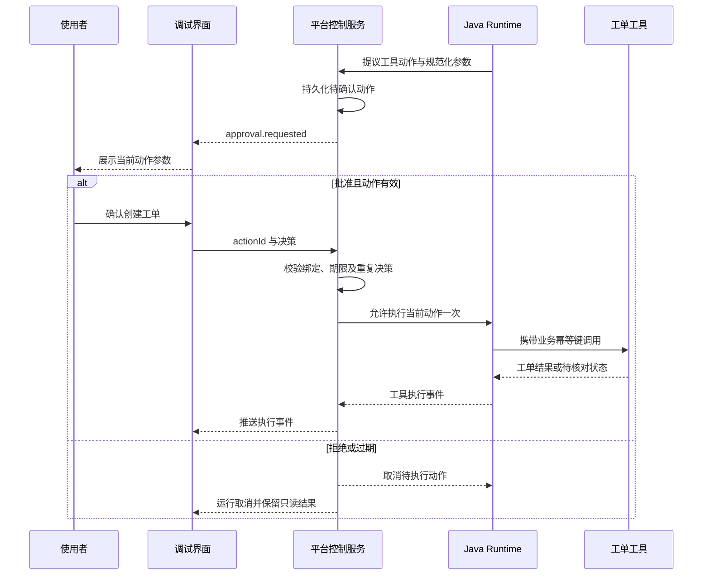

# 自然语言 to Agent 开发平台交互设计

版本：v0.2（沿用原文件路径，保持既有引用有效）\
日期：2026-10-22\
设计范围：桌面工作台、移动 Web 模拟 App、本地开发 Demo、分阶段 P0 页面与关键状态\
修订说明：依据本次布局讨论，采用四个流程页签、单版本上下文、局部内容切换与详情抽屉，替换七页签和历史版本纵向堆叠。\
配套文档：[需求文档](NL2Agent_需求文档_v0.1.md)、[企业模拟环境规格](NL2Agent_企业模拟环境_v0.1.md)、[测试与验收基线](NL2Agent_测试与验收基线_v0.1.md)

> 本次修订是待实施的页面设计。TDD-018 的组件目录和 TDD-019 的开发区视觉调整已提供部分基础，但不代表四页签、单版本展示及状态恢复已经实现。实际交付范围以实施记录为准。本次仅刷新设计文档。

## 1 设计定位

工作台围绕“需求录入 → 环境与装配 → 开发与测试 → 发布与验证”四个流程页签组织。优先复用组件，缺少组件时进入受限生成。用户首先看到业务目标、生成进度和业务结果；开发者可以检查代码、构建、依赖、Rail 和执行证据。生成对象覆盖业务 Agent、Skill、Rail、Tool，不只是修改配置。

首要用户为类似大型银行 AI 平台部门的开发人员，默认使用开发者模式。产品是一站式开发／测试平台；首期只提供本地 Mock 演示发布。设置页和任务摘要显示 `trusted-local：未启用执行沙箱`，不反复插入确认弹窗。

本设计借鉴本地 `D:\agent\feature-list\developer-prototype` 的 Agent 编辑页、配置与侧栏分区、红白灰视觉层级；同时保留 agent-studio 的能力配置与调试入口作为早期参考。本地原型中的模拟对话、示例配置和静态轨迹不作为平台能力证据。**复用的是用户理解界面的方式，平台的数据模型、前后端和执行适配独立实现。** 本文是可实施的交互规格，不是 Studio 现有功能清单，也不是对其页面的像素复刻。

### 1.1 Studio 借鉴项与本平台扩展

| 来源或设计依据 | 已观察到的界面组织 | 本平台采用方式 | 本平台新增设计 |
| --- | --- | --- | --- |
| Studio Agent 编辑页 [S1] | 名称与模式、配置页签、提示词和工具、右侧调试、发布按钮 | 固定顶部身份区；中央编辑；右侧随当前流程展示摘要或证据 | 自然语言修改建议、修订号、快照和现行版本分别展示 |
| Studio 能力配置 [S2] | 模型、MCP、插件、Workflow、Skill 等分区 | 能力卡片与统一选择抽屉 | 工厂兼容检查；环境与装配页内的 Rail 配置区；绑定版本与缺口定位 |
| Studio 调试区 [S3] | 对话、清空、日志、展开调试区 | 对话与事件切换；支持展开查看 | 真实执行标识、Rail 触发、动作确认、重连、取消和结果核对 |
| Studio 发布弹窗 [S4] | 分类标签、说明文案和确认按钮 | 独立的发布确认容器 | 版本说明、当前快照校验、实例就绪、原子切换和失败保留旧版本 |
| 本项目需求 | 模板或问答生成可运行 Agent | 同一份需求记录，两种输入方式 | 从需求缺口到组件缺口的连续修复路径 |

不能据此断言 Studio 只能编排 Workflow，也不能据工具配置界面推断其已支持通用 Rail 可视化装配。本平台的 DeepAgent/Rail 交互是针对 Java 底座另行设计的能力。

### 1.2 核心交互原则

1. 先收集业务目标，默认向开发人员提供接口、代码差异和测试信息；业务沟通模式简化技术细节，不承担代码审阅责任。
2. 每项生成内容都有来源；建议只有在用户应用后才改变草稿。生成、保存、验证、发布是不同动作。
3. 配置中的 Rail、实例已装载的 Rail、某次运行实际触发的 Rail 分开呈现。
4. 草稿修改影响后续快照，不能改变已经启动的 Run 或现行发布版本。
5. 实际执行、模拟执行和示例业务数据分别标记；计划、轨迹、耗时和成功状态均依据真实事件展示。
6. 页面出现可操作入口时，后端必须有对应能力；未实现项只在路线说明中呈现。
7. 开发 Agent、测试 Agent 和业务 Agent 的任务与会话分开呈现；工程任务完成、平台验收通过和发布就绪分别显示。
8. 企业 Mock 表示业务数据与接口环境，不能与模拟执行混为一谈；真实 Agent 调用 Mock 的结果可用于该环境的本地演示验收。
9. 需求和测试基线变更显示理由与影响，用户确认后建立新版本；两个工程角色不能自行降低验收要求。

## 2 导航与页面清单

### 2.1 项目入口与四个流程页签

默认工作区采用“左侧项目列表 + 顶部项目身份与版本选择 + 四个流程页签”。左侧只承载项目选择、搜索与新建，项目项不展开快照、运行和测试结果。资产、全局运行记录、演示环境与设置作为辅助入口，不与四个流程页签并列成第二套任务导航。

| 主页签 | 用户目标 | 页内内容 | 主要出口 |
| --- | --- | --- | --- |
| ① 需求录入 | 定义要开发什么 | 名称、目标用户、业务目标、交付内容、约束、来源与待确认项 | 保存需求；进入环境与装配 |
| ② 环境与装配 | 确认哪些能力可用、如何组合 | 运行依赖检测，Tool／Rail／Skill 目录、组件配置、Agent 指令、验收基线 | 确认基线；固定为测试版本；进入开发与测试 |
| ③ 开发与测试 | 生成组件并验证候选 | 双角色任务、源码、构建、候选选择、用例结果、失败修复与证据 | 启动开发／验收；进入发布与验证 |
| ④ 发布与验证 | 发布并体验业务行为 | 发布条件、发布操作、固定版本业务对话、审批、回滚与调用证据 | 发布；新建业务会话；发送消息；回滚 |

页签允许自由查看。前置条件控制具体按钮，不锁死导航；未满足条件时展示原因和跳转入口。选择页签或浏览详情不触发生成、测试、发布或工具调用。

### 2.2 页面归属与路由建议

路由为目标设计，不表示当前已实现。工作台以 `/agents/:id/edit?tab=requirements|assembly|development|release` 为统一入口。`version=draft` 表示可编辑草稿，`snapshotId` 表示只读固定测试版本；选中候选时额外记录 `candidateId`。参数不存在或不属于当前项目时提示重新选择，不能静默替换为另一个可执行对象。

| 页面 ID | 内容 | 四页签中的归属或独立入口 |
| --- | --- | --- |
| UI-01 | 全局环境设置与连接诊断 | `/settings/environment`；② 页签展示与当前项目有关的检测结果 |
| UI-02 | 项目列表 | `/agents` 或工作台左侧；单击选择一个项目 |
| UI-03 | 模板、问答与表单 | `/agents/new` 创建后进入①需求录入 |
| UI-04 | 需求与变更审阅 | ①页签内摘要／差异抽屉；②页签审阅验收基线 |
| UI-05 | Agent 工作台 | 四个流程页签的公共容器 |
| UI-06 | Rail 装配 | ②环境与装配的组件详情，不再设顶级 Rail 页签 |
| UI-07 | 资产与连接 | ②页签内选择／配置抽屉；全局管理保留 `/assets/:type` |
| UI-08 | 调试与运行详情 | ③候选预览、④发布版对话；事件详情可深链 `/runs/:runId` |
| UI-09 | 测试与验证报告 | ③开发与测试的“测试结果”；可深链 `/validations/:id` |
| UI-10 | 发布、版本与回滚 | ④发布与验证；历史版本从顶部“版本历史”抽屉进入 |
| UI-11 | 自动开发任务与候选审阅 | ③开发与测试；任务与候选 ID 支持详情定位 |
| UI-12 | 企业模拟环境 | `/demo-environments`，从②环境检测或④目标环境进入 |
| UI-13 | 模拟企业手机 App | ④内嵌发布版对话；独立 `/demo-app/:environmentId/:agentId`；③候选预览使用 `/test-app/:testDeploymentId` |

### 2.3 主流程与返回路径


只复用内置组件的项目可在③直接登记模板候选并验收，不必启动代码生成。修改需求或装配时返回草稿编辑；固定快照、旧候选和历史报告继续可查，不被新编辑覆盖。发布后的对话用于人工验证业务体验，不替代③的自动验收门禁。

## 3 桌面布局与视觉规则

### 3.1 工作台布局规格

以 1440 × 900 为桌面设计基线，推荐尺寸单位为 CSS px。

```text
┌──────────────┬─────────────────────────────────────────────────────────┐
│ 项目         │ 设备运维助手   当前：草稿／测试版本 ▾   状态   版本历史 │
│ 搜索         ├─────────────────────────────────────────────────────────┤
│ ＋ 新建项目  │ ①需求录入   ②环境与装配   ③开发与测试   ④发布与验证   │
│              ├─────────────────────────────────────┬───────────────────┤
│ 设备助手     │ 当前页签：表单／代码／结果／对话     │ 摘要／依赖／证据  │
│ 账户助手     │                                     │ 随页签变化        │
│ ……           │                                     │                   │
│              ├─────────────────────────────────────┴───────────────────┤
│ 设置与辅助项 │ 保存状态／阻塞原因                  当前阶段主要操作  │
└──────────────┴─────────────────────────────────────────────────────────┘
```

| 区域 | 推荐尺寸与位置 | 内容与滚动规则 |
| --- | --- | --- |
| 项目侧栏 | 左侧 220–240，可收起 | 名称、简要状态、搜索与新建；长项目列表独立滚动 |
| 项目身份栏 | 高约 64 | 项目名、当前草稿／测试版本、现行发布版本、版本历史；固定可见 |
| 四个流程页签 | 高约 48 | 名称和真实状态标记；保持单行，可键盘切换 |
| 主操作区 | 弹性，推荐最小宽 560 | 仅当前页签、当前选中对象的内容；主要纵向滚动区域 |
| 右侧辅助区 | 宽 300–340，可收起 | 页签相关摘要、状态或选中证据；长内容按需打开 |
| 底部操作栏 | 高约 56，按需增高 | 保存状态、阻塞摘要、一个主要操作及必要次要操作；不遮挡字段与输入框 |

总宽不足时优先收起右侧辅助区，再把项目列表改为选择抽屉；不把三个区域压成窄列。移动端保留四阶段名称并允许页签栏横向滚动，主内容使用单列；④对话输入区固定在可见底部。窄屏详情使用全屏面板。

主页面不为每个历史测试版本展开完整工作区，也不把所有测试用例、任务日志和 JSON 同时平铺。表格分页或虚拟化，详情抽屉只展示当前选中项；避免表单内多层嵌套滚动。

### 3.2 单版本与单候选上下文

1. 一个项目同时显示一个当前草稿或固定测试版本。顶部版本选择器区分“可编辑草稿”和“只读测试版本”；“现行发布版本”单独标识，不能等同于当前选择。
2. ③页签在当前测试版本内选择一个候选、一个开发任务或一次验收执行；每个选择器都只列出属于该项目和版本的对象。历史记录采用紧凑列表或抽屉，点击后切换详情。
3. ④页签分别显示“拟发布候选”和“当前对话绑定版本”。选择拟发布对象不自动改变会话版本。
4. 切换版本后重新读取对应状态，不显示前一个候选的通过标记。请求返回时检查项目、版本与请求上下文，迟到响应不能覆盖新视图。
5. 版本历史抽屉显示版本、来源修订、生成时间、候选数、最近验收与发布标记。选中历史对象默认只读；编辑需显式返回草稿或复制为新草稿。

### 3.3 视觉与可访问性

| 项目 | 设计要求 |
| --- | --- |
| 基调 | 借鉴本地 developer-prototype：浅灰背景、白色内容卡片、克制的红色主操作；主操作色保持一致 |
| 字体 | 正文 14，辅助 12–13，标题 20–24；代码使用等宽字体 |
| 层级 | 页签表达流程，局部切换表达当前阶段的不同内容，抽屉表达详情；不把三者混作全局导航 |
| 状态 | 进行中、失败、通过、阻塞使用文字和图标共同表达；“会话完成”“构建完成”“验收通过”“已发布”分别呈现 |
| 表单 | 标签持续可见，必填与确认状态明确；错误贴近字段，提交失败保留输入 |
| 键盘 | 页签采用 tablist／tab／tabpanel 语义，支持方向键；抽屉支持关闭、焦点约束及关闭后回到触发项 |
| 长内容 | 默认只显示摘要；源码、JSON、堆栈与事件详情按需打开；密钥始终脱敏 |
| 空状态 | 说明当前缺少什么，并给出可执行的下一步；不显示假统计值或示例成功状态 |

## 4 UI-01 首次设置与环境诊断

**目的：** 让用户知道能做什么、缺什么，以及如何修复；环境不完整也能先编写需求。

分组显示基础运行依赖，以及 OpenCode、受限构建／测试执行器和 Mock 环境检查。每项展示当前状态、最后检测时间、简要原因和“重新检测”。首次检测结果只作为当时的观察，运行前仍由服务端执行必要校验。自动开发引擎未就绪只阻塞依赖它的操作，不阻塞合法草稿编辑或已有版本调用。

| 情况 | 页面文案 | 可用动作 |
| --- | --- | --- |
| 无模型连接 | 尚未配置模型，可先保存需求草稿 | 添加模型；先创建草稿 |
| Runtime 无法访问 | 执行服务连接失败，草稿编辑不受影响 | 查看地址；重新检测；诊断详情 |
| 组件版本不兼容 | 当前 Runtime 不支持所选组件版本 | 查看依赖差异；修改配置 |
| 端口冲突 | 本地端口已被占用 | 查看端口；按启动说明调整 |
| 开发引擎不可用 | 自动开发暂不可用，现有项目可继续编辑 | 检查 OpenCode 连接与版本 |
| 执行限制未通过 | 当前环境尚未通过受限生成检查 | 查看失败项；不开放对应生成能力 |
| Mock 未就绪 | 演示环境尚未就绪 | 创建／启动环境；查看接口状态 |
| 全部就绪 | 开发环境已就绪；检测于 HH:mm:ss | 使用示例创建；新建空白 Agent |

模型连接表单包含名称、服务地址、模型标识、凭据输入和“测试连接”。测试结果展示流式、工具调用等已核验能力；“HTTP 可达”不等于“模型能力全部可用”。凭据提交后不回填明文。

## 5 UI-02 Agent 列表

卡片或表格包含名称、类型、草稿状态、现行版本、最近运行状态和修改时间。首版默认列表，提供搜索、类型和部署状态筛选。

主按钮“新建 Agent”打开 UI-03。空状态说明：“描述业务需求，平台生成并验证 Agent，也可以导入已有项目。”提供“设备运维示例”“企业金融模拟”“空白创建”“导入”入口；阶段未实现的模板不作为可执行入口。

“继续编辑”默认打开草稿；“查看现行版本”打开只读版本。不要把已部署版本当作可直接修改对象。列表中的“最近运行失败”不能将部署状态改成“部署失败”。

更多操作首版包含复制草稿、导出、归档。归档仅隐藏常规列表，不自动停止部署或清除运行记录；若未实现归档后端，则不展示该操作。批量删除和物理清理后置。

## 6 UI-03 模板与分支问答

### 6.1 创建入口

模板卡展示适用任务、预计所需信息、需要的连接、生成范围和预设验收样例。提供“设备运维助手”“企业金融服务模拟”和“空白 Agent”。金融模板说明余额／产品查询、可选模拟申购及 Mock 环境依赖。模板导入内容均标记“模板默认”，不能冒充用户确认。

选择模板或空白创建后立即得到 Agent 草稿标识。在①需求录入内完成“描述任务、补齐信息、审阅需求”，不另设一套顶级步骤导航；提供保存与返回项目列表。问答和表单是同一页签的两种视图。

### 6.2 问答界面

左侧为当前问题和已有回答，右侧为同步更新的需求摘要。首轮允许用户一次描述三项内容：“谁来用、要做什么、最终交付什么”。能从用户完整描述中提取的字段不再重复询问。

后续每轮聚焦一个主要决策，可附少量相关字段。回答方式包括选项、自由文本和资源选择；用户可以明确回答“不确定”。未知项进入待确认清单。

| 问答分支 | 面向用户的问题示例 | 写入字段 | 后续行为 |
| --- | --- | --- | --- |
| 数据来源不清楚 | 告警和维护资料从哪里获取？ | resources | 选择已有连接或登记待接入资源 |
| 是否需要外部动作 | 只给出建议，还是还要创建维修工单？ | actions | 选择创建后补问确认与工单字段 |
| 动作确认 | 创建工单前是否需要使用者确认？ | approval | 展示平台强制规则；不允许绕过锁定策略 |
| 步骤约束 | 哪些步骤必须执行？哪些可由 Agent 自主安排？ | process | 固定业务约束与自主计划分别记录 |
| 输出不明确 | 结果要包含哪些信息？ | output | 提供告警事实、建议、资料来源等候选 |
| 异常处理 | 没有设备编号或维护资料时怎么办？ | exceptions | 推荐追问或说明依据不足，等待确认 |
| 缺少验收样例 | 给一个输入和你认为合格的结果 | examples | 生成可编辑的测试草案 |
| 使用入口 | 在工作台使用，还是从企业 App 发起请求？ | clientAndEnvironment | 选择模拟 App 与目标环境 |
| 接口存在但缺少封装 | 已有余额接口，是否生成查询能力？ | resources、generationScope | 选择接口契约与允许的生成模板；不要求用户编写类名 |

**提问停止条件：** 生成草稿所需的业务字段已经明确，或剩余问题已被用户明确标为待补充。真实连接未就绪可以继续生成草稿，但显示“尚不能真实运行”。

### 6.3 同步、纠错与恢复

- 切换到表单时显示当前所有字段；更新表单后问答读取新状态，不复述已完成问题。
- 用户更正某个答案时，只将受影响的规则、组件和测试标记为待复核。例如从“只查询”改成“创建工单”，新增写操作与确认问题。
- 用户撤销写操作需求后，工单工具移除作为待应用建议；已生成的测试变更需要一起审阅。不得直接删除历史运行记录。
- 显式保存显示“保存中 / 已保存 / 保存失败”。失败时保留本地输入并允许重试；退出前提示未保存内容。
- 问答服务不可用时仍可填写表单和保存。生成方案需等待构建服务恢复或由开发者手工配置。

## 7 UI-04 需求与变更审阅

### 7.1 首次生成前审阅

审阅区由业务摘要、执行方案、资源与缺口、验收样例四部分组成。每条内容展示来源标签：“用户确认”“模板默认”“系统建议”“待确认”。业务字段必须有明确来源，不能把推测隐藏为默认事实。

| 审阅项 | 设备运维示例 | 用户操作 |
| --- | --- | --- |
| 业务目标 | 查询告警并给出维护建议，按需创建工单 | 修改目标 |
| 执行方式 | 推荐 DeepAgent；按任务自主制定计划 | 查看原因；开发者可选择兼容工厂 |
| 工具 | 告警查询、资料检索、工单创建 | 绑定连接；替换工具 |
| Rail 组合 | 任务规划扩展、运行审计；来源为平台示例扩展 | 查看作用和实现状态 |
| 执行规则 | 缺少编号先追问；创建工单需确认；最多 12 个任务轮次 | 修改允许变更的值 |
| 验收样例 | 正常告警、缺编号、拒绝工单、工具超时 | 编辑输入与断言 |
| 未决事项 | 工单连接未绑定 | 定位资产接入或保留为草稿 |

需求审阅后进入②确认装配与验收基线，随后固定测试版本。受限生成路径在③提供“启动双角色开发”，展示 BR 编号、已确认基线、接口契约、生成产物类型、策略和预算，点击后创建 DevelopmentJob；复用路径在③直接登记模板候选。构建依赖和命令细节默认折叠，但生成边界与阻塞原因保持可见。只有执行端上报阶段时才显示对应进度，不能播放虚构轨迹。

### 7.2 建议应用与局部修改

首次生成和后续自然语言修改采用同一种变更卡片：目的、受影响字段、变更前后、依赖变化、测试变化、校验结果。建议绑定生成时的草稿 revision 和目录版本。

“应用建议”创建新修订；“放弃”保留原草稿。互相依赖的修改作为一组应用，P0 不提供任意单行勾选导致半套无效配置。可以逐项编辑建议后重新校验。

| 状态 | 主操作 | 限制或提示 |
| --- | --- | --- |
| 校验通过且基线未变 | 应用建议 | 说明将生成的新修订 |
| 关键字段或组件非法 | 修改建议、重新生成 | 禁止应用非法内容 |
| 工具合法但连接待绑定 | 应用到草稿 | 明确真实运行仍被阻塞 |
| 建议生成期间草稿已变 | 比较冲突、基于新草稿重新生成 | 禁止覆盖较新修订 |
| 生成失败 | 重试、查看诊断、手工编辑 | 保留原输入和现有草稿 |

“撤销本次修改”创建一个恢复内容的新修订，不删除历史修订，也不改变已有 Run。

## 8 UI-05 Agent 工作台

### 8.1 四个页签的输入与操作

#### ① 需求录入

主区提供名称、目标使用者、业务目标、交付内容及约束输入；沿用字段来源和逐项确认。表单为默认入口，问答能力实现后作为同页另一种输入方式。右侧显示同步摘要与待确认事项。保存是明确动作，底栏显示未保存／保存中／已保存／失败；“进入环境与装配”不代替保存或用户确认。

选择固定版本时展示只读需求，并提供“返回草稿编辑”。不把需求编辑输入与业务验证对话混在同一窗口。

#### ② 环境与装配

主区按“运行依赖 → 可用组件 → 装配参数 → 验收基线”组织；目录可按 Tool／Rail／Skill 局部筛选。右侧显示已选组件、依赖、冲突和装配摘要。

| 输入或区域 | 内容 | 操作与约束 |
| --- | --- | --- |
| 环境检测 | 模型配置、Runner、Mock、构建引擎等状态及检测时间 | 重新检测；进入连接设置；“已配置”不显示为模型调用已验证 |
| 组件目录 | 名称、用途、版本、来源、读写分类、兼容性 | 选择组件、查看契约／内容；仅显示当前能力对应的有效操作 |
| 装配参数 | 能力组合、Agent 指令、模型轮次及适配器支持参数 | 变更只影响草稿；依赖联动必须显示结果 |
| 验收基线 | 当前需求修订的要求、场景、预期结果 | 紧凑列表与详情抽屉；用户审阅后确认 |
| 固定版本 | 需求、组件选择与基线状态摘要 | 检查已保存／已确认及配置合法性，固定测试版本后进入③ |

组件状态区分“可直接使用”“需要生成”“当前不支持”。缺失组件只能在有受限生成支持时进入生成清单，不能标记为已装载。当前已知实现是两个设备／工单 Tool、三个内置 Rail 与设备只读 Skill 生成路径；Skill 由生成候选绑定。自由组合、跨项目复用、Agent／Rail 自动生成属于后续能力，页面不能提前提供可提交的虚假选择。

#### ③ 开发与测试

顶部保留当前快照、候选选择器和实际任务阶段。主区局部切换为“概览｜代码产物｜测试结果｜执行记录”，每次仅展开一个内容面板；右侧展示双角色状态、阻塞／失败摘要与下一步操作。

| 局部面板 | 默认内容 | 用户输入与动作 |
| --- | --- | --- |
| 概览 | 测试方案 → 代码生成 → 构建检查 → 独立验收；当前任务与预算 | 启动双角色开发、取消、选择历史任务、按失败证据修复；支持的预算参数才可编辑 |
| 代码产物 | 文件树与选中文件，构建结果、候选来源 | 审阅源码／Skill；刷新可用构建；登记固定候选；内容修改必须形成新候选 |
| 测试结果 | 当前候选的验收摘要与紧凑用例表 | 选择匹配基线、确认独立 Mock 写入范围、运行验收、查看单例证据 |
| 执行记录 | 工程事件、命令状态与退出码；可筛选 | 查看某个事件／命令的详情；不把开发日志当业务运行证据 |

没有可用生成能力的内置模板项目可直接登记模板候选进行验收。失败时默认突出失败用例与原因；日志量不能决定页面总长度。点击用例行打开“输入／预期／实际／断言／证据”详情抽屉，返回时保留筛选和滚动位置。候选人工预览作为③的独立抽屉或面板，输入真实业务消息并明确标记“未发布候选”；不与④发布版会话混用。

#### ④ 发布与验证

主区以业务对话为核心，右侧提供拟发布候选、现行发布版、对应验收摘要和调用详情。尚未发布时，主区显示发布条件与下一步，对话输入禁用并说明原因。

发布前选择通过验收且绑定有效的固定候选，填写支持的版本说明、选择目标环境并审阅报告。发布确认抽屉展示最终对象与影响，成功切换入口后才能显示“已发布”。发布失败保留现行版本并显示错误阶段。

业务对话提供消息输入、发送、取消、新建会话和真实动作确认卡。顶栏持续显示会话绑定的发布版本、业务身份和环境；用户变更发布版本或身份时新建会话，已有会话保留原绑定，不自动重放消息。执行轨迹、Rail 事件、工具请求与外部结果放入右侧详情。对话成功仅说明该次调用结果，不替代自动验收报告。

版本历史、发布记录和回滚进入抽屉，不在对话窗口下方平铺所有历史版本。

### 8.2 保存、切换与状态恢复

第一轮改版沿用显式保存，暂不以“800 ms 自动保存”作为前置能力。后续若实现自动保存，需独立验证 revision 并发保护和失败恢复后再开放。

| 场景 | 交互规则 |
| --- | --- |
| 切换页签 | 保留未提交输入、组件选择、局部页签、列表筛选和滚动位置；不重新启动任务 |
| 切换项目或版本 | 保留按项目绑定的未提交输入；明确未保存状态。无法安全保留时提供保存／放弃／取消切换，不能静默丢失 |
| 页面刷新 | 从 URL 恢复项目、页签、快照、候选等定位，再读取服务端权威状态；只承诺恢复已保存内容。浏览器关闭前对未保存编辑提供离开提示 |
| 后台生成／验收 | 切换页签不取消；③标记执行中、失败或已完成。通知仅作导航，最终结果需查询原任务 |
| 前置条件缺失 | 页签可以查看，依赖操作禁用并展示原因和定位入口；环境不就绪仍可保存需求 |
| 需求或装配变更 | 明确草稿比固定版本更新；旧报告对原版本仍有效，不得冒充新草稿通过；新版本须重新确认对应基线并验收 |
| 保存冲突 | 依据 expectedRevision 显示本地与服务端差异；保留输入，不能覆盖较新修订 |
| 发布或写操作网络异常 | 查询原 operationId／requestId，显示待核对；不因重进页签再提交一次 |

页面状态由项目级容器保存，或采用等效的按项目状态管理方式；不依赖某个页签组件始终挂载才能保留输入。旧项目的异步响应不得写入新项目页面。深链打开固定对象需核验其归属并显示明确版本上下文。

### 8.3 类型与策略切换

Agent 类型选择器来自能力目录，只列出当前可用工厂。切换 DeepAgent 到 ReAct 前展示将受影响的 Rail、Skill 和规则。若目标工厂不支持，要求用户明确修改或取消；不能静默丢弃配置。

“任务最大轮次”“工具调用上限”“执行超时”只在适配器支持且语义明确时展示。策略受平台锁定时显示锁定原因及来源，不提供无效开关。

## 9 UI-06 Rail 装配

### 9.1 环境与装配页内的 Rail 区域

| 区域 | 内容 | 关键交互 |
| --- | --- | --- |
| 顶部摘要 | 已启用数、冲突数、上次装配检查状态 | 添加 Rail；检查装配 |
| 已选 Rail 列表 | 名称、用途、版本、启用状态、参数摘要、顺序约束 | 打开详情；修改参数；移除可选项 |
| 装配检查 | 兼容性、依赖、锁定策略、有效执行顺序 | 点击错误定位具体 Rail |
| 实例证据 | 指定 Run 的实际装载清单 | 跳转运行详情 |

Rail 卡片的主标题使用用途，例如“运行审计”；副标题显示 `demo.audit@1.0.0`。Java 类名、制品摘要和 hook 标识放在开发者详情中。

### 9.2 添加与配置

“添加 Rail”打开右侧抽屉，支持按用途、适用类型和来源筛选。卡片明确标识“SDK 内置”“平台扩展”或其他已登记来源。推荐组件必须来自当前目录，无法解析的名称不能出现在可添加列表。

选择后显示说明、参数表单、依赖和冲突；参数表单由已验证的 Schema 驱动。确认添加后只修改草稿。需要其他组件时列出完整变更组，由用户一并应用。

P0 默认展示只读有效顺序，不预设拖拽排序。只有目录和适配器确认支持用户排序时才开放顺序控件；系统按实际 SDK 语义校验，不把优先级数字当作自然语言顺序。

### 9.3 三类状态必须分开

| 对象 | 状态示例 | 能证明什么 | 不能据此推断什么 |
| --- | --- | --- | --- |
| 草稿配置 | 已启用、已禁用、参数错误 | 当前定义是否选择该 Rail | 实例已经装载 |
| 指定实例 | 已装载、装载失败、未知 | Runtime 回报的组件与版本 | 本次业务路径已经触发 |
| 指定 Run 的回调 | 已触发、失败、未触发、不可观测 | 该次运行的实际回调证据 | 所有后续运行一定触发 |

“已装载但未触发”可能是本次路径未经过该 hook，不能显示为故障，也不能伪造一次触发补齐演示。尚无事件采集能力时显示“不可观测”，并将对应验收标为未完成。

### 9.4 错误与影响提示

- 参数缺失：在字段下展示错误，并在 Rail 列表显示未完成标记。
- 版本或类型冲突：写明冲突的双方与原因，提供更换版本或移除可选项。
- 强制 Rail：显示锁定状态；生成建议和手工操作均不可移除。
- 已有运行时修改：提示“将在后续新实例生效；当前 Run 使用快照 S-xxx”。
- 目标制品不可用：阻止真实装配，提供制品和目录诊断；不降级成忽略该 Rail。

## 10 UI-07 资产、工具与连接

### 10.1 资产对象区分

| 对象 | 用户看到的内容 | 修改影响 |
| --- | --- | --- |
| 工具定义 | 名称、用途、读写分类、输入输出 Schema、版本 | 创建新定义版本，不覆盖已被快照引用的版本 |
| 服务连接 | 地址、认证方式、凭据配置状态、连接版本 | 新绑定用于后续验证；已有报告可能失效 |
| Rail | 实现版本、参数和生命周期扩展 | 在新实例装配时生效 |
| Skill | 来源、版本、内容或包摘要、适用工厂 | 通过已验证适配器装载 |
| 生成组件 | 类型、来源任务、模板、接口契约、候选／登记状态 | 未构建或适配未验证的组件不可被当作已可用资产 |
| 模型连接 | 服务地址、模型标识、已检测能力 | 重新验证相关 Agent 的模型要求 |

工具中心使用“HTTP / OpenAPI”和“MCP”接入卡片。MCP 是工具来源与协议，不等于 Rail；知识检索以工具引用呈现，不在首版展示未实现的文档入库流水线。

接口详情增加“生成业务 Skill”入口：选择操作与业务目标，展示拟复用的 Tool、缺失封装、读写分类和确认要求，再进入 UI-11。资产列表区分工程角色 Skill 与业务 Skill；业务 Skill 详情显示依赖 Tool 和实际装载／执行路径，只有说明文本不能显示“可调用”。

### 10.2 HTTP 与 OpenAPI 接入流程

先输入或导入规范，再选择操作、检查 Schema 和读写分类，随后绑定连接并保存工具版本。不能仅按 HTTP 方法推断是否有副作用；允许维护者声明，未知类别默认要求复核。

导入结果区分“已识别操作”和“不支持部分”。不支持认证、引用或 Schema 特性时指出具体位置；禁止静默丢失约束后声称导入成功。

“测试工具”弹窗展示请求参数、目标环境、读写分类和可能的业务动作。无副作用探测可以直接执行；写操作测试必须明确展示并确认本次参数。保存、导入或选择工具本身不触发业务请求。

### 10.3 MCP 接入流程

填写服务名称、地址、当前支持的传输方式与凭据，点击“连接并读取工具列表”。工具列表显示名称、描述、Schema 和状态；逐项选择要登记的工具。协议不兼容、鉴权失败、超时、工具发现成功但零工具分开提示。

传输方式由 M0 固定 SDK 核验结果决定；未支持的 stdio 或远程变体不能做成可保存但无效的配置选项。远端工具 Schema 变化时提示更新候选版本，不自动覆盖现有定义。

### 10.4 从工作台补接资源

从“连接待绑定”进入资产抽屉时携带原 Agent 和字段定位。保存连接后返回原工作台，显示待应用的绑定变化。新增资产成功不代表 Agent 已绑定，也不代表旧测试仍有效。

## 11 UI-08 运行调试与动作确认

### 11.1 运行前

调试区顶部显示执行模式、业务数据来源、当前快照、会话和连接环境。例如：“真实执行 · 示例业务数据 · 快照 S-17 · 本地测试”。模拟执行使用持续可见的标签，并在报告中保留模式字段。

用户发送输入前核对会话绑定的固定目标和运行条件；③使用选中候选的测试部署，④使用会话绑定的发布版本。尚未固定的草稿必须先在②保存并固定版本，不能在发送业务消息时隐式覆盖目标。请求返回 runId 后立即将该标识写入路由或本地视图状态；重复点击发送使用同一请求幂等键，不重复启动。

一个会话可包含多个 Run。缺少设备编号等普通追问在 P0 作为本次 Run 的正常响应结束，界面提示“请补充设备编号”；用户回答后在同一会话创建新 Run。涉及写操作的人工确认则保持同一 Run 等待确认，二者不能混为一种状态。

P0 每个会话固定快照。修改定义后继续调试时，新建会话并提示将使用新快照，避免旧上下文被误当作新配置的验证证据。可查看旧会话，但不能把历史测试结果挪到新快照。

### 11.2 对话与事件视图

| 视图 | 展示内容 | 规则 |
| --- | --- | --- |
| 对话 | 用户输入、最终答复、引用、工具业务结果、确认卡片 | 流式输出只展示真实收到的内容 |
| 任务计划 | 计划步骤与完成状态 | 仅在 Runtime 提供可观测任务事件时出现；计划变化留记录 |
| 执行事件 | 模型、工具、Rail、确认、错误时间线 | 由 eventId 去重、sequence 排序 |
| 开发者详情 | snapshotId、依赖、连接版本、事件 payload、脱敏错误 | 默认折叠，支持复制非敏感诊断 |

工具事件详情展示输入、脱敏输出、起止时间、耗时和连接版本。Rail 事件展示组件版本、hook、结果与耗时。不展示模型未暴露的内部推理；可展示明确返回的计划、解释和最终结论。

进度没有可计算分母时使用阶段文字和进行中标记，不显示虚构百分比。token 或费用未返回时显示“未提供”，不能显示 0。

### 11.3 工单确认卡片

确认卡包含动作名称、目标环境、设备编号、标题、描述、优先级、产生原因和有效期限；开发者可展开 actionId 与参数摘要。批准按钮使用明确文案“确认创建工单”，拒绝按钮为“拒绝并结束本次运行”。

批准只授权当前卡片绑定的那一次动作，不代表该 Agent 后续所有写操作都获准。P0 不允许在确认卡内直接改参数；需要改动时拒绝当前动作，再通过新请求生成新的确认卡。



上图为平台预期控制语义，具体调用方式由 M0 适配验证确定，不表示上游已存在相同接口。服务端保存有效决策；前端禁用按钮只用于防误点，不能代替重复决策保护。

### 11.4 取消、断线与结果核对

| 事件 | 界面状态 | 可用动作 | 禁止行为 |
| --- | --- | --- | --- |
| 点击停止 | 正在取消 | 查看已产生结果 | 立即显示已取消 |
| Runtime 确认停止 | 已取消 | 查看记录；新建运行 | 撤销已发生的外部动作 |
| 停止请求到达前已完成 | 成功，并说明取消未生效 | 查看实际结果 | 把已完成业务动作标为已取消 |
| SSE 断线 | 事件连接中断，运行状态正在核对 | 自动重连；刷新状态 | 自动再发一次业务输入 |
| 工单超时且结果未知 | 结果待核对 | 查询业务幂等结果；查看诊断 | 默认重复创建工单 |
| 确认请求网络失败 | 提交状态待核对 | 查询动作状态；复用决策幂等键 | 创建另一份待执行动作绕过核对 |
| 服务异常重启 | 恢复核对中 | 查看持久化记录 | 自动重放未完成写操作 |

“清空对话”在 P0 命名为“新建会话”，保留历史记录。已有运行或确认未完成时，新建会话不会将其取消；界面保留可返回的运行提示。

“查看历史”是只读操作。“重新运行”创建新 Run，沿用的输入、快照和环境需显式展示；存在写工具时明确提示它可能再次执行。未知结果优先提供“核对结果”，不突出“重试”。

## 12 UI-09 测试与验证报告

### 12.1 测试编辑

用例包含名称、输入、前置业务数据、预期输出、确定性断言和确认路径。生成的测试显示“测试草案”，用户确认后保存为测试集版本。测试集变更使相关旧验证状态过期。

首版设备运维测试集至少覆盖正常输出、缺编号追问、资料不足、拒绝工单、重复确认和超时核对。写入测试使用独立数据的 Demo 服务，执行前说明示例写入。P0 不提供真实业务连接；测试不能绕过正常审批。

金融测试集覆盖余额与产品查询、账户归属、模拟申购确认、重复请求、限额 Rail 和写后超时核对。每项显示 BR／TC、输入、预期、断言、身份、种子和故障配置版本。测试 Agent 生成内容标记为草案；修改已确认预期时展示理由、差异和受影响报告，由用户确认新基线。

### 12.2 报告布局

③“测试结果”顶部只展示当前候选、结论与通过／失败／阻塞统计。用例采用紧凑表格，列为编号、场景、结果、失败原因和详情入口；支持筛选与分页。需求基线、制品摘要、快照、测试集、执行模式、环境实例、数据／故障配置和连接版本在“报告绑定”详情中展开。构建／单元测试、定义合法性、装配检查、连接检查、行为验收分别展示。点击用例行查看需求映射、预期与实际、原始证据及辅助模型评分，点击失败项定位到字段、组件、连接或 Run。

自动开发报告增加 testDeploymentId、实际运行的 candidateId／artifactDigest 与环境兼容键。启动候选测试时由执行器准备固定候选部署；首次版本也可先验收再发布，不能用现行版本的请求冒充候选证据。

按测试与验收基线显示当前阶段必测集合和复合 AC 子项，后续子项显示“本阶段不要求”，不能标为通过。交付成功率在原型完成后的评测报告中统计，可先导出记录供评审，不要求先建设指标大屏；未评测时显示未评测。

| 报告状态 | 页面表现 | 发布行为 |
| --- | --- | --- |
| 尚未测试 | 提示至少需要当前快照的实际验证 | 阻塞 |
| 正在执行 | 当前用例与已完成数量 | 等待结果 |
| 全部通过且绑定匹配 | 验证通过，显示证据和时间 | 可进入发布检查 |
| 部分失败 | 失败断言、实际值与证据 | 阻塞，提供修复入口 |
| 环境阻塞或证据缺失 | 指出不可用依赖或缺失证据，标记阻塞／未验证 | 阻塞，不记为通过 |
| 测试脚本错误 | 显示执行错误，转测试修复 | 阻塞，不直接判为业务实现缺陷 |
| 新草稿产生或候选依赖改变 | 新草稿尚未验收；旧报告只说明原绑定对象通过。原候选依赖变化时报告过期 | 新版本或依赖变化需重测；仍满足原绑定的旧候选不因另一份草稿编辑自动失效 |
| 仅模拟执行通过 | 模拟执行通过；缺少真实执行证据 | 阻塞实际发布 |
| 真实执行且 Mock 验收通过 | 明示目标 Mock 实例与虚构业务数据 | 仅可进入对应演示环境发布检查 |

报告下载或查看不能修改报告。模型评分作为辅助列，不得把确定性失败覆盖成通过。验证中的草稿又被修改时，允许旧验证完成，但它只能验证原快照。

失败操作按原因提供“修复实现”“修复测试”“处理环境”“澄清需求”。回归入口直接使用固定测试集；修复与重测历史全部保留，展示剩余预算，不能只显示最后一次成功。平台自身 FR／AC 验收和生成项目 BR／TC 验收分别标识。

## 13 UI-10 发布、版本与回滚

### 13.1 发布前检查

④“发布与验证”的“发布本地版本”打开确认抽屉。抽屉展示拟发布快照、版本说明、目标环境、验证报告、绑定变化和当前版本差异。示例数据依赖持续标注，避免误认成生产数据部署。

| 检查项 | 展示 | 阻塞条件 |
| --- | --- | --- |
| 发布对象已固定 | 拟发布候选、来源修订与快照摘要 | 未选择固定候选，或绑定与报告不匹配；未保存的新草稿不进入本次发布 |
| 验证有效 | 报告、测试集、快照与环境 | 未通过、已过期或仅模拟执行 |
| 依赖可解析 | 模型、工具、Rail、Skill 版本 | 缺制品、连接变化或不兼容 |
| 生成制品一致 | 已测试候选与待发布制品摘要 | 摘要不同或试图发布时重新生成代码 |
| 目标环境一致 | 目标与验证环境对比 | 目标变化后缺少对应验证 |
| 版本说明 | 本次变更简述 | 未填写必要说明 |

阻塞时保留“查看阻塞项”入口，不只放一个无法点击的灰色按钮。按钮解释要能通过鼠标和键盘访问。

### 13.2 发布过程

用户提交后冻结本次发布输入，返回 operationId。显示“准备实例 → 就绪检测 → 切换入口”的真实阶段；各阶段未开始、进行中、完成或失败分别展示。用户关闭抽屉不取消已受理的操作，可从版本页重新打开。

只有入口切换成功后显示“版本 v2 已发布”。失败时说明失败阶段和原因，显示“现行版本仍为 v1”；首次发布失败则显示“尚无可用发布版本”。重复提交相同幂等键不得生成重复部署。

发布期间发生的草稿修改另存修订，不进入本次已冻结发布。针对同一调用入口，P0 串行处理发布与回滚；已有操作未结束时禁止提交竞争性切换。

### 13.3 版本详情与回滚

版本列表包含版本号、定义摘要、发布时间、环境、部署状态、现行标记与说明。版本详情是只读的，提供“复制为草稿”“导出”“查看运行”和“回滚到此版本”。

回滚面板显示当前版本与目标版本、旧依赖的可用性、连接差异、已有运行的处理规则。目标环境或绑定变化时要求相应验证；检查通过后启动目标实例并等待就绪，再切换入口。

回滚失败保留原入口。成功后新调用使用目标版本，已有 Run 仍绑定原快照。“回滚”不撤销业务工具已经产生的工单，也不修改历史记录。

成功页提供本地调用地址、参数示例和版本信息。仅在部署就绪后提供可用调用入口，具体执行 API 由 Runtime 适配方案确定，不能把本文建议管理 API 当作上游调用协议。

## 14 公共状态、提示和错误定位

| 场景 | 推荐文案 | 后续动作 |
| --- | --- | --- |
| 保存失败 | 本次修改尚未保存，输入已保留 | 重试保存；查看连接 |
| 修订冲突 | 草稿已更新，请比较后再应用修改 | 比较差异 |
| 无法映射需求 | 当前目录缺少组件，正在检查允许的生成路径 | 进入受限开发；接入接口；超出范围则保存缺口 |
| 未绑定资源 | 工单工具已选，但未绑定可用连接 | 绑定连接 |
| 未支持的能力 | 当前工厂不支持该能力，尚未加入配置 | 查看兼容类型 |
| Rail 未触发 | 已装载，本次运行没有该回调事件 | 查看装载清单和执行路径 |
| 验证过期 | 配置或绑定已变化，请验证当前快照 | 重新测试 |
| 运行取消中 | 已请求停止，正在等待执行端确认 | 查看运行状态 |
| 外部结果未知 | 工单提交结果待核对，暂不重复创建 | 核对结果 |
| 发布失败 | 新版本未就绪，调用入口保持原版本 | 查看错误；修复后再发布 |
| 自动开发超限 | 已达到本次开发预算，已保留候选和诊断 | 查看失败原因；由用户调整任务后重新启动 |
| 候选冲突 | 当前草稿已更新，候选基于较早修订 | 比较差异，不能直接覆盖 |
| 环境使用中 | 当前环境仍有运行或待核对动作，不能重置 | 查看关联运行；完成核对后再重置 |

错误详情统一带错误类别、可读原因、对象定位和 correlationId。默认隐藏堆栈；诊断导出先脱敏。详情入口属于错误上下文，不把 Java 异常直接堆在业务用户的聊天答复中。

## 15 前后端协作约定

### 15.1 状态与契约

| 数据 | 前端用途 | 服务端责任 |
| --- | --- | --- |
| capability matrix | 决定可选工厂、字段、操作和不兼容提示 | 返回实际支持能力及目录版本 |
| draft revision | 保存状态、修改建议基线、冲突处理 | 乐观锁与新修订返回 |
| snapshotId | 固定运行、报告、发布的对象 | 内容不可变并锁定依赖 |
| Run 状态 | 显示运行与取消结果 | 提供权威状态，SSE 断开仍可查询 |
| RunEvent | 时间线、步骤详情、Rail 证据 | 稳定 eventId、sequence、真实事件和脱敏 payload |
| PendingAction | 展示一次动作及其决策状态 | 参数绑定、过期检查、幂等决策和执行控制 |
| ValidationReport | 发布是否可进入下一步 | 检查快照、测试集、环境和绑定是否匹配 |
| deployment operation | 发布进度、失败定位、重开面板 | 串行切换、就绪检测、幂等与旧入口保留 |
| DevelopmentJob / TaskExecution | 双角色进度、预算、取消、重启恢复 | 独立会话映射、权威执行状态、命令与退出码 |
| CandidateBundle | 代码／配置差异、源码与制品摘要、应用冲突 | 不可变制品、受限构建与 expectedRevision 校验 |
| RequirementBaseline / TestSuite | BR／TC 映射及基线修订审阅 | 确认后版本化，角色不可自改验收门槛 |
| EnvironmentInstance | 就绪、种子、故障、重置与证据浏览 | 隔离实例、活动运行检查、历史证据保留 |
| ClientRequest | 模拟 App 消息恢复与动作确认 | 身份、环境、请求去重、发布版本解析 |

前端禁用、隐藏、加载动画都不能替代服务端校验。收到未知状态值时显示“状态待同步”并重新查询，不默认归为成功。

### 15.2 建议前端组件

- ProjectWorkspace / ProjectList：项目选择与按项目保留的编辑状态。
- WorkflowTabs：四个主流程页签、状态标记与深链恢复。
- AgentHeader / VersionSelector：当前草稿或固定快照、现行发布版本分别展示。
- VersionHistoryDrawer / EvidenceDrawer：紧凑历史列表与当前选中详情。
- RequirementEditor：表单和问答共用字段状态。
- ChangeReview：建议差异、基线版本与应用结果。
- CapabilityCard / AssetPicker：组件引用、缺口和绑定。
- RailInspector：参数、兼容性、装载与触发证据。
- DebugPanel / RunTimeline：真实消息和事件查询。
- ActionApprovalCard：明确参数和一次有效决策。
- ValidationSummary / ReleasePanel：版本约束与阶段状态。
- DevelopmentTimeline / CandidateReview：双角色任务、构建和候选差异。
- ScenarioPicker / MockEvidenceViewer：实例、数据批次和真实调用证据。
- DemoApp / DemoActionCard：移动 Web 业务请求、结果与模拟申购确认。

开发时可先用带模式标记的事件样例完成页面，但端到端验收必须换成真实适配器。组件目录、生成结果和运行状态不得长期写死在前端。

## 16 Demo 交互剧本

### 16.1 设备运维基础场景

| 步骤 | 用户操作 | 页面反馈 | 可核对结果 |
| --- | --- | --- | --- |
| 1 | 选择设备运维模板 | 展示默认目标、连接需求与样例 | 已创建草稿，字段来源为模板 |
| 2 | 说明要分析告警，也能创建工单 | 追问工单确认方式与输出要求 | 需求包含 actions 和 approval |
| 3 | 审阅方案并生成 | 出现 DeepAgent、工具、Rail 和规则建议 | 建议引用已登记组件 |
| 4 | 绑定告警、检索和工单示例服务 | 连接缺口清除，业务数据标为示例 | 绑定有版本和检测记录 |
| 5 | 应用建议并检查 Rail | 显示参数、兼容性与有效装配 | 快照包含两种真实 Rail |
| 6 | 发送“分析设备 PUMP-001 的最新告警” | 展示告警、引用与建议；事件流更新 | 实际工具、Rail 和输出证据 |
| 7 | 要求创建维修工单 | 展示工单参数和确认卡 | 确认前工单写接口零调用 |
| 8 | 点击“确认创建工单” | 等待结果后显示工单编号 | 一次有效动作与幂等记录 |
| 9 | 运行验收用例 | 正常与异常断言逐项显示 | 当前快照的有效报告 |
| 10 | 发布 v1 | 就绪检测后显示可调用版本 | 入口实际指向 v1 |
| 11 | 修改描述并发布 v2，再回滚 v1 | 草稿、版本和运行历史分别可查 | 新调用版本切换，旧 Run 不变 |

必须同时演示三个异常路径：拒绝工单确认时零写入；提交超时后核对已有工单而不重复创建；v2 启动失败时 v1 保持可调用。它们比只有顺畅对话更能证明平台控制闭环有效。

### 16.2 企业金融模拟与自动开发场景

| 步骤 | 用户操作 | 页面反馈与核对结果 |
| --- | --- | --- |
| 1 | 新建金融场景实例，选择 API 契约 | 虚构数据标签、种子版本与实例就绪；未预置被测余额封装 |
| 2 | 输入“让企业 App 查询余额和理财资料” | 问答形成 BR 条目、接口映射和 TC 草案 |
| 3 | 确认基线并启动开发 | 分别显示开发与测试角色、生成 Tool／Skill、构建和测试阶段 |
| 4 | 审阅候选及验收报告，发布本地版本 | 代码与配置差异、制品摘要和独立证据；就绪后提供 App 入口 |
| 5 | App 选择 U1001 查询余额和产品 | 实际答复；演示详情可关联版本、Run 和 Mock 响应 |
| 6 | 要求支持模拟申购及单笔限额 | 生成 Agent 工程扩展、写入 Skill 与限额 Rail，形成新候选并重测 |
| 7 | 拒绝、批准、重复批准申购，测试高于限额输入 | 确认前／拒绝后零写入；一次记账；Rail 阻止高于限额请求 |
| 8 | 配置写成功后响应超时，再执行 | App 显示待核对，查询已有订单；无重复余额变更 |
| 9 | 查看预置缺陷及自动修复回归 | 原失败保留，新候选与新报告对应，不能覆盖旧证据 |

具体身份、金额、接口和故障行为以企业模拟环境规格为准。生成能力演示需显示真实产生的组件，不能用预置资产和静态进度替代。

## 17 需求追踪与开发交付

| 页面或横切设计 | 对应需求 | 对应验收用例 |
| --- | --- | --- |
| UI-01 环境诊断 | FR-001、FR-008 | AC-01 |
| UI-02 列表与恢复 | FR-001、FR-014、FR-015 | AC-18 |
| UI-03 问答与表单 | FR-002、FR-003 | AC-02、AC-03 |
| UI-04 建议审阅 | FR-003、FR-004 | AC-04、AC-14 |
| UI-05 工作台与类型 | FR-004、FR-005、FR-009 | AC-06、AC-14 |
| UI-06 Rail 装配 | FR-005、FR-006 | AC-05、AC-06、AC-17 |
| UI-07 资产接入 | FR-007、FR-008、FR-009 | AC-07、AC-08、AC-18 |
| UI-08 调试与确认 | FR-010、FR-011、FR-014 | AC-08 至 AC-13、AC-19 |
| UI-09 验证 | FR-012 | AC-08、AC-09、AC-14、AC-20 |
| UI-10 发布回滚 | FR-013、FR-015 | AC-15、AC-16、AC-18、AC-20 |
| UI-11 自动开发与候选 | FR-017、FR-018、FR-019、FR-020、FR-023 | AC-21 至 AC-29、AC-31、AC-37、AC-38、AC-41、AC-42 |
| UI-12 企业模拟环境 | FR-021、FR-015 | AC-30、AC-35、AC-39、AC-40 |
| UI-13 模拟企业 App | FR-011、FR-022、FR-023 | AC-32 至 AC-36 |

本地开发按需求文档的 P0-A/B/C 分阶段交付；前四项对应基础阶段，后两项完成自动开发与企业环境：

1. 环境诊断、资产连接和手工装配，先证明 DeepAgent、Rail、工具与事件可工作。
2. Agent 工作台、调试、确认与取消，完成真实运行和异常状态。
3. 需求模板、问答、生成建议与差异应用，连接自然语言到装配流程。
4. 测试、版本发布、回滚及导入导出，完成测试与验收基线中的 P0-A 必测集合。
5. 双角色开发任务、候选审阅、Tool／Skill 生成、Mock 只读接口与模拟 App，完成 P0-B。
6. Agent 工程与 Rail 生成、模拟申购、故障注入、修复回归和场景导出，完成全部 P0 验收。

验收页面时，应同时检查空状态、加载、正常、失败、过期和重连状态；只完成静态正常页面不能算完成对应交互。

### 17.1 本次布局改版的交互验收项（待实现与验证）

| 编号 | 验收场景 | 预期表现 |
| --- | --- | --- |
| UX-01 | 同一项目存在多个测试快照与报告 | 默认仅展开一个选中版本；新增版本不会把其完整工作区追加到页面底部 |
| UX-02 | 在①输入未保存内容，进入②再返回 | 输入保持；保存状态准确；未触发生成或运行 |
| UX-03 | 在②更改组件，切换页签／项目后返回 | 状态按项目保留；不存在静默丢失、跨项目串值或误标已保存 |
| UX-04 | ③任务进行中切到④，再返回或刷新 | 原任务继续，按原 ID 恢复；未重复创建工程或验收任务 |
| UX-05 | 测试集有大量用例与执行事件 | 主表分页或虚拟化；只打开一项详情，关闭后保留列表位置 |
| UX-06 | 切换项目／版本时旧请求迟到 | 页面只显示当前上下文；旧候选报告不能出现在新版本上 |
| UX-07 | 需求修改后查看旧版通过报告 | 清楚显示报告绑定旧版；新草稿不能借此发布 |
| UX-08 | 未发布、发布失败、发布成功 | 可查看④；分别显示发布条件、原现行版本与错误、可用业务对话 |
| UX-09 | 对话期间发布新版本或切换身份 | 旧会话保持绑定；新会话使用新目标；无自动重放和跨身份内容混用 |
| UX-10 | 缺失生成／运行依赖 | 草稿仍可编辑；操作旁显示具体阻塞原因，不锁死四个页签 |
| UX-11 | 键盘操作或窄屏查看 | 页签与抽屉可操作；焦点恢复；业务输入不被底栏遮挡 |

本表只定义布局改版的验收要求，不替代已有 FR／AC 业务验收，也不表示这些交互已经通过测试。

实施顺序：先完成四页签容器与单版本上下文，再迁移现有表单和任务组件，随后收拢用例／证据详情，最后整合发布版对话。既有真实 API、审批和版本绑定规则继续作为实现依据。

## 18 参考材料与实施前核验

参考日期：2026-10-21。以下 Studio 引用固定到 commit `0ae558d79394f09b4819e8adf7808701315e8ba4`。参考基于源码中的页面结构，未把功能开关或模板片段视为完整服务能力证明。

- [S1 Agent 编辑页](https://github.com/openJiuwen-ai/agent-studio/blob/0ae558d79394f09b4819e8adf7808701315e8ba4/frontend/src/routes/agent-center/app-agent/agent-bot-page/agent-bot-page.component.html)
- [S2 能力配置区](https://github.com/openJiuwen-ai/agent-studio/blob/0ae558d79394f09b4819e8adf7808701315e8ba4/frontend/src/routes/agent-center/app-agent/components/config-tools/config-tools.component.html)
- [S3 调试预览区](https://github.com/openJiuwen-ai/agent-studio/blob/0ae558d79394f09b4819e8adf7808701315e8ba4/frontend/src/routes/agent-center/app-agent/components/preview-debug/preview-debug.component.html)
- [S4 发布弹窗](https://github.com/openJiuwen-ai/agent-studio/blob/0ae558d79394f09b4819e8adf7808701315e8ba4/frontend/src/routes/agent-center/app-agent/components/publish-agent-modal/publish-agent-modal.component.html)

实施前需要固定 Java 仓库版本并核验：Rail 排序语义、实际装载清单获取方式、回调观测、确认动作的暂停与续接、取消确认、远程 MCP 传输、Skill 装载、Runtime 就绪检测。界面据能力矩阵开放操作；发现缺口时更新适配任务和范围记录，不能用前端状态替代执行能力。

自动开发还需核验固定 OpenCode 版本的会话、角色操作策略和事件接口，以及任务适配器检查、候选摘要和进程停止。首期不实施文件／网络强隔离，不能显示未经验证的“安全沙箱已启用”。新增页面属于拟议设计，不是 OpenCode 或 Studio 已有能力声明。

## 19 UI-11 自动开发任务与候选审阅

### 19.1 任务详情

顶部显示业务目标、基线版本、生成范围、环境、任务状态和预算。在③“开发与测试”内按“固定基线 → 测试方案 → 代码生成 → 构建检查 → 独立验收”展示真实进度。当前测试角色先准备方案，开发角色随后实现；不以动画暗示不存在的并行执行。源码、结果与执行记录按局部面板切换，角色状态放在右侧，不能重新把所有详情纵向铺开。

| 区域 | 默认内容 | 开发者详情 |
| --- | --- | --- |
| 需求基线 | BR 编号、验收要求、待确认项 | 接口契约与生成策略版本 |
| 开发角色 | 正在生成或修复的组件、变更摘要 | 引擎会话、源码差异、命令和退出码 |
| 测试角色 | TC 草案、需求覆盖、缺陷与分析 | 脚本、数据与故障配置建议 |
| 构建 | 排队、执行、失败／成功及原因 | 固定模板、依赖、制品摘要、受限执行诊断 |
| 平台验收 | 必测项结果、阻塞与证据 | 原始断言、外部调用、辅助模型评分 |

主操作按状态提供“查看候选”“补充需求”“处理阻塞”“取消任务”。取消先显示正在取消，收到执行端确认后才显示已取消；关闭页面不自动取消任务。重启后通过任务 ID 查询状态，未知状态不自动重做生成或业务写入。

### 19.2 候选审阅

候选展示 AgentSpec、源码、Skill 文件、Rail／Tool 描述、依赖与测试变更，按组件分组。业务模式显示用途、规则和影响，开发者模式可展开差异。用户可放弃候选或应用合法候选形成新草稿修订；应用不等于验收通过或发布。

候选有独立构建与测试状态。只允许引用已构建／检查并具备适配支持的组件；有失败业务用例的合法候选可保留为待修复草稿，但不能发布。用户修改候选内容时创建新候选，旧测试不自动继承。当前草稿与候选基线不一致时显示冲突，不能直接覆盖。

提供“启动候选测试”“打开候选预览”“停止测试部署”。自动测试与人工预览使用不同部署和数据实例；预览始终显示未发布候选、制品摘要和有效期。停止后拒绝新请求，历史证据可查，不自动切换至发布版。通过验收后才开放演示发布。

角色要求更改验收预期时，显示单独的“验收基线变更建议”，不能混入普通代码修复后自动应用。用户确认后生成新基线并说明报告失效范围。

## 20 UI-12 企业模拟环境

列表显示场景名称、版本、数据说明、实例状态、占用情况和最近验证时间。创建实例时选择种子与故障配置，默认正常模式。环境详情分为概览、业务数据、接口契约、故障配置、调用证据和关联任务。

业务数据只展示虚构账户、产品、余额与订单；明确“这是 Mock 状态”。“重置数据”展示将恢复的种子、影响实例和历史证据保留说明，需用户确认。存在活动 Run、测试或待核对写操作时，服务端拒绝重置并列出关联对象；不能只靠按钮禁用。

故障配置显示作用接口、触发次数、行为和版本。测试开始后锁定本次配置；改动用于新测试，不能让同一报告对应多套故障条件。调用证据支持按客户端请求、Run、用例、操作和身份筛选，逐项显示实际参数、响应、幂等键引用及状态变化。

“打开演示 App”要求选择已发布且环境配置兼容的 Agent；候选预览从候选详情进入独立测试部署，不要求已有发布版本。业务工具和代理不暴露本页管理 API；页面权限不证明宿主隔离。

## 21 UI-13 模拟企业手机 App

采用移动 Web，建议 390 × 844 视口验证基本布局。顶栏持续显示模拟标识和当前模拟身份；主区域是业务对话、余额／产品结果及确认卡。开发角色任务、Java 类名和构建细节不进入默认业务对话。

提供“查询余额”“查看理财产品”“查看持仓”“模拟申购”示例输入。演示模式发送到已发布 Agent，候选预览发送到固定测试部署；未实现能力按阶段隐藏。按钮不能拼接成功结果。确认卡显示账户、产品、金额、环境与期限，支持批准和拒绝；高于限额显示真实阻止结果。

请求发送后记录 clientRequestId 和 requestId；刷新查询原状态，重复点击复用同一请求标识。未知写入结果显示“结果待核对”，提供核对入口，不默认重复申购。身份切换后只展示当前身份的会话与请求，由服务端阻止查看或批准他人动作。

演示者可展开请求详情，查看 Agent 版本、业务 Run、对应 Skill／Tool、Rail 事件和 Mock 证据链接。标签分别说明“Agent 真实执行”和“业务数据模拟”；仅在有真实记录时显示成功状态。
