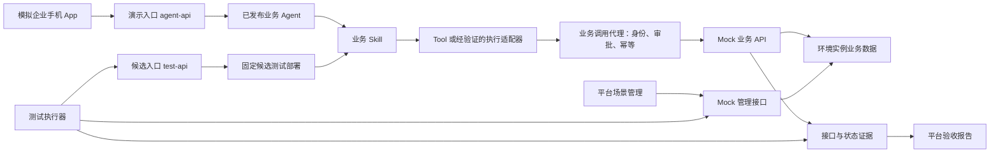

# agent-builder 企业模拟环境规格

版本：v0.1\
日期：2026-10-22\
状态：拟议设计，尚未实现或运行验证\
配套文档：[需求文档](NL2Agent_需求文档_v0.1.md)、[交互设计](NL2Agent_交互设计_v0.1.md)、[测试与验收基线](NL2Agent_测试与验收基线_v0.1.md)

## 1 目标与边界

为 agent-builder 提供可重复演示、自动测试和验证生成能力的企业业务环境。首个新增场景采用模拟企业手机 App、账户余额、理财产品和模拟申购；保留设备运维场景。平台开发 Agent 与测试 Agent 在该环境中完成业务 Agent、Skill、Rail、Tool 的开发、测试、修复和验收。

业务身份、账户、产品及交易均为虚构数据，不接入真实账户或资金。Agent、模型请求、生成组件、接口调用和证据采集必须真实执行。本规格不定义投资建议、真实金融定价、生产认证或合规验证；示例交易仅用于验证软件行为。

| 层次 | 本规格要求 | 证据边界 |
| --- | --- | --- |
| agent-builder 平台 | 双角色编排、受限生成、构建、验收和发布 | 对应平台 FR／AC 验收 |
| 生成的业务 Agent | 按 BR 业务需求使用 Skill、Tool、Rail 完成任务 | 对应项目 TC 用例与外部状态 |
| 企业业务环境 | 可重置的数据、真实可调用的 Mock API、身份适配与调用记录 | 证明模拟契约下的行为，不等于真实企业系统已接入 |
| 模拟手机 App | 移动 Web 调用已发布 Agent、显示结果并处理确认 | 不要求原生移动应用或手机系统集成 |

## 2 调用与管理边界



两个 Agent 入口复用同一消息、身份、审批、去重与取消实现，分别解析固定测试部署和发布版本。业务调用代理根据入口建立的运行上下文注入模拟身份、环境实例和关联标识；不以模型提交的身份为准。模型只生成允许的业务参数，不能通过代理指定任意服务地址或管理凭据。Mock 服务校验代理连接身份与资源归属。

场景管理和测试执行器可初始化数据、配置故障及查询证据；业务 Agent 和开发／测试角色的正常工具入口不提供 Mock 管理操作或证据写权限。测试 Agent 提交数据与故障配置方案，由平台校验后交执行器应用。代理不支持任意 URL 转发，也不转发 Mock 管理路径。

首期为无执行沙箱的可信本地开发原型。上述规则是应用协议与流程约束，不构成对同账户恶意代码直接联网、读取凭据或修改宿主文件的防护承诺。受控模板、代码审阅、独立进程和 Mock 环境用于缩小首期范围；强隔离及越界攻击测试后置。所有“身份拒绝”“零写入”结论均针对用例描述的调用路径与环境。

## 3 场景包与环境实例

场景包是可版本化的资源集合，不包含个人凭据或真实客户数据。

| 内容 | 示例或规则 |
| --- | --- |
| 场景标识 | enterprise-finance-demo@0.1 |
| 业务接口契约 | 受支持的 OpenAPI／Schema 文件及内容摘要 |
| 初始数据 | seed-finance-001@1，包含用户、账户、产品与初始持仓 |
| 身份规则 | 模拟身份与账户归属映射；本地调用入口校验方式 |
| 业务规则 | 金额单位、最小金额、幂等、余额不足与订单查询规则 |
| 故障配置 | 正常、读超时、写前失败、写成功后响应超时、返回字段缺失 |
| 验收资源 | BR 需求、TC 用例、断言与数据准备步骤 |
| 可选预置资产 | 示例 Skill／Tool；生成能力验收场景明确排除被测预置资产 |

每次演示或测试创建 environmentInstanceId，固定场景、契约、种子和故障配置版本。每个实例拥有独立数据与调用序号，不以同一可变数据库状态服务多个并发测试。

实例状态为创建中、就绪、使用中、重置中、失败、已停止。重置需通过 expectedStateRevision 校验且没有活动 Run、未核对写操作或正在执行的测试；否则返回冲突。状态核对完成后可重置为同一种子，产生新状态批次，保留旧批次证据。停止实例不能抹除已经发生的业务动作记录。

## 4 固定示例数据与规则

### 4.1 初始数据

| 对象 | 标识 | 初始内容 |
| --- | --- | --- |
| 模拟用户一 | U1001 | 拥有账户 A1001 |
| 模拟用户二 | U1002 | 拥有账户 A1002 |
| 账户一 | A1001 | CNY，availableBalanceFen=1000000，即 10,000.00 元 |
| 账户二 | A1002 | CNY，availableBalanceFen=500000，即 5,000.00 元 |
| 模拟产品 | SIM-W001 | 示例理财产品 A；可模拟申购；最低金额 10000 分；全部说明为虚构资料 |
| 模拟产品 | SIM-W002 | 示例理财产品 B；状态为暂停申购 |
| 初始订单与持仓 | 两账户 | 订单为空，模拟累计申购金额为零 |

API 金额使用整数分，展示层转成元，禁止浮点金额直接记账。P0 不计算收益、净值或份额；模拟持仓记录按产品累计的申购金额。余额、订单和持仓更新为一个原子业务动作。

余额不足专用种子为 `seed-finance-low-balance-001@1`：仅将 U1001 的 A1001 初始余额改为 50000 分，其余数据和规则与默认种子一致。TC-007b 在该种子上确认申购 SIM-W001、100000 分；金额高于余额、低于 Rail 上限且满足最低金额。预期为 `INSUFFICIENT_BALANCE`，余额仍为 50000 分，订单和持仓无新增。该用例不能以限额 Rail 拒绝代替余额不足结果。

### 4.2 示例业务规则

1. U1001 只可查询或操作 A1001，U1002 只可操作 A1002。账户编号来自业务参数也必须核验归属；越权失败不得返回他人余额。
2. 产品查询只输出接口真实返回的信息；缺字段、未知产品和无持仓分别处理，不能编造收益或记录。
3. 模拟申购必须指定产品与金额，满足最低金额、产品可用和余额足够。禁止负数、零和非整数分。
4. 生成的示例 Rail 施加单笔上限 200000 分；高于上限时应在调用业务写接口前阻止。这是演示业务约束，不是现实金融规则。
5. 申购需要用户确认，绑定账户、产品、金额、Run 和动作标识。拒绝即取消本次运行，保留已有只读结果。参数变化需要新确认。
6. 每个待执行动作使用稳定的业务幂等键。同环境、同身份、同一键与同参数重复调用返回同订单；同键不同参数返回冲突。
7. 写入结果未知时先查询幂等结果，不换新键盲目重试。一次动作最多产生一个订单和一次账本变更；HTTP 调用次数与业务效果次数分别记录。

## 5 拟议业务接口

接口属于本地 Mock 服务，不表示真实企业系统或 openJiuwen 已有相同 API。操作 ID 用于生成 Tool 与追踪契约变化。

| 方法与路径 | operationId | 关键输入／输出 | 副作用 |
| --- | --- | --- | --- |
| GET /mock-business/v1/accounts/{accountId}/balance | getAccountBalance | accountId → accountId、currency、availableBalanceFen、asOf | 无 |
| GET /mock-business/v1/wealth/products | listWealthProducts | 可选状态过滤 → 产品列表、资料版本 | 无 |
| GET /mock-business/v1/wealth/products/{productId} | getWealthProduct | productId → 名称、状态、最低金额、说明 | 无 |
| GET /mock-business/v1/accounts/{accountId}/holdings | listHoldings | accountId → 产品及累计模拟申购金额 | 无 |
| POST /mock-business/v1/wealth/orders | createMockSubscription | accountId、productId、amountFen；Idempotency-Key → orderId、status | 模拟扣减余额并登记订单和持仓 |
| GET /mock-business/v1/wealth/orders/by-key/{key} | getOrderByIdempotencyKey | 幂等键 → 已成功订单或明确 NOT_FOUND | 无 |
| GET /mock-business/v1/wealth/orders/{orderId} | getMockOrder | orderId → 归属、金额、状态和创建时间 | 无 |

认证、environmentInstanceId 与 correlationId 由连接／调用适配层注入，不由模型填写。幂等键由待执行动作生成，不允许模型随意更换。可公开的 Tool Schema 不包含服务凭据或 Mock 管理操作。

错误响应采用 `code`、`message`、`correlationId`；业务错误码至少区分 UNAUTHENTICATED、FORBIDDEN、ACCOUNT_NOT_FOUND、PRODUCT_NOT_FOUND、PRODUCT_UNAVAILABLE、INVALID_AMOUNT、INSUFFICIENT_BALANCE、IDEMPOTENCY_CONFLICT。传输超时由调用端记录，不能伪装为后端明确拒绝。

示例余额响应：

```json
{
  "accountId": "A1001",
  "currency": "CNY",
  "availableBalanceFen": 1000000,
  "asOf": "2026-10-21T08:00:00Z"
}
```

字段来自种子数据和场景时钟。需要严格复现的测试固定场景时钟；时长等运行观测数据仍记录实际值。

## 6 模拟 App 的 Agent 调用入口

模拟 App 的普通演示模式使用已发布的 Agent；候选预览使用第 6.1 节的测试部署。管理端草稿调试继续使用原管理 API，调试记录不自动变成验收报告。页面显示“模拟企业 App · 虚构业务数据”，候选预览额外显示“未发布候选”；业务视图显示任务结果，工程关联信息放入演示详情。

| 方法与路径 | 用途 | 服务端规则 |
| --- | --- | --- |
| POST /agent-api/agents/{agentId}/messages | 发送 input、clientRequestId、可选 conversationId | 校验模拟登录会话，绑定可信身份与环境；返回 requestId、runId、conversationId、agentVersion |
| GET /agent-api/requests/{requestId} | 查询状态、答复与待确认动作 | 只能访问当前身份和环境的请求；刷新不重新发送消息 |
| POST /agent-api/requests/{requestId}/actions/{actionId}/decision | 批准／拒绝当前动作 | 身份、Run、参数摘要、期限和决策幂等键全部匹配 |
| POST /agent-api/requests/{requestId}/cancel | 请求取消 | 只返回受理；等待执行端确认终态 |

示例本地身份选择器通过 Mock 身份适配服务创建模拟登录会话，调用入口校验该会话，不能信任消息正文携带的 userId。身份切换后清除旧视图上下文，不泄露另一身份的请求记录；不宣称具备真实企业登录安全能力。

演示请求以入口类型、环境、身份、Agent 和 clientRequestId 组成去重范围；先查已有请求，再为新请求解析版本，避免发布切换后重复提交启动第二次运行。相同标识与相同输入返回原请求，不同输入返回冲突。新会话解析当前已就绪发布版本，后续消息固定快照。旧版本已不可执行时要求新建会话，不能静默混用上下文。

确认卡展示账户、产品、金额、环境和期限，按钮为“确认模拟申购”和“拒绝并结束”。App 不直接调用申购 API；外部写入必须经过业务 Agent 的受控执行路径。

### 6.1 固定候选测试入口

采用独立的 `/test-api/deployments/{testDeploymentId}` 路由，复用 `/agent-api` 的业务处理组件，不复制另一套审批和去重逻辑。选择该方案是为了首次候选无需先发布，也避免测试 v2 时误用现行 v1。

1. 平台执行器经 `POST /api/test-deployments` 创建测试部署，固定 candidateId、制品摘要、需求／测试基线、环境实例、连接与策略版本；准备就绪后才能发请求。P0-A 的装配验证可沿用快照测试，P0-B 起自动开发候选必须使用该入口。
2. 创建过程不修改当前发布指针。测试授权由平台签发并绑定部署、测试身份、允许操作和有效期；开发／测试 Agent 不能自行签发。预览的浏览器通过工作台服务端会话访问，不把管理凭据放入 URL。
3. 执行器调用下面的路径并核验实际返回的 candidateId、制品摘要和 Run。请求正文不能覆盖候选、身份、环境或连接；不匹配直接失败，不能回退现行版本。
4. 测试结束停止部署，拒绝新请求、撤销测试授权并清理已管理的执行进程。原始结果保留；有未知写入结果时通过执行器核对接口完成核对，不能靠删除实例消除记录。

| 方法与路径 | 行为 |
| --- | --- |
| POST /test-api/deployments/{id}/messages | 与演示入口相同的 input、clientRequestId、conversationId；返回 requestId、runId、testDeploymentId、candidateId、artifactDigest，agentVersion 为 null |
| GET /test-api/deployments/{id}/requests/{requestId} | 仅允许读取本部署、本测试身份的请求状态 |
| POST /test-api/deployments/{id}/requests/{requestId}/actions/{actionId}/decision | 执行用例规定的批准或拒绝；使用相同身份、参数摘要、期限和幂等检查 |
| POST /test-api/deployments/{id}/requests/{requestId}/cancel | 使用相同取消语义，不将受理直接显示为终态 |

候选请求去重范围包含入口类型、testDeploymentId、环境、测试身份与 clientRequestId；不同部署不能复用会话、请求或确认动作。相同 key 不同输入返回冲突。停止或授权过期后的新请求被拒绝，工作台仍可经管理查询读取历史报告。人工预览另建测试部署和数据实例，不与自动验收共享正在变化的数据。

### 6.2 从候选验收到演示发布

测试实例与演示实例的 ID、测试身份授权和状态批次可以不同，不能共享正在变化的账本。发布仍须固定同一 candidateId、AgentSnapshot、制品摘要及 `validationCompatibilityKey`。该键由平台根据场景／接口契约版本、模型与参数、组件依赖、策略版本及连接配置模板版本计算；连接模板包括服务实现版本、认证方式和允许的端点配置，排除实例 ID 与每次签发的临时凭据。

报告保留每个用例的实际环境、种子、故障配置和绑定摘要，不能用兼容键替代原始证据。演示目标必须是该报告覆盖的默认种子和正常故障配置；低余额及超时用例是附加测试场景，不要求演示一直保持故障。使用不同业务服务、模型配置、契约、策略、连接模板或未覆盖种子时旧报告不再适用，须重新测试。

验收通过后，以同一制品创建演示实例，完成默认种子初始化和目标就绪／只读冒烟检查，再原子切换发布入口。就绪失败保留旧版本。P0 仅支持登记的 Mock 配置，生产连接直接拒绝；对“新实例但同配置”的有限复用规则，不应解释成任意环境的验收许可。

## 7 从接口生成 Skill 的过程

1. 选择环境场景和接口契约，输入“让企业 App 查询当前用户余额”等业务需求，确认 BR 条目及测试草案。
2. 开发 Agent 识别已有 Tool／Skill。没有余额封装时，按允许模板生成 Tool、参数 Schema、响应映射和单元测试，再生成业务 Skill 的说明、步骤、异常规则及 Tool 引用。
3. 构建／检查服务按固定依赖执行；候选记录源码、模板、接口契约和产物摘要。Skill 有执行文件时同样进入受限构建流程。
4. 用户审阅变更，平台登记候选资产并装配到业务 Agent。Runtime 适配器回报实际装载和调用路径。
5. 测试 Agent 提供需求驱动用例，执行器创建固定候选测试部署，使用 `/test-api` 和独立数据实例执行，核对实际制品、Mock 调用与状态。候选预览复用 App 界面但明确未发布。
6. 平台验收通过后发布到本地演示入口，资产可被后续项目复用。接口契约变化时生成新组件版本，保留原版本并重测。

Skill 不是将任意 API 文档原样保存后就获得执行能力。P0 允许采用“Skill 指引 + Tool 适配”或经验证的 Skill 执行适配器，必须说明使用哪种路径，并验证模型确实触发对应能力。生成能力测试从无对应 Skill／Tool 的工作区开始，不能引用预置封装冒充生成结果。

## 8 业务需求与用例基线示例

以下编号属于金融示例项目，不替代平台 FR／AC。

| BR | 业务需求 | TC 与主要断言 |
| --- | --- | --- |
| BR-001 | 当前用户查询自己的余额 | TC-001：U1001 查询 A1001，返回 10000.00 元；接口响应、身份和参数匹配 |
| BR-002 | 查询理财产品与持仓，资料不足时不补造 | TC-002：产品与接口一致；暂停状态正确；空持仓明确返回；缺字段不编造 |
| BR-003 | 不允许查询或操作他人账户 | TC-003：U1001 查询 A1002 被拒绝，无他人数据泄露；他人确认动作被拒绝 |
| BR-004 | 模拟申购必须获得当前动作的确认 | TC-004：等待／拒绝时写调用零次；批准后余额、订单和持仓一致 |
| BR-005 | 重复确认或结果未知不产生重复记账 | TC-005：重复批准及写成功后超时场景，仅一笔订单和一次余额变化 |
| BR-006 | 单笔模拟申购不得超过 2000.00 元 | TC-006：1000.00 元可进入确认并执行；3000.00 元被生成 Rail 阻止，写接口零调用 |
| BR-007 | 异常有明确结果，不虚报成功 | TC-007：无效产品、余额不足、读超时、契约缺字段各有可识别结果与证据 |

正常申购固定为 U1001、A1001、SIM-W001、amountFen=100000。批准后余额为 900000 分、成功订单一笔、累计模拟申购金额 100000 分。独立用例从新实例或重置后的固定状态开始，不依赖上一用例是否成功。

TC-001 至 TC-007 是用例组。实际必测子项、阶段、正常与异常数据及断言见[测试与验收基线](NL2Agent_测试与验收基线_v0.1.md)。P0-B 只读组通过不能把审批或写入子项标为通过。

平台需同时验证生成过程：从空余额资产生成 Tool／Skill；生成 Agent 工程并运行；生成限额 Rail 并观察拒绝效果；预置字段映射缺陷被测试发现并修复。业务功能可用与自动开发能力成立分别提供证据。

## 9 故障注入与独立证据

| 故障配置 | Mock 实际行为 | 应观察的结果 |
| --- | --- | --- |
| read-timeout | 指定只读接口延迟超过调用超时 | Agent 明确查询未完成，不能返回伪造余额 |
| write-fail-before-commit | 写请求在修改状态前失败 | 无订单和账本变化，保留明确失败证据 |
| write-timeout-after-commit | 原子记账后丢失／延迟首次写响应；结果查询仍可用 | 运行进入核对，查询原幂等键，不重复记账 |
| missing-response-field | 指定响应移除契约必填字段 | Tool 适配或断言报告契约错误，不补造字段 |
| environment-unavailable | 实例无法就绪或不可访问 | 测试阻塞，不能验收通过或简单归咎于实现 |

故障按实例、操作和触发次数配置并版本化，测试执行前固定，不允许 Agent 在运行中自行关闭故障。管理入口建议为 `/mock-admin/environments/{id}` 下的初始化、故障配置、调用记录和状态快照接口，仅供平台服务或执行器访问。

每次接口记录至少包含 environmentInstanceId、stateRevision、callId、sequence、occurredAt、operationId、可信身份、脱敏参数、响应／传输结果、业务幂等键引用及 correlationId。写入证据另含 orderId、业务效果次数、受控的前后状态引用。

“零调用”通过执行器读取指定环境、身份、操作及用例时间窗口内的完整调用计数判定；证据服务不可用时为未验证，不能把无法读取当成零。证据读取、重置和故障配置不计作业务 Agent 的工具调用。

## 10 演示剧本与交付阶段

| 阶段 | 演示步骤 | 完成证据 |
| --- | --- | --- |
| P0-B | 创建金融场景实例；导入余额与产品接口；确认业务需求 | 场景版本、接口摘要与 BR／TC 基线 |
| P0-B | 平台双角色生成 Tool／Skill，构建、独立测试并发布 | 开发／测试任务、候选制品、实际调用和验收报告 |
| P0-B | 模拟 App 以 U1001 查询余额和理财产品，再尝试访问 U1002 账户 | 正常返回与身份拒绝证据，能关联发布版本和 Run |
| P0-C | 生成 Agent 工程扩展与限额 Rail，装载并执行 | 生成源码、构建记录、Rail 触发和实际约束结果 |
| P0-C | 演示等待确认、拒绝、批准、重复批准和高于限额 | 写入次数、订单、余额及 Rail 事件 |
| P0-C | 注入写成功后响应超时；再演示字段映射缺陷修复 | 幂等结果核对、失败报告、新候选与完整回归记录 |
| P0-C | 导出项目和场景包，在新工作区恢复 | 缺失连接提示、恢复说明及重新验收报告 |

金融场景应作为平台环境目录中的一项，支持用户重新进入并演示。交付包含可启动服务、模拟 App、契约、种子、脚本和说明；本规格本身只定义要求，不代表这些实现已存在。
