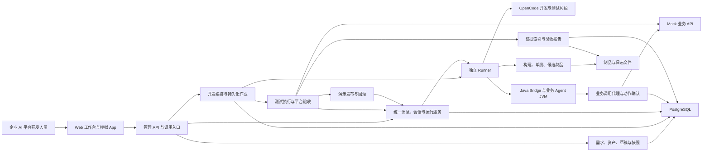
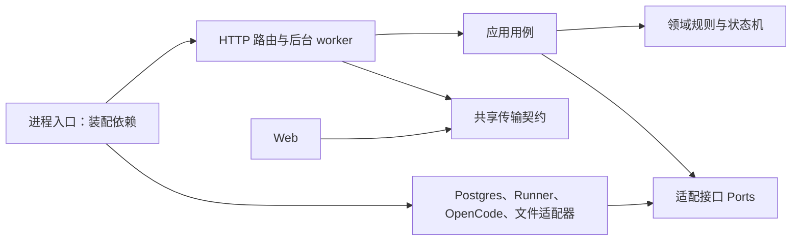
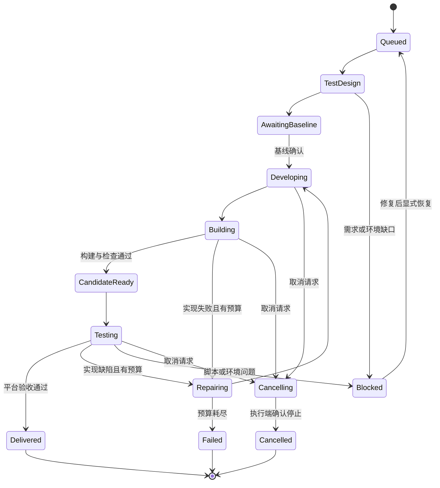
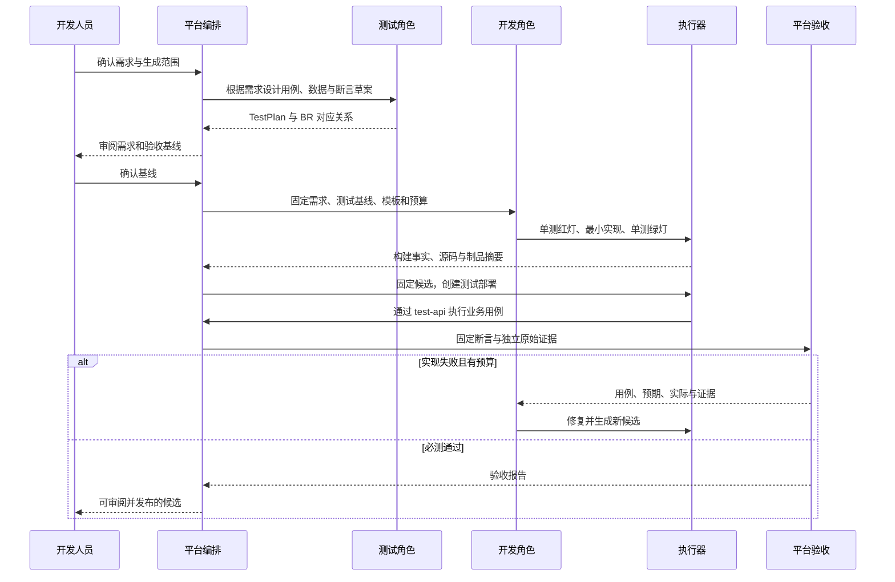
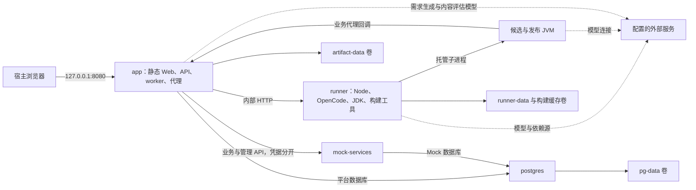

# agent-builder 技术设计

版本：v0.1\
日期：2026-10-22\
状态：技术基线；首个切片已实现，范围见[实施记录](implementation/TDD-001.md)，其余能力按阶段推进与核验\
输入：[PRD](NL2Agent_需求文档_v0.1.md)、[测试与验收基线](NL2Agent_测试与验收基线_v0.1.md)、[Mock 规格](NL2Agent_企业模拟环境_v0.1.md)、[交互设计](NL2Agent_交互设计_v0.1.md)\
实施配套：[TDD 开发计划](NL2Agent_TDD开发计划_v0.1.md)

## 1 设计结论与边界

平台采用 **TypeScript 模块化单体、独立执行器和 openJiuwen Java 执行底座**。Web、管理 API、开发编排、验收引擎、业务调用代理和 Mock 服务使用 TypeScript；业务 Agent、Java Tool、Rail 及 SDK 适配层使用 Java。Skill 首期采用 Markdown／结构化描述与受控 Tool 引用。JavaScript 是 TS 的构建输出，不在同一业务模块混用无类型 JS 实现。

默认交付使用 **Docker Compose 单机部署**，同时提供依赖容器化、平台本地热更新的开发方式。容器用于统一依赖和启动环境；首期仍是 `trusted-local`，不实现每个任务的安全沙箱，不承诺任意生成代码的宿主隔离。

**TDD 在本文指测试驱动开发**：先根据行为写会失败的测试，再实现最小行为，测试通过后重构。它同时约束平台研发和平台中的自动开发流程。测试后补、只检查编译、只使用模型自评，都不满足本设计。

首期保留单用户、本地 Mock、四类产物生成、固定候选、独立验收及交付成功率评测。生产托管、多租户、Kubernetes、通用工作流引擎、任意工程执行和执行沙箱不进入 P0。

## 2 关键技术决策

| 决策 | 选型 | 理由与替换边界 |
| --- | --- | --- |
| 平台语言 | TypeScript，开启 strict | 前后端共享契约类型，状态与错误使用明确联合类型；运行时仍做 Schema 校验 |
| Node 运行环境 | Node.js 24 LTS，补丁版本在 M0 锁定 | 采用稳定 LTS；不直接追随 Current 版本。[官方发布表](https://nodejs.org/en/about/previous-releases) |
| Web | React、Vite、TypeScript | 管理工作台和模拟 App 共用组件与请求客户端，路由不同；[React](https://react.dev/learn)、[Vite](https://vite.dev/guide/) 为选型依据 |
| HTTP 服务 | Fastify | 路由薄层、Schema 校验、插件式模块装配；支持类型及 HTTP 注入测试。[TypeScript](https://fastify.dev/docs/latest/Reference/TypeScript/)、[测试接口](https://fastify.dev/docs/latest/Guides/Testing/) |
| 契约 | 受版本管理的 JSON Schema、生成 TS 类型与 OpenAPI | Schema 是跨进程边界的权威定义，Java 端也按它验证；不让 TS 类型替代运行时验证 |
| 持久化 | PostgreSQL 18；node-postgres；显式 SQL 迁移 | 状态迁移、幂等、乐观锁与版本切换需要事务；不引入 ORM 隐式写入。补丁版本与镜像摘要在 M0 锁定 |
| 长任务 | PostgreSQL 作业表和应用内轮询 worker | 首期并发小，避免 Redis／消息中间件成为必需组件；通过租约与幂等处理重启 |
| 实时事件 | HTTP 查询 + SSE | SSE 展示增量事件，查询接口裁定权威状态；页面断开不取消任务 |
| 制品与大证据 | 本地内容寻址文件存储，数据库保存摘要与索引 | 首期不部署对象存储服务；后续通过 ArtifactStore 接口替换 |
| 开发引擎 | OpenCode HTTP 适配器 | 引擎会话不泄漏为领域模型；角色、模型、Skill 和版本随任务固定 |
| Java 底座 | 固定版本 agent-core-java、agent-runtime-java；按需 agent-solution | 平台不重写 Agent Loop；统一 Java Bridge 屏蔽上游差异 |
| 测试 | Vitest、Playwright、Java 模板对应的 JUnit | TS 单元／契约／集成测试、浏览器 E2E、生成 Java 单测各司其职 |
| 工程组织 | pnpm workspace，锁文件提交 | 单仓维护共享契约、平台和执行器；Java 适配工程使用自己的构建文件 |
| 默认部署 | Docker Compose，4 个基础常驻服务 | app、runner、mock-services、postgres；Java 候选作为 runner 托管的独立 JVM，不动态创建任务容器 |

上表是本项目选型，不是上游已提供这些集成功能的声明。库的精确版本、镜像摘要、JDK／JUnit／Maven 版本在 M0 的真实构建后写入版本清单；JDK 以固定 SDK 的 POM 要求为准。若上游 Runtime 必需额外存储依赖，须补入 Compose 和启动契约后验证，不能默默以替身替代。

## 3 整体架构

### 3.1 逻辑架构

图中的方框是职责，多个方框可位于同一进程；物理服务见第 12 节。



业务请求路径：App → 调用入口 → 固定版本解析 → Java Agent → Skill／Tool → 业务代理 → Mock API。开发路径：已确认需求 → 测试草案与开发任务 → 构建 → 固定候选 → 候选测试 → 平台验收 → 演示发布。两条路径通过候选、Run 和证据关联，不能把 OpenCode 会话当成业务 Run。

### 3.2 代码依赖规则



领域层不导入 Fastify、数据库客户端、OpenCode SDK 或文件系统。应用层通过接口调用外部能力；HTTP handler 只做认证、解析、用例调用与结果映射。不同业务模块通过公开用例或只读查询接口协作，不直接写对方表。模块是组织边界，不拆成十几个微服务。

## 4 模块职责与关系

| 模块 | 职责与数据所有权 | 主要依赖 | 对应 FR |
| --- | --- | --- | --- |
| M01 工作台 | 问答、编辑、运行事件、任务与候选、验收、App 视图；不持有权威业务状态 | 共享契约与 API | FR-001、002、010、014、022 |
| M02 需求基线 | Brief、字段来源、确认修订、BR 与验收草案；模型建议不能自确认为基线 | 模型适配、版本存储 | FR-002、003 |
| M03 定义与资产 | ComponentDescriptor、ConnectionBinding、AgentDraft／Snapshot、兼容矩阵、规范化摘要 | SDK 能力清单、制品索引 | FR-004 至 FR-009、018、023 |
| M04 开发编排 | DevelopmentJob、角色任务、修复预算、阶段迁移；不执行任意代码 | M02、M03、M05、M09 | FR-017 |
| M05 Runner | OpenCode 会话、受控命令、构建、生成单测、进程生命周期和候选 JVM | EnginePort、ProcessPort、ArtifactStore | FR-018、019 |
| M06 Java Bridge | 真实装配、Rail／Skill 适配、业务运行与事件、确认续接和取消 | 固定 Java SDK／Runtime、模型连接 | FR-005、006、009、010、011 |
| M07 调用与运行 | published/test/debug 目标解析、请求去重、Session／Run、状态与 SSE | M03、M05/M06、M08、M11 | FR-010、011、022 |
| M08 动作与代理 | PendingAction、规范化参数、审批、写入幂等、结果核对；只转发登记操作 | M07 可信上下文、Mock 业务接口 | FR-007、011 |
| M09 测试与验收 | 固定 TestSuite、TestDeployment、执行计划、确定性断言、报告及辅助评分 | M05、M07、M11、M12 | FR-012、020 |
| M10 发布与交付 | 发布版本、就绪检查、入口指针、回滚、导出导入 | M03、M05、M09 | FR-013、015 |
| M11 证据与事件 | 原始事件归一化、日志脱敏、内容摘要、原始证据索引与查询 | 数据库、文件存储 | FR-014、012 |
| M12 场景与 Mock | 场景版本、实例、种子、故障、Mock 身份、业务账本与调用记录 | 独立 Mock 数据库、平台管理适配 | FR-021 |
| M13 交付评测 | 固定 EV 任务批次、尝试与人工介入统计、交付成功率导出 | M04、M09、M10 的只读结果 | PRD 2.2、EV-01 至 EV-06 |

FR-016 的完整 IDE／Workflow 画布属于 P1，不创建空功能模块。M11 记录事实，M09 判定验收，M10 决定能否发布；单一模块不能通过写日志中的“成功”跨过三个职责。

### 4.1 工程目录

以下是实施时创建的目录规划，当前不表示相应代码已存在。

```text
apps/
  web/                     # React 工作台与模拟 App
  server/                  # Fastify、应用用例、领域模块、后台 worker
  runner/                  # Node Runner、OpenCode／进程适配器
  mock-services/           # 金融与设备 Mock
packages/
  contracts/               # JSON Schema、生成类型、OpenAPI
  test-support/            # 固定数据、假时钟、协议替身
java/
  runtime-bridge/           # 项目自有适配，不重写 SDK Loop
  generation-templates/    # Agent、Tool、Rail 的固定工程模板
tests/
  integration/  contract/  e2e/  acceptance/  live/  evaluation/
deploy/                    # Dockerfile、Compose、迁移与启动说明
docs/                      # PRD、设计、验收与决策记录
```

server 内各模块按 `domain/application/adapters/http` 分层。公共包只容纳契约和无业务所有权的基础类型，不把所有业务逻辑塞进 shared。

## 5 进程接口与契约

### 5.1 平台 API

保留 PRD 中 `/api` 管理 API、`/agent-api` 演示入口、`/test-api/deployments/{id}` 候选入口。所有写接口明确幂等范围或 expectedRevision；错误返回 `code/message/details/correlationId`，时间为 UTC，版本与摘要不能由浏览器自行构造为已验证状态。

长操作返回 `202 + operationId`，读取权威状态；草稿冲突返回 409，Schema 错误返回 400，凭据／身份错误区分 401/403，环境未就绪返回明确的不可执行状态。成功接收不等于任务或发布成功。测试入口关闭、授权失效和错误候选不得回退演示入口。

首次本地启动使用工作台会话及 CSRF／Origin 校验保护管理写请求；模拟业务身份属于另一种会话。它们不是企业 SSO 或 RBAC。模型和生成角色不能通过普通业务凭据调用需求确认、发布、审批决策或证据写入接口。

### 5.2 关键 Ports

| 接口 | 核心操作 | 返回的独立事实 |
| --- | --- | --- |
| ModelPort | suggestBrief、proposeSpec、evaluateContent | 提议、来源、模型标识；没有基线确认权 |
| EnginePort | startRoleTask、readEvents、abort、inspect | 引擎会话和角色任务状态，不返回“平台验收通过” |
| RunnerPort | submitExecution、inspectExecution、cancelExecution、startDeployment、stopDeployment | executionId、runnerBootId、进程记录、实际制品摘要、退出状态 |
| JavaRuntimePort | inspectCapabilities、startRun、decideAction、cancelRun、readRun、readEvents | SDK 实际状态与事件；能力缺失明确返回 unsupported |
| ArtifactStore | putVerified、openByDigest、verifyManifest | 实际 SHA-256、大小、不可变引用 |
| MockControlPort | createInstance、configureFixture、readEvidence、reset、inspect | 独立调用计数、业务前后状态与状态批次 |
| EvidencePort | append、queryByExecution、verifyReferences | 来源、摘要、采集状态；缺证据不是零结果 |

所有 Ports 可注入协议替身以开展单元／契约测试；阶段验收必须使用真实适配器，不把替身结果混入实际运行报告。

### 5.3 Runner 与 Java 边界

Runner 提供项目自有内部 HTTP 协议：提交／查询／取消执行，启动／查询／停止部署，以及向目标部署转发 Run 命令。请求包含 correlationId、幂等键、taskId／deploymentId、不可变 manifest 引用和策略版本；不接受浏览器提交原始 Shell 字符串。命令由固定模板和独立参数数组构造，不通过 Shell 拼接用户文本。

候选 manifest 至少包含源码摘要、制品清单及摘要、入口、SDK／JDK／模板版本、AgentSnapshot、组件依赖、GenerationProfile 和构建测试结果引用。启动前和测试结束后校验摘要；开发目录与测试复制目录分开。候选不得原地覆盖。

Java Bridge 是本项目适配层：复用 SDK 工厂、Agent Loop 和 Runtime 能力，并提供稳定的项目协议。首期每个测试／发布部署有独立 JVM；同一部署可承载多个独立 Session，版本不变。需固定版本核验上游 Agent Server 的嵌入或托管方式。Bridge 方法名、manifest 和内部路径均是本项目设计，不声称上游已有同名 API。[Java Core 固定源码](https://raw.githubusercontent.com/openJiuwen-ai/agent-core-java/89c7810ca35dface93cea797816f89af1fe4c588/core/src/main/java/com/openjiuwen/harness/deep_agent/DeepAgent.java)、[Runtime 仓库](https://github.com/openJiuwen-ai/agent-runtime-java)

Runner 只在容器内部为 JVM 分配端口，通过 RunnerPort 转发，不为每个 JVM 暴露宿主端口；本地开发适配器使用回环地址。部署句柄保存端口和 runnerBootId，不能只靠旧 PID 判断实例存活。就绪必须核对候选摘要、SDK 能力和实际装载清单。

### 5.4 OpenCode 接入

OpenCode Server 提供 HTTP、会话、事件及中止能力，作为 EnginePort 的适配来源；接口按 M0 固定版本的规范生成或校验客户端。[官方 Server 文档](https://opencode.ai/docs/server/)

首期一个 Runner 托管一个 OpenCode 服务，开发与测试使用独立会话、角色配置和工作目录，默认工程任务并发为 1。Runner 保存会话到任务的映射，采集工具／命令、变更和结束原因。平台不直接信任模型描述的文件路径、退出码或测试结果。

OpenCode 的 abort 返回不等于子进程已停止。取消须核对引擎任务与 Runner 管理的进程；必要时终止该任务的进程组。无法区分任务归属时不得停止其他部署，也不得显示已取消。M0 若发现角色命令限制不能满足正常工具路径要求，应通过自有构建／测试工具适配收紧入口，不能静默放开任意 Shell。

## 6 状态、持久化与一致性

### 6.1 数据所有权

| 数据组 | 主要记录 | 关键约束 |
| --- | --- | --- |
| 需求与定义 | briefs、baselines、drafts、snapshots、components、bindings | 乐观修订；基线、快照和组件版本不可覆盖 |
| 工程任务 | jobs、role_tasks、executions、candidates、artifacts | 任务和候选分离；预算、全部尝试和实际退出状态可查 |
| 测试 | suites、test_deployments、test_executions、case_results、reports | 报告绑定固定候选、规则、数据和证据；结束后只追加新报告 |
| 业务执行 | client_requests、sessions、runs、pending_actions、action_attempts | 请求去重；Session 固定目标；动作与参数／身份绑定 |
| 发布 | versions、deployments、release_pointers、operations | 指针按 Agent／环境串行切换；不修改旧运行版本 |
| 观测与评测 | events、evidence、evaluation_batches、task_attempts | 原始证据与解释分开；批次分母和历史不可筛掉失败 |
| Mock 数据库 | environments、state_revisions、accounts、orders、holdings、calls | 独立数据库角色；按实例／状态批次分区，金额为整数分 |

平台和 Mock 可共用一台 PostgreSQL，但使用不同数据库和凭据。Runner 和生成进程不获得平台数据库凭据。文件存储由 app 管理：Runner 上传流时 app 计算摘要、原子落盘，再登记元数据；下载依据 manifest 和受控引用，避免共享可变源码充当制品。

SQL 迁移提交版本控制；一次业务事务使用同一数据库连接，不将事务中的语句散布到连接池。[node-postgres 事务说明](https://node-postgres.com/features/transactions)

### 6.2 不可混用的状态

DevelopmentJob 完成表示交付候选；TestExecution 完成不代表全部断言通过；ValidationReport 通过不代表演示实例就绪；Deployment 就绪才允许新请求路由。Run 另有等待确认、正在取消、结果待核对状态。



这是主要路径图。完整转换表还要求所有非终态可进入 Cancelling，准备失败／协议错误可进入 Failed 或 Blocked；终态拒绝普通推进事件，只有创建新尝试才能重做。状态转换在事务中比较当前 revision，重复事件不重复推进。

### 6.3 作业、事件与恢复

应用用例在同一事务中写领域状态、待执行作业及领域事件；后台 worker 用短事务领取作业并记录租约、attempt、fencingToken。不要持有数据库锁等待模型、编译或 HTTP 返回。领取队列可使用 `FOR UPDATE SKIP LOCKED`；该模式仅用于工作领取，不用于普通一致性查询。[PostgreSQL SELECT](https://www.postgresql.org/docs/current/sql-select.html)

队列采用至少一次交付：Runner 根据 executionKey 和输入摘要去重，同键不同输入拒绝；重复派发不重复启动同一执行。租约过期先查 Runner 的 executionId／bootId，再决定恢复或新尝试；旧 fencingToken 不能写回新尝试状态。首次默认单 worker，保留上述规则以处理进程崩溃，不以单用户为由忽略重复请求。

业务写操作不使用通用队列自动重试。写前登记 PendingAction／业务幂等键，写结果未知时先核对。API 与 Mock 之间不做跨服务数据库事务；由明确的动作状态和后端幂等保证最多一次业务效果。

SSE 以数据库事件序号恢复，事件唯一键为来源事件 ID 或 executionId + sourceSequence；页面按 eventId 去重。客户端断线后读取 `afterSequence`，再持续接收事件；进度通知丢失可由轮询补齐。Runner 未成功上传的日志在本地暂存并按序重传，缺失片段显式记录。

重启后恢复草稿和历史；对在途任务先核对进程与外部状态。无法恢复的模型上下文可记录中断／失败并要求新尝试，不能冒充从任意检查点继续。涉及待审批恢复的具体 SDK 机制须通过 M0 契约测试后开放。

## 7 核心流程

### 7.1 双 Agent 自动开发与验收



TestPlan 首期采用受版本管理的声明式步骤与断言：输入、身份、数据、故障、确认路径、预期响应／调用／状态。必要的测试脚本使用固定模板，测试角色提交方案，执行器应用数据。原始证据由接口与执行环境采集，平台在生成脚本之外重算必测断言；脚本返回退出码 0 或生成“通过”JSON 均不能单独决定验收。

生成单测由开发角色编写，不替代测试角色的业务断言。平台验收校验必测项完整、候选一致、环境一致和证据可访问；语义评分只能作为附加列。模型不能在失败后修改预期来使自身通过。

### 7.2 候选与发布版本路由

统一 InvocationService 接收三类 TargetRef：`debug(snapshotId)`、`test(testDeploymentId)`、`published(agentId)`。业务身份、请求去重、审批与取消逻辑共用，目标解析器分离。

- test 解析固定 candidateId、artifactDigest 和环境，不查现行发布指针；只有 Ready 且授权有效时执行。
- published 先按请求键查重，再为新请求解析现行就绪版本；已有会话继续绑定原快照。
- debug 可用于开发调试，结果不自动计入正式候选验收；需要显式的 TestExecution 和固定基线才能形成报告。

Session 记录已解析目标；跨部署／环境／身份请求拒绝。报告实际 digest 从启动和执行端核验，不能只复制请求参数。原型首次无发布版本时依然可以完成候选测试。

### 7.3 审批、幂等与取消

1. Java Tool 调用平台代理，提交登记的 operationId 和业务参数，运行上下文由受控连接提供；代理不信任模型提交的 userId、环境或服务地址。
2. 需审批时按规范化参数计算 actionHash，登记绑定身份、Run、候选、版本与期限的 PendingAction；尚未批准不调用 Mock 写接口。相同动作的重复提交取得原记录。
3. 决策接口在事务中校验上下文及当前状态，一次有效决策；批准后由执行端续接原动作。参数变化创建新动作，旧批准无效。
4. 代理使用稳定业务幂等键。Mock 以环境、状态批次、身份与幂等键建唯一约束，并在单事务中写订单、余额和持仓；同键不同参数拒绝。
5. 超时不等于失败。结果未知进入核对状态，查询原幂等键；不能换键重试。取消已受理时先阻止新动作，再确认受管理进程停止；已发生的业务效果仍保留。

SDK 的中断与续接必须接到这一动作状态，不允许重新从头执行包含写操作的完整 Agent 任务来假装恢复。若固定 SDK 版本缺少可用能力，应实现并验证显式待执行动作适配，未验证前关闭相应写场景。

业务 Run 的取消与工程任务的取消分开：共享部署 JVM 中只取消指定 Run 的 SDK 执行和工具任务，不因一个用户取消就终止整个 JVM。无法确认指定 Run 已停止时保留“正在取消／待核对”，拒绝其新动作；整 JVM 停止只能由部署回收流程执行，并先处理其他活动 Run。独占的构建／测试进程才使用任务级进程组终止。

### 7.4 演示发布、回滚与兼容性

M10 核对同一候选制品、AgentSnapshot、测试集与 validationCompatibilityKey；目标实例 ID 可不同，但模型配置、策略、组件、接口契约和连接模板必须一致，种子必须在报告覆盖范围内。复用边界沿用 Mock 规格第 6.2 节。

准备新 JVM 和独立演示实例 → 核对装载摘要 → 就绪及只读冒烟 → 事务切换 release_pointer。锁定 Agent／环境级发布操作，失败保留原指针。旧 Run 使用旧部署，旧部署无活动 Run／待核对动作后才可回收；不能为升级直接杀死旧任务。回滚走同一流程，不回滚业务账本。

导出包含配置、源码、组件／制品摘要、契约、测试与场景；不导出明文凭据。导入新工作区校验归档路径与摘要，重新绑定连接并重测；归档目录穿越的拒绝是导入校验，不等于执行沙箱。

## 8 Mock 与证据设计

Mock 业务 API 和管理 API 位于同一独立服务的不同路由，使用不同凭据；业务代理不能转发管理路由。开发／测试角色只提交场景方案，M09/M12 才能应用种子和故障。

设备 Mock 同时提供 HTTP 与 MCP 测试适配，复用同一实例数据和调用记录，用于验证 FR-007 的两种接入；MCP 传输与协议版本在 M0 与 Java SDK 联测后固定。金融 Mock 先提供 HTTP 契约，由生成 Tool 和 Skill 封装。两种接入都必须关联 Run 和外部证据，不能用接口替身替代实际 MCP 调用。

每个用例独立 environmentInstanceId 和 stateRevision；重置在活动 Run、测试或未知写结果存在时拒绝。默认与低余额种子、正常与故障模式均版本化。Mock 保存入站调用序号、操作、身份、幂等引用和业务效果，重置生成新批次，不删除旧证据。

EvidenceRecord 至少含采集来源、对象关联、时间、内容摘要、脱敏引用和采集状态。日志脱敏在进入长期存储前执行；确需原始内容时使用受控引用。平台判定“零调用”必须拿到完整用例窗口计数；采集服务不可用时为未验证。金额以整数分处理，超过 JavaScript 安全整数范围的输入直接拒绝或改用明确的大整数契约，不能默默丢精度。

## 9 TDD 设计约束

平台自身先测试领域不变量，再测数据库与接口，最后通过真实服务执行阶段验收。生成业务 Agent 的 TDD 则由测试角色先设计验收、开发角色先写单测、Runner 执行、平台重算断言构成。二者共享规则，不共享“模型说通过”的结果。

| 层次 | 框架／环境 | 可以替身什么 | 必须真实验证什么 |
| --- | --- | --- | --- |
| 领域单测 | Vitest | Clock、ID、模型返回、Ports | 状态迁移、审批规则、兼容性、预算与统计 |
| HTTP 契约 | Vitest + Fastify inject | 服务端口适配器 | Schema、状态码、身份绑定、幂等与目标解析 |
| 持久化集成 | Vitest + 临时 PostgreSQL | 外部模型 | 唯一约束、事务、并发确认、作业租约与发布指针 |
| Java 与引擎适配 | Java 测试 + 实际 Runner | 离线模型响应可用于协议测试 | JVM 装载、Rail hook、OpenCode 事件／取消、子进程生命周期 |
| Web E2E | Playwright | UI 开发可替身 API | 阶段验收用真实后端、候选路由和 Mock 状态，不能用浏览器拦截响应证明端到端通过 |
| 实际生成与交付 | 固定模型与版本、EV 任务包 | 业务后端使用真实 Mock 服务 | 真正模型调用、代码生成、构建、运行、独立证据与演示就绪 |

[Vitest](https://vitest.dev/guide/) 与 [Playwright](https://playwright.dev/docs/intro) 作为测试工具选型；具体项目分组、脚本和阶段映射见 TDD 开发计划。测试替身报告标记 `simulated`，实际服务报告标记 `live-mock`；只有后者满足对应真实验收要求。

## 10 首期执行与资源策略

GenerationProfile 固定模板、SDK、允许依赖、命令模板、业务连接、工作目录及预算。检查路径规范化、依赖声明和命令参数；生成后的代码仍以 Runner 账户权限执行。默认不给应用或 Runner Docker socket，不启动特权容器，不把整个用户目录挂进执行器；这些是部署约束，不改变“没有每任务强隔离”的边界。

以下是实现初始配置建议，M0 测量后可修订并版本化，不是性能承诺：工程任务并发 1、单任务自动修复最多 3 次、单次构建超时 10 分钟、完整开发尝试超时 30 分钟、取消宽限 10 秒后停止受管理进程组。业务 Run 轮次／超时仍来自快照，不与工程预算混用。原型评测前固定预算，不能在失败途中悄悄放宽。

进程输出和制品上传有大小上限，达到上限记录截断与缺失状态；缺必要证据不通过。磁盘不足先阻塞新任务并保留历史索引，不自动删除正在使用的候选、发布版本或待核对写证据。日志保留期配置化，删除按引用关系检查。

## 11 可观测性与错误处理

请求保留 requestId／correlationId；工程使用 jobId／roleTaskId／executionId，业务使用 sessionId／runId，候选使用 candidateId／artifactDigest。两套会话不合并。错误至少区分需求缺口、策略拒绝、构建失败、SDK 不支持、模型不可用、环境阻塞、脚本错误、业务断言失败与证据缺失。

Node 服务输出结构化日志，Java Bridge 归一化 SDK 事件，OpenCode 事件适配后另存工程时间线。只展示模型公开输出和实际事件，不采集未暴露的内部推理。未知 token／费用值为 null，不写零。健康探测不调用收费模型，也不执行业务写入。

## 12 Docker 部署设计

### 12.1 部署模式与拓扑

**默认选择 Compose。** 它适合统一多服务的开发、测试和单机交付环境；本项目因此将它用于可重复启动与验收，而非企业集群调度。[Docker Compose 适用场景](https://docs.docker.com/compose/intro/features-uses/)



Java JVM 是 runner 内的子进程，不是第五个必须手工部署的服务。SDK 若要求独立运行组件，M0 将其启动方式固定在 Runner 适配中；新增基础设施必须显式修改此拓扑。

| 服务 | 镜像内容 | 网络与持久化 |
| --- | --- | --- |
| app | 多阶段构建产出的 Web 静态文件、TS server、迁移工具 | 仅对宿主发布 127.0.0.1:8080；使用 artifact-data；平台 DB 角色 |
| runner | TS Runner、固定 OpenCode、JDK／构建工具、Java Bridge 与模板 | 仅内部控制端口；runner-data、依赖缓存；无平台 DB 凭据、无 Docker socket |
| mock-services | TS 金融与设备 Mock、种子与故障处理 | 仅内部端口；独立 Mock DB 角色，业务与管理凭据分开 |
| postgres | 固定 PostgreSQL 镜像 | pg-data；默认不发布宿主端口；平台与 Mock 数据库分开 |
| migrate（一次性） | 复用 app／Mock 迁移工具 | 数据库就绪后执行，成功才启动正常服务；不在每个请求里建表 |

业务代理所在 app 不执行生成代码。Runner 中的任务仍共享可访问目录、进程账户和网络能力，因此此部署不等于每任务安全沙箱。首期不做 Docker-in-Docker，也不把平台变成容器调度器。容器的隔离效果还取决于内核、挂载、能力和守护进程访问配置，不能仅凭使用 Docker 判定安全隔离成立。[Docker 安全说明](https://docs.docker.com/engine/security/)

### 12.2 开发、演示与 CI

| 模式 | 启动方式 | 用途 |
| --- | --- | --- |
| 全容器演示 | Compose 启动基础服务，app 提供已构建 Web | 可交付演示与阶段验收的推荐路径 |
| 本地开发 | Compose 提供 PostgreSQL；Web／server／runner／Mock 在 WSL 同一开发环境启动 | 热更新和 Java 调试；使用与容器相同的应用配置契约 |
| CI | 每个 CI run 使用独立 Compose project、数据库和卷；按测试层启动服务 | 测试结束先导出证据，再清理本次测试资源 |

WSL2 + Linux 容器是 Windows 首选实施路径。应用和 Runner 的工作目录按所在运行环境配置，不把 Windows 绝对路径写入候选。若使用全容器模式，不要求宿主另外安装 JDK／OpenCode。企业代理、CA、镜像和依赖源配置化；不以关闭证书校验解决下载问题。

实现时交付 `compose.yaml`、`compose.dev.yaml`、`compose.test.yaml`、Dockerfile、`.env.example` 和一键检查脚本。它们是本阶段待实现清单，本次设计文档不声称已有可启动镜像或可执行 Compose 文件。

### 12.3 就绪、持久化与升级

Compose 的启动顺序不等于应用就绪，应给数据库设置 healthcheck、迁移设置成功退出条件，并使用健康依赖；服务运行中仍须自身重试和降级。[Compose 启动顺序](https://docs.docker.com/compose/how-tos/startup-order/)

启动顺序：PostgreSQL 就绪 → 一次性迁移 → Mock 和 app → Runner 协议握手 → OpenCode／SDK 能力诊断。app 的基本健康不依赖所有可选模型已配置；能力页明确显示哪些功能被阻塞。部署就绪探测另行校验目标 JVM，不能用容器进程存活替代。

数据库、制品和 Runner 任务记录使用命名卷。停止／重建服务不删除数据；备份同时包含数据库和被引用的制品、场景版本。数据卷生命周期与容器生命周期分开。[Docker volumes](https://docs.docker.com/engine/storage/volumes/)

升级前停止接收新工程任务，核对在途 Run 和未知写操作，备份并迁移；失败时恢复兼容版本和数据。用户停止平台后可能无法保留 JVM 内模型上下文，因此重启按照第 6.3 节核对，不自动重放写入。清理命令默认不包含删除持久卷；CI 只能清理具有本次 project 标识的资源。

镜像固定摘要，npm／pnpm 和 Java 依赖固定版本，不使用 latest 作为交付标识。凭据经运行配置或 secret 文件注入，不烘焙进镜像、不随导出提交。镜像、配置摘要与平台 commit 一起记录到验收报告。

## 13 M0 实施验证与未决事项

| 验证项 | 关闭证据 | 未通过时的处理 |
| --- | --- | --- |
| TS／Node／数据库版本组合 | 最小 API、事务集成测试、锁文件及镜像构建 | 调整版本清单，不跳过类型或数据库测试 |
| Java SDK／Runtime 启动方式 | 真实 DeepAgent、两种 Rail、Tool 与事件；记录固定 commit、JDK、依赖 | 形成适配缺口；不把项目协议当成上游接口 |
| 审批续接与取消 | 拒绝零写入、批准一次、重复批准、取消及未知结果核对 | 对应写能力关闭，补适配后重验 |
| OpenCode 双角色与停止 | 角色会话／目录映射、真实命令事件、abort 后进程核验 | 限制到可验证工具路径，不只改提示词 |
| 候选部署 | 无发布版也可测试；v1/v2 分流与制品核对 | 不启用发布前候选验收能力 |
| Compose | 干净环境启动、健康依赖、停止重启、卷保留、无 Docker socket | 修复部署契约；不能以本机 IDE 可运行作为容器交付证明 |

可立即按 TDD 开发纯领域、Schema、持久化及 Mock；依赖上游行为的适配在 M0 核验后实现。业务范围沿用 PRD，技术路径调整记录为 ADR，不修改已确认业务验收门槛。
