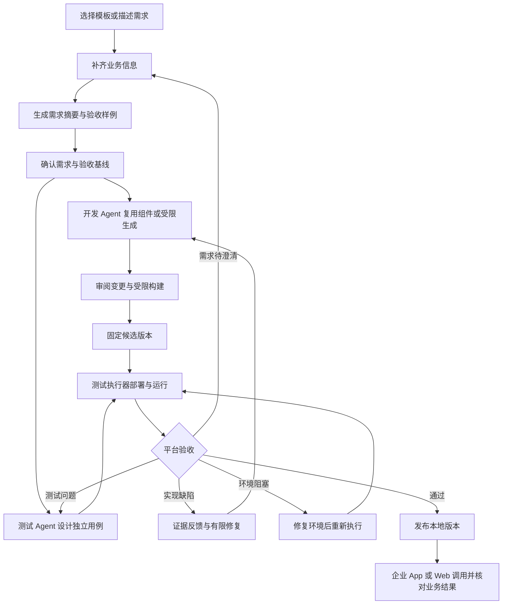
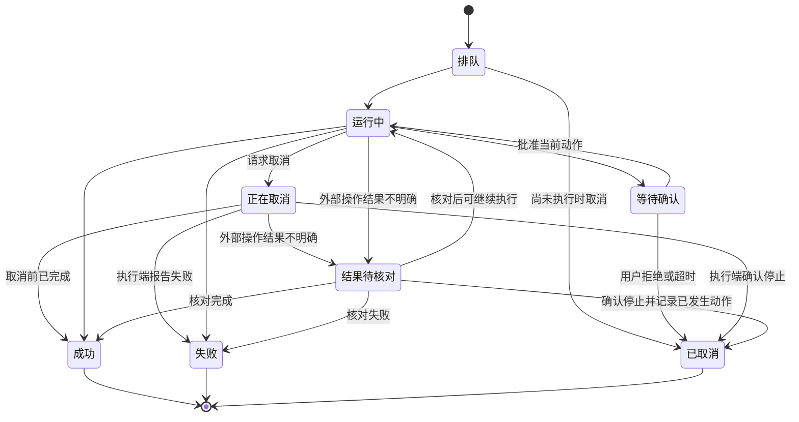

# 自然语言 to Agent 开发平台需求文档

版本：v0.1\
日期：2026-10-22\
适用范围：本地开发 Demo 与后续平台扩展\
修订说明：明确企业 AI 平台开发人员、一站式开发测试定位、候选测试入口及阶段必测集合；首期 P0 不建设执行沙箱。\
配套文档：[交互设计文档](NL2Agent_交互设计_v0.1.md)、[企业模拟环境规格](NL2Agent_企业模拟环境_v0.1.md)、[测试与验收基线](NL2Agent_测试与验收基线_v0.1.md)、[技术设计](NL2Agent_技术设计_v0.1.md)、[TDD 开发计划](NL2Agent_TDD开发计划_v0.1.md)

## 1 建设目标与范围约定

建设一个面向企业场景的 Agent 开发工作台，暂名 agent-builder。用户通过需求模板或分步问答描述任务，平台通过开发 Agent 和测试 Agent，生成业务 Agent 及其需要的 Skill、Rail、Tool，完成受限代码开发、独立测试和平台验收，在 openJiuwen Java 执行底座上验证并发布。优先复用已有组件；组件不足时，在允许的模板、接口和依赖范围内生成扩展。

目标客户是类似工商银行 AI 平台部门的开发人员；这是客户类型定位，不表示已获得该机构需求或完成客户验证。产品定位为一站式 Agent 开发／测试平台，覆盖需求、代码与组件生成、构建、调试、测试、修复及交付。首期发布指开发环境中的本地演示发布，生产托管、企业运行治理和生产安全认证不属于首期目标。

待验证的问题假设是：企业开发人员需要串联需求、SDK 编码、接口封装、测试与缺陷修复等工作，过程和证据分散。一站式流程应提高可验收交付的成功率；具体改善幅度在原型完成后测量，不补造客户访谈或现状数据。

首版完整 P0 的核心验收目标是：**用户完成需求输入后，平台能够以开发 Agent 和测试 Agent 协作的方式，生成真实运行的业务 Agent 及所需组件，完成构建、测试、修复和验收，发布到本地，并由模拟企业手机 App 调用。** 用户可在 Web 中检查代码与配置变更、Skill 和 Rail 装载信息、业务执行事件及外部结果。按第 3 章分阶段实现，但仅完成组件装配不代表完整 P0 已完成。

企业模拟环境是平台内可选择、可重置、可复用的演示与验证能力。业务身份、账户、理财产品和交易数据可以使用 Mock；Agent、生成组件、测试执行器和接口调用必须实际执行。界面动画或预录事件只能用于界面开发，不能替代运行证据。

### 1.1 方向与首版设计约定

用户已明确的方向是：基于 openJiuwen Java 仓库、本地实施、自然语言生成 Agent、参考 Studio 交互但实现独立、支持 DeepAgent 和灵活的 Rail 装配；平台向用户提供开发与测试两个 Agent，自动开发业务 Agent、Skill、Rail、Tool；提供企业 App 与业务接口的 Mock 环境，支持演示、生成和验证。本文的 P0 分阶段安排、具体示例数据与接口契约属于实施建议，不表示上游已有实现。

| 编号 | 约束 | 对实施的影响 |
| --- | --- | --- |
| D-01 | 使用 agent-core-java、agent-runtime-java 作为执行底座，按需复用 agent-solution 扩展 | 平台自身不重写 Agent Loop；缺口优先通过适配器或扩展补齐 |
| D-02 | 借鉴 agent-studio 的界面组织与交互，平台实现独立 | 不依赖 Studio 后端、数据库、DSL 或 Python Runtime；前端技术栈不受其限制 |
| D-03 | 以 Agent 工程为中心，重点支持 DeepAgent 与 Rail 装配 | Workflow 是一种开发形态，不要求所有 Agent 都转换成固定流程图 |
| D-04 | 在本地开发和运行 | Windows 加 WSL2 可作为开发环境；浏览器访问本地服务，无云端托管依赖 |
| D-05 | 表单和问答维护同一份需求记录 | 切换输入方式不丢失数据，不建立两套独立配置 |
| D-06 | 首版按版本创建实例并装配 Rail | 正在执行的实例不随草稿变化；不承诺运行中热替换 Java 类 |
| D-07 | 生成结果必须经过确定性校验和实际运行验证 | 模型自述成功、模拟事件和静态页面均不构成真实运行证据 |
| D-08 | 开发 Agent、测试 Agent 是平台面向用户的产品能力 | 不是仅用来开发 agent-builder 自身的工程助手；业务 Agent 是其交付对象 |
| D-09 | 自动开发覆盖 Agent、Skill、Rail、Tool，采用受限生成 | P0 通过模板、策略校验、任务适配器和代码审阅限制生成范围；不是操作系统级执行隔离 |
| D-10 | 验收标准与候选产物分别版本化，由平台裁定验收 | 开发 Agent 不能自行降低验收要求；测试 Agent 不能修改被测实现 |
| D-11 | 企业 Mock 是真实执行链的业务后端 | 模拟业务验证通过只覆盖该环境，不自动证明生产系统接入可用 |
| D-12 | 首期 P0-A/B/C 暂不建设执行沙箱 | 面向可信开发人员的单用户本地工作区；只使用受控模板与 Mock 业务连接，不接收任意第三方工程执行；沙箱及对抗性隔离测试后置 |
| D-13 | 平台采用 TypeScript，业务 Agent 保持 Java 底座 | Web、管理、编排、测试和 Mock 使用 TS；Java Bridge 与生成的 Java 工程复用 SDK，职责分开 |
| D-14 | TDD 导向实施，默认 Compose 单机交付 | 平台自身和自动开发均先测试后实现；Docker 统一环境，不改变首期无每任务安全沙箱的边界 |

本文件中的需求、数据模型和平台 API 均为拟议设计。源码中已存在的接口与拟新增能力应分别登记，不得将本文的 AgentSpec、RailDescriptor 或平台 API 当作 openJiuwen 现有标准。

### 1.2 可用 Agent 的定义

一个 Agent 只有同时满足以下条件，才可标记为“验证通过”：定义合法；依赖可解析且版本明确；目标环境的模型和工具连接可用；实际装配成功；通过当前快照对应的验收用例。发布还需完成实例就绪探测和入口切换。

“验证通过”限定于指定的快照、环境、连接版本和测试集合，不代表对任意业务输入均正确，也不自动覆盖模型服务后续变化。

对于自动生成代码的 Agent，还需固定源码修订、构建制品摘要和生成策略版本；编译通过、单元测试通过与业务验收通过分别记录。含必测失败、阻塞、未验证项的版本不能标为验收通过。

## 2 用户与使用方式

| 角色 | 主要任务 | 首版实现方式 |
| --- | --- | --- |
| 企业 AI 平台开发人员（首要用户） | 输入业务开发目标、接入接口、审阅代码与测试、调试并交付 | 默认开发者模式；具备 API、基本代码和测试理解能力 |
| 业务需求协作者（次要用户） | 补充业务规则、预期结果与验收样例 | 业务模式用于需求沟通，不要求其承担代码审阅 |
| 平台维护者 | 配置模型和 Runtime、注册组件、诊断环境 | 本地设置与资产管理 |

P0 采用单用户本地工作区，一人可承担上述角色；模式切换是界面呈现，不作为权限边界。服务默认绑定回环地址。项目标识在数据中保留，但不以此宣称已实现企业多租户隔离。对外共享、多人身份认证、企业角色体系列入 P1。

首要用户负责确认需求与测试基线、审阅生成变更、选择候选并发起演示发布；平台负责执行检查和裁定验收，两个工程 Agent 不替代这些责任。正常的需求补充、审阅与动作确认不视为自动开发失败；人工直接修补交付代码或测试必须单独记录。

### 2.1 平台自动开发职责

| 职责 | 输入与责任 | 交付与边界 |
| --- | --- | --- |
| 平台需求生成 | 问答补齐需求、生成业务需求条目和验收草案 | 用户确认的需求与验收基线；未确认内容保留来源标签 |
| 开发 Agent | 根据基线复用或生成 Agent、Skill、Rail、Tool，编写单元测试并修复实现 | 代码、配置、单元测试与构建请求；不能修改已确认验收标准和平台强制规则 |
| 测试 Agent | 开发开始时依据需求设计用例，候选版本就绪后分析执行结果 | 测试脚本、数据方案、缺陷与证据引用；可读源码，不可修改被测业务实现 |
| 平台验收 | 校验证据、执行确定性断言并汇总辅助模型评估 | 逐条业务需求的验收结果；不能用模型结论覆盖硬性失败 |
| 测试执行器 | 按固定候选、测试集和数据版本部署、执行及采集结果 | 实际命令、退出码、接口记录和业务状态；稳定回归无需每次由模型逐步操作 |

首版拟采用 OpenCode 的两个独立角色与会话，可共用服务。角色分别加载开发和验收测试 Skill；这些工程 Skill 与最终业务 Agent 装载的业务 Skill 分开登记。任务适配器检查正常操作路径的角色、目录和命令策略；会话、目录和独立进程均不构成安全沙箱。具体 OpenCode 版本、权限、事件采集与任务取消能力在 M0 核验。

### 2.2 产品收益与核心指标

核心指标为**交付成功率**：固定评测任务集中，在预先登记预算内完成自动开发／修复、通过独立业务验收并完成本地演示就绪探测的任务尝试数，除以该批次已启动的任务尝试总数。一次任务中的多个候选和修复重试只算一次任务尝试。正常的需求确认、代码审阅、测试基线确认和业务审批允许人工参与；需人工直接改交付代码或测试才能成功的任务计入“辅助交付”，不计入核心成功分子。

失败、超时、取消、环境阻塞、未验证和人工辅助均保留，不静默从分母剔除；环境问题另列原因。分母为零时显示“未评测”。分母使用开始评测前固定的任务和重复计划，禁止只选成功记录。模型标识、参数、版本、预算、种子、人工介入及全部修复尝试随报告保存。

原型开发完成后，使用代表性开发任务集进行评审；当前先确定口径和记录要求，不设未经测量的成功率目标，也不以缺少基线阻塞原型开发。用例设计从开发初期开始。阶段功能必测项必须逐项通过；交付成功率用于评估平台对任务集的交付能力，不替代硬性断言。耗时、人工投入和成本作为诊断信息，暂不设独立达标门槛。具体评测任务见测试与验收基线。

## 3 首版范围与后续范围

| 能力 | P0 本地可运行 Demo | P1 及后续 |
| --- | --- | --- |
| 管理面 | 单用户工作区、Agent 与资产管理、环境诊断 | 组织与项目空间、RBAC、资源配额、操作审计与审批 |
| 需求输入 | 模板填写、分支问答、需求摘要、待确认项 | 团队模板、批量导入、多语言 |
| Agent 类型 | DeepAgent 为主；提供基础 ReAct 工厂 | Workflow 可视化编辑、TeamAgent、多 Agent 协同 |
| Rail 装配 | 已注册 Rail 的装配；按允许 hook 模板生成扩展并验证实际触发 | 任意扩展开发、独立制品仓、热更新研究 |
| 工具与插件 | HTTP/OpenAPI 接入、MCP 远程连接、模拟工具 | 插件市场、第三方安装、更多协议和部署方式 |
| Skill | 登记、版本引用、根据接口生成业务 Skill；依 SDK 或明确适配器核验装载 | 自由在线编辑、自演进与共享分发 |
| 知识能力 | 调用已有检索 API，Demo 使用受控资料集 | 文档解析、向量化、知识库建设与治理 |
| Web 调试 | 对话、事件时间线、工具参数与结果、Rail 触发、取消 | 节点单步、断点编辑、任意检查点恢复 |
| 自动开发 | 开发／测试两个 Agent；Agent、Skill、Rail、Tool 受限生成、构建和修复 | 更多语言、模板、SDK 和复杂工程协作 |
| 验证与发布 | 独立测试、统一执行器、证据验收、本地发布、切换与回滚 | 灰度、集群调度、弹性和企业审批流 |
| 企业模拟环境 | 模拟手机 App、余额和理财 API、Skill 示例、故障注入、数据重置与证据查询 | 更多企业场景、真实企业系统适配、多人共享环境 |
| 工程交付 | 版本锁定、独立构建进程、任务策略检查、制品登记、诊断与导出 | 执行沙箱、对抗性隔离、完整浏览器 IDE、分布式构建 |

P0 不以“高级功能预留”名义提供没有实际效果的开关。未实现的能力必须标注规划状态，不能被选择进入可发布配置。Tool、Skill 和 Rail 分开建模；MCP 工具注册不等于 Rail 生命周期装配。

### 3.1 P0 分阶段实施建议

| 阶段 | 可演示增量 | 完成依据 |
| --- | --- | --- |
| P0-A 装配与运行基础 | 已有组件生成定义、设备运维 Demo、真实运行与本地发布 | AC-01 至 AC-20、AC-42a；基础 NFR 必测项，见测试与验收基线 |
| P0-B 双 Agent 与接口生成 | 双角色协作；从接口生成 Tool／Skill；模拟 App 查询余额与理财资料；固定候选和独立验收 | 累积 P0-A，加 AC-21、22a/b、23 至 28、29a、30 至 32、33a、36a、38a/b、39a/b、40a、41a/b/c、42b/c；只读业务必测集 |
| P0-C 扩展生成与业务闭环 | 生成 Agent 工程扩展和 Rail；模拟申购确认、幂等核对、故障修复与回归 | 全部 P0 FR 与 AC-01 至 AC-42 的全部子项、完整业务与 NFR 必测集 |

阶段是实施顺序，不将后续阶段能力移出产品范围。各阶段记录能力矩阵；完整 P0 中四类产物都应有实际生成与验证案例，不要求每个任务都重复生成四类产物。

阶段必测集合、复合 AC 的子项和数据前提以[测试与验收基线](NL2Agent_测试与验收基线_v0.1.md)为准。父 AC 只有全部子项通过才可标为完整通过；P0-B 仅通过部分子项时展示“本阶段通过，完整项待后续阶段”。

## 4 用户主流程



执行模式与业务环境分开：模拟执行不能进入实际发布判定；真实 Agent 调用企业 Mock API 可以形成该 Mock 环境的有效验收，并发布到本地演示入口。P0 业务连接仅允许登记的 Mock／测试服务，真实业务连接保持不支持；将来开放时需另行验证运行隔离与目标环境，不能沿用 Mock 报告。未解决的接口、连接或超出生成边界的组件缺口可保存为草稿。

### 4.1 标准需求模板

以下字段组成 RequirementBrief。字段同时保存来源、确认状态和更新时间，问答回答与表单填写共用同一份记录。

| 字段 | 面向用户的问题 | 生成前要求 |
| --- | --- | --- |
| goal | 给谁使用，要完成什么任务 | 必填 |
| input | 用户提供什么，如何触发 | P0 明确输入；触发限聊天和 API |
| resources | 数据和资料来自哪里，有哪些现成工具、Skill 或底层接口 | 可以先写待接入；区分已有资产、可生成封装和缺失后端 |
| clientAndEnvironment | 从 Web 还是企业 App 使用，连接哪个演示或业务环境 | 运行前固定环境、场景和调用身份来源 |
| generationScope | 哪些组件允许自动开发，有哪些接口与工程约束 | 开发者选择平台生成策略；业务用户不必填写类名 |
| process | 有哪些必须遵守的步骤，哪些允许自主决定 | 可选，系统提出建议后供确认 |
| actions | 允许查询、修改、创建或发送什么 | 必须明确有无外部写入 |
| approval | 哪些动作需要确认，由谁确认 | 有需确认动作时必填 |
| output | 输出格式和必需字段是什么 | 必填，可由模板给出可修改默认值 |
| exceptions | 缺信息、无数据、超时或失败时怎么办 | 必须采用明确的处理规则 |
| limits | 任务时长、轮次、工具范围和资源预算 | 可使用模板默认值，但须展示 |
| examples | 正常输入与预期结果，至少一个异常例子 | 实际发布前必填 |

第一轮只询问使用者、目标和交付物。后续优先追问影响执行的缺口；不询问已明确的信息。业务用户无需回答 Rail 类名、SPI、Maven 依赖等技术问题。

## 5 功能需求

### FR-001 工作区与环境诊断 P0

提供本地工作区、项目和 Agent 列表。首次进入检查管理服务、Runtime、数据库和模型配置；区分未配置、连接失败和版本不兼容。未就绪时允许保存草稿，禁止标记真实运行可用。

**验收：** 模型未配置时可创建草稿；点击真实运行应定位到缺失连接并给出修复入口。诊断结果包含检测时间，不把历史连通结果永久视为有效。

### FR-002 模板与分支问答 P0

提供空白、设备运维及企业金融服务模拟模板。表单与问答支持双向切换、保存和恢复。问答按缺失字段、歧义、资源可用性生成追问；用户可更正既有回答，并查看受影响的规则、组件和测试。

**验收：** 修改“只查询”为“允许创建工单”后，新增授权与确认问题；原来的目标和输出要求保留。更正不得静默覆盖已确认的其他需求。

### FR-003 需求摘要与生成前检查 P0

生成业务目标、执行规则、所需资源、验收样例及未决问题。每项标注“用户确认”“模板默认”“系统建议”或“待确认”。缺少关键业务参数、真实连接或授权时，明确列出阻塞项。

**验收：** 系统不得虚构工具标识或声称缺失接口已连接；可生成含待绑定项的草稿，但不可进入实际发布。

### FR-004 Agent 定义生成与局部修改 P0

自然语言构建服务仅使用当前可用的组件目录和受约束输出格式，生成 AgentSpec 或变更补丁。区分聊天、解释和实际修改。应用前显示增删改差异，应用后生成新草稿修订。允许人工调整和撤销到历史修订。

目录缺少组件时可转入 FR-018 的受限代码生成。新组件先作为候选登记，经构建和适配校验后，才可被 AgentSpec 正式引用；生成任务中的计划名称不能被当作已可用组件。

**验收：** “增加工单创建前确认”只修改相关规则、组件和测试；模型返回未知字段、无效组件或非法参数时，校验拒绝应用并显示错误。自动修复尝试设次数上限，仍失败则保留诊断。

### FR-005 Agent 工厂与能力适配 P0

提供 DeepAgent 和基础 ReAct 的装配工厂，平台工厂将统一定义映射到固定版本的 Java SDK。每种工厂声明支持的工具、Rail、Skill、交互控制和事件能力。类型切换前展示不兼容字段及处理方案，禁止静默丢弃配置。

**验收：** 同一发布定义可在重启后重新装配；实际实例回报的类型、版本和依赖与定义一致。SDK 中尚无对应实现的字段必须拒绝，而非仅持久化后忽略。

### FR-006 Rail 目录与装配 P0

RailDescriptor 至少包含组件 ID、版本、说明、适用 Agent 类型、挂载事件、参数 Schema、优先级规则、依赖、冲突、状态作用域和实现制品引用。用户可启用已注册 Rail、修改允许的参数，并查看有效顺序。强制策略由平台配置锁定，生成服务无法移除。

有效顺序以 SDK 的实际优先级语义为准，不能默认“数字越大越先执行”。需要将平台顺序与 SDK 注册机制的映射写入适配测试。单次运行的可变 Rail 状态不得跨 Agent 或会话泄漏。

**验收：** 至少一个生命周期扩展 Rail 和一个观测或业务约束 Rail 实际执行，产生可核对事件。自定义 Demo Rail 可以新建，但必须标记为平台扩展，不能冒充上游内置组件。

### FR-007 HTTP 和 MCP 工具接入 P0

HTTP 工具支持方法、路径、输入输出 Schema、连接引用、超时和读写分类；OpenAPI 导入后允许选择操作，并拒绝暂不支持的规范部分。MCP 首版支持一个经固定 SDK 验证的远程传输方式，读取工具列表后执行参数与结果适配。stdio 进程管理可后置。

连接与工具定义分离。工具定义可复用，测试环境和发布环境绑定不同连接。仅执行无副作用探测或显式选定的测试请求；导入工具不自动执行写操作。

**验收：** 各完成一个 HTTP 和 MCP 工具的真实调用，并记录工具版本、连接引用、参数摘要、结果和耗时。协议不支持、认证失败和返回格式错误具有不同错误码。

### FR-008 模型连接与凭据管理 P0

模型连接记录提供方、服务地址、模型标识、功能能力和凭据引用。连通测试同时核对所需功能，例如流式输出和工具调用。凭据在服务端保存，UI 只显示脱敏状态；不得写入 AgentSpec、聊天记录、普通日志或导出包。

**验收：** 更换凭据不会改变工具的业务定义；无效凭据得到明确诊断。模型名称相同不等于能力相同，实际请求不支持工具调用时阻止相关 Agent 运行。

### FR-009 Skill 与知识服务引用 P0

登记受信任 Skill 的来源、内容或包摘要及版本；只装载适配器明确支持的能力。知识检索作为工具连接，结果包含资料标识和可引用片段。首版不建设文档解析与索引流水线。

Skill 可由已有包导入，或由 FR-023 根据业务接口生成。Skill 描述适用任务、输入输出、步骤、异常处理及所依赖的 Tool；底层 HTTP 调用、认证和参数适配由 Tool 或已验证的 Skill 执行适配器承担。仅生成说明文件不代表模型已有可调用能力；采用哪种装载与调用路径需在能力矩阵中明确。

**验收：** 运行记录能追溯所用 Skill 和检索工具版本；资料不足时输出“依据不足”或追问，不允许把模型补写内容作为检索证据。

### FR-010 Web 运行与事件追踪 P0

每次运行绑定不可变快照、环境和连接绑定版本。展示任务状态、模型调用摘要、工具执行、Rail 触发、用户确认请求及错误。执行事件由服务端产生，不能根据前端动画伪造成功记录。展示计划、结果和可观测信息，不要求采集模型未暴露的内部推理过程。

一个会话可包含多个 Run。缺少业务参数时，P0 将追问作为当前 Run 的正常响应结束；补充回答在同一会话启动新 Run。动作确认则保持原 Run 等待决策。更换快照后默认创建新会话，旧会话只读保留，避免上下文混用。

**验收：** 查看任一工具调用可关联 Run、步骤和版本；刷新页面后可恢复历史事件。流连接断开不等于运行终止，前端应重新查询服务端状态。

### FR-011 人工确认与执行控制 P0

对配置为需确认的写操作，先创建待执行动作，保存工具、规范化参数摘要、快照和确认标识；确认前无外部副作用。确认结果与当前用户、Run 和动作绑定，重复点击只产生一次有效决策。参数改变需重新确认，拒绝或过期后不得执行。

取消以服务端确认结果为准。点击取消后进入“正在取消”；未收到确认前不显示“已取消”。已发生的外部操作不自动撤销，超时后结果不明确时标为“结果待核对”。写操作仅在目标接口支持幂等或可核对结果时自动重试。

**验收：** 拒绝创建工单时写接口调用次数为零；重复确认不会重复创建。若 SDK 中断恢复能力不足，应在适配层实现明确的待执行动作机制，并验证续接语义；未实现时不可发布含该规则的 Agent。

### FR-012 测试集与验证报告 P0

测试分为定义校验、装配检查、连接检查、行为测试。测试集至少包含正常、缺参数、拒绝确认、工具失败等场景。确定性断言覆盖输出 Schema、指定工具调用、禁用工具零调用及确认前零写入；模型评分只能作为补充。

默认写入测试使用独立数据的 Demo 业务服务，并在执行前说明预期写入。P0 不接真实业务连接，测试模式不能绕过正常调用入口的服务端控制。

**验收：** 每次报告关联快照哈希、测试集版本、环境和依赖绑定摘要。影响行为的配置变化、连接版本变化或测试变化使旧结果失效。模拟执行模式的结果不能满足实际发布门槛；真实执行调用 Mock 接口的结果按对应环境判定。

补充自动开发验收规则：报告还需绑定业务需求版本、候选制品摘要、测试数据／故障配置版本和评估规则版本。每项结果为通过、失败、阻塞或未验证；旧报告保留，但对变更后的验证对象不再有效。模型评分记录评分标准、模型标识和证据引用，P0 作为辅助信息。全部必测项通过、证据齐全且绑定匹配后，才可进入发布检查。

测试失败按实现、测试、环境和需求问题分流。修复重试必须保留全部执行记录，设置次数、时长和资源预算，不能通过反复运行只保留一次成功结果。需求或验收标准变更需经用户确认形成新基线，开发和测试角色均不能自行删除必测场景或降低通过标准。

本文 FR／AC 编号验收 agent-builder 平台；每个生成项目另建 BR-xxx 业务需求和 TC-xxx 用例，建立需求到断言及证据的映射。两层测试分开记录，平台通过不表示任意生成项目均通过。

### FR-013 本地版本发布与回滚 P0

草稿可变，发布版本不可变。发布前检查当前快照验证报告，创建或加载目标版本实例，等待就绪，再切换本地调用入口。每次发布有 operationId 和幂等键，失败保留原已就绪版本。

回滚选择历史定义及其兼容制品重新验证连接和就绪状态，成功后切换入口。运行中的任务按其原快照继续，除非用户另行取消。禁止将编辑草稿直接写入现行实例。

验证报告必须匹配发布目标的环境配置与绑定版本；独立 Mock 数据实例之间仅按企业模拟环境规格第 6.2 节的兼容规则复用。针对同一调用入口，发布和回滚串行处理；关闭页面不取消已受理操作，重新进入后通过 operationId 查询。

包含生成代码时，发布加载已验收的同一制品摘要，不在发布步骤重新生成或替换代码。候选测试部署不切换演示入口，验收通过后才创建发布版本并切换。Mock 环境验证通过可发布到该演示环境，不能直接转成生产连接的发布许可。测试与演示数据实例分开；允许转移验收结论的绑定条件见企业模拟环境规格第 6.2 节。

**验收：** 连续发布 v1、v2 后，旧运行仍关联 v1；回滚后新调用使用 v1。目标实例启动失败时不得显示发布成功。

### FR-014 日志与运行记录 P0

提供按 Agent、版本、Run、状态和时间查询。保存结构化事件与脱敏错误，提供简明错误原因及开发者详情。历史浏览是读取事件记录；“重新运行”会创建新 Run，可能再次触发业务动作，不能标为无副作用回放。

增加开发与测试任务记录：角色、OpenCode 会话引用、输入基线、变更摘要、实际命令、退出码、构建产物和测试报告。它们与业务 Session／Run 分开存储，通过任务、候选和验收记录关联。原始执行证据由构建环境、Runtime、测试执行器或 Mock 服务采集，Agent 生成的总结仅作为解释。

**验收：** 同一 Run 的事件有稳定顺序和唯一事件 ID；重连去重后不重复展示。密钥及认证 Header 不出现在导出的诊断记录中。

### FR-015 导出与本地恢复 P0

导出需求、AgentSpec、组件锁定清单、测试和运行说明；凭据只导出待配置项。自定义代码制品必须随版本登记，缺失时导出包明确说明依赖来源。支持将导出包导入另一本地工作区，重新绑定连接后校验。

自动开发项目同时导出生成源码、工程模板版本、构建说明、制品摘要、业务需求与用例映射；可选导出演示场景包、Mock 接口契约和数据种子。导出包清单说明证据是否随包携带，不能因缺少本地历史路径而无法恢复。

**验收：** 新工作区可导入、定位缺失依赖并按说明恢复；不存在“导入即继承原凭据”的行为。

### FR-016 完整代码编辑与 Workflow 编辑 P1

后续增加完整浏览器 IDE、更广泛的工程编辑与调试，以及 Workflow 画布。P0 的受限代码生成、构建和制品登记由 FR-017 至 FR-020 覆盖，不再整体后置。任何生成代码都不能直接在管理进程中执行。

### FR-017 双 Agent 自动开发编排 P0

平台根据已确认需求创建开发任务，分派独立的开发和测试角色。测试角色在实现开始时准备需求驱动的用例；开发角色提交候选后，由执行器运行。任务支持进度、诊断、取消、有限修复和重启后状态核对。稳定用例可由执行器直接回归，不必重新调用模型设计。

首版 OpenCode 接入通过适配层完成，不把其 Session 当作业务 Session。任务绑定引擎版本、角色配置、工程 Skill 版本与生成策略；可同机顺序执行，不要求两套服务。超限、执行环境不可用或需求待确认时保留已产出内容并明确结束或阻塞原因。

**验收：** 用户从平台发起需求后，能看到两个角色的独立任务记录、同一需求基线、测试草案与候选结果；预置实现缺陷能按证据修复并产生新候选，达到预算上限时停止而非无限循环。

### FR-018 Agent／Skill／Rail／Tool 受限生成 P0

| 产物 | P0 允许生成的内容 | 必需验证 |
| --- | --- | --- |
| Agent | 固定 Java SDK 上的 Agent 工程、启动／装配代码、AgentSpec 与允许的业务扩展 | 编译、装配、真实任务执行；复用 SDK Loop |
| Skill | 业务描述、输入输出约束、步骤、异常处理与 Tool 引用；P0 使用经审阅的固定执行模板 | 包检查、装载／适配、模型触发和实际业务结果；任意外部脚本后置 |
| Rail | 已核验 hook 模板中的可观测或业务约束实现、参数 Schema | 实际触发、状态隔离与约束效果；不得移除平台强制策略 |
| Tool | 根据受支持接口契约生成调用适配、Schema、错误映射与测试 | 请求／响应契约、认证引用、超时、读写分类与实际调用 |

生成策略固定模板版本、SDK／依赖允许列表、工作目录、任务适配器允许命令、连接目的地和资源预算。超出边界的需求输出具体缺口，可保存为待扩展任务；不得静默放开任意依赖或命令。P0 策略在生成入口、构建前检查和任务适配器实施，不宣称可阻止任意代码直接操作本机。源码、配置和测试差异可审阅，应用采用草稿修订检查。使用预先审阅模板的授权任务可自动构建，应用到项目和发布仍为独立动作。

**验收：** 完整 P0 四类产物各有一个真实生成案例；提交超范围路径、依赖、命令或连接的任务请求被策略检查拒绝并留记录，扫描未通过的产物不进入执行。Agent 工程有可检查的生成源码，不能仅以保存 AgentSpec 代替该项验收。扫描与请求校验不构成任意代码无越界行为的证明。

#### FR-018 分阶段启用与交付门槛

四类产物分开登记生成策略和可用状态。每一类只有在端到端验证完成后，才可由工作台提交生成请求；尚未接通的类型应显示“计划中”或“待验证”，不能显示为可生成。一个类型的通过证据不自动证明其他类型通过。

| 增量 | 生成范围 | 必须先通过的真实验证 | 可用边界 |
| --- | --- | --- | --- |
| G1 Skill 扩展 | 根据固定业务 Tool 契约生成 Skill 指令；只能引用候选实际装配的 Tool | 包格式与内容检查、SDK 装载、真实模型选择该 Skill、外部 Mock 结果匹配 | Skill 不承载认证、网络请求或任意脚本；Tool 仍按已审阅连接配置执行 |
| G2 Rail 模板生成 | 从已审阅 Rail 模板中生成类型与参数，例如单次调用限额；平台强制 Rail 不可生成或移除 | 参数 Schema 拒绝未知字段、SDK hook 实际触发、边界值生效、会话间状态隔离、事件可追溯 | 首期输出是受限 Rail 定义并由固定适配器实例化，不是任意 Java hook 源码 |
| G3 Agent 工程生成 | 生成固定 SDK 的工程入口、装配代码和 AgentSpec 映射 | 源码编译、实例清单与需求一致、真实任务运行、停止与失败状态可观察 | 复用固定 SDK Loop；不得复制或替换 Runtime 核心 |
| G4 写 Tool／Skill 与组合交付 | 从受支持写接口契约生成参数适配、Skill 步骤和测试 | 未确认零写入、身份与参数绑定、拒绝／重复／超时核对、独立 Mock 账本断言 | 只允许具备确认、幂等或结果核对机制的登记操作 |

当前工作台仅启用 G1 的设备只读 Tool／Skill 固定配置；G2、G3、G4 均未通过端到端门槛，不能据此承诺已支持任意 Skill、Rail、Agent 工程或写 Tool 自动生成。新增类型应先完成契约、负向校验和实际装载／行为测试，再开放页面入口。

### FR-019 受限构建与候选产物 P0

构建使用独立于管理服务的进程和任务目录，固定源码、模板、依赖和构建命令。平台提供给开发角色的操作仅面向开发工作区，测试角色的编辑操作仅面向测试区与结果区；正常任务工具不得修改被测源码和制品。命令使用预先配置的模板，角色无任意 Shell 操作入口。P0 不实现操作系统级沙箱，普通文件权限与流程检查不证明任意生成代码无法越界。

构建服务登记源码修订／摘要、制品摘要、构建日志与退出码，组装不可变候选清单。测试部署从该清单复制并校验产物；开发目录后续修改不影响当前测试。平台不向生成进程注入发布凭据、Mock 管理凭据或验收写权限，也不把整个用户目录作为任务目录。该约定不保证同一操作系统用户下的恶意代码无法另行读取文件。构建失败不得登记为可运行组件。

同一源码修订、依赖锁定和构建配置只构建一次固定候选；多个验收用例可在同一 App／Runner 镜像摘要上连续执行，不得因切换测试用例而重建镜像。用例之间通过独立 TestDeployment、数据命名空间或固定重置流程隔离状态。代码、依赖或镜像构建配置发生变更时，生成新候选并重新构建受影响镜像。

**验收：** 相同候选在独立测试目录可装配；测试期间修改开发源码不改变候选摘要与实际执行版本；测试角色经平台编辑或命令入口修改被测实现被拒绝，产物摘要异常使测试中止。构建进程退出、超时和取消可核对，不能只在 UI 隐藏继续执行的任务。

### FR-020 独立测试与统一执行器 P0

测试 Agent 根据业务需求、接口契约和确认后的验收标准生成测试草案，可读取实现辅助定位，但不能只依据现有返回值生成预期结果。用户确认测试集后固定用例、断言、数据准备和确认路径。开发角色无权覆盖该基线；测试角色的基线修改作为建议提交。

执行器负责候选部署、环境就绪、数据初始化、用例执行、真实状态采集与清理。每次测试使用独立环境实例或独立数据命名空间，写入测试显式标注目标环境。模拟 App 的审批由执行器按固定测试步骤通过正常确认入口提交；不得直接修改待执行动作状态以绕过控制。

执行器支持固定候选的验收批次：一次构建并锁定 App／Runner 镜像摘要后，可在同一批次执行多项 AC、业务 TC 和 NF 用例；每项独立记录状态、环境实例及证据，整个批次共享候选和镜像摘要，环境配置按用例记录。只读用例可顺序复用服务；会改动余额、订单、发布指针、故障配置或进程状态的用例，必须使用独立部署／数据命名空间或经验证的重置，并与其他用例串行执行。停止 Runner、重启服务等破坏性场景应在隔离部署中执行或安排在批次末尾，完成后核对恢复状态。

候选测试入口确定为 `/test-api/deployments/{testDeploymentId}`，普通演示仍使用 `/agent-api`。执行器通过管理 API 创建 TestDeployment，固定 candidateId、制品摘要、测试集、策略与环境绑定；测试入口和演示入口复用消息、身份、审批、去重、取消处理代码，只改变版本解析方式和调用权限。测试入口只接受本次测试的授权，禁止回退到现行发布版本。无已发布版本也能测试首个候选；停止后入口失效，证据保留。完整契约见企业模拟环境规格第 6.1 节。

**验收：** 一套已固定脚本无需再次调用测试 Agent 即可回归；同一固定镜像可在一次验收批次执行多项用例，测试项之间不触发镜像构建；Agent 回答“成功”但外部状态不匹配时断言失败；脚本错误、环境阻塞与实现缺陷可区分，缺证据时不通过。

### FR-021 企业业务 Mock 环境 P0

提供可启动、选择、重置和导出的企业场景环境。首个新增场景为金融服务模拟环境：模拟用户、账户余额、理财产品资料、持仓和模拟申购接口；保留设备运维场景作为基础回归。所有金融数据为虚构数据，不接入真实账户或资金。

环境包包含接口契约、数据种子、身份与权限样例、错误码、超时／失败注入规则及证据查询接口。控制面与业务 API 分离，业务 Agent 不得调用数据重置、故障开关或证据管理接口。环境实例记录场景版本和状态批次；运行中不得重置其数据，重置不删除历史证据。

**验收：** 可按同一数据种子重复运行；可观察调用次数、参数、响应、余额和订单等状态；可注入“写入已成功但响应超时”；不同环境实例互不污染。Mock 验证只证明该模拟契约下的能力。

### FR-022 模拟企业手机 App 与已发布 Agent 接入 P0

提供移动端尺寸的 Web 模拟 App，支持选择模拟身份、发起请求、查看答复、确认／拒绝动作、查询结果和刷新恢复。P0 不要求原生移动应用。App 经调用适配入口访问已发布且就绪的 Agent，不能直接修改草稿、验收结果或绕过 Agent 调用业务写接口来伪造效果。

调用入口校验模拟身份并绑定可信用户上下文；用户消息或模型参数不能任意更换账户归属。客户端请求标识用于去重，确认与拒绝绑定当前身份、Run、动作和参数摘要。调用身份校验是本地模拟契约，不代表已集成企业 SSO。

**验收：** 从模拟 App 完成查询余额与理财资料；返回请求关联的 Agent 版本和运行结果。重复提交不产生重复业务动作，换身份不能查看另一用户账户或批准其待确认动作，刷新不重新发送请求。

### FR-023 从业务接口生成 Skill 与调用适配 P0

用户选择 Mock 环境的 OpenAPI／受支持 Schema 和业务目标，平台识别可复用 Tool，生成缺失的 Tool 适配及业务 Skill。产物声明接口操作标识、输入输出、调用身份来源、读写分类、确认要求、异常规则和依赖版本。已有接口是生成依据，不能根据自然语言虚构后端能力。

至少支持“查询余额”“查询理财产品”两个只读 Skill，以及“模拟申购”写入 Skill。可采用 Tool 封装加 Skill 指引，或经 M0 验证的 Skill 执行适配路径；报告明确实际调用方式。能力不仅可生成，还应可登记复用、装载到业务 Agent 并被模型实际选择和执行。

**验收：** 在不存在预置余额 Skill／Tool 的工作区，仅提供接口契约与业务要求即可生成、构建／检查、登记、装载并完成实际余额查询。接口字段变化产生新组件版本并要求重测；未知接口保持缺口，不生成假成功结果。

## 6 定义与数据契约

### 6.1 核心对象

| 对象 | 关键内容 | 不变规则 |
| --- | --- | --- |
| RequirementBrief | 业务字段、来源、确认状态、未决问题 | 可修订，保留变更记录 |
| AgentDraft | spec、revision、最近编辑来源 | 使用乐观锁，拒绝覆盖较新修订 |
| AgentSnapshot | 规范化定义、内容哈希、锁定依赖 | 创建后不可变 |
| ComponentDescriptor | 类型、版本、Schema、兼容性、制品摘要 | 被版本引用后不可原地修改 |
| ConnectionBinding | 服务地址、非密配置、secretRef、绑定版本 | 环境特定；无明文密钥 |
| ValidationReport | snapshot、测试集版本、绑定摘要、结果 | 与验证对象精确关联 |
| AgentVersion | snapshot、制品、创建时间、说明 | 发布定义不可变 |
| Deployment | 版本、目标、期望状态、实际状态、operationId | 切换以实际就绪为准 |
| Session | Agent、快照、对话上下文、Run 列表 | P0 每个会话固定快照，跨会话隔离 |
| Run 与 RunEvent | snapshot、session、状态、步骤、事件序号 | 运行状态由服务端裁定 |
| PendingAction | 工具、参数哈希、确认人、期限、决策 | 一次有效决策，动作变更即失效 |
| RequirementBaseline | briefRevision、BR 业务需求、确认人、验收规则版本 | 已确认基线不可被开发或测试角色覆盖 |
| DevelopmentJob 与 TaskExecution | 基线、角色、引擎会话引用、策略版本、命令、退出码、预算、状态 | 开发与测试上下文分离；与业务 Run 分开 |
| GenerationProfile | 模板、SDK、依赖、目录、命令、连接允许范围、预算与执行模式 | P0 executionMode=trusted-local；入口和任务适配器执行流程检查；不声称有 OS 沙箱 |
| BuildArtifact 与 CandidateBundle | 源码摘要、构建记录、制品摘要、AgentSnapshot、依赖清单 | 候选不可变；测试和发布使用同一制品 |
| TestDeployment | candidateId、制品摘要、suiteVersion、环境实例、策略／绑定摘要、测试授权与实际状态 | 无需发布；不能修改现行入口；请求绑定固定测试部署，停止后拒绝新调用 |
| TestSuite 与 TestExecution | BR／TC 映射、断言、数据版本、候选、环境实例、每次执行结果 | 基线变更需确认；全部尝试留存 |
| EvidenceRecord | 采集方、类型、对象引用、内容摘要、受控存储引用 | 执行器／Runtime／Mock 服务采集，不接受模型总结替代原始证据 |
| ScenarioPackage 与 EnvironmentInstance | 契约、数据种子、故障配置、场景版本、实例 ID、状态批次 | 运行中不重置；隔离实例；历史证据保留 |
| ClientRequest | 客户端请求标识、可信模拟身份、会话、Run、入口类型及已解析目标 | 目标为发布版本或测试部署；去重和会话禁止跨目标复用，不能指定他人身份 |

ValidationReport 扩展保存 requirementBaselineId、candidateId、suiteVersion、testDeploymentId、validationCompatibilityKey、评估规则版本、逐项结果与 evidenceRefs；每个用例记录实际 environmentInstanceId、绑定摘要、数据和故障配置版本。汇总报告可引用多个测试部署和环境实例，不把所有用例假写为同一环境。可追溯关系为：业务需求基线 → 开发／测试任务 → 源码与候选制品 → 用例和测试部署 → 业务 Run／外部状态证据 → 验收报告 → 发布版本。traceId 在实际采集时关联，不要求 P0 先建设分布式追踪系统。

### 6.2 AgentSpec 示例

下面展示平台拟议格式。示例中的 demo.* 是计划实现或登记的组件 ID，不表示上游已有同名类；实际 ID、版本、挂载点由能力目录提供。

```json
{
  "schemaVersion": "0.1",
  "agentId": "equipment-assistant",
  "name": "设备运维助手",
  "agentType": "deep",
  "modelRef": "model/local-default@1",
  "instructions": "根据告警和维护资料给出处理建议。缺少设备编号时先追问。",
  "tools": [
    {"ref": "demo.alarm-query@1.0.0", "connectionRef": "conn/alarm-test@1"},
    {"ref": "demo.manual-search@1.0.0", "connectionRef": "conn/manual-test@1"},
    {"ref": "demo.ticket-create@1.0.0", "connectionRef": "conn/ticket-test@1"}
  ],
  "rails": [
    {"ref": "demo.task-planning@1.0.0", "enabled": true, "params": {}},
    {"ref": "demo.audit@1.0.0", "enabled": true, "params": {"redact": true}}
  ],
  "actionPolicy": {
    "confirmationRequired": ["demo.ticket-create@1.0.0"]
  },
  "execution": {"maxTaskRounds": 12, "timeoutSeconds": 120},
  "memory": {"scope": "session"},
  "output": {
    "type": "object",
    "required": ["deviceId", "findings", "recommendations", "sources"]
  }
}
```

actionPolicy 是管理侧规则，应由服务端执行路径强制实施；可通过已验证 Rail 或适配器实现，不能仅加入提示词。工具调用次数、任务轮次与模型调用次数应分别定义，不能混用同一个计数器。

### 6.3 事件契约

事件至少包含 eventId、runId、sequence、occurredAt、type、snapshotId、stepId、parentStepId 和脱敏 payload。Rail 事件增加 componentId、componentVersion、hook、outcome、durationMs。模型未提供的 token 或费用字段保存为 null，不填零。

建议事件类型：run.started、task.updated、model.started、model.completed、tool.started、tool.completed、rail.triggered、approval.requested、approval.resolved、run.cancel_requested、run.cancelled、run.reconciliation_required、run.completed、run.failed。事件名称属于平台协议，通过适配器映射真实底层事件；未采集到的事件显示“不可用”，不得补造。

### 6.4 工程与环境事件

开发任务、构建、测试和环境操作使用单独的事件流，至少包含 eventId、sequence、occurredAt、subjectType、subjectId、type、correlationId、脱敏 payload 和 evidenceRefs；工程事件不强行填写不存在的业务 runId。候选、测试或 App 请求触发业务执行时再关联相应 Run。

建议类型包括 development.started、development.blocked、development.cancel_requested、development.cancelled、build.completed、build.failed、candidate.created、test.started、test.completed、validation.decided、environment.ready、environment.reset。候选生成、构建成功、测试通过和发布就绪是不同事件；不得把 OpenCode 会话正常结束映射为业务验收通过。

## 7 状态与版本规则

避免用一个状态字段同时表达草稿开发、自动开发任务、测试执行、业务运行和发布。各类状态独立维护。

| 维度 | 状态 | 关键转换 |
| --- | --- | --- |
| 开发 | 草稿、待补充、可校验、验证中、验证通过、验证失败 | 变更快照后重新验证 |
| 运行 | 排队、运行中、等待确认、正在取消、成功、失败、已取消、结果待核对 | 服务端事件与查询共同决定 |
| 部署 | 未部署、部署中、已就绪、部署失败、回滚中、已停止 | 健康探测成功才切换调用入口 |
| 自动开发任务 | 排队、开发中、构建中、待审阅、测试中、修复中、阻塞、正在取消、已取消、完成、失败 | 完成表示候选交付，不表示已发布；超限停止并保留证据 |
| 测试／验收 | 未验证、排队、执行中、通过、失败、阻塞、已取消 | 必测项缺失不能通过；绑定变化后历史结果对当前对象过期 |



P0 对需要确认的工单创建，拒绝即取消该次运行；已生成的只读分析结果保留。进程异常重启后，不自动重放写操作。未正常结束的运行进入恢复核对流程；历史事件仍可浏览。

## 8 本地实施边界

### 8.1 建议部署组成

| 组成 | 建议职责 | 本地实现约束 |
| --- | --- | --- |
| Web 工作台 | 管理、需求收集、装配、调试、版本 | React、Vite、TypeScript；开发时代理请求，演示时由 app 提供静态文件 |
| 平台管理服务 | 定义、目录、连接、测试、发布与事件查询 | TypeScript／Fastify 模块化单体；后台 worker 处理持久化作业，不在管理进程执行生成代码 |
| Java Runtime 服务 | 对接 Core 和已选 Solution 扩展 | 与管理服务独立进程；测试部署使用固定候选；生成代码不加载到平台管理进程，也不宣称进程等于沙箱 |
| 数据服务 | 元数据、Run 与事件持久化 | 建议 PostgreSQL；Redis 按所选 Runtime 的状态存储需要接入 |
| Demo 工具服务 | 告警、资料检索、工单模拟业务系统 | 可确定性复现；明确为示例数据服务 |
| 模型服务 | 需求生成与业务 Agent 推理 | 支持可访问的远程服务；本地模型按资源另配 |
| 自动开发引擎 | 承载开发／测试角色与独立会话 | 首版拟接入 OpenCode；平台经服务端适配器调用并采集真实事件 |
| 构建与测试执行器 | 受限生成、构建、固定候选部署、测试和证据采集 | 同机顺序执行；独立任务目录和进程、命令模板、摘要核验与进程终止；强隔离后置 |
| 业务调用代理 | 解析登记操作、注入 Mock 身份、检查审批和幂等、转发并采证 | 与生成代码分离的正常调用路径；无任意 URL 转发；并非本机网络隔离设施 |
| 企业模拟环境 | 金融业务 Mock、身份适配、场景数据、故障注入与证据查询 | 业务接口和管理接口分离；数据按环境实例隔离 |
| 模拟企业 App | 已发布 Agent 的外部调用演示 | 移动 Web；通过可信调用入口传递模拟身份，不持有管理凭据 |

默认 Compose 演示只对宿主回环地址发布 app 的 8080 端口；Runner、Mock 与数据库使用内部网络，候选 JVM 由 Runner 分配内部端口。开发时 Web 可用 5173，其他端口配置化。浏览器使用同源入口，不持有模型凭据；首次启动检查端口冲突。物理组成与卷布局见技术设计第 12 节。

### 8.2 本地开发交付要求

1. 锁定三个 Java 仓库的 commit 或 release，并生成依赖矩阵。JDK 17 可作为核验起点；最终版本以选定 POM 和编译结果为准。
2. 默认交付 Docker Compose 单机环境，提供版本锁定、启动顺序、迁移、示例数据、健康检查、持久卷和停止说明；同时支持数据库容器化、应用在 WSL／IDE 本地调试。容器部署不等于任务沙箱。
3. Windows 项目建议放在 WSL Linux 文件系统内；说明 Windows 浏览器如何访问回环服务。
4. 企业代理、CA、Maven 和前端依赖源均可配置。失败时保留原始错误分类，不要求关闭证书校验作为常规修复。
5. 本地凭据不随 Git 或导出包提交；服务重启后可恢复草稿和历史版本。
6. 管理面与执行面之间使用显式适配接口。先验证真实服务入口、取消、确认续接和事件机制，再固化适配实现。
7. 固定 OpenCode、角色配置、工程 Skill、生成模板、构建配置与测试工具版本；核验平台入口的路径／命令／依赖策略、候选摘要和子进程停止。策略路径不可用时不得开放对应生成能力；不以此证明可抵御任意代码绕过。
8. 提供企业 Mock 与模拟 App 启动说明、场景包、数据重置和故障注入方式；演示与自动化测试分别创建环境实例，避免共享可变数据。凭据与模拟身份材料的用途明确区分。
9. 按 TDD 开发计划先写失败测试、实现最小行为并重构；平台测试、生成工程单测、独立业务验收分别记录。阶段交付需真实适配器和模型／Mock 运行证据，离线替身结果不得冒充实际通过。

### 8.3 首期无沙箱的执行边界

首期所有阶段使用 `trusted-local` 模式：可信开发人员、受控工程模板、独立工作目录和进程、正常平台操作路径的策略检查；业务接口限定为 Mock。模型和依赖下载按开发环境连接配置访问，业务 Agent 的 Tool 不暴露 Mock 管理操作。生成后的 Java 工程及固定模板执行文件仍会以本地运行账户的权限执行；不得把工作目录、提示词、静态扫描或不同会话当作文件／网络强隔离。

业务调用代理是平台维护的普通适配服务，生成 Tool 使用固定代理客户端按登记的 operationId 调用；代理持有 Mock 连接配置，校验运行上下文、账户归属、规范化参数、确认状态及幂等键。Mock 业务 API 自身也校验连接身份。正常调用路径中缺少确认、身份错误或未登记操作必须拒绝；不支持任意 URL 或管理接口转发。审批决策入口不作为生成角色可用工具。

P0 测试这些应用协议规则，不承诺阻止恶意生成代码读取同账户文件、窃取凭据后伪装可信调用、直接联网或修改宿主进程。正式沙箱、宿主文件／网络越界和容器逃逸等对抗测试列入后续阶段。在该边界下继续实现四类生成与真实 Mock 执行，不用模拟日志替代。开发人员从专用 Demo 工作目录运行，平台不主动注入生产业务凭据。

### 8.4 拟议平台 API

以下是新平台 API 草案，不是上游 Runtime 的现有接口。前后端可据此先建立契约测试。

| 方法与路径 | 用途 | 关键输入或行为 |
| --- | --- | --- |
| GET /api/capabilities | 获取当前工厂与组件能力 | 返回兼容范围、支持状态与目录版本 |
| POST /api/agents | 创建 Agent 草稿 | projectId、模板或需求 |
| PATCH /api/agents/{id}/draft | 应用人工修改或模型补丁 | expectedRevision；冲突返回 409 |
| POST /api/agents/{id}/generate | 生成定义修改建议 | briefRevision、catalogVersion；不直接发布 |
| POST /api/validations | 校验或执行测试 | snapshotId、suiteVersion、environmentId |
| POST /api/runs | 创建运行 | snapshotId、sessionId、mode、input、idempotencyKey；首轮创建会话 |
| GET /api/runs/{id}/events | 读取历史与增量 SSE 事件 | afterSequence；支持重连去重 |
| GET /api/runs/{id} | 读取权威运行状态 | 不依赖 SSE 连接是否在线 |
| POST /api/runs/{id}/cancel | 请求停止运行 | 返回请求受理，不直接返回已取消 |
| POST /api/runs/{id}/approvals/{aid}/decision | 确认或拒绝动作 | 参数摘要匹配、单次决策、过期校验 |
| POST /api/deployments | 发布或回滚目标版本 | versionId、target、幂等键 |
| GET /api/operations/{id} | 查询发布等异步操作 | 阶段、结果与错误 |
| POST /api/development-jobs | 创建自动开发任务 | agentId、expectedRevision、requirementBaselineId、generationProfileVersion、预算 |
| GET /api/development-jobs/{id} | 查询开发／测试编排状态 | 分角色状态、候选、阻塞原因和证据引用 |
| GET /api/development-jobs/{id}/events | 查询工程任务事件 | afterSequence；重连不重复提交任务 |
| POST /api/development-jobs/{id}/cancel | 请求取消工程任务 | 先受理，再由执行端确认停止 |
| POST /api/candidates/{id}/apply | 应用审阅后的候选 | expectedRevision；检查制品、依赖及规则合法性 |
| POST /api/test-deployments | 创建候选测试部署 | candidateId、suiteVersion、requirementBaselineId、环境／绑定／策略摘要、幂等键；返回 testDeploymentId 和异步操作 |
| GET /api/test-deployments/{id} | 查询候选测试部署 | 准备中、就绪、失败、停止中或已停止；实际候选摘要与环境 |
| POST /api/test-deployments/{id}/stop | 停止测试部署 | 停止新请求与在途执行、撤销测试授权；保留证据，未知写结果仍需核对 |
| POST /api/test-suites/{id}/revisions | 提交或确认测试基线修订 | 原版本、变更理由、确认状态；角色不得自批 |
| GET /api/evidence/{id} | 读取受控证据 | 来源、摘要、脱敏内容；业务 Agent 无写权限 |
| POST /api/mock-environments | 创建场景环境实例 | scenarioVersion、seedVersion、faultProfileVersion |
| GET /api/mock-environments/{id} | 查询环境就绪与使用状态 | 实例、状态批次、活动运行、证据摘要 |
| POST /api/mock-environments/{id}/reset | 重置无活动运行的环境 | expectedStateRevision；活动运行时拒绝，保留旧证据 |

`POST /api/validations` 对自动开发项目补充 candidateId、requirementBaselineId 和 environmentInstanceId，由执行器创建或严格匹配 TestDeployment，报告保存 testDeploymentId、数据及故障版本。自动执行使用 `/test-api`，演示 App 使用 `/agent-api`；两者复用业务处理契约，见企业模拟环境规格。`/mock-business` 经登记 Tool 及代理调用，`/mock-admin` 不作为业务工具暴露。

## 9 非功能需求

| 编号 | 要求 | 验证口径 |
| --- | --- | --- |
| NFR-01 一致性 | 草稿、快照、测试和发布版本可追溯 | 运行与测试记录均包含 snapshotId；旧报告不能验证新快照 |
| NFR-02 可恢复性 | 草稿与事件持久化，重连不重复写操作 | 刷新页面后恢复；重启后核对未结束任务 |
| NFR-03 隔离 | 每次运行的参数、Rail 可变状态和会话数据独立 | 两个会话交替运行，不互相污染 |
| NFR-04 凭据保护 | 服务端保存，日志脱敏，导出排除 | 对日志和导出文件执行确定性密钥检查 |
| NFR-05 性能 | 本地普通配置操作反馈及时，长操作展示进度 | 在约定参考机上，排除模型和外部工具延迟，普通保存与列表请求 p95 目标小于 1 秒 |
| NFR-06 资源控制 | 有限的运行轮次、超时和事件保留策略 | 超限产生可识别终态；不以无限重试掩盖失败 |
| NFR-07 可诊断性 | 区分需求、定义、装配、连接和执行错误 | 页面能定位错误所属字段或步骤 |
| NFR-08 可移植性 | 路径、端口、连接和环境均可配置 | 新工作区按文档恢复；不包含个人绝对路径依赖 |
| NFR-09 工程流程约束 | 独立任务进程、操作入口策略和候选摘要校验；明确无沙箱模式 | 超范围请求被平台入口拒绝；停止后已管理的任务进程及子进程终止；不等同于任意代码的宿主隔离 |
| NFR-10 验收完整性 | 需求、候选、测试、数据和证据精确关联 | 不可修改候选与原报告；环境故障或缺证据不能通过 |
| NFR-11 模拟环境可复现性 | 场景可重置，调用和业务状态可检查 | 同种子产生相同初始状态，两个环境实例隔离，历史证据不被重置删除 |

性能数字是首版验收目标，需在开发开始时登记 CPU、内存、模型与并发条件，不作为上游框架性能结论。P0 至少验证两个独立会话的隔离，不要求集群压测。

## 10 端到端 Demo 与企业模拟环境

### 10.1 场景

设备维护人员输入设备编号。Agent 查询最新告警，检索对应维护资料，输出故障线索、建议步骤和资料来源。用户可要求创建维修工单；系统展示拟提交参数，批准后调用工单工具，返回工单编号。

### 10.2 固定示例与业务规则

- 正常输入：“分析设备 PUMP-001 的最新告警并给出处理建议。”
- 数据服务包含 PUMP-001 的温度异常告警、两段带资料 ID 的维护说明，以及可查询的工单记录。
- 缺少设备编号时先追问；不存在的设备返回明确结果，不猜测编号。
- 没有维护资料时注明依据不足；允许输出告警事实，不编造引用。
- 创建工单前确认设备、标题、描述和优先级；取消确认不得调用写接口。
- 工单服务支持幂等键和结果查询；写入超时后先核对结果，不直接重试创建。

Demo 工具服务使用示例数据，Agent 与 Rail 则必须真实运行。两者在页面和报告中分别标注，避免将业务数据模拟误表述为 Agent 执行模拟。

### 10.3 企业金融服务模拟场景

企业模拟环境作为可复用的平台能力，设备运维与金融服务是场景包。演示链路为：模拟 App → agent-api → 已发布业务 Agent → Skill／Tool → 业务调用代理 → Mock API；候选验收将前两步替换为执行器 → test-api → 固定候选部署。平台从独立证据入口核对调用和业务状态。

| 演示任务 | 初始资源 | 平台应证明的能力 |
| --- | --- | --- |
| 查询账户余额 | 余额 API 与虚构账户数据，可不预置余额 Skill／Tool | 从接口自动生成封装、装载并实际查询；核对金额与身份 |
| 查询理财产品及持仓 | 产品资料、持仓 API 与可复用 Tool | 生成／组合业务 Skill，输出来自接口的字段，不编造产品数据 |
| 模拟申购 | 支持幂等与结果查询的订单 API | 生成写入 Skill；确认前零写入、重复确认不重复记账 |
| 生成约束 Rail | 固定 hook 与业务规则模板 | 生成并装载 Rail；违反示例单笔限额时实际阻止调用 |
| 缺陷修复与回归 | 已固定需求、预置缺陷或接口契约新版本 | 测试发现问题、开发生成新候选、执行器回归、平台重新验收 |

示例接口、身份、种子数据、可观察证据和具体剧本见[企业模拟环境规格](NL2Agent_企业模拟环境_v0.1.md)。模拟申购只改变 Mock 账本，不接触真实资金；产品资料为演示输入，不构成投资建议或真实金融业务合规验证。

## 11 验收用例

| ID | 前提与动作 | 预期结果 | 对应需求 |
| --- | --- | --- | --- |
| AC-01 | 无模型连接，填写需求并保存 | 草稿保存；真实运行阻塞并定位连接 | FR-001、008 |
| AC-02 | 问答输入后切换表单，再返回问答 | 字段与确认状态一致，无重复追问 | FR-002 |
| AC-03 | 将只读目标改成创建工单 | 新增确认规则与资源缺口，保留其他字段 | FR-002、003 |
| AC-04 | 生成不存在的工具或非法 Rail 参数 | 校验失败，不应用非法修改 | FR-004、006 |
| AC-05 | 启用两个 Rail 并运行 DeepAgent | 实际装载清单和触发事件可核对 | FR-005、006、010 |
| AC-06 | 配置冲突 Rail 或不支持的 Agent 类型 | 显示具体冲突，禁止真实装配 | FR-005、006 |
| AC-07 | 分别调用一个 HTTP 和 MCP 工具 | 真实返回结果，有版本和耗时记录 | FR-007 |
| AC-08 | 输入 PUMP-001 告警分析任务 | 输出事实、建议和来源，满足输出结构 | FR-009、010、012 |
| AC-09 | 不提供设备编号 | 追问，不调用要求该参数的业务工具 | FR-002、012 |
| AC-10 | 申请创建工单后拒绝确认 | 写接口零调用，运行已取消且保留分析 | FR-011 |
| AC-11 | 对同一动作重复批准 | 仅一次有效决策，最多创建一张工单 | FR-011 |
| AC-12 | 工单写入返回超时但已成功 | 查询幂等结果；不重复创建 | FR-011、014 |
| AC-13 | 运行中刷新页面，SSE 重连 | 恢复同一 Run，事件无重复 | FR-010、014 |
| AC-14 | 运行中修改草稿并再次测试 | 原 Run 不变，新 Run 使用新快照；旧测试失效 | FR-004、012 |
| AC-15 | 发布 v2 时实例启动失败 | 保留 v1 的就绪入口，显示失败原因 | FR-013 |
| AC-16 | 发布 v2 后回滚 v1 | 新调用指向 v1，历史 Run 版本不变 | FR-013 |
| AC-17 | 两会话交替执行带状态 Rail | 参数、计数和会话数据不串用 | FR-006、NFR-03 |
| AC-18 | 导出并导入新工作区 | 无密钥，要求重绑连接，可恢复验证 | FR-015、NFR-04 |
| AC-19 | 运行中取消，外部结果暂不明确 | 显示正在取消或待核对，不能伪报已取消 | FR-011 |
| AC-20 | 仅有模拟执行测试通过时尝试发布 | 发布阻塞并说明缺少真实执行验证 | FR-012、013 |
| AC-21 | 从平台提交业务需求并启动开发 | 开发与测试两角色具有独立任务记录，绑定同一确认基线 | FR-017 |
| AC-22 | 分别提出 Agent、Skill、Rail、Tool 生成任务 | 四类均有受限生成产物；Agent 工程有源码；构建／检查、装载与执行可核对 | FR-018 |
| AC-23 | 经平台入口提交越界目录、未允许依赖／命令／业务连接的生成或构建请求 | 策略校验拒绝并保留诊断；不开展任意代码绕过 OS 的对抗测试 | FR-018、019、NFR-09 |
| AC-24 | 测试期间修改开发目录；测试角色经平台编辑／命令入口修改被测实现；校验时发现候选被改动 | 固定候选不随开发目录变化；越权操作被入口拒绝；摘要异常中止测试 | FR-019 |
| AC-25 | 开发角色删除必测项，测试角色降低预期值 | 原验收基线不变；修改进入待确认建议，不能自行验收通过 | FR-012、020 |
| AC-26 | 候选含预置实现缺陷，随后按失败证据修复 | 原失败留存，新候选重新测试；旧报告不验证新制品 | FR-017、020 |
| AC-27 | 固定测试集后重复执行回归 | 执行器直接运行脚本，无需模型重新设计或逐步操作 | FR-020 |
| AC-28 | 业务 Agent 宣称成功但外部状态缺失；另一次环境不可用 | 前者断言失败，后者阻塞；两者都不可通过验收 | FR-012、020 |
| AC-29 | 生成任务超预算或取消，再重启平台 | 停止由执行端确认；产物和证据可查，不自动重放写操作 | FR-017、019 |
| AC-30 | Mock 环境按同一种子创建两个实例并分别运行 | 初始状态一致，后续数据隔离；运行中重置被拒绝，完成后可重置且保留证据 | FR-021、NFR-11 |
| AC-31 | 未预置余额 Skill／Tool，仅提供余额接口与需求 | 平台生成封装并装载；实际查询结果与 Mock 账户一致 | FR-018、023 |
| AC-32 | 模拟 App 调用已发布 Agent 查询余额和理财产品 | 返回契约字段，能关联客户端请求、业务 Run 和发布版本 | FR-021、022、023 |
| AC-33 | U1001 请求 U1002 账户或批准 U1002 动作 | 服务端拒绝，不泄露账户数据，不执行未授权动作 | FR-011、022 |
| AC-34 | 模拟申购前不确认、拒绝、批准及重复批准 | 未批准时写调用为零；批准后仅一笔订单与一次余额变化 | FR-011、021、023 |
| AC-35 | Mock 申购已记账但返回超时 | 按幂等键核对已有订单，最多一次业务效果，结果可追溯 | FR-011、021 |
| AC-36 | 模拟 App 刷新或重复发送同一 clientRequestId | 返回原请求状态，不重复启动业务动作；确认状态可恢复 | FR-022 |
| AC-37 | 生成单笔限额 Rail，提交低于和高于限额的模拟申购 | Rail 实际装载并触发；高于限额的业务写接口零调用 | FR-006、018 |
| AC-38 | 接口契约或测试数据版本变化 | 产生新组件／测试绑定并重测；旧报告不验证新对象 | FR-012、023 |
| AC-39 | 在 Mock 中通过后发布演示；改为另一个 Mock 绑定；尝试登记生产业务连接 | 同制品且兼容环境就绪发布；不兼容绑定要求重测；P0 拒绝生产连接 | FR-013、021 |
| AC-40 | 导出自动开发项目及场景包，再导入新工作区 | 无凭据；源码、制品摘要、契约、数据与用例可恢复并重新验证 | FR-015、021 |
| AC-41 | 无已发布版本时测试首个候选；现行为 v1 时测试候选 v2；错误授权或部署停止后调用 | 请求固定命中候选摘要，不改变演示入口；不回退发布版；非法调用拒绝且证据保留 | FR-019、020、022 |
| AC-42 | 检查 trusted-local 模式和业务连接；经正常代理调用伪造身份／管理操作／未审批写动作 | 明示未启用沙箱；生产连接不支持；应用协议拒绝非法请求；不宣称宿主强隔离 | FR-011、018、019、021、NFR-09 |

完整 P0 完成条件：AC-01 至 AC-42 全部子项和测试与验收基线中的业务／NFR 必测集合均有可复现通过证据，并满足全部 P0 FR。分阶段只声明已完成增量；尚未实现或验证的内容不能靠隐藏按钮、伪造轨迹或降低标准标为通过。交付成功率另按原型评测口径报告。

## 12 建议开发顺序

| 阶段 | 工作内容 | 退出条件 |
| --- | --- | --- |
| M0 底座与生成路径核验 | 固定仓库版本和 OpenCode 版本，核对 SDK、工程模板、Skill 调用路径与 trusted-local 执行 | DeepAgent 加两种 Rail 加工具真实运行；任务策略、进程停止及候选入口最小验证；冻结最小 GenerationProfile 和 Mock 契约 |
| M1 定义与运行 | AgentSpec、目录、校验器、工厂、Run 与事件持久化 | 手工配置可执行，事件能查询 |
| M2 Web 工作台 | 创建、装配、连接、调试、确认和取消 | 浏览器完成业务与异常路径 |
| M3 自然语言构建 | 问答、摘要、受约束生成、变更审阅 | 由需求创建并修改同一个可运行 Agent |
| M4 基础交付闭环 | 用例集、版本发布、回滚、导出、环境说明 | 测试与验收基线中的 P0-A 集合全部通过 |
| M5 双 Agent 与接口封装 | 自动开发任务、独立测试、候选入口、Tool／Skill 生成、Mock 只读 API 与模拟 App | P0-B 累积集合全部通过；未实现子项不能标为完整 AC 通过 |
| M6 生成扩展与异常闭环 | Agent 工程与 Rail 生成、模拟写入、确认、故障注入、修复回归与场景导出 | AC-01 至 AC-42 全部子项及完整业务／NFR 必测集；原型完成后开展交付成功率评测 |

开始 UI 实现前优先解决：Runtime 实际取消接口、确认后的续接方式、Rail 事件采集路径、快照到实例的装配入口。它们影响用户看到的真实状态，应在 M0 至 M1 固化。

测试设计从 M0 开始，M4 是基础闭环交付节点，不表示到 M4 才准备测试。自动开发路径还需优先确认 Skill 的实际装载机制、生成组件登记流程和角色执行限制，避免只实现两个聊天窗口。

### 12.1 待落实决策与风险记录

以下责任为建议角色，不指派具体人员；已明确产品方向不再列为待确认。每项关闭时保存版本、证据和结论，失败时更新能力矩阵，不自动放开限制。

| ID | 待落实项 | 责任角色／关闭阶段 | 关闭证据与不成立时处理 |
| --- | --- | --- | --- |
| OQ-01 | 固定 SDK、OpenCode、工程 Skill 及确认／取消／Rail／Skill 路径 | 平台开发人员，M0 至 M1 | 最小真实执行和适配记录；不支持的能力不得开放 |
| OQ-02 | 首个 GenerationProfile：模板、接口子集、依赖、命令、连接、修复次数与超时 | 平台维护者，M0 | 带具体值的配置与正反例；超范围输入输出明确缺口 |
| OQ-03 | TestDeployment、摘要与环境兼容键的最小实现 | 平台开发人员，M0 验证路径、P0-B 完整验收 | AC-41 和 AC-39 证据；不能先发布来绕开候选测试 |
| OQ-04 | NF-03 参考机、数据量、并发与测试方法 | 测试负责人，M0 登记、P0-A 测量 | 可重复报告；结果未达标时记录性能问题 |
| OQ-05 | 交付成功率任务集版本、预算、重复次数与后续目标 | 产品／测试负责人，原型评测前固定计划 | 保留全部任务尝试；首轮建立基线后决定后续目标 |
| RISK-01 | trusted-local 不能约束任意代码的宿主访问 | 平台维护者，P0 持续保留边界说明 | 仅可信本地原型；出现不受控工程或生产接入需求时重新评估沙箱，不直接扩大范围 |

## 13 参考与核验记录

参考日期为 2026-10-21。Studio 参考固定到 commit `0ae558d79394f09b4819e8adf7808701315e8ba4`；源码阅读可证明页面组织或接口存在，不构成完整运行验证。

1. [Studio Agent 编辑页](https://github.com/openJiuwen-ai/agent-studio/blob/0ae558d79394f09b4819e8adf7808701315e8ba4/frontend/src/routes/agent-center/app-agent/agent-bot-page/agent-bot-page.component.html)：标题和模式、配置页签、信息与提示词、工具配置、调试区与发布入口。
2. [Studio 能力配置](https://github.com/openJiuwen-ai/agent-studio/blob/0ae558d79394f09b4819e8adf7808701315e8ba4/frontend/src/routes/agent-center/app-agent/components/config-tools/config-tools.component.html)：模型、MCP、插件、工作流和 Skill 的界面组织。
3. [Java DeepAgent](https://github.com/openJiuwen-ai/agent-core-java/blob/89c7810ca35dface93cea797816f89af1fe4c588/core/src/main/java/com/openjiuwen/harness/deep_agent/DeepAgent.java)：已读取版本包含 addRail、registerRail、unregisterRail 和 getRails。
4. [Java DeepAgentRail](https://github.com/openJiuwen-ai/agent-core-java/blob/89c7810ca35dface93cea797816f89af1fe4c588/core/src/main/java/com/openjiuwen/harness/rails/DeepAgentRail.java)：生命周期及模型、工具回调适配参考。
5. [Agent Runtime Java](https://github.com/openJiuwen-ai/agent-runtime-java)：执行服务适配入口；实施时另行固定 commit 并验证，不以默认分支作为可复现基线。
6. [agent-solution](https://gitcode.com/openJiuwen/agent-solution)：扩展候选来源；具体模块及兼容性由 M0 核验登记。
7. [OpenCode Server](https://opencode.ai/docs/server/)：官方文档提供 Session、消息、事件与 HTTP 服务接口，作为接入设计依据；未构成本项目适配运行验证。
8. [OpenCode Agents](https://opencode.ai/docs/agents/) 与 [Permissions](https://opencode.ai/docs/permissions/)：支持角色提示词、模型和工具权限配置；文件修改与 Shell 权限分别配置，不能以独立会话或仅禁用编辑工具证明执行隔离。实施时固定版本并做负向测试。
