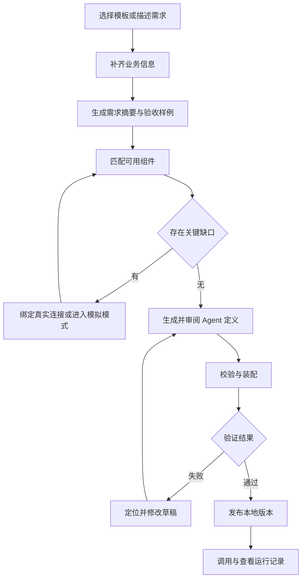
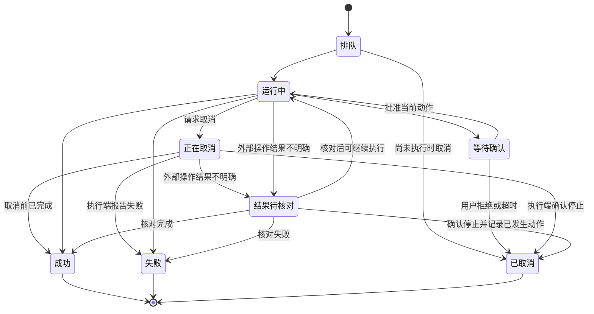

# 自然语言 to Agent 开发平台需求文档

版本：v0.1  
日期：2026-10-21  
适用范围：本地开发 Demo 与后续平台扩展  
配套文档：[交互设计文档](NL2Agent_交互设计_v0.1.md)

## 1 建设目标与范围约定

建设一个面向企业场景的 Agent 开发工作台。用户通过需求模板或分步问答描述任务，平台将需求转换为可检查、可修改、可版本管理的 Agent 定义，装配已有组件，在 openJiuwen Java 执行底座上验证并发布。

首版的核心验收目标是：**用户完成需求输入后，可以生成一个真实运行的 DeepAgent，在 Web 中配置 Rail 和工具，查看实际装载信息与执行事件，并将验证通过的快照发布为本地可调用版本。** 模拟运行可以用于开发，但不能替代这一验收目标。

### 1.1 方向与首版设计约定

用户已明确的方向是：基于 openJiuwen Java 仓库、本地实施、自然语言生成 Agent、参考 Studio 交互但实现独立，并支持 DeepAgent 和灵活的 Rail 装配。本文进一步提出 P0 单用户范围、示例场景和接口契约，作为开发起点；这些属于设计建议，不表示上游已有实现。

| 编号 | 约束 | 对实施的影响 |
| --- | --- | --- |
| D-01 | 使用 agent-core-java、agent-runtime-java 作为执行底座，按需复用 agent-solution 扩展 | 平台自身不重写 Agent Loop；缺口优先通过适配器或扩展补齐 |
| D-02 | 借鉴 agent-studio 的界面组织与交互，平台实现独立 | 不依赖 Studio 后端、数据库、DSL 或 Python Runtime；前端技术栈不受其限制 |
| D-03 | 以 Agent 工程为中心，重点支持 DeepAgent 与 Rail 装配 | Workflow 是一种开发形态，不要求所有 Agent 都转换成固定流程图 |
| D-04 | 在本地开发和运行 | Windows 加 WSL2 可作为开发环境；浏览器访问本地服务，无云端托管依赖 |
| D-05 | 表单和问答维护同一份需求记录 | 切换输入方式不丢失数据，不建立两套独立配置 |
| D-06 | 首版按版本创建实例并装配 Rail | 正在执行的实例不随草稿变化；不承诺运行中热替换 Java 类 |
| D-07 | 生成结果必须经过确定性校验和实际运行验证 | 模型自述成功、模拟事件和静态页面均不构成真实运行证据 |

本文件中的需求、数据模型和平台 API 均为拟议设计。源码中已存在的接口与拟新增能力应分别登记，不得将本文的 AgentSpec、RailDescriptor 或平台 API 当作 openJiuwen 现有标准。

### 1.2 可用 Agent 的定义

一个 Agent 只有同时满足以下条件，才可标记为“验证通过”：定义合法；依赖可解析且版本明确；目标环境的模型和工具连接可用；实际装配成功；通过当前快照对应的验收用例。发布还需完成实例就绪探测和入口切换。

“验证通过”限定于指定的快照、环境、连接版本和测试集合，不代表对任意业务输入均正确，也不自动覆盖模型服务后续变化。

## 2 用户与使用方式

| 角色 | 主要任务 | 首版实现方式 |
| --- | --- | --- |
| 业务使用者 | 描述需求、补充业务规则、提供验收样例 | 业务模式，隐藏 Java 类名和 Rail 挂载细节 |
| Agent 开发者 | 调整组件、配置工具、调试和发布 | 开发者模式，查看完整装配与执行信息 |
| 平台维护者 | 配置模型和 Runtime、注册组件、诊断环境 | 本地设置与资产管理 |

P0 采用单用户本地工作区，一人可承担上述角色；模式切换是界面呈现，不作为权限边界。服务默认绑定回环地址。项目标识在数据中保留，但不以此宣称已实现企业多租户隔离。对外共享、多人身份认证、企业角色体系列入 P1。

## 3 首版范围与后续范围

| 能力 | P0 本地可运行 Demo | P1 及后续 |
| --- | --- | --- |
| 管理面 | 单用户工作区、Agent 与资产管理、环境诊断 | 组织与项目空间、RBAC、资源配额、操作审计与审批 |
| 需求输入 | 模板填写、分支问答、需求摘要、待确认项 | 团队模板、批量导入、多语言 |
| Agent 类型 | DeepAgent 为主；提供基础 ReAct 工厂 | Workflow 可视化编辑、TeamAgent、多 Agent 协同 |
| Rail 装配 | 已注册 Rail 的选择、参数、顺序校验、版本绑定 | 自定义 Rail Web 开发、独立制品仓、热更新研究 |
| 工具与插件 | HTTP/OpenAPI 接入、MCP 远程连接、模拟工具 | 插件市场、第三方安装、更多协议和部署方式 |
| Skill | 受信任目录或包的登记、版本和引用；依 SDK 核验装载 | 在线编辑、自动生成、自演进与共享分发 |
| 知识能力 | 调用已有检索 API，Demo 使用受控资料集 | 文档解析、向量化、知识库建设与治理 |
| Web 调试 | 对话、事件时间线、工具参数与结果、Rail 触发、取消 | 节点单步、断点编辑、任意检查点恢复 |
| 验证与发布 | 用例集、快照验证、本地发布、版本切换与回滚 | 灰度、集群调度、弹性和企业审批流 |
| 工程交付 | 版本锁定、部署说明、配置示例、诊断与导出 | 完整浏览器 IDE、任意 Java 代码生成与沙箱编译 |

P0 不以“高级功能预留”名义提供没有实际效果的开关。未实现的能力必须标注规划状态，不能被选择进入可发布配置。Tool、Skill 和 Rail 分开建模；MCP 工具注册不等于 Rail 生命周期装配。

## 4 用户主流程



模拟模式拥有单独的运行标识和测试结果，不进入真实发布判定。未解决的连接缺口可以保存为草稿，不应阻止用户继续补充其他需求。

### 4.1 标准需求模板

以下字段组成 RequirementBrief。字段同时保存来源、确认状态和更新时间，问答回答与表单填写共用同一份记录。

| 字段 | 面向用户的问题 | 生成前要求 |
| --- | --- | --- |
| goal | 给谁使用，要完成什么任务 | 必填 |
| input | 用户提供什么，如何触发 | P0 明确输入；触发限聊天和 API |
| resources | 数据和资料来自哪里，有哪些现成工具 | 可以先写待接入，真实运行前必须解决 |
| process | 有哪些必须遵守的步骤，哪些允许自主决定 | 可选，系统提出建议后供确认 |
| actions | 允许查询、修改、创建或发送什么 | 必须明确有无外部写入 |
| approval | 哪些动作需要确认，由谁确认 | 有需确认动作时必填 |
| output | 输出格式和必需字段是什么 | 必填，可由模板给出可修改默认值 |
| exceptions | 缺信息、无数据、超时或失败时怎么办 | 必须采用明确的处理规则 |
| limits | 任务时长、轮次、工具范围和资源预算 | 可使用模板默认值，但须展示 |
| examples | 正常输入与预期结果，至少一个异常例子 | 真实发布前必填 |

第一轮只询问使用者、目标和交付物。后续优先追问影响执行的缺口；不询问已明确的信息。业务用户无需回答 Rail 类名、SPI、Maven 依赖等技术问题。

## 5 功能需求

### FR-001 工作区与环境诊断 P0

提供本地工作区、项目和 Agent 列表。首次进入检查管理服务、Runtime、数据库和模型配置；区分未配置、连接失败和版本不兼容。未就绪时允许保存草稿，禁止标记真实运行可用。

**验收：** 模型未配置时可创建草稿；点击真实运行应定位到缺失连接并给出修复入口。诊断结果包含检测时间，不把历史连通结果永久视为有效。

### FR-002 模板与分支问答 P0

提供空白模板和设备运维示例模板。表单与问答支持双向切换、保存和恢复。问答按缺失字段、歧义、资源可用性生成追问；用户可更正既有回答，并查看受影响的规则、组件和测试。

**验收：** 修改“只查询”为“允许创建工单”后，新增授权与确认问题；原来的目标和输出要求保留。更正不得静默覆盖已确认的其他需求。

### FR-003 需求摘要与生成前检查 P0

生成业务目标、执行规则、所需资源、验收样例及未决问题。每项标注“用户确认”“模板默认”“系统建议”或“待确认”。缺少关键业务参数、真实连接或授权时，明确列出阻塞项。

**验收：** 系统不得虚构工具标识或声称缺失接口已连接；可生成含待绑定项的草稿，但不可进入真实发布。

### FR-004 Agent 定义生成与局部修改 P0

自然语言构建服务仅使用当前可用的组件目录和受约束输出格式，生成 AgentSpec 或变更补丁。区分聊天、解释和实际修改。应用前显示增删改差异，应用后生成新草稿修订。允许人工调整和撤销到历史修订。

**验收：** “增加工单创建前确认”只修改相关规则、组件和测试；模型返回未知字段、无效组件或非法参数时，校验拒绝应用并显示错误。自动修复尝试设次数上限，仍失败则保留诊断。

### FR-005 Agent 工厂与能力适配 P0

提供 DeepAgent 和基础 ReAct 的装配工厂，平台工厂将统一定义映射到固定版本的 Java SDK。每种工厂声明支持的工具、Rail、Skill、交互控制和事件能力。类型切换前展示不兼容字段及处理方案，禁止静默丢弃配置。

**验收：** 同一发布定义可在重启后重新装配；实际实例回报的类型、版本和依赖与定义一致。SDK 中尚无对应实现的字段必须拒绝，而非仅持久化后忽略。

### FR-006 Rail 目录与装配 P0

RailDescriptor 至少包含组件 ID、版本、说明、适用 Agent 类型、挂载事件、参数 Schema、优先级规则、依赖、冲突、状态作用域和实现制品引用。用户可启用已注册 Rail、修改允许的参数，并查看有效顺序。强制策略由平台配置锁定，生成服务无法移除。

有效顺序以 SDK 的实际优先级语义为准，不能默认“数字越大越先执行”。需要将平台顺序与 SDK 注册机制的映射写入适配测试。单次运行的可变 Rail 状态不得跨 Agent 或会话泄漏。

**验收：** 至少一个生命周期扩展 Rail 和一个观测或业务约束 Rail 实际执行，产生可核对事件。自定义 Demo Rail 可以新建，但必须标记为平台扩展，不能冒充上游内置组件。

### FR-007 HTTP 和 MCP 工具接入 P0

HTTP 工具支持方法、路径、输入输出 Schema、连接引用、超时和读写分类；OpenAPI 导入后允许选择操作，并拒绝暂不支持的规范部分。MCP 首版支持一个经固定 SDK 验证的远程传输方式，读取工具列表后执行参数与结果适配。stdio 进程管理可后置。

连接与工具定义分离。工具定义可复用，测试环境和发布环境绑定不同连接。仅执行无副作用探测或显式选定的测试请求；导入工具不自动执行写操作。

**验收：** 各完成一个 HTTP 和 MCP 工具的真实调用，并记录工具版本、连接引用、参数摘要、结果和耗时。协议不支持、认证失败和返回格式错误具有不同错误码。

### FR-008 模型连接与凭据管理 P0

模型连接记录提供方、服务地址、模型标识、功能能力和凭据引用。连通测试同时核对所需功能，例如流式输出和工具调用。凭据在服务端保存，UI 只显示脱敏状态；不得写入 AgentSpec、聊天记录、普通日志或导出包。

**验收：** 更换凭据不会改变工具的业务定义；无效凭据得到明确诊断。模型名称相同不等于能力相同，实际请求不支持工具调用时阻止相关 Agent 运行。

### FR-009 Skill 与知识服务引用 P0

登记受信任 Skill 的来源、内容或包摘要及版本；只装载适配器明确支持的能力。知识检索作为工具连接，结果包含资料标识和可引用片段。首版不建设文档解析与索引流水线。

**验收：** 运行记录能追溯所用 Skill 和检索工具版本；资料不足时输出“依据不足”或追问，不允许把模型补写内容作为检索证据。

### FR-010 Web 运行与事件追踪 P0

每次运行绑定不可变快照、环境和连接绑定版本。展示任务状态、模型调用摘要、工具执行、Rail 触发、用户确认请求及错误。执行事件由服务端产生，不能根据前端动画伪造成功记录。展示计划、结果和可观测信息，不要求采集模型未暴露的内部推理过程。

一个会话可包含多个 Run。缺少业务参数时，P0 将追问作为当前 Run 的正常响应结束；补充回答在同一会话启动新 Run。动作确认则保持原 Run 等待决策。更换快照后默认创建新会话，旧会话只读保留，避免上下文混用。

**验收：** 查看任一工具调用可关联 Run、步骤和版本；刷新页面后可恢复历史事件。流连接断开不等于运行终止，前端应重新查询服务端状态。

### FR-011 人工确认与执行控制 P0

对配置为需确认的写操作，先创建待执行动作，保存工具、规范化参数摘要、快照和确认标识；确认前无外部副作用。确认结果与当前用户、Run 和动作绑定，重复点击只产生一次有效决策。参数改变需重新确认，拒绝或过期后不得执行。

取消以服务端确认结果为准。点击取消后进入“正在取消”；未收到确认前不显示“已取消”。已发生的外部操作不自动撤销，超时后结果不明确时标为“结果待核对”。写操作仅在目标接口支持幂等或可核对结果时自动重试。

**验收：** 拒绝创建工单时写接口调用次数为零；重复确认不会重复创建。若 SDK 中断恢复能力不足，应在适配层实现明确的待执行动作机制，并验证续接语义；未实现时不可发布含该规则的 Agent。

### FR-012 测试集与验证报告 P0

测试分为定义校验、装配检查、连接检查、行为测试。测试集至少包含正常、缺参数、拒绝确认、工具失败等场景。确定性断言覆盖输出 Schema、指定工具调用、禁用工具零调用及确认前零写入；模型评分只能作为补充。

默认写入测试使用隔离的 Demo 业务服务，并在执行前说明预期写入。真实业务连接仍遵守动作确认规则，测试模式不能绕过服务端控制。

**验收：** 每次报告关联快照哈希、测试集版本、环境和依赖绑定摘要。影响行为的配置变化、连接版本变化或测试变化使旧结果失效。模拟模式结果不能满足真实发布门槛。

### FR-013 本地版本发布与回滚 P0

草稿可变，发布版本不可变。发布前检查当前快照验证报告，创建或加载目标版本实例，等待就绪，再切换本地调用入口。每次发布有 operationId 和幂等键，失败保留原已就绪版本。

回滚选择历史定义及其兼容制品重新验证连接和就绪状态，成功后切换入口。运行中的任务按其原快照继续，除非用户另行取消。禁止将编辑草稿直接写入现行实例。

验证报告必须匹配发布目标的环境与绑定版本。针对同一调用入口，发布和回滚串行处理；关闭页面不取消已受理操作，重新进入后通过 operationId 查询。

**验收：** 连续发布 v1、v2 后，旧运行仍关联 v1；回滚后新调用使用 v1。目标实例启动失败时不得显示发布成功。

### FR-014 日志与运行记录 P0

提供按 Agent、版本、Run、状态和时间查询。保存结构化事件与脱敏错误，提供简明错误原因及开发者详情。历史浏览是读取事件记录；“重新运行”会创建新 Run，可能再次触发业务动作，不能标为无副作用回放。

**验收：** 同一 Run 的事件有稳定顺序和唯一事件 ID；重连去重后不重复展示。密钥及认证 Header 不出现在导出的诊断记录中。

### FR-015 导出与本地恢复 P0

导出需求、AgentSpec、组件锁定清单、测试和运行说明；凭据只导出待配置项。自定义代码制品必须随版本登记，缺失时导出包明确说明依赖来源。支持将导出包导入另一本地工作区，重新绑定连接后校验。

**验收：** 新工作区可导入、定位缺失依赖并按说明恢复；不存在“导入即继承原凭据”的行为。

### FR-016 高码扩展与 Workflow 编辑 P1

后续增加自定义 Rail、Tool 和 Agent 的 Web 编辑、隔离构建、测试、制品发布，以及 Workflow 画布。生成任意代码必须进入独立构建流程；不直接在管理进程运行用户上传的 Java 类或脚本。

## 6 定义与数据契约

### 6.1 核心对象

| 对象 | 关键内容 | 不变规则 |
| --- | --- | --- |
| RequirementBrief | 业务字段、来源、确认状态、未决问题 | 可修订，保留变更记录 |
| AgentDraft | spec、revision、最近编辑来源 | 使用乐观锁，拒绝覆盖较新修订 |
| AgentSnapshot | 规范化定义、内容哈希、锁定依赖 | 创建后不可变 |
| ComponentDescriptor | 类型、版本、Schema、兼容性、制品摘要 | 被版本引用后不可原地修改 |
| ConnectionBinding | 服务地址、非密配置、secretRef、绑定版本 | 环境特定；无明文密钥 |
| ValidationReport | snapshot、测试集版本、绑定摘要、结果 | 与验证对象精确关联 |
| AgentVersion | snapshot、制品、创建时间、说明 | 发布定义不可变 |
| Deployment | 版本、目标、期望状态、实际状态、operationId | 切换以实际就绪为准 |
| Session | Agent、快照、对话上下文、Run 列表 | P0 每个会话固定快照，跨会话隔离 |
| Run 与 RunEvent | snapshot、session、状态、步骤、事件序号 | 运行状态由服务端裁定 |
| PendingAction | 工具、参数哈希、确认人、期限、决策 | 一次有效决策，动作变更即失效 |

### 6.2 AgentSpec 示例

下面展示平台拟议格式。示例中的 demo.* 是计划实现或登记的组件 ID，不表示上游已有同名类；实际 ID、版本、挂载点由能力目录提供。

```json
{
  "schemaVersion": "0.1",
  "agentId": "equipment-assistant",
  "name": "设备运维助手",
  "agentType": "deep",
  "modelRef": "model/local-default@1",
  "instructions": "根据告警和维护资料给出处理建议。缺少设备编号时先追问。",
  "tools": [
    {"ref": "demo.alarm-query@1.0.0", "connectionRef": "conn/alarm-test@1"},
    {"ref": "demo.manual-search@1.0.0", "connectionRef": "conn/manual-test@1"},
    {"ref": "demo.ticket-create@1.0.0", "connectionRef": "conn/ticket-test@1"}
  ],
  "rails": [
    {"ref": "demo.task-planning@1.0.0", "enabled": true, "params": {}},
    {"ref": "demo.audit@1.0.0", "enabled": true, "params": {"redact": true}}
  ],
  "actionPolicy": {
    "confirmationRequired": ["demo.ticket-create@1.0.0"]
  },
  "execution": {"maxTaskRounds": 12, "timeoutSeconds": 120},
  "memory": {"scope": "session"},
  "output": {
    "type": "object",
    "required": ["deviceId", "findings", "recommendations", "sources"]
  }
}
```

actionPolicy 是管理侧规则，应由服务端执行路径强制实施；可通过已验证 Rail 或适配器实现，不能仅加入提示词。工具调用次数、任务轮次与模型调用次数应分别定义，不能混用同一个计数器。

### 6.3 事件契约

事件至少包含 eventId、runId、sequence、occurredAt、type、snapshotId、stepId、parentStepId 和脱敏 payload。Rail 事件增加 componentId、componentVersion、hook、outcome、durationMs。模型未提供的 token 或费用字段保存为 null，不填零。

建议事件类型：run.started、task.updated、model.started、model.completed、tool.started、tool.completed、rail.triggered、approval.requested、approval.resolved、run.cancel_requested、run.cancelled、run.reconciliation_required、run.completed、run.failed。事件名称属于平台协议，通过适配器映射真实底层事件；未采集到的事件显示“不可用”，不得补造。

## 7 状态与版本规则

避免用一个状态字段同时表达开发、运行和发布。三类状态独立维护。

| 维度 | 状态 | 关键转换 |
| --- | --- | --- |
| 开发 | 草稿、待补充、可校验、验证中、验证通过、验证失败 | 变更快照后重新验证 |
| 运行 | 排队、运行中、等待确认、正在取消、成功、失败、已取消、结果待核对 | 服务端事件与查询共同决定 |
| 部署 | 未部署、部署中、已就绪、部署失败、回滚中、已停止 | 健康探测成功才切换调用入口 |



P0 对需要确认的工单创建，拒绝即取消该次运行；已生成的只读分析结果保留。进程异常重启后，不自动重放写操作。未正常结束的运行进入恢复核对流程；历史事件仍可浏览。

## 8 本地实施边界

### 8.1 建议部署组成

| 组成 | 建议职责 | 本地实现约束 |
| --- | --- | --- |
| Web 工作台 | 管理、需求收集、装配、调试、版本 | 可独立选前端框架；开发代理到管理服务 |
| 平台管理服务 | 定义、目录、连接、测试、发布与事件查询 | Java 模块化单体起步，避免过早拆分 |
| Java Runtime 服务 | 对接 Core 和已选 Solution 扩展 | 与管理服务独立进程，保留依赖边界 |
| 数据服务 | 元数据、Run 与事件持久化 | 建议 PostgreSQL；Redis 按所选 Runtime 的状态存储需要接入 |
| Demo 工具服务 | 告警、资料检索、工单模拟业务系统 | 可确定性复现；明确为示例数据服务 |
| 模型服务 | 需求生成与业务 Agent 推理 | 支持可访问的远程服务；本地模型按资源另配 |

建议默认端口为 Web 5173、管理服务 8080、Runtime 8090、Demo 工具 8091；均为可修改约定。浏览器使用同源代理，避免直接持有模型凭据。首次运行需检测端口占用并提供覆盖配置。

### 8.2 本地开发交付要求

1. 锁定三个 Java 仓库的 commit 或 release，并生成依赖矩阵。JDK 17 可作为核验起点；最终版本以选定 POM 和编译结果为准。
2. 提供环境示例、启动顺序、数据库迁移、示例数据、健康检查与停止方式。允许基础依赖用 Docker Compose 启动，应用在 IDE 中调试。
3. Windows 项目建议放在 WSL Linux 文件系统内；说明 Windows 浏览器如何访问回环服务。
4. 企业代理、CA、Maven 和前端依赖源均可配置。失败时保留原始错误分类，不要求关闭证书校验作为常规修复。
5. 本地凭据不随 Git 或导出包提交；服务重启后可恢复草稿和历史版本。
6. 管理面与执行面之间使用显式适配接口。先验证真实服务入口、取消、确认续接和事件机制，再固化适配实现。

### 8.3 拟议平台 API

以下是新平台 API 草案，不是上游 Runtime 的现有接口。前后端可据此先建立契约测试。

| 方法与路径 | 用途 | 关键输入或行为 |
| --- | --- | --- |
| GET /api/capabilities | 获取当前工厂与组件能力 | 返回兼容范围、支持状态与目录版本 |
| POST /api/agents | 创建 Agent 草稿 | projectId、模板或需求 |
| PATCH /api/agents/{id}/draft | 应用人工修改或模型补丁 | expectedRevision；冲突返回 409 |
| POST /api/agents/{id}/generate | 生成定义修改建议 | briefRevision、catalogVersion；不直接发布 |
| POST /api/validations | 校验或执行测试 | snapshotId、suiteVersion、environmentId |
| POST /api/runs | 创建运行 | snapshotId、sessionId、mode、input、idempotencyKey；首轮创建会话 |
| GET /api/runs/{id}/events | 读取历史与增量 SSE 事件 | afterSequence；支持重连去重 |
| GET /api/runs/{id} | 读取权威运行状态 | 不依赖 SSE 连接是否在线 |
| POST /api/runs/{id}/cancel | 请求停止运行 | 返回请求受理，不直接返回已取消 |
| POST /api/runs/{id}/approvals/{aid}/decision | 确认或拒绝动作 | 参数摘要匹配、单次决策、过期校验 |
| POST /api/deployments | 发布或回滚目标版本 | versionId、target、幂等键 |
| GET /api/operations/{id} | 查询发布等异步操作 | 阶段、结果与错误 |

## 9 非功能需求

| 编号 | 要求 | 验证口径 |
| --- | --- | --- |
| NFR-01 一致性 | 草稿、快照、测试和发布版本可追溯 | 运行与测试记录均包含 snapshotId；旧报告不能验证新快照 |
| NFR-02 可恢复性 | 草稿与事件持久化，重连不重复写操作 | 刷新页面后恢复；重启后核对未结束任务 |
| NFR-03 隔离 | 每次运行的参数、Rail 可变状态和会话数据独立 | 两个会话交替运行，不互相污染 |
| NFR-04 凭据保护 | 服务端保存，日志脱敏，导出排除 | 对日志和导出文件执行确定性密钥检查 |
| NFR-05 性能 | 本地普通配置操作反馈及时，长操作展示进度 | 在约定参考机上，排除模型和外部工具延迟，普通保存与列表请求 p95 目标小于 1 秒 |
| NFR-06 资源控制 | 有限的运行轮次、超时和事件保留策略 | 超限产生可识别终态；不以无限重试掩盖失败 |
| NFR-07 可诊断性 | 区分需求、定义、装配、连接和执行错误 | 页面能定位错误所属字段或步骤 |
| NFR-08 可移植性 | 路径、端口、连接和环境均可配置 | 新工作区按文档恢复；不包含个人绝对路径依赖 |

性能数字是首版验收目标，需在开发开始时登记 CPU、内存、模型与并发条件，不作为上游框架性能结论。P0 至少验证两个独立会话的隔离，不要求集群压测。

## 10 首个端到端 Demo

### 10.1 场景

设备维护人员输入设备编号。Agent 查询最新告警，检索对应维护资料，输出故障线索、建议步骤和资料来源。用户可要求创建维修工单；系统展示拟提交参数，批准后调用工单工具，返回工单编号。

### 10.2 固定示例与业务规则

- 正常输入：“分析设备 PUMP-001 的最新告警并给出处理建议。”
- 数据服务包含 PUMP-001 的温度异常告警、两段带资料 ID 的维护说明，以及可查询的工单记录。
- 缺少设备编号时先追问；不存在的设备返回明确结果，不猜测编号。
- 没有维护资料时注明依据不足；允许输出告警事实，不编造引用。
- 创建工单前确认设备、标题、描述和优先级；取消确认不得调用写接口。
- 工单服务支持幂等键和结果查询；写入超时后先核对结果，不直接重试创建。

Demo 工具服务使用示例数据，Agent 与 Rail 则必须真实运行。两者在页面和报告中分别标注，避免将业务数据模拟误表述为 Agent 执行模拟。

## 11 验收用例

| ID | 前提与动作 | 预期结果 | 对应需求 |
| --- | --- | --- | --- |
| AC-01 | 无模型连接，填写需求并保存 | 草稿保存；真实运行阻塞并定位连接 | FR-001、008 |
| AC-02 | 问答输入后切换表单，再返回问答 | 字段与确认状态一致，无重复追问 | FR-002 |
| AC-03 | 将只读目标改成创建工单 | 新增确认规则与资源缺口，保留其他字段 | FR-002、003 |
| AC-04 | 生成不存在的工具或非法 Rail 参数 | 校验失败，不应用非法修改 | FR-004、006 |
| AC-05 | 启用两个 Rail 并运行 DeepAgent | 实际装载清单和触发事件可核对 | FR-005、006、010 |
| AC-06 | 配置冲突 Rail 或不支持的 Agent 类型 | 显示具体冲突，禁止真实装配 | FR-005、006 |
| AC-07 | 分别调用一个 HTTP 和 MCP 工具 | 真实返回结果，有版本和耗时记录 | FR-007 |
| AC-08 | 输入 PUMP-001 告警分析任务 | 输出事实、建议和来源，满足输出结构 | FR-009、010、012 |
| AC-09 | 不提供设备编号 | 追问，不调用要求该参数的业务工具 | FR-002、012 |
| AC-10 | 申请创建工单后拒绝确认 | 写接口零调用，运行已取消且保留分析 | FR-011 |
| AC-11 | 对同一动作重复批准 | 仅一次有效决策，最多创建一张工单 | FR-011 |
| AC-12 | 工单写入返回超时但已成功 | 查询幂等结果；不重复创建 | FR-011、014 |
| AC-13 | 运行中刷新页面，SSE 重连 | 恢复同一 Run，事件无重复 | FR-010、014 |
| AC-14 | 运行中修改草稿并再次测试 | 原 Run 不变，新 Run 使用新快照；旧测试失效 | FR-004、012 |
| AC-15 | 发布 v2 时实例启动失败 | 保留 v1 的就绪入口，显示失败原因 | FR-013 |
| AC-16 | 发布 v2 后回滚 v1 | 新调用指向 v1，历史 Run 版本不变 | FR-013 |
| AC-17 | 两会话交替执行带状态 Rail | 参数、计数和会话数据不串用 | FR-006、NFR-03 |
| AC-18 | 导出并导入新工作区 | 无密钥，要求重绑连接，可恢复验证 | FR-015、NFR-04 |
| AC-19 | 运行中取消，外部结果暂不明确 | 显示正在取消或待核对，不能伪报已取消 | FR-011 |
| AC-20 | 仅有模拟测试通过时尝试真实发布 | 发布阻塞并说明缺少真实验证 | FR-012、013 |

P0 完成条件：上述用例全部有可复现结果；任何不支持项需作为版本范围调整记录，不能通过隐藏按钮、伪造轨迹或降低状态要求规避。

## 12 建议开发顺序

| 阶段 | 工作内容 | 退出条件 |
| --- | --- | --- |
| M0 底座核验 | 固定仓库版本，编译 Core/Runtime，选择 Solution 扩展，核对 SDK | DeepAgent 加两种 Rail 加一个工具真实运行 |
| M1 定义与运行 | AgentSpec、目录、校验器、工厂、Run 与事件持久化 | 手工配置可执行，事件能查询 |
| M2 Web 工作台 | 创建、装配、连接、调试、确认和取消 | 浏览器完成业务与异常路径 |
| M3 自然语言构建 | 问答、摘要、受约束生成、变更审阅 | 由需求创建并修改同一个可运行 Agent |
| M4 交付闭环 | 用例集、版本发布、回滚、导出、环境说明 | 全部 P0 验收用例完成 |

开始 UI 实现前优先解决：Runtime 实际取消接口、确认后的续接方式、Rail 事件采集路径、快照到实例的装配入口。它们影响用户看到的真实状态，应在 M0 至 M1 固化。

## 13 参考与核验记录

参考日期为 2026-10-21。Studio 参考固定到 commit `0ae558d79394f09b4819e8adf7808701315e8ba4`；源码阅读可证明页面组织或接口存在，不构成完整运行验证。

1. [Studio Agent 编辑页](https://github.com/openJiuwen-ai/agent-studio/blob/0ae558d79394f09b4819e8adf7808701315e8ba4/frontend/src/routes/agent-center/app-agent/agent-bot-page/agent-bot-page.component.html)：标题和模式、配置页签、信息与提示词、工具配置、调试区与发布入口。
2. [Studio 能力配置](https://github.com/openJiuwen-ai/agent-studio/blob/0ae558d79394f09b4819e8adf7808701315e8ba4/frontend/src/routes/agent-center/app-agent/components/config-tools/config-tools.component.html)：模型、MCP、插件、工作流和 Skill 的界面组织。
3. [Java DeepAgent](https://github.com/openJiuwen-ai/agent-core-java/blob/89c7810ca35dface93cea797816f89af1fe4c588/core/src/main/java/com/openjiuwen/harness/deep_agent/DeepAgent.java)：已读取版本包含 addRail、registerRail、unregisterRail 和 getRails。
4. [Java DeepAgentRail](https://github.com/openJiuwen-ai/agent-core-java/blob/89c7810ca35dface93cea797816f89af1fe4c588/core/src/main/java/com/openjiuwen/harness/rails/DeepAgentRail.java)：生命周期及模型、工具回调适配参考。
5. [Agent Runtime Java](https://github.com/openJiuwen-ai/agent-runtime-java)：执行服务适配入口；实施时另行固定 commit 并验证，不以默认分支作为可复现基线。
6. [agent-solution](https://gitcode.com/openJiuwen/agent-solution)：扩展候选来源；具体模块及兼容性由 M0 核验登记。
