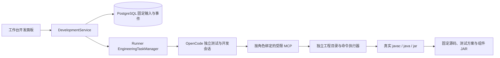

# TDD-013：受限生成与 OpenCode 双角色工程任务

日期：2026-10-22。状态：源码开发与验证；当前 Docker 演示实例仍为 TDD-012。本批不代表完整 PRD 或 TD-15 验收通过。

## 交付行为

设备只读快照确认验收基线后，管理端可发起双角色开发。测试 Agent 先根据固定基线保存测试方案；开发 Agent 生成单元测试，平台确认其在原始占位实现上真实失败后冻结单测，再允许修改业务实现。开发 Agent 生成 Java Tool 和业务 Skill，平台运行真实 JDK 编译、单测、独立契约检查与打包。所有命令保存实际参数、退出码、时间和截断标记。

当前规格 `equipment-java@2` 只接受 Tool＋Skill、固定依赖和 `mock-equipment@1`。生成代码使用固定 OpenJiuwen Tool API，HTTP、身份和超时仍由受信任传输层负责。生成器不能通过平台文件工具修改业务实现之外的路径、测试基线、OpenCode 配置或依赖。测试角色不能修改开发目录，也不能调用构建命令。SDK 文件在工程初始化时固定摘要，命令前及打包时再次核对。

两个角色使用同一个受平台管理的 OpenCode 服务，各自拥有独立目录、会话、工程 Skill 和 MCP 凭据。默认 OpenCode 工具权限全部拒绝，仅开放受限 `builder_*` 工具。模型进程获得自身模型及工程 MCP 凭据；Java 命令不继承平台、数据库或 Mock 凭据。文件路径、导入和命令策略属于正常操作限制，不是恶意代码隔离。首期仍是可信本地模式，没有每任务操作系统沙箱。

代码包固定源码／文件清单、实际 JAR、SDK、生成规格及工程模板摘要、需求快照、验收基线、独立方案和命令证据。生成目录后续修改不覆盖已有代码包；审阅接口重新核对文件摘要。

**生成的 JAR 尚未加载到业务运行时。** 当前 TestDeployment 的可运行候选仍来自模板装配；生成代码包不是已验收 Agent。Agent／Rail 生成、生成 Skill 的运行装载、完整候选业务用例与缺陷修复闭环继续保留在后续范围。

## 任务与证据

平台数据库先固定输入，再以相同任务编号向 Runner 提交。响应丢失时重复提交不启动第二份任务；相同编号不能变更需求、预算或生成策略。取消先保存不可重用标记，迟到提交不能重新启动任务。任务状态采用乐观版本检查，迟到启动结果不能覆盖取消决定。

Runner 同时执行一个工程任务，最多保留四个非终态任务。每个任务最多 900 秒、每个角色最多 16 步、单个命令最多 60 秒。预算超时与用户取消竞争时保留超时原因。只有确认模型进程与 Java 命令退出后，才记录 cancelled；无法确认时保留 reconciling，不自动重放。重启后遗留的运行中任务也进入 reconciling；孤儿进程核对仍需后续实现。

| 管理接口 | 用途 |
| --- | --- |
| POST /api/snapshots/{id}/development | 从固定快照与已确认基线发起开发 |
| GET /api/drafts/{id}/development | 查询开发历史 |
| GET /api/development/{id} | 查询状态、双角色会话及代码包摘要 |
| POST /api/development/{id}/cancel | 受理取消，等待执行器确认退出 |
| GET /api/development/{id}/events | 按游标读取开发／测试事件 |
| GET /api/development/{id}/file?path=… | 审阅代码包内允许的固定文本文件 |
| GET /api/development/{id}/commands/{commandId} | 查看真实命令及退出证据 |

管理入口沿用登录和 CSRF；正文不能提交 Shell、环境变量、模型 Key、基线内容或通过结论。Runner 的内部接口另用控制凭据。Web 支持任务刷新恢复、取消、源码和命令审阅，明确提示构建与业务验收的区别。

## TDD 与真实失败

行为红灯包括生成策略未校验、角色 MCP 尚未实现、工程任务／管理 API 尚未实现、冻结单测可被外部修改、取消竞争丢失预算原因、取消后角色仍显示执行中、SDK 在同一路径被替换，以及模型未配置时任务永久排队。相应修复均保留红绿记录。

真实模型探测保留全部尝试，不覆盖失败：

- 首次直接执行器探测完成 Tool、Skill、真实红绿单测和组件 JAR 构建。
- 首次平台任务中，生成单测错误地断言 Map 对象地址不变，而固定 SDK 会复制 Map。冻结门禁阻止修改单测，该任务失败且没有代码包。随后将 SDK 的值比较与回调语义明确写入 `equipment-java@2`，创建新任务。
- v2 平台任务完成生成、构建与文件审阅，但随后的取消探测未确认退出。Windows 停止逻辑现会等待拥有的进程句柄关闭，避免仅凭 taskkill 与 close 回调的先后顺序判定失败；执行器及平台 API 的实际会话取消均已单独复查。
- 回归中的发布／回滚大用例因顺序启动多个 JVM 达到 90 秒测试总时限；仅该测试的总时限改为 180 秒，各步骤断言和超时不变。过期测试改为等待服务所使用的 PostgreSQL 时钟，避免以宿主机时钟判定数据库过期；原失败结果继续保留。

最终重新从管理 API 发起真实开发，完整通过生成、构建、文件审阅和另一任务的取消。任务编号 `0467b267-eee9-420c-8219-462088962b97`，两角色具有不同 OpenCode 会话。代码包摘要为 `cf8c5528e03c84928bea7170fc57c0357db0b75b191a480ce8e0feea6f95d08a`。

| 最终检查 | 结果与范围 |
| --- | --- |
| 单元与 HTTP 契约 | 74／74 通过 |
| PostgreSQL 集成 | 80／80 通过 |
| 原生 JVM／OpenCode／进程适配 | 21／21 通过；包括此前超时的发布回滚用例 |
| TypeScript 类型检查与构建 | 通过 |
| Web 交互 | 1／1 通过；接口夹具，390px 布局与文本显示 |
| 真实双角色平台流程 | 最终完整探测通过；真实 DeepSeek、真实生成源码、真实命令退出、固定文件审阅及取消 |
| Runner 主入口 | 实际启动、认证、生成规格读取与进程停止通过；未调用模型 |
| 凭据扫描 | 本地凭据精确匹配 0 处；证据不保存凭据值 |

源码清单覆盖 133 个生产与配置文件，摘要 `59e4c2ef7dd629b3014349a5f98771a653b47acac208e6c91349faf8ac97d02b`。本批未更新 Docker 服务；原 app、Runner、Mock 和 PostgreSQL 均健康。

关键证据：[最终真实任务](evidence/TDD-013/development-88e3e19d-33b5-44fc-986b-b39d03f71630.json)、[生成 Tool](evidence/TDD-013/platform-final/bundle/src/generated/EquipmentTool.java)、[生成 Skill](evidence/TDD-013/platform-final/bundle/skills/equipment-query/SKILL.md)、[独立方案](evidence/TDD-013/platform-final/bundle/test-plan.json)、[组件 JAR](evidence/TDD-013/platform-final/bundle/component.jar)、[代码包清单](evidence/TDD-013/platform-final/bundle/manifest.json)、[源码清单](evidence/TDD-013/source-inventory.json)、[凭据扫描](evidence/TDD-013/secret-scan.json)。

最终汇总以 [测试与源码清单](evidence/TDD-013/test-summary.json) 为准。普通测试中的生成 Java 和模型服务使用明确夹具；真实 OpenCode 探测另列。Web 测试使用接口夹具，仅证明交互与显示，不作为真实模型 E2E 或交付成功率证据。Bridge Java 源码未修改，本批不声称重新运行 JUnit。

## 依据与剩余工作

接入依据为固定 OpenCode 1.19.3 的实际 OpenAPI 核验，以及官方 [Server](https://opencode.ai/docs/server/)、[MCP](https://opencode.ai/docs/mcp-servers/)、[Permissions](https://opencode.ai/docs/permissions/) 和 [Agents](https://opencode.ai/docs/agents/) 文档。实际版本、会话和退出结果以本地证据为准。

下一批需要建立生成组件的制品登记与 Java 装载接口，使同一代码包进入 TestDeployment，经 test-api 完成完整基线用例；之后接入报告、修复与发布绑定。当前全部 88 条阶段验收仍未完整晋级，EV 交付成功率尚未评测。Docker 部署、崩溃恢复、金融与导出等仍在总目标内。
