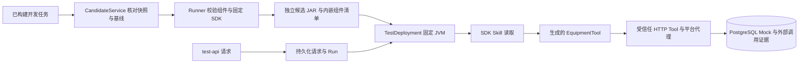

# TDD-014：生成 Tool／Skill 接入固定候选与测试入口

日期：2026-10-22。状态：源码开发与验证，尚未部署到当前 Docker 演示实例。本批不代表完整 PRD 或 TD-15 验收通过。

## 交付行为

已完成的设备只读开发任务可以登记为生成候选。平台取出任务绑定的快照、已确认基线和固定代码包，Runner 将组件与该任务使用的 Bridge SDK 组成独立可运行 JAR。候选摘要对应完整 JAR 的实际字节。生成任务未完成、SDK 已变化或组合结果与任务不符时，登记被拒绝，不改为模板候选。

TestDeployment 部署该 JAR，`test-api` 沿用平台的身份、请求去重、Run、工具代理和 Mock 证据链。生成的 Java Tool 在 JVM 内实际执行；生成的 Skill 通过 SDK `SkillUseRail` 发现、提示和 `SkillTool` 读取，随后调用设备工具。平台记录 `skill_loaded`、`generated_tool_invoked` 与真实业务接口调用。



## 版本与执行约束

- 组件包只允许 `generated/EquipmentTool` 及其内部类、固定 `skills/equipment-query/SKILL.md` 和 JAR 标准清单。提取前拒绝重复条目、越界路径、其他包、额外 Skill 文件和业务实现替换。
- 组合前重新检查代码包清单、每个文件、组件、测试方案及 SDK 的摘要。组合结果按实际 JAR 摘要登记；相同代码包、规格与 SDK 重试或重启后复用原制品。
- 内嵌清单绑定需求快照、运行规格、组件包、SDK、类文件与 Skill 摘要。Java 加载前再次核对；Runner 将 JVM 实际报告与登记记录比较。后续调用继续检查 JAR 与规格字节。
- Skill 工具只接受 `equipment-query` 与 `SKILL.md`，拒绝其他路径和额外参数；读取前及 SDK 重新发现前检查摘要。未开放 SDK 的 Bash、Code、文件读取等回退工具。
- 生成 Tool 只负责业务参数与结果适配。HTTP 地址、凭据、用户身份、会话关联和超时由平台传输层控制。模型不能通过业务参数改变这些值。
- 源码仍在可信本地 Runner 中编译、测试与执行。路径／命令策略、JAR 校验和 Docker 部署都不构成每任务操作系统沙箱。

登记接口为 `POST /api/candidates`，正文只增加可选的 `developmentJobId`；不接受调用方指定 JAR 路径、制品摘要或验收结论。Runner 内部提供任务制品组合与按摘要读取制品描述的认证接口。模板候选继续使用原流程。

页面可以刷新已完成的构建、选择候选来源、登记生成候选和启动独立预览。候选显示明确来源与版本摘要。当前完整自动验收／发布仍针对模板装配版本，界面已说明这一边界。

## TDD 与修复记录

保留的行为红灯包括：组件加载入口未实现；Skill 尚未接入 Core 循环，被工具白名单拒绝；制品登记未实现；Runner 只接受默认 Bridge；请求生成候选时误登记模板；TestDeployment 仅按默认 Bridge 判断就绪。实现后分别执行 Java、制品、数据库与真实 JVM 回归。

额外修复：部署过期由 PostgreSQL 时钟判断准入，但清理 worker 曾再次用宿主机时钟判断，临界时刻可能继续保留 ready。现在领取任务与清理使用同一数据库时钟，原失败及修复后结果均保留。

首轮快速回归在高并发启动测试时有六项未通过；保留原报告，限制为四个 worker 后全量通过，未放宽断言或单项超时。第一轮实测探测脚本误用了相同 Mock 控制／业务凭据，服务在模型调用前拒绝启动；修正后重跑，原日志与两个空测试 schema 的清理记录保留。

## 真实 DeepSeek 证据

最终探测 `ca6daf63-5312-420e-a7e2-506a1519ead0` 使用真实 DeepSeek，完成两个独立 OpenCode 会话、生成源码、真实红绿单测、独立契约检查、组件打包、候选组合和 `test-api` 业务调用。测试数据来自虚构设备 Mock。

| 绑定 | 实际值 |
| --- | --- |
| 开发任务 | `80f5e769-7e82-4c56-8c4d-180703189abf` |
| 候选 | `ee717958-91e4-4d6d-9f70-499c5e7d4345` |
| 代码包摘要 | `ce0ac6558f473757cf6d19feb214991d563d8f4edaf1e493abb4dd82c2fe2a38` |
| SDK JAR 摘要 | `4e7918e988a2f51d8089bf326cb7912190f74651d86543ae5799c39600111946` |
| 运行候选 JAR 摘要 | `1059ebeae355214f36ac5230c0ec723c4f37359913e060a2bd4a1d8d084ff4c8` |
| Run | `22aac8f5-8c0d-450a-b2f4-44143ebe1b45` |

请求使用 U1002，外部 Mock 收到一次设备查询，结果含真实种子温度 86℃。Skill 加载和生成类调用事件均关联到该会话。测试部署最后进入 stopped，JVM 已停止，未创建发布指针。

完整运行 JAR 约 182 MB，保留于该探测的本地 `.cache/generated-candidate-live/<probeId>/runner/artifacts/`。冻结证据保存小型组件 JAR、源码、Skill、组件与运行时描述、命令、运行事件及摘要；没有将完整 SDK 依赖包重复加入文档目录。

| 检查 | 结果／范围 |
| --- | --- |
| 单元与 HTTP 契约 | 76 项通过；新制品 API 越权／额外参数检查另作定向复核 |
| PostgreSQL 集成 | 83 项通过；SDK 变化拒绝另作定向复核 |
| Java JUnit 与打包 | 14 项通过，`mvn verify` 成功 |
| 原生适配器 | 23 项通过，涵盖生成候选、默认候选、取消、审批、发布／回滚与原生进程 |
| 浏览器 | 接口夹具验证任务恢复、取消、源码文本显示、生成候选登记和 390px 布局 |
| 真实模型 | 生成、构建、固定候选与 test-api 单场景探测通过 |
| 部署 | 当前 Docker 四服务仍为 TDD-012，本批未更新实例 |

TypeScript 类型检查与生产构建通过。源码清单覆盖 139 个生产与配置文件，摘要为 `f082e1870bc3b76c6b8531ab6d111f9fc53a3ffb21b65fc55c3c962643f032c8`；本地实际凭据精确匹配扫描为 0 处。临时模型进程、JVM 和浏览器测试用 Vite 服务均已停止，原有 Docker 四服务健康。

执行真实探测需本地 Bridge、专用测试 PostgreSQL 和 `.env.local` 的模型凭据，显式设置 `RUN_LIVE_E2E=1` 后运行：

```powershell
node --env-file=.env.local --import tsx scripts/probe-generated-candidate.ts
```

汇总、源码清单、凭据扫描和原始红绿记录见 [TDD-014 证据](evidence/TDD-014/test-summary.json)。真实流程见 [探测结果](evidence/TDD-014/live-generated-ca6daf63-5312-420e-a7e2-506a1519ead0.json)，生成实现见 [Tool](evidence/TDD-014/live/bundle/src/generated/EquipmentTool.java)、[Skill](evidence/TDD-014/live/bundle/skills/equipment-query/SKILL.md)。

## 剩余范围

下一步将完整候选用例调度、验收报告和发布门禁绑定到这个生成制品。缺陷驱动的新版本修复、Agent／Rail 自动生成、工单与金融场景、交付导出、完整会话恢复及 TD-15 部署与质量回归继续保留。当前证据不是交付成功率评测，也没有将完整 AC 条目晋级为通过。
