# TDD-015：生成候选的自动验收与发布绑定

日期：2026-10-22。状态：本批源码已部署，设备只读候选的真实 Docker 页面流程通过。本批记录编号 TDD-015 不代表开发计划工作包 TD-15 已完成；完整 PRD 仍有未实现项。

## 交付行为

自动验收可以选择已登记的生成候选。平台固定候选 ID、代码包、测试计划、基线、SDK／JAR、模型及 Mock 摘要。每个用例通过管理接口创建独立 TestDeployment 和数据环境，再实际调用 `/test-api/deployments/{id}/messages`。用例只接受基线固定的输入、身份和故障配置，不允许业务请求改写候选或环境。

```mermaid
flowchart LR
  C[固定候选与确认基线] --> V[持久化验收任务]
  V --> D[每个用例的独立测试部署]
  D --> H[test-api HTTP 请求]
  H --> J[候选 JAR 与生成 Skill / Tool]
  J --> M[Mock 业务状态和调用证据]
  M --> S[停止部署并撤销入口授权]
  S --> R[平台断言与不可变报告]
  R --> G[重新核验同一候选]
  G --> P[独立发布实例与只读冒烟]
  P --> A[原子切换业务入口]
```

测试 Agent 的方案摘要进入报告追溯链。当前执行器解释已确认基线中的设备场景、参数、故障与断言；方案中的文字步骤不作为任意代码执行。正常查询、缺少设备编号、只读工具超时已有完整候选执行路径。工单改参数用例仍返回未验证，不会跳过后宣布整套通过。

报告引用测试入口、请求、Run、候选、环境配置、停止后的测试部署及实际装载清单。生成候选有外部工具调用时，平台还核对同一 Run 的 `skill_loaded`、`generated_tool_invoked` 及组件摘要。缺少证据、实际 JAR 不匹配或停止未确认，都不能形成通过报告。固定响应模型仍只能得到“未验证”，不能发布。

发布门禁按报告中的候选重新查询真实制品及测试计划绑定，再部署同一 JAR。发布环境独立于各测试环境，先进行只读冒烟，再切换版本指针。回滚要求历史候选和 JAR 一致；相同快照上的另一个生成候选不能冒充历史版本。

## 取消、接管与重试

自动执行器使用进程内签发的短期 HTTP 凭据，数据库租约及接管编号是最终准入依据。凭据中的权限不能由管理接口正文直接提供。创建部署、发送业务请求、审批与自动清理均检查当前租约；已取消或已被接管的执行器不能产生迟到操作。

每个用例预分配 Run 编号，部署和请求去重都使用稳定编号。响应丢失或执行器重启后可以找回原目标。普通预览不能为自动验收部署签发人工调用授权。新的自动会话替换旧会话，停止部署后入口拒绝继续执行，历史记录仍可读取。

并发回归发现并修复了最后一项结果返回与取消竞争的问题：取消已经提交时，迟到的通过结果不再结束任务；后续清理完成后，该项保留为未验证。

## TDD 与部署检查

已观察并保留的红灯：自动用例未注入故障；取消后的执行器仍能创建部署；候选请求误走模板验收；最后一项结果覆盖已接受的取消。修复后的数据库／HTTP 测试检查了拒绝、去重、租约接管和证据完整性。

首轮 Docker 页面实测在生成开始时失败：OpenCode 1.19.3 的安装元数据在 Linux 也声明 `bin/opencode.exe`，原启动代码按操作系统拼出不存在的 `bin/opencode`。检查确认已安装文件为 ELF 可执行文件，包没有缺失。现在从包的 `bin` 元数据读取路径，并在 Runner 镜像构建时以实际运行用户执行 `--version`。第一次失败的任务与诊断保留，后续结果单独记录。

浏览器夹具首轮因测试定位器写错按钮名称而超时；改为现有可访问名称后通过，未改页面行为或延长超时。页面验证覆盖候选选择、提交的候选编号、报告摘要、证据查看、模拟模型禁止发布以及 390px 布局。

## 验证结果

| 检查 | 当前结果 |
| --- | --- |
| 单元／契约 | 79 项全量通过，含跨平台 OpenCode 路径检查 |
| PostgreSQL 集成 | 89 项通过 |
| 原生 Java 适配器 | 23 项全量通过，含真实 JVM 候选三场景与生成组件证据核验 |
| Java 与镜像构建 | Java 14 项测试、类型检查和生产构建通过；最终镜像再次通过 79 项快速测试及 OpenCode 1.19.3 可执行文件检查 |
| 浏览器夹具 | 1 项通过；固定响应报告保持未验证 |
| 宿主机真实模型 | 两个 OpenCode 角色、候选预览、三项验收、发布及业务调用已通过 |
| Docker 真实页面 | 修复后重跑通过；真实双角色生成、候选登记、三项验收、同一 JAR 发布和 U1002 业务调用 |

宿主机真实模型探测编号为 `c5c74956-bac1-47a3-b416-2b9e972a9127`，候选为 `a6dca8c4-20a0-4750-9e02-ef3c2e44cf42`，验收为 `0df7c0e2-4c5f-497c-ab9c-7b0bc0f18527`。该轮执行期间仍补充了最终证据核验和取消保护；最终源码以完成回归后的清单为准，不能把这轮探测独自视为最终版本验收。

最终 Docker 页面流程绑定如下：

| 证据 | 实际值 |
| --- | --- |
| 开发任务 | `403f4668-ab7a-4f65-8d10-ac84f842971f` |
| 候选 | `be7574b4-9b77-428a-b47a-0a31f2c246b3` |
| 代码包 | `32501202d95ef7c83ae6f4df976f9486162cbc81bf72812761767d450f113d67` |
| Docker SDK JAR | `0a7f589b59b2d4a70bcb8d549adf7a36a37597f04513121d1ff4c26972a71ebf` |
| 验收及发布 JAR | `03953fc83ad17a9bb888566c4374469b7d6d1c42117d9c8356909a89da5c1f40` |
| 验收报告 | `936b68c7-ad20-4b76-b5ec-34d1e0d926e5` |
| 发布版本 | `add6383d-692a-4672-b512-53e1fa86d73a` |
| 发布后的业务 Run | `21343c6d-30ea-4ccc-b0a5-f784f71be76c` |

三项验收均通过并保存独立环境／停止证据；发布后的 U1002 请求有一次外部设备查询，结果为 Mock 种子中的 86℃。生成组件及 Skill 的执行事件绑定到各自 Run。演示发布实例保留可用，测试部署已停止。源码清单共 144 项，摘要为 `06f823ad7c138adfda01a7b42349d4f4d0cd9057f94771e986143e32f6c02a70`。

原始结果见 [汇总](evidence/TDD-015/test-summary.json)、[真实 Docker 页面流程](evidence/TDD-015/live-docker-generated.json)、[镜像与运行时](evidence/TDD-015/deployment.json) 和 [源码清单](evidence/TDD-015/source-inventory.json)。生成源码、Skill、组件包、两角色记录、命令及运行事件保存在 `evidence/TDD-015/docker/`；完整可运行 JAR 保留在 Runner 卷 `/data/artifacts/`，没有重复加入文档目录。与本地实际凭据精确匹配的扫描结果为 0 处。

升级前已确认活动 Run／验收／测试部署为零，并将业务数据库备份保留在忽略提交的本地缓存。最终四服务均健康，浏览器测试用 Vite 和宿主机临时运行进程已停止。第一次 Docker 引擎启动失败及其他诊断记录仍保留；没有用最终成功结果覆盖它们。

## 剩余范围

缺陷驱动的新候选修复、Agent／Rail 生成、完整工单验收、金融场景、交付导出、完整会话恢复、交付成功率评测，以及 TD-15 新目录部署／崩溃恢复／性能和完整必测集合继续保留。当前没有将完整 AC／NF 条目晋级为通过。
