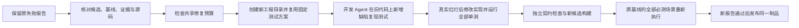

# TDD-016：失败证据驱动的有限修复

日期：2026-10-22。状态：本批代码已部署，真实模型修复闭环及回归通过；不表示完整 PRD 或 TD-15 已完成。

## 交付行为

设备 Tool／Skill 候选产生完整失败报告后，用户可在页面点击“按失败证据修复”。管理接口只接收原报告编号，平台自行读取并校验原候选、需求快照、基线、测试计划、失败断言、证据摘要和固定源码。通过、阻塞、未验证、跨目标或缺证据的报告不能进入此修复路径。

每个初始开发任务最多有三次修复，每次最多 900 秒。失败和取消均计入次数；并发请求按同一初始任务串行受理，同一请求键的重试返回已有任务。需求或验收标准不能借修复接口修改。新开发任务的修复预算独立；交付评测仍需按预先固定的任务尝试汇总全部候选和预算。

修复工作目录复制旧实现、Skill、原单元测试及已存在的修复回归测试。开发 Agent 只能新增当前次数对应的回归测试；旧测试不可修改。新增测试必须在未修改的旧代码上真实编译、执行，并产生明确的断言失败。编译失败、超时、旧测试失败或新增测试通过均不能解锁实现修改。红灯后新增测试也冻结，构建前执行全部新旧单测与独立平台契约检查。

测试 Agent 的已固定方案直接复用，不再调用模型重新设计；事件记录 `test-plan.reused`。新构建包保存原报告、原候选、父开发任务和本次修复次数，保留同一方案摘要。候选登记和构建回写均检查这些绑定。旧报告不会验证新 JAR，新候选仍需通过现有登记和自动验收入口运行全部必测场景。

当前修复入口支持设备 Tool 的可复现实现缺陷及关联 Skill 调整。不能通过 Java 回归用例复现的问题应留下诊断；尚未实现任意业务缺陷分类、任意测试脚本生成、模型质量优化或无人工操作的自动循环。执行模式继续为可信本地环境，不具有代码沙箱隔离。

## TDD 证据

本批保留四类实际红灯：

- 受理逻辑忽略修复来源，接受不适合修复的报告，并发启动多个任务。
- 工程目录仍初始化为空实现，未载入旧候选；无法先复现原缺陷。
- 新回归测试进入构建包后，运行制品登记仍按原固定文件数拒绝。
- 页面没有失败报告修复入口。

页面测试第一次未找到 Playwright 默认浏览器，属于环境诊断，不计为功能红灯；改用已安装 Edge 后观察到缺少修复按钮的真实功能失败。没有通过延长测试超时或降低断言获得通过。

## 验证结果

| 检查 | 结果 |
| --- | --- |
| 单元／契约 | 79 项通过 |
| PostgreSQL 集成 | 92 项通过，含修复来源、重试、并发和共享预算 |
| 原生适配器 | 24 项通过，使用真实 JDK／SDK／HTTP；含旧实现红灯、新旧单测及候选 JAR 组合 |
| 类型与构建 | 类型检查、Docker 生产构建及 OpenCode 可执行文件检查通过 |
| 页面 | 1 项 Edge 夹具流程通过；检查失败报告修复、方案复用、旧报告保留和 390px 布局 |
| 真实模型闭环 | 原候选失败 → OpenCode 修复 → 三项回归通过 → 同一 JAR 发布 → 业务调用通过 |
| Docker 升级 | 四服务健康；原有生成候选重新发布及 U1002 业务请求通过 |

共 195 项 TypeScript 测试通过，无跳过。Java Bridge 源码及 Maven 配置与 TDD-015 一致，本批未单独重跑 14 项 Java JUnit；原生适配器与生成 Java 测试均在本批实际执行。

真实探测使用明确标注的预置缺陷实现作为起点，不能称作首轮模型自动生成。缺陷在 Mock 种子来源下把实际 86℃ 改为 87℃，因此独立事实断言失败；原单测和平台构建契约不能覆盖该条件，保留了缺陷进入业务验收的真实过程。OpenCode 生成新的回归测试，在旧代码上取得断言红灯，再修复实现。修复开发角色和业务 Agent 使用真实 DeepSeek，Mock 接口提供外部可核验状态。宿主机临时进程及测试数据库 schema 已清理。

| 追溯节点 | 标识 |
| --- | --- |
| 预置缺陷开发任务 | `f6287733-8c8e-479d-aa3e-bdc9b58102c3` |
| 原失败报告 | `09b4de6a-081c-405b-a928-190217146730` |
| 修复开发任务 | `30db3024-8aec-4e02-ac45-01ff0683ab28` |
| 新候选 | `9ba2e898-0f84-46e1-84d0-aacbff2ab8c3` |
| 新回归报告 | `58632e7e-96b2-4de3-a1d8-764b7ef28d38` |
| 新发布版本 | `8541f23b-1635-4748-8865-7e64563ec569` |

上述修复闭环在宿主机隔离测试环境执行。Docker 已部署相同生产源码；升级后使用 TDD-015 的原候选完成重新发布和真实业务探测，不把它称作 Docker 内的新修复验证。升级前活动任务数量为零，数据库备份留在本地忽略目录；升级后演示发布实例保留可用。

证据见 [测试汇总](evidence/TDD-016/test-summary.json)、[真实修复与回归](evidence/TDD-016/live-repair-0020e6e8-e47c-41b4-8110-b3cd2724a92c.json)、[Docker 升级探测](evidence/TDD-016/docker-upgrade-smoke.json)、[部署状态](evidence/TDD-016/deployment.json) 和 [源码清单](evidence/TDD-016/source-inventory.json)。生产源码清单共 145 项，摘要为 `270b8463cbf8828772bbe0d06feeb1b5a65cdcbbeb36b3bc8e68752c19be3bb9`。原代码包、修复包、生成回归测试、OpenCode 会话、命令与运行事件一并保留；完整运行 JAR 不重复加入文档目录。精确匹配本地实际凭据的扫描结果为 0 处。

完整 P0-C 检查仍为 88 项未验证，见 [阶段状态](evidence/TDD-016/acceptance-status.json)。本批失败记录及浏览器环境诊断均保留，没有只留最终成功结果。

## 剩余范围

本批不将完整 AC／NF 条目晋级为通过。完整工单验收、Agent／Rail 生成、金融场景、导出、会话恢复、交付成功率评测，以及 TD-15 新目录部署、崩溃恢复、性能与完整必测回归仍在实施目标内。
