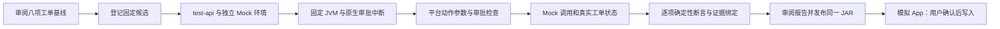

# TDD-017：工单模板八项验收与同制品发布

日期：2026-10-22。状态：本批已部署，八项固定工单场景及发布后的业务写入通过；完整 PRD／TD-15 尚未完成。

## 本批交付

“设备查询与工单审批”模板现在可通过固定候选测试入口执行全部八项场景。用户审阅并确认基线，允许执行器在独立 Mock 环境按场景审批后，平台自动准备数据、部署固定 JAR、发起业务请求、执行审批分支、停止测试部署并保存证据。真实模型报告通过后，可审阅并发布同一制品，在模拟企业 App 中手动批准工单请求。

本批使用固定模板候选。工单 Tool／Skill、Agent／Rail 的自动生成仍未交付；已有设备只读自动生成及有限修复路径保留。可信本地模式不变，Docker 不代表任务沙箱。

## 行为与证据修正

1. **批准后改变参数会撤销原确认。** 测试执行器根据数据库中固定的验证任务、用例、快照和制品，在真实 Tool Proxy 写入路径注入优先级变化。普通业务请求、模型参数和公开接口不能选择此故障。原审批参数保留；实际动作门禁记录冲突摘要，将动作设为 `invalidated`，请求结束运行，Mock 写入次数为零。这里验证的是平台拦截能力，不声称模型自行改变了参数。
2. **事务提交后再返回参数冲突。** 失效状态、拒绝尝试和平台事件一起持久化，避免抛异常后事务回滚使原批准继续有效。再次使用原参数也不能复用该动作。
3. **取消状态不被迟到的成功响应覆盖。** Run 已接受取消时，后到的运行结果不能改为成功；此前取得的分析内容保留。中断状态仍按原规则处理。
4. **验收检查实际结果。** 不再用单个“参数变化已拒绝”标记代替证据。必须同时存在对应 Run 的失效动作、拒绝尝试和平台事件。拒绝与过期也必须有各自实际动作终态，不能仅凭取消状态通过。
5. **成功写入绑定完整。** 断言核对审批身份、批准参数、实际写入输入、原幂等键、工单记录及动作返回的工单编号。Mock 成功写入会推进数据版本；原来要求结束时版本仍为 1 的检查会误判证据缺失，本批修正该条件。

工单断言升级为 `equipment-workorder-assertions@2`，改变基线摘要和兼容绑定。旧基线与报告保持不可变，但不能用于新验收或发布。用户需重新审阅并确认八项场景。设备只读规则维持原版本。

## 八项真实场景

| 编号 | 场景 | 核验结果 |
| --- | --- | --- |
| TC-001 | 正常查询 | 结构化输出与实际设备事实一致，零工单写入 |
| TC-002 | 缺少设备编号 | 先追问，零业务调用 |
| TC-003 | 只读工具超时 | 真实工具错误证据，不编造设备事实，零写入 |
| TC-004 | 批准与重复确认 | 批准前零写入，一次有效决定、一次创建，工单绑定一致 |
| TC-005 | 拒绝 | 动作 rejected、运行 cancelled，零写入并保留分析 |
| TC-006 | 过期 | 实际等待五分钟；动作 expired、运行 cancelled，零写入 |
| TC-007 | 批准后参数变化 | 原确认 invalidated、持久化拒绝证据、零写入 |
| TC-008 | 写入后响应超时 | 原幂等键核对已提交结果；一条创建调用、一个工单 |

每项测试使用独立环境，报告同时绑定基线、快照、候选、JAR、模型配置、Mock 实现和用例集合。测试部署全部停止后才确认收集到完整证据。当前为确定性断言，不包含通用语义质量评分。

## TDD 与回归结果

| 检查 | 本批结果 |
| --- | --- |
| 单元／契约 | 85 项通过 |
| PostgreSQL 集成 | 94 项通过 |
| 原生适配器 | 26 项通过；其中新增两项分别覆盖模板入口和固定候选 HTTP 入口的全部八场景 |
| 类型与构建 | TypeScript 类型检查、Docker 生产构建、OpenCode 实际可执行文件检查通过 |
| Docker 真实模型与页面 | Edge 审阅八项基线 → 固定候选 → 验收 → 发布 → U1002 业务确认与重复确认通过；检查 390px 布局 |

共 **205 项 TypeScript 测试通过，无跳过**。原生适配器使用确定性 HTTP 模型替身、真实 JVM／SDK／HTTP／PostgreSQL；新增测试为节约时间仅推进测试注入的审批时钟。因此适配器报告仍标记 `REAL_MODEL_REQUIRED`，不能发布。Docker 真实 DeepSeek 流程没有推进时钟，审批有效期及等待均为 300000 毫秒。

Java Bridge 源码与 Maven 配置与 TDD-016 相同，本批未单独重跑 14 项 Java JUnit。原生适配器及生成组件的实际 Java 测试在本批运行。生产源码清单 146 项，摘要为 `11c21fb3a398f2cd1913d2eb11c27eb4120d3b47320eba9bd37b6494d63461f8`。

红灯覆盖参数冲突后审批未失效、单个标记造成错误通过、仅取消不能证明拒绝／过期、取消被迟到成功覆盖，以及八项服务链路中 TC-007 未实现、TC-004／TC-008 被误判证据不足。修正实现后原断言通过。

首次新增适配器执行因测试凭据未分离而初始化失败，修正夹具后才采集功能红灯；补充缺失验证绑定的测试最初试图修改不可变 Run，被数据库正确拒绝，随后改为独立边界测试。这两项均作为测试设置诊断保留，不计为产品功能红灯。

回归期间同时运行多组 Java 适配器与 Docker 验收，观察到多项超时，Docker 首轮出现 `JVM_READINESS_TIMEOUT`。平台将其记为阻塞；主动取消剩余用例，保存完整首轮报告。随后按单 worker 执行原生回归、独立执行 Docker 流程，沿用原超时和断言通过。该结果说明本机测试安排需要限制并发，不构成平台性能或容量结论。失败记录没有删除，也没有计入通过数。

第二轮真实八项验收及发布通过后，浏览器脚本在读取尚未创建的工单集合时失败：Mock 合法地省略空集合，脚本却将该字段标成必填。修正观察代码后重新执行完整页面流程，仍要求确认前零写入、零工单，确认后恰好一个工单。原脚本失败报告、已通过的八项报告及发布记录保留；本轮尚未批准的业务请求主动取消，没有追加写入。

## 真实版本追溯

| 节点 | 标识 |
| --- | --- |
| 项目 | `6672f336-fab1-4a50-a3cd-91044653a81b` |
| 基线 | `fbe4b1bd-9f6f-4c15-977b-2417aebb9d6a` |
| 固定候选 | `a186534c-c21b-4eff-ba83-c6b02751dc81` |
| 八项验收 | `b73885e7-076b-4a1a-bbfc-563f7f0f8e43` |
| JAR 摘要 | `0a7f589b59b2d4a70bcb8d549adf7a36a37597f04513121d1ff4c26972a71ebf` |
| 发布版本 | `4fff5f03-c67e-471a-8b61-bca74c40e647` |
| U1002 业务请求 | `48f87b93-b89a-4bec-9004-f458529dd2e3` |

发布后模拟 App 的用户手动确认前，独立读取 Mock 控制接口确认零写入、零工单；确认后再提交相同决定，仍只有一条创建调用和一个工单。普通业务轨迹中没有验收故障注入事件。测试授权不会替代业务用户确认。

升级前活动运行、验证、开发、测试部署和发布操作均为零，平台与 Mock 数据库备份保存在本地忽略目录。四服务健康，新工单演示版本保留可用。旧 JVM 在升级时停止，历史业务会话不自动重放；如需使用其他项目，按操作指南重新发布并新建会话。

证据：[测试汇总](evidence/TDD-017/test-summary.json)、[Docker 真实完整链路](evidence/TDD-017/live/live-1c7d8d00-5e35-4ab6-9245-f6d02f0002b6/live-docker-workorder.json)、[模板入口适配器](evidence/TDD-017/native/snapshot.json)、[候选入口适配器](evidence/TDD-017/native/candidate.json)、[部署状态](evidence/TDD-017/deployment.json)、[源码清单](evidence/TDD-017/source-inventory.json)、[凭据检查](evidence/TDD-017/credential-scan.json)。启动阻塞、取消、功能红灯和重跑检查也保留在同一证据目录。

## 剩余范围

本批完成固定工单模板的八项项目验收，不将完整 AC／NF 条目直接标为通过。[P0-C 状态](evidence/TDD-017/acceptance-status.json)仍为 88 项未验证。

下一批重点为 Agent／Rail 与写组件受限自动开发。金融场景、导入导出、完整会话恢复、交付成功率评测，以及 TD-15 新目录部署、崩溃恢复、性能与完整必测回归继续保留在实施目标内。
