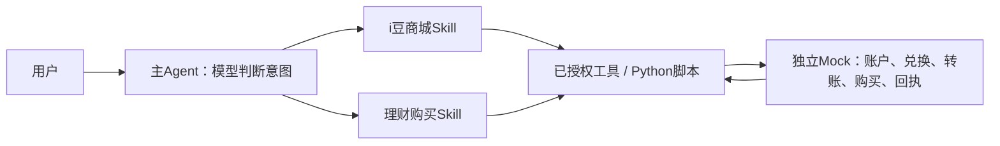

# 业务示例：Mock 复用与主 Agent 分工

2026-10-25 静态检查：`/home/vincent/openjiuwen/agent-solution` 当前 `common` 分支，提交 `089822db38f23f2458abc804e0818d2194414ca4`，工作区干净。另通过 `git show upstream/0.1.1:<path>` 读取 MOA 来源，提交 `552294d013b28a79d912a5bda9f627237e826e6b`；未切换或修改外部仓库。本次没有运行外部仓库的业务示例，README 中的历史测试数不计为本次验证。

| 来源 | 实际实现 | 复用边界 |
| --- | --- | --- |
| solution `common/example/fast-intent-versatile-routing-demo/.../runtime/MockWorkflowServer.java` | 本机HTTP服务包装现有MockControllerController；POST `/v1/proj/agents/{agentId}/conversations/{conversationId}` 返回工作流SSE | 工作流协议、中断和续接参考；它不是理财账户账本 |
| solution `common/example/versatile-controller-handoff-demo/.../mock/FastIntentMockWorkflows.java` | 余额选卡、转账收款账号/金额追问、意图识别和范围变化 | Mock用有限规则推进交互；不能把这些规则当成主Agent的大模型能力 |
| solution `common/example/bank-intent-routing-a2a-demo/.../common/BankTools.java` | 有余额、execute_transfer、purchase_wealth等确定性工具；示例余额固定12800.50，转账/购买固定成功回执 | 可参考工具输入及多Agent角色，但这些方法没有扣减账户余额、资金不足或防重复交易账本 |
| solution `upstream/0.1.1:common/agents/moa-agent/docs/examples/native-skill/entry/SKILL.md` | 理财入口Skill：选品后读资金筹划Skill、查余额/缺口，转账和购买前精确确认 | 文件明确是迁移指导示例，需部署业务Skill/操作，并非现成完整业务包 |
| 旁侧 AgentEnvExplorer `docs/moa-stateful-l2-mock.md`、`platform/gateway/src/gateway/mock_l2.py` | 独立有状态L2 A2A Mock，转账补充输入、任务/上下文关联、范围变化、异步完成和回调 | 可直接参考A2A多轮协议；文档明确其他域主要是简单完成结果，不能当作完整理财购买账本 |
| 旁侧 AgentEnvExplorer `scenarios/wealth-invest/scenario.yaml` | 理财推荐/购买分支、选品和确认的数字孪生场景 | 此文件中的步骤是Mock服务自身的工作流，不能又宣称同一组步骤全由Skill/模型编排 |

## 当前例子的选择

沿用本项目已独立运行的Node业务Mock，在其中补一个小的模拟理财账本；不引入第二套工作流引擎。复用现有MOA的Skill/确认/工具契约思想和现有Mock的独立部署边界。这里是“参考与补齐”，没有把未运行的solution示例宣布为已集成。

- 主Agent根据已装配业务范围选择Skill；Skill在当前任务中执行。本例不是三个独立A2A业务Agent部署，若后续要模拟远程业务工作流，可接上表的A2A/Versatile Mock。
- Skill写流程及分支，模型按工具结果选择下一步；例如余额不足时请求转账，转账成功后再查询并单独确认购买。
- 工具/Mock硬性校验固定客户/本人账户、整数分、产品/金额范围、实际余额、差额变化、幂等回执。转账确认不授权购买；拒绝购买不回滚已完成转账。
- 如果将整个购买流程交给外部工作流Mock，Skill只承担调用与结果处理；应明确流程归Mock所有，避免两边同时维护一套流程状态机。

预制资产与启动说明见[示例说明](../examples/commerce-wealth/README.md)。实际验证记录在开发计划中逐批补充，模拟金融数据不能作为真实交易证据。
