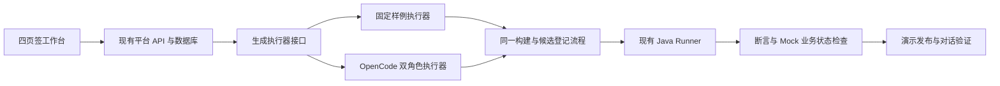

# 技术设计复审与轻量化方案

日期：2026-10-24。范围：本地 agent-builder-java 的交付节奏、测试成本、运行资源和磁盘生命周期。

状态：只读调查后的整改建议。未修改业务实现、验收基线和服务状态，未清理历史数据，未执行构建或回归。本文不将 Demo 等同于完整 PRD 验收。

## 结论

二次复审修正：清理、缓存和 Mock 只是局部手段。根本问题是业务场景、生成工程、运行时制品与平台验收被绑成一条过长的变化链。需要改变开发与交付单元；否则每增加一个场景，仍会扩大核心代码、构建和回归范围。

保留 TypeScript 平台、Java Bridge、PostgreSQL 和双 Agent 产品方向，不保留“所有变化都重新生成、编译、包装完整运行时、逐例部署”的默认路径。平台围绕可导出的业务项目组织，测试环境只在需要时运行项目。下面的二次复审决定建议优先级；后文的缓存与清理措施仍有价值，但不能作为架构整改完成标准。

## 二次复审：需要改变的六个设计决定

### 1. 用业务项目版本组织交付，拆开平台版本与业务候选版本

PRD 已明确这是开发态产品，本地发布用于演示，生产托管不在首期范围。现有代码同时维护需求、生成、构建、测试部署、业务 Run、动作确认、发布与恢复；其中一部分是必要行为，但不应让所有历史候选都成为待恢复服务。

建议项目交付内容为源码、Agent/Tool/Skill/Rail 清单、测试计划和 SDK 锁定信息。构建结果作为项目的派生产物。演示发布表示选择已验证项目版本并提供本地入口；默认不承担历史版本常驻、集群调度或生产服务连续性。

平台自身的测试回答“工作台和执行器是否正确”；候选测试回答“这个业务项目是否满足需求”。二者单独记录版本与结果。页面改动不等于业务候选变化，生成一个业务项目也不等于平台需要重新验收全部能力。公共执行契约变化仍必须触发相关回归，不能借此复用不兼容结果。

### 2. 以变化内容决定构建范围，不再把 Skill 修改当成 Java 工程重建

代码事实：`wealthSkillProfile` 只允许修改 Skill，但仍物化固定 Java Tool 和测试，`EngineeringWorkspace.run()` 仍编译/运行 Java 后进入 Skill 专用红绿分支，构建再打包 Tool 与 Skill。

| 变化 | 建议执行路径 |
| --- | --- |
| Skill 指令、Agent 提示、已有 Rail 参数 | 内容/配置校验、装载检查、相关行为测试；复用已有编译组件 |
| 新 Tool 或自定义 Agent/Rail 源码 | 编译变化的组件、单测、实际装载、相关业务测试 |
| Core/Runtime/Bridge | 构建新工具链版本，执行兼容性回归；不自动升级旧项目 |
| 工作台页面 | 前端及相关 API 测试，不触发业务代码生成 |

这不会将四类真实代码生成能力移出产品范围。Agent 配置生成不能冒充 Agent 源码生成，Rail 参数实例化也不能冒充自定义 Rail 源码生成；两类能力分开显示和验证。

### 3. 固定运行时与可变项目分开存储，完整 JAR 改为交付格式

当前完整 Bridge 约 174 MiB，每个候选复制基础 JAR，打包目录再留副本，每个工程还解包依赖。因此占用随尝试次数增长，与业务代码大小关系很弱。内容寻址只能去重完全相同的文件；往 JAR 内增加少量不同内容，仍得到另一份完整文件。

目标结构：固定 SDK/运行时按版本保存一次，业务候选保存清单、配置、Skill 与小型编译组件。候选身份由这些实际内容及运行时版本共同确定，校验每项内容，不靠文件名声明版本。运行时共享的是磁盘依赖，首期仍可使用独立短期 JVM，不建设多租户 JVM 热加载平台。

存储趋势从约 `尝试数 × 完整 SDK/运行时大小`，变成 `保留的 SDK 版本大小 + 保留的项目增量大小`。这只是设计模型，节省比例须实测，临时文件与导出包另计。

最小验证应先证明现有 Spring Boot Bridge 能以独立进程加载外部固定组件和 Skill，并正确隔离同名类、会话与依赖版本。当前实现从 JAR classpath 读取生成清单，不能直接换一条启动命令就声称完成。验证前仍可沿用完整 JAR，但必须回收临时副本。

企业需要可执行 JAR 时，由已验证项目与锁定运行时导出，记录输入清单和输出 JAR 摘要，再做导出物启动与代表性业务检查。导出是新包装结果，不能把旧二进制的通过记录直接改成新 JAR 通过。Docker 继续用于平台环境和可选部署，不作为每个业务版本的必经格式。

### 4. 业务场景从核心代码迁出，让新增案例验证可扩展性

代码事实：`generation-profile.ts`、Runner `profile.ts/templates.ts`、`development-service.ts`、`candidate-service.ts` 都有设备/金融 Profile 分支；Java `AgentAssembler` 硬编码写操作名称；`CandidateValidationDriver` 根据 `workorder-*` 决定审批行为。这使场景扩展牵动多个平台层。

建议先抽出受审阅的本地场景包：接口契约、生成模板、资产引用、Mock 种子、故障配置和测试步骤。平台提供通用步骤，如发送消息、审批、检查调用次数、比较 JSON 字段；业务包提供参数和预期。写操作属性来自受信任接口登记，不由生成 Agent 自行声明为只读。测试执行器从已确认计划取动作，不解析场景名称猜行为。

不新建插件市场、任意脚本引擎或复杂 DSL；先支持当前两个场景需要的少量步骤。核心验收标准是：新增第三个相似查询案例，只添加场景包和测试数据，无需修改平台调度、候选服务、Java 装配或 Dockerfile。超出已支持原语的能力仍可正常扩展平台，不能承诺所有场景零代码。

### 5. 保留双 Agent 分工，取消错误层次的过程门禁

平台工程继续 TDD。生成任务也优先先测后实现，但“必须出现指定 Java 红灯且第一次可执行测试立即冻结”不应成为所有产物的通用交付条件。现有实现让第一版单测写错后难以修正，也把非代码缺陷送进 Java 修复路径。

独立验收基线和硬性断言仍锁定，开发 Agent 无权降低。开发者单测允许纠正并记录差异；单测绿色不替代独立验收。新代码或代码缺陷在单测层建立红绿，Skill/提示问题在内容契约或轨迹回放层建立红绿，复用已验证组件不人为制造失败。

测试 Agent 在需求确认时设计并审阅用例；稳定用例交给执行器重复运行。开发 Agent 只处理确需生成/修复的内容。编译错误、组件断言失败、模型回答失败和环境不可用先分类：分别进入对应修复入口，环境不可用不让模型重写业务代码。允许受限修复预算，但不默认把每个失败都做三轮完整重新生成。

### 6. 三种能力分别验证，不能靠一条昂贵全链路证明全部

| 问题 | 合适的主要验证 |
| --- | --- |
| 平台能否正确编排开发、测试、发布和失败处理？ | 固定工程样例、可控模型响应、真实关键接口；大部分分支无需真实模型 |
| Java/SDK/Tool/Rail 集成是否正确？ | 少量固定项目的真实编译和运行；可注入模型响应，业务状态真实检查 |
| 两个 Agent 能否自动完成用户任务？ | 固定任务集的真实生成评测，记录成功率、修复次数、耗时和模型消耗 |

保留少量真实端到端检查验证这些层确实连通，不做“所有 UI × 所有场景 × 所有模型 × 所有故障”的组合回归。Mock 生成替换的应是外部生成器返回值，其下游契约与真实生成一致；它不会证明真实生成成功率。

现有阶段验收集合仍是历史基线。若按以上边界调整，须单独更新 PRD/TD/测试映射，明确保留、转为低层验证、推迟或新增的条目；本审查不自动删除需求，也不把未验证项改成通过。

### 执行取舍与停止条件

建议先做一个纵向切片：同一业务项目从固定样例生成、真实运行到演示发布；紧接着只改 Skill，再次验证。这个切片必须展示代码/配置变化、真实 Tool 结果和失败分支，不能只播放前端状态。

切片同时验证三件事：修改 Skill 不重编译不变的 Tool；重复验证不复制 SDK 或完整运行时；换生成器不会改变候选/验收接口。外部组件加载若无法快速验证，明确记录边界，暂用单份完整 JAR 跑通切片，不扩展为类加载框架研究。

随后增加第三个相似查询场景，检查是否需要修改平台核心；若需要，先修场景边界，再继续堆功能。清理旧数据是配套措施，只有“增加业务项目不会增加平台分支、重复运行不会线性增加大文件”同时成立，才算本轮架构整改达到目标。

不重写 TS 为另一种语言、不替换 PostgreSQL、不建设 Kubernetes、不新增分布式任务平台、不把独立 JVM 合成共享状态服务。已有审批、幂等、候选校验和实际业务证据保留；历史测试部署的全面恢复和全栈重复验证不作为每次开发反馈的前置条件。

本轮不给新的整项目工期承诺。先测上述切片的冷/热启动、Skill 修改、Tool 修改、一次真实生成和磁盘增长，用结果重排剩余工作。此前“1 天整改、1–2 天 Demo”是未验证排期假设，不能作为可承诺的开发期限。

## 现场数据

仓库目录统计采用文件逻辑长度，不跨符号链接；Docker 数值来自当前 daemon，包含其他项目，不能直接相加为本项目占用。GiB 为 1024³ 字节，Docker 输出 GB 沿用工具单位。

| 对象 | 本次观测 | 解释 |
| --- | ---: | --- |
| `test-results` | 56.535 GiB | 其中 `.jar` 为 56.477 GiB，共 15,726 个；包含重复的依赖 JAR，不是 15,726 个业务候选 |
| `.cache` | 10.198 GiB | `runner-tests` 4.411 GiB，`generated-repair-live` 2.445 GiB，其余为工程、依赖和探测缓存 |
| `node_modules` | 1.862 GiB | 文件逻辑长度，不等同于 pnpm 硬链接的独占物理占用 |
| `docs` | 约 0.010 GiB | 正式报告不是磁盘主要来源 |
| 当前 NF01 Runner `/data/artifacts` | 16.63 GiB | `du -sk` 报告 17,440,092 KiB |
| 当前 NF01 Runner `/data/engineering` | 12.60 GiB | `du -sk` 报告 13,208,996 KiB |
| Docker 全局镜像 | 82.98 GB | 20 个镜像，包含其他项目和共享层 |
| Docker 全局构建缓存 | 73.75 GB | 工具报告可回收 21.13 GB；与镜像可能共享数据，不能相加估算释放量 |
| Docker 全局卷 | 40.55 GB | 20 个卷，需逐个核对归属、引用和保留要求 |
| Docker 数据 VHDX | 文件逻辑长度 125.391 GiB | `D:\DockerDesktopData\DockerDesktopWSL\disk\docker_data.vhdx`；不代表本项目独占或可释放量 |
| D 盘剩余 | 约 66.80 GiB | 整盘读数，不能把全部已用空间归因于本项目 |

另有 platform、td15-nf01、td15-ac01、td15-ac32 多套项目服务残留；ac32 Runner 已停止，但 App、Mock、PostgreSQL 仍在运行。m0-test PostgreSQL 也在运行。多套环境会保留旧镜像、数据库和 Runner 卷。

## 根因与修改顺序

| 优先级 | 已核验的问题 | 后果 | 建议 |
| --- | --- | --- | --- |
| P0 | `EngineeringWorkspace.sdk()` 在每个工作区解压完整 Bridge 的 classes 和 lib | 每次测试、每次修复重复保存 SDK | 按 SDK digest 建共享只读缓存；原子初始化、校验完成后发布；任务仅保存自身源码、测试和输出 |
| P0 | `RuntimeArtifactRegistry.composeInternal()` 留存 build/candidate.jar，又复制到正式 artifacts | 一个候选保存两份完整大 JAR；本地基础 JAR 约 174 MiB | 先保留现有可执行 JAR 方案，用临时文件发布到正式位置；成功清临时树，失败只保留诊断和短期必要输入 |
| P0 | 多个 adapter 测试用 UUID 创建 test-results 工作区，finally 只调用 ws.cancel | 测试退出后文件仍累计 | 统一测试工作区助手，finally 回收；报告另存；失败保留必须显式开启并有数量、体积限制 |
| P0 | 日常验证依赖真实模型开发和多轮业务回归 | 反馈慢且结果有随机性 | 默认使用固定开发产物和脚本化模型响应；真实生成、真实运行模型分别显式启用 |
| P1 | Runner 启动等待逐个恢复 restartCandidates | 历史测试部署拖慢启动并占用 JVM 资源 | 测试部署有租期，结束即停止；只恢复明确需要服务的发布版本；历史候选保留文件，不自动常驻 |
| P1 | 多个验证 Compose 项目长期并存 | 服务、卷和旧镜像持续累积 | 一套主开发环境；故障测试最多一套临时环境，测试结束清理；异常中止后可按标签回收 |
| P1 | 验收记录多以 App/Runner 整体镜像身份匹配 | 局部改动造成广泛证据刷新 | 日常按模块、契约、配置、SDK、测试集建立影响关系；不受影响的历史证据显式标注复用理由；未知影响才扩大回归 |
| P1 | 生成链强制修复回归必须先在 Java 单测层出现红灯 | 模型输出语义缺陷可能不在 Java 组件内，导致错误层次的修复 | 缺陷先分类；代码缺陷做单测红绿，提示/模型行为缺陷做固定轨迹回放或业务断言红绿；不得强造无关单测失败 |

代码依据：

- [SDK 解包与工程命令](../apps/runner/src/engineering/workspace.ts)，`sdk()`、`run()`。
- [候选打包与复制](../apps/runner/src/runtime/artifact-registry.ts)，`initialize()`、`composeInternal()`。
- [金融 adapter 测试](../tests/adapters/finance-profile-workspace.test.ts)、[工程 adapter 测试](../tests/adapters/engineering-workspace.test.ts)。
- [部署恢复](../apps/runner/src/runtime/deployment-manager.ts)，`restoreAfterRestart()`；[启动入口](../apps/runner/src/main.ts)。
- [真实双角色执行器](../apps/runner/src/engineering/task-executor.ts)，已有 `TaskExecutor` 接口可作为替换入口。
- [证据匹配](../scripts/record-td15-current-target-evidence.mjs)、[现行 TDD 计划](NL2Agent_TDD开发计划_v0.1.md)中的批次规则。

## 保留架构，缩短反馈路径

固定样例执行器交付可查看的 Agent 配置/工程、Tool、Skill、Rail 文件，并记录其来源。需要区分哪些是实际编译的代码、哪些是配置，不能用固定文件伪称模型自动开发成功。两个角色的步骤可以演示，但必须标明样例回放。

生成模式与业务运行模型模式独立：

| 模式 | 生成来源 | 业务运行 | 用途 |
| --- | --- | --- | --- |
| 快速自动回归 | 固定源码与测试样例 | 脚本化模型响应、真实 Java/Tool/Mock | 稳定验证状态、打包、接口、审批和发布链路 |
| 交互 Demo | 固定源码与测试样例 | 真实模型、真实 Java/Tool/Mock | 快速演示完整工作流与对话体验 |
| 生成能力评测 | OpenCode 双角色真实生成 | 真实模型与 Mock | 单独评估生成质量、修复成功率、费用和耗时 |

同一个候选可被重复测试，环境数据按用例隔离或重置。默认回归不重新生成代码。真实模型失败后不静默切换为样例通过。

先演示一个完整设备工单场景：录入需求 → 选择 Tool/Skill/Rail → 固定样例生成 → 构建 → 独立验收 → 演示发布 → 对话查询及审批。余额查询作为第二场景。完整金融写入、任意 Agent/Rail 源码生成能力继续保留在产品范围，逐步交付。

## 验证策略

TDD 继续用于本平台的实现，但测试放在能稳定观察缺陷的最低层次。既有正式验收结果保持原样，不能为了加速改成通过。

1. 每次代码改动：受影响的单元/契约测试、必要的类型检查；不启动真实模型，不重建 Docker。
2. 跨边界改动：固定样例下的真实 Java/数据库/Mock 集成测试，一次准备环境，多次运行。
3. Demo 交付：一条完整浏览器流程，验证实际发布候选和真实外部业务状态。
4. 生成器、模型配置、提示或 SDK 改动：运行相关真实模型样本集；平台页面修改不触发重新生成。
5. 正式阶段交付：运行规定的阶段验收；其范围与 Demo 检查分开。调整正式基线时保留映射和变更理由，不能只给旧结果换目标摘要。

Demo 必测集合压缩为八类，均有真实断言：正常闭环、生成/构建失败不可发布、工具失败不编造事实、未批准零写入、批准后只写一次、重复请求不重复写、候选修改使相关验收失效、退出后资源可回收。UI 细节、不同措辞和随机模型轨迹不复制为多套全栈环境。

## 磁盘治理与资源预算

先建立资源清单和引用关系，再清理。`test-results` 这个名称本身不代表其中所有内容都可删除。

- 正式源码、需求、报告、必要日志和现用/回滚候选保留；已提交报告与未提交的本批证据均不得覆盖。
- 历史临时 SDK 解包、成功测试工作区、正式候选已有对应物的构建副本，列为优先可回收对象。核对引用后按精确目录执行，不做全局删除。
- 产物 GC 从发布指针、回滚保留版本、活动任务、固定样例和保留证据追踪引用；仅回收无引用对象。执行前输出路径、原因和估算大小。
- 存在未决外部写操作的任务不可仅因租期到期就清除状态；先停止执行并完成核对，保留必要记录。
- Docker 构建缓存与业务卷分开管理；禁止全局 `docker system prune --volumes`。只处理本项目确认无用的资源。
- VHDX 文件是整个 Docker 数据盘，不作为缓存文件删除；逻辑删除后宿主物理回收需要单独验证，不承诺清理数字等于 D 盘立即增加空间。

建议预算（待整改后测量，不是已达标）：

| 对象 | 初始目标 |
| --- | --- |
| 成功测试临时目录 | 测试退出即回收 |
| 失败调试工作区 | 最多保留最近 3 次且总计不超过 1 GiB；另保留轻量诊断 |
| SDK/工具缓存 | 按版本共用，初始预算 3 GiB；仅回收无活动引用的旧版本 |
| 项目 Runner 数据 | 初始预算 10 GiB；接近阈值先回收无引用对象，无法回收则阻止新增大产物并解释原因 |
| 本地历史业务候选 | 每 Agent 当前发布 + 上一个回滚版本，其他按显式保留规则管理 |
| 本地 Java 测试进程 | 初始最多并发 2 个；发布服务独立计数 |
| 环境数 | 1 套主开发环境 + 最多 1 套短期故障环境 |

共享运行时加小组件包可进一步减少每候选完整 JAR，但涉及类加载、版本绑定与导出契约。先通过 SDK 缓存与临时副本清理取得收益；只有测量仍超预算，再实施共享运行时。企业导出可执行 JAR 的能力可以继续保留。

## 实施批次与可核验交付

| 顺序 | 范围 | 完成标准 |
| --- | --- | --- |
| 1 | 测试工作区回收、打包临时目录清理、共享 SDK 缓存 | 连续执行同一小集成集合 3 次，无按次数线性增长的 SDK/JAR 残留；记录前后磁盘大小 |
| 2 | 固定样例执行器、界面来源标识、主流程入口 | 浏览器走完需求至发布；可选择真实模型对话；样例与真实生成状态明确 |
| 3 | 测试部署租期、主环境收敛、历史资源清单 | 测试完成退出 JVM；历史候选不随 Runner 重启全部启动；清理计划可预览 |
| 4 | 模块影响测试与真实生成样本评测 | 普通 UI/API 改动无需模型生成；真实模型调用次数、耗时和失败阶段可独立统计 |

首次复审曾提出“1 个工作日完成核心回收、再用 1–2 个工作日打通样例”的排期假设。二次复审撤回其作为实施期限的建议：先按上文的项目切片验证架构边界，再估算后续；不能用未验证的期限代替进展证据。

快速回归目标为 2 分钟以内，固定样例完整闭环目标为 5 分钟以内；需实测后公布。真实模型阶段另报耗时，不混入确定性回归预算。

本轮仅提交审查文档。既有业务代码、服务、未提交验收证据和磁盘数据均未修改。
